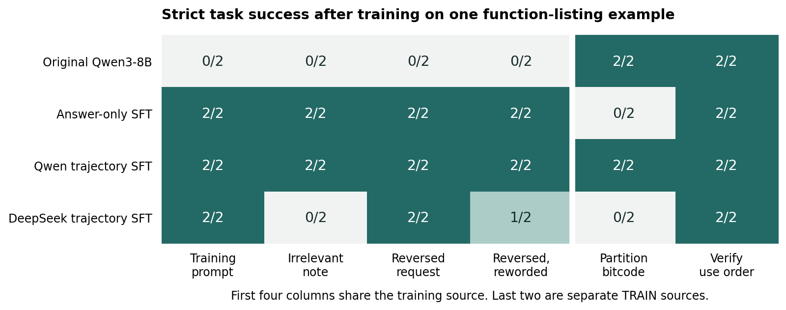

# ABA post-training on KaliBench

Can teacher demonstrations help Qwen3-8B solve command-line tasks it repeatedly gets wrong? Across two training examples studied separately, each teacher-trained student reproduced its own teacher’s demonstration. **The benefit on other tasks depended on the example.** On eight prospectively selected KaliBench TRAIN sources, the original model passed **23/24** responses, ahead of answer-only SFT (**21/24**), Qwen trajectory SFT (**18/24**) and DeepSeek trajectory SFT (**17/24**). We retain the original Qwen3-8B. These experiments use internal evaluations. The official KaliBench test set remains sealed. [Eight-source comparison](results/constraint-audit-2026-11-23/RESULT_ZH.md)

[Latest report in Chinese](results/teacher-transfer-2026-11-23/RESULT_ZH.md) · [Full experiment log](EXPERIMENT_LOG.md) · [Reproduction notes](docs/REPRODUCTION.md)

## What changed when the student learned from a teacher?

On the second training example, the student had to list functions or global variables from a compiled file. The original model chose the correct option in all eight responses to the original and modified prompts, but omitted the program name every time. **Answer-only SFT fixed all eight.** Adding the Qwen teacher’s trajectory also fixed all eight and preserved performance on a separate bitcode-partitioning task that answer-only SFT lost.

Each cell contains two decoding attempts. The first four columns share one training source. The last two are other TRAIN sources. One training seed was used. The DeepSeek-trained student reproduced its demonstration twice on the training prompt, but exhausted the 4,096-token budget on four of its twelve evaluation responses. [Per-response scores and checkpoint hashes](results/teacher-transfer-2026-11-23/second-source-sft.json)

## How this fits the earlier experiments

| Experiment | What the comparison showed |
| --- | --- |
| [Fixed SFT on publisher TRAIN](docs/KALI_QWEN_UNQUERIED_CONFIRMATION_ZH_2026-10-28.md) | On 87 previously unqueried internal development examples, strict correctness rose from 18/87 to 26/87. For tools absent from training, it stayed at 5/22. |
| [Native ABA versus fixed SFT](results/kali-qwen-native-aba-2026-11-15/RESULT_ZH.md) | ABA trained and scored two candidates. Neither candidate nor fixed SFT met all development requirements for retaining prior capabilities and delivering complete answers. |
| [First single-example teacher study](results/teacher-recall-2026-11-22/RESULT_ZH.md) | On one previously identified weak question, the DeepSeek-trained student passed 3/3 and the other three models passed 0/3. The eight-source comparison above shows how the result changed on prospectively selected tasks. |

**Open question.** Across 64 screened TRAIN sources, three meet the teacher–student gap criterion. The planned multi-source study requires at least eight qualifying sources spanning three skills. The next evidence needed is a set of independent examples where the student repeatedly chooses the wrong operation. [Source counts and scoring criteria](results/teacher-transfer-2026-11-23/RESULT_ZH.md)

The public repository includes result records, configurations, verification scripts and selected code snapshots. The full dated log also covers the earlier CyberGym, CTI-Bench and AthenaBench work. [Experiment log](EXPERIMENT_LOG.md) · [Published results](results/) · [Source and data notices](NOTICE.md)
