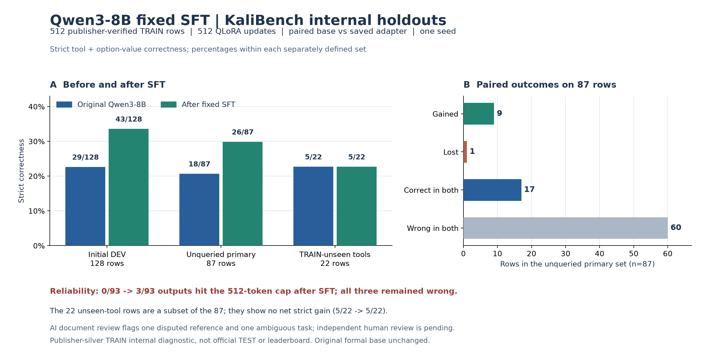
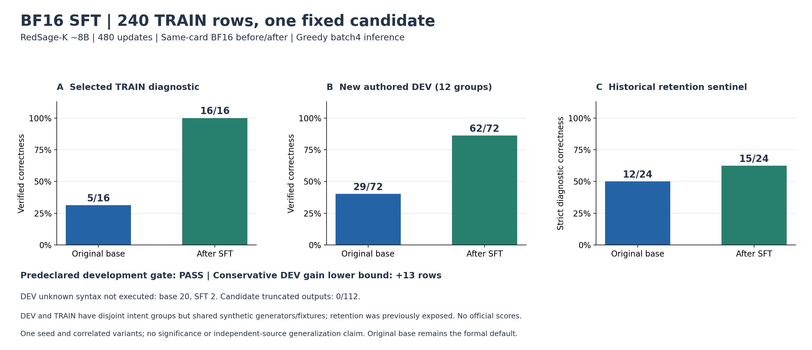
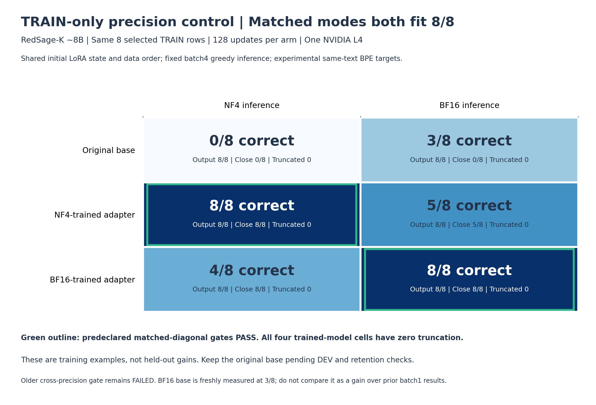

# ABA Cybersecurity Post-training Research

Research code and traceable experiment summaries for adapting open-weight language models to cybersecurity tasks. Minhao's current experiment is **KaliBench**; AthenaBench preparation and an eventual CyberGym transfer are separate work.

## Current result — October 28, 2026

A fixed 512-step NF4 QLoRA SFT run adapted **Qwen3-8B** using 512 publisher-verified KaliBench official-TRAIN examples. The same saved adapter was then compared with the unchanged base under a matched inference protocol. All sets below are **internal splits of official TRAIN**, with publisher silver labels; these are **not official benchmark or leaderboard scores**.

| Strict tool + option-value diagnostic | Original Qwen3-8B | After fixed SFT | Reading |
| --- | ---: | ---: | --- |
| Initial internal DEV | 29/128 | 43/128 | Positive pilot signal |
| Previously unqueried, command-group-separated primary DEV | 18/87 | 26/87 | 9 gained, 1 lost |
| TRAIN-unseen tools within the primary 87 | 5/22 | 5/22 | No net cross-tool gain |

**Reliability limit:** three post-SFT outputs among all 93 previously unqueried inputs hit the 512-token cap and repeated content; the base had none. This is one training seed, with no independent-source blind validation or official TEST use. ABA automated data generation/search has **not** been run in this Qwen study. The original RedSage-K remains the formal default; the Qwen adapter is a candidate under review.

One initial DEV prompt contained its reference command; excluding it leaves strict correctness **28/127 → 42/127**. The separately selected 87-row primary set has no prompt-embedded reference commands or exact normalized tool-plus-command overlap with the prior TRAIN/DEV sets. Semantic near-duplicates remain possible.

**Preliminary source review:** of the nine automatically scored gains on the primary set, seven are supported by tool documentation, one reference (`lvmconfig`) conflicts with its tool manual, and one (`hardlink`) needs task interpretation. Excluding only the disputed reference yields **18/86 → 25/86** as a sensitivity check; it does not replace the frozen automatic **18/87 → 26/87** result. No independent human semantic signoff has occurred. [Review summary](results/kali-qwen-confirmation-2026-10-28/source-review-summary.json).

**TRAIN data audit:** all 512 SFT records match the frozen publisher-verified files and target format. They span 275 tools, but 165 tools have only one example; 14 records share five normalized tool-command groups. This is a read-only static audit, with **0 independently human-reviewed labels** and no new model run. [Chinese audit](docs/KALI_QWEN_TRAIN512_DATA_AUDIT_ZH_2026-10-28.md) · [Sanitized aggregate](results/kali-qwen-train512-audit-2026-10-28/summary.json) · [Next experiment draft](docs/KALI_QWEN_NEXT_EXPERIMENT_PROTOCOL_DRAFT_ZH_2026-10-28.md).

An exploratory breakdown of the already queried 87-row set shows strict correctness **5→5** for 22 tools unseen in training, **9→12** for 37 rows whose tool appeared once, and **4→9** for 28 rows whose tool appeared at least twice. This is post hoc and cannot establish a causal coverage effect. [Aggregate breakdown](results/kali-qwen-train512-audit-2026-10-28/coverage-posthoc.json).

[Full Chinese result and error audit](docs/KALI_QWEN_UNQUERIED_CONFIRMATION_ZH_2026-10-28.md) · [Public aggregate](results/kali-qwen-confirmation-2026-10-28/summary.json) · [Figure source](scripts/plot-kali-qwen-confirmation.py) · [Reproduction scope](docs/REPRODUCTION.md). Check the public arithmetic and figure hashes with `python3 scripts/verify-kali-qwen-confirmation-public.py`. Raw questions, predictions, labels, model weights and the adapter are not in this repository.

## Experiment log (newest first)

The dated entries below preserve earlier engineering work and negative results. Read the current result above for the latest model decision.

## October 28 — Qwen3-8B TRAIN512 static audit and review preparation

Rechecked the frozen 512-row publisher-verified official-TRAIN SFT set without running commands or model inference. All targets have the expected envelope; 512 normalized questions are unique, with 503 normalized tool-command groups. Five questions explicitly contain their reference command; these are review cues rather than proven leakage. A private all-row review queue, priority 64, deterministic sample 32, and blank independent 13-case adjudication form are ready. No human signoff, new SFT, official TEST, or independent-source result occurred. [中文数据审计](docs/KALI_QWEN_TRAIN512_DATA_AUDIT_ZH_2026-10-28.md) · [Aggregate](results/kali-qwen-train512-audit-2026-10-28/summary.json) · [Protocol draft](docs/KALI_QWEN_NEXT_EXPERIMENT_PROTOCOL_DRAFT_ZH_2026-10-28.md).

## October 28 — Qwen3-8B unqueried internal DEV confirmation

Froze 93 previously unqueried KaliBench official-TRAIN internal DEV inputs before generating any outputs. The predeclared primary 87 exclude six normalized tool+gold-command groups shared with earlier DEV and contain no prompt-embedded gold commands. With the same Qwen3-8B base and saved adapter, strict correctness rose **18/87 → 26/87** (9 gained, 1 lost); exact command matching rose **14/87 → 22/87**. Among 22 primary rows whose tools were absent from the 512-row TRAIN set, strict correctness stayed **5/22 → 5/22**. Mechanical case triage found three new 512-token repetitive truncations; independent semantic review is pending. This is a one-seed silver-label internal holdout result, not official TEST, external validation, or ABA. The original formal default remains unchanged. [中文复测与误差审计报告](docs/KALI_QWEN_UNQUERIED_CONFIRMATION_ZH_2026-10-28.md) · [Aggregate results](results/kali-qwen-confirmation-2026-10-28/summary.json) · [Mechanical triage](results/kali-qwen-confirmation-2026-10-28/mechanical-triage.json). Offline check: `python3 scripts/verify-kali-qwen-confirmation-public.py`.

## October 28 — Qwen3-8B publisher-TRAIN SFT cycle completed

Ran a matched, one-RTX3090 NF4 QLoRA baseline → 512-step SFT → internal-DEV evaluation on 512/128 publisher-verified KaliBench TRAIN rows. Strict option-value correctness rose **29/128 → 43/128**; exact command matching rose **25/128 → 36/128**. Paired strict transitions: 17 gained, 3 lost. One DEV prompt embeds its gold command; excluding it gives 28/127 → 42/127 strict. The saved adapter was SHA-256 verified on the PVC and all owned Jobs/Pods/ConfigMaps were cleaned. This is a one-seed **official-TRAIN internal development** result, not official TEST, external validation, an ABA search, or a promotion decision. [中文结果报告](docs/KALI_QWEN_OFFICIAL_SFT_RESULT_ZH_2026-10-28.md) · [Aggregate results](results/kali-qwen-official-executed-pilot-2026-10-28/cycle-summary.json).

## October 28 — publisher-verified KaliBench TRAIN pilot for Qwen3-8B

Replaced the pending-review synthetic rows for this second-base pilot with publisher-verified KaliBench TRAIN records. After the existing scorer-consistency screen, 936 records have the stronger terminal `PASS_EXECUTED` label; a fixed group split selected 512 TRAIN and 128 internal DEV rows with no exact query or canonical-command overlap. Qwen-native encoding passed 512/512 prompt-masking and target/EOS checks; DEV inputs contain no gold. These are publisher-verified **silver** labels, not independent expert gold. **No weights were downloaded, model run, GPU job, optimizer step or official TEST evaluation occurred in this preparation.** [中文报告](docs/KALI_QWEN_OFFICIAL_TRAIN_PILOT_ZH_2026-10-28.md) · [Aggregate receipt](results/kali-qwen-official-executed-pilot-2026-10-28/summary.json).

## October 28 — Qwen3-8B TRAIN encoding and review packet

Prepared Qwen-native, nonthinking TRAIN encodings for all 240 prior synthetic rows: prompt labels masked 240/240, target/EOS labels supervised 240/240, six negative controls rejected. The private encoded rows are explicitly **not approved for training**; an independent 40-group review packet is pending. The pinned model has five published weight shards totaling ~15.26 GiB, but no weights were downloaded, GPU Job submitted, or model call made. [中文准备报告](docs/KALI_QWEN_SECOND_BASE_PREP_ZH_2026-10-28.md) · [Aggregate receipt](results/kali-qwen-second-base-prep-2026-10-28/summary.json). Offline check: `python3 scripts/verify-kali-qwen-second-base-prep-public.py`.

## October 28 — second-base decision and Qwen3-8B preflight

Selected public, Apache-2.0-labelled `Qwen/Qwen3-8B` as a future general-model control alongside the specialized RedSage-K. Tokenizer-only checks passed on all 240 existing TRAIN prompts. Qwen's native prompt does **not** end at the open `<think>` token required by the prior RedSage worker, so swapping model IDs would invalidate that run. A full second-base training cycle is deferred until data review and a separate model-native protocol are complete. No weights, model inference, GPU job, optimizer step or official TEST were used. [中文决策与预检](docs/KALI_SECOND_BASE_DECISION_ZH_2026-10-28.md) · [Aggregate receipt](results/kali-qwen3-8b-second-base-2026-10-28/summary.json). Offline check: `python3 scripts/verify-kali-second-base-preflight-public.py`.

## October 28 — external utility candidate intake

Pinned an Apache-2.0-labelled public Linux command dataset and screened 8,669 pairs into 23 **review-pending** generic utility candidates. Fifteen have automatic risk flags; two may run indefinitely. None is training gold or a blind test. No dataset command, model, GPU, ABA generation or official TEST was run. The original base remains the formal default. [中文审核报告](docs/KALI_EXTERNAL_UTILITY_INTAKE_ZH_2026-10-28.md) · [Aggregate receipt](results/kali-external-utility-intake-2026-10-28/summary.json). Verify with `python3 scripts/verify-kali-external-utility-intake-public.py`.

## October 26 — 240-row matched-BF16 SFT

Completed one frozen 480-update SFT candidate and 224 before/after generations. Verified authored DEV: **29/72 → 62/72**; historical retention strict: **12/24 → 15/24**. Conservative DEV gain lower bound **+13** after accounting for unreviewed baseline syntax. Predeclared development gate: **PASS**. **Original base retained; no official/independent-source gain, protected-confirmation query or new ABA search claimed.**

[中文完整报告与逐组结果](docs/KALI_BF16_240_SFT_ZH_2026-10-26.md) · [Aggregate evidence](results/kali-bf16-240-sft-2026-10-26/summary.json). Offline check: `python3 scripts/verify-kali-bf16-240-result.py`.

## October 26 — matched training / inference precision

Completed a frozen TRAIN-only 2x2 precision study: 256 real optimizer updates and 48 generations, same initial LoRA state, same eight BPE-target training rows. Both matched-diagonal gate: **PASS**. All cross-precision outputs are reported. **Keep the original base; no held-out gain or new 240-row SFT/ABA claim.** Batch4 inference uses fresh same-job baselines; the older failed cross-precision gate is unchanged.

[中文完整对照](docs/KALI_MATCHED_PRECISION_ZH_2026-10-26.md) · [All six readouts](results/kali-matched-precision-2026-10-26/summary.json). Offline check: `python3 scripts/verify-kali-matched-precision.py`.

## Results figures — October 26, 2026

[中文结果图解与限制](docs/KALI_RESULTS_FIGURES_ZH_2026-10-26.md) · [TRAIN-only diagnostic](results/kali-results-figures-2026-10-26/02-train-segmentation-control.svg) · [Earlier DEV and transfer](results/kali-results-figures-2026-10-26/01-development-and-transfer.svg). These are separate diagnostic studies, not official benchmark scores. The original base remains the default; the full reliability gate has not passed.

## October 26 later results — target representation and precision limits

Completed **512 additional real 8B optimizer updates and 96 generations** across two matched TRAIN-only controls. Critical-prefix loss weighting did not fix premature EOS. In a separate same-card target-representation control, keeping **all decoded training text and inference inputs unchanged**, an explicit experimental BPE target segmentation increased NF4 TRAIN correctness from **0/8 to 8/8**, with all eight closing/output tags complete.

The same adapter evaluated in BF16 achieved **5/8**, with **one truncated response** and incomplete tag closure. **The full predeclared gate still failed. Keep the original base; no new 240-row SFT, ABA search, official TEST, sealed validation, confirmation or external teacher calls.** These are selected training questions, not held-out performance or a universal root-cause proof. The target segmentation is noncanonical and is not yet an adopted deployment recipe.

All jobs, Pods, ConfigMaps and Secrets were cleaned. CPU row inspection excluded simple all-zero or exact-EOS-duplicate closing-token rows; it does not prove corruption. Eight grounded short-rationale targets were prepared and schema-checked but remain untrained. Recorded GPU utilization includes loading overhead and the inefficient 0.5-CPU RTX3090 run; the next matched-precision design proposes more CPU and batched inference and has not executed.

[中文完整结果与限制](docs/KALI_PREFIX_CONTROL_RESULT_ZH_2026-10-26.md) · [Stage status](results/kali-prefix-control-2026-10-26/stage-status.json) · [Next design, not executed](results/kali-prefix-control-2026-10-26/next-matched-precision-design.json). Offline check: `python3 scripts/verify-kali-prefix-control-result.py`.

## October 26 follow-up — fixed-weight prefix diagnosis

Completed **56 additional TRAIN-only generations and zero new optimizer steps** on one L4. Cache on/off and two adapter loading paths produce identical token sequences on all eight rows. At the required closing-think position, the NF4 adapter assigns only **0.72%** mean probability to the target token versus **46.85%** to EOS. This localizes the premature-ending decision; it does not establish every upstream cause.

Prepared a matched uniform-versus-critical-prefix-weight SFT control and checked its causal loss/mask mathematics on CPU. **Repair training has not executed:** ordinary GPU and approved single-A100 attempts reached bounded scheduling waits without allocation, then cleaned all objects. No larger 240-row SFT or new ABA search has started; keep the original base. Official, sealed, confirmation and external teacher calls remain zero.

[中文诊断与修复状态](docs/KALI_PREFIX_FOLLOWUP_ZH_2026-10-26.md) · [Recorded status](results/kali-prefix-followup-2026-10-26/stage-status.json). Offline evidence check: `python3 scripts/verify-kali-prefix-followup.py`. This is a TRAIN diagnostic, not an official benchmark score.

## October 26, 2026 — training recall, microfit controls and verified SFT data

Completed a real TRAIN-recall diagnostic (168 generations) and two matched eight-example 8B microfit arms (256 optimizer updates, 48 generations). Existing-adapter NF4 corrections improve only **4/22→5/22**. The higher-rate microfit reduces TRAIN NLL by **92%**, yet emits newline then EOS for all eight NF4 tasks. **Both predeclared training-sanity gates failed. Keep the original base; the new 240-row SFT and new ABA search have not started.** Fixed-weight cache/prefix diagnosis is prepared; see its recorded status rather than assuming a root cause.

Prepared **240 TRAIN / 72 DEV / 72 protected confirmation** examples across **40 / 12 / 12 intent groups**. All **384 gold commands and 448 negative checks** passed Linux execution. Six variants per intent are correlated; independent human review remains absent. Released authored TRAIN/DEV, eight byte-matched audited input fixtures, a strict configuration-driven optimizer, native input encoder, local-weight training CLI and aggregate evidence. Official TEST, old sealed validation, new confirmation and external teacher calls remain zero.

[中文执行报告](docs/KALI_SFT_PROGRESS_ZH_2026-10-26.md) · [English report](docs/KALI_SFT_PROGRESS_2026-10-26.md) · [Data and limitations](data/benchkit/kali-verified-sft-v1/README.md) · [Stage status](results/kali-sft-progress-2026-10-26/stage-status.json). Offline check: `python3 scripts/verify-kali-sft-progress.py`. These public checks do not independently reproduce private model outputs or prove generalization.

## October 25, 2026 — scoring repair and matched learning diagnosis

Fixed two reviewed OpenSSL option-order false negatives: the prior12-row developer result is **4→4** under contract-v2, with historical scores/gates preserved. Old training NLL decreases in NF4 but not BF16; this alone does not explain DEV outcomes.

Two fresh matched42-step arms completed on one NVIDIA L4. BF16/native DEV: original **4/12**, style control **5/12**, corrected-data mix **4/12**. Retention strict: **12/24 → 13/24 / 13/24** respectively. These small exposed diagnostics do not establish generalization; **keep the original base**. No sealed-validation/official TEST or external teacher calls. Owned GPU jobs cleaned.

Released a reviewed command contract, explicit future DEV entrypoint, opt-in native completion encoder,43 generic regression checks and aggregate causal evidence. This is an operator-fixed diagnostic, not a new ABA search. [中文原因分析](docs/KALI_LEARNING_DIAGNOSIS_ZH_2026-10-25.md) · [English report](docs/KALI_LEARNING_DIAGNOSIS_2026-10-25.md) · [Aggregates](results/kali-learning-diagnosis-2026-10-25/summary.json). Check: `python3 scripts/verify-kali-learning-publication.py`.

## October 25, 2026 — native inference and 42-step ABA pilot

Completed one actual 42-step LoRA candidate with BF16/native-prompt before/after evaluation. **Retention strict: 13/24 → 13/24.** The new developer exact-argv count changed **4/12 → 2/12**; offline checks verified that both apparent losses are equivalent OpenSSL option ordering. Each model has **4/12 fixture-verified passes, with 9 commands executed and 3 not executed**. These checks show no improvement. **Keep the original base; sealed validation and official TEST queries remain zero.**

Separately, changing the untrained base's inference protocol on the same exposed 24 tasks gives 8/24 under the historical NF4/final-only setup vs 13/24 with model-card-aligned BF16/native usage. **That difference is not a training gain or a single-factor causal result.** All results are small self-authored development diagnostics, not official KaliBench scores.

Independent checks rejected an initial Finalizer delivery of task inputs. A cached native controller replay produced the required four baseline model artifacts, without additional optimizer steps or GPU jobs. Native gates, adapter reload, exact delivery bytes and final cleanup were independently checked. Training data/scaffold were operator-provided; no autonomous data-search claim. Historical scientific records below remain unchanged.

[Full report](docs/KALI_NATIVE_FAMILY_PILOT_2026-10-25.md) · [中文报告](docs/KALI_NATIVE_FAMILY_PILOT_ZH_2026-10-25.md) · [Aggregates](results/kali-native-family-2026-10-25/summary.json) · [Native supervision helper](scripts/kali_native_completion.py). Offline consistency check: `python3 scripts/verify-kali-native-publication.py` (does not rerun private model inference).

## October25,2026 — second-seed replication and transfer limits

Seed43 repeated the retention recovery **36/72→54/72**, with domain strict **3/36→4/36** (seed42:3/36→5/36). Both compact/newline arms completed128 steps. A newly frozen24row transfer panel showed **8/24strict and10/24verified execution for both repaired models, equal to the base**; certificate, filename/quoting and offline-capture constraints remain. **Keep the original base as formal default; do not claim broad improvement.**

Completed450 generations,256 new optimizer steps,24gold prevalidation executions and144 postvalidation records (133executed,11not executed). The panel was authored after prior errors were known, not independent expert/official validation. No tuning or extra candidates followed. Resources were cleaned. Historical results below remain unchanged.

[Replication report](docs/KALI_SEED43_REPLICATION_2026-10-25.md) · [中文说明](docs/KALI_SEED43_REPLICATION_ZH_2026-10-25.md) · [Aggregates](results/kali-seed43-replication-2026-10-25/summary.json) · [Opt-in target formatter](scripts/kali_target_envelope.py). Offline check: `python3 scripts/verify-kali-seed43-publication.py`.

## October 25, 2026 — causal investigation and recovery candidate

Changing only the TRAIN target envelope to use internal newlines recovered retention **36/72 → 54/72** and domain strict **3/36 → 5/36**, compared with V3. All18 original new strict regressions recovered;579 fresh CPU checks supported the execution conclusions. A separate fixed-weight, bidirectional output-prefix intervention (18 generations, zero training;108 fresh Linux checks) reproduced and removed the same filename error in three correlated counting variants.

These are one-seed exposed-development diagnostics, **not official KaliBench scores or independent validation**. Target token count/loss weighting also changed. The prefix mechanism was tested on one counting family, not all tasks. The candidate passes the development gate; keep the original base as the formal default pending independent replication. Later cause studies are operator-fixed experiments, not new native ABA search cycles. Historical results below remain unchanged.

[Full findings](docs/KALI_CAUSAL_FINDINGS_2026-10-25.md) · [中文说明](docs/KALI_CAUSAL_FINDINGS_ZH_2026-10-25.md) · [Aggregate evidence](results/kali-causal-findings-2026-10-25/summary.json). Offline check: `python3 scripts/verify-kali-causal-findings.py`.

## October 24, 2026 — V3 tool-aware replay completed

Replaced the previous 32 unrelated utility replay rows with 32 Linux-validated tool-aware rows, keeping the 96 domain rows and numerical recipe fixed. Completed a fresh matched baseline, native ABA orchestration, 128 optimizer steps and 108 post-training development predictions on one RTX A6000. **Domain strict: 2/36 → 3/36; retention: 52/72 → 36/72. Keep the original base.** These strict counts match the previous V1 adapter; all 72 extracted retention commands are identical across the two adapters, despite verified new training data, changed losses and a different adapter hash.

This is an exposed source-silver development experiment, not an official KaliBench result or independent holdout validation. Operator-authored data; no autonomous ABA data-generation claim. A metric-name mismatch caused one zero-update control failure before a fresh successful native run; guards and scoring were retained. Official TEST and old confirmation queries: zero. Owned GPU jobs were cleaned and the CPU VM stopped. Inference GPU utilization was low and needs optimization before repeated runs.

[V3 report](docs/KALI_REPLAY_V3_RESULT_2026-10-24.md) · [Public evidence and offline verification](docs/KALI_REPLAY_V3_PUBLICATION_2026-10-24.md) · [V3 comparison](results/kali-replay-v3-2026-10-24/comparison.json).

The V1 scientific records below remain historical. Neither completed experiment should be relaunched automatically.

## October 24, 2026 — native ABA post-training completed

Completed real128-step LoRA post-training of `RISys-Lab/RedSage-K-SFT-GRPO` (~8.19B) on one RTX A6000, matched108-row before/after development evaluation, and native ABA delivery verification. Domain strict correctness **2/36 → 3/36**; utility retention **52/72 → 36/72**. **Keep the original base; do not promote this adapter.** This is a fixed-recipe engineering result on exposed source-silver development data, not an official benchmark score or autonomous data-generation result. Official tests and new confirmation data remain untouched. All owned GPU jobs were removed and the CPU VM stopped; private adapter data retained.

[Full report](docs/KALIBENCH_CUDA_POSTTRAIN_REPORT_2026-10-24.md) · [Published evidence and verification](docs/KALI_CUDA_PUBLICATION_2026-10-24.md) · [Aggregate comparison](results/kali-cuda-2026-10-24/comparison.json).

This completion supersedes historical pending/running statements below. Do not relaunch the completed experiment. Published files contain general source, aggregate results and numerical receipt excerpts. Internal operational scripts, cluster metadata, weights, credentials, raw predictions and protected evaluation data are excluded.

## Historical project snapshot — October 23, 2026

## October 23: CUDA/ABA preflight ready; baseline waiting for hardware

Prepared a separate frozen CUDA study and native ABA task for RedSage8B. The
native ABA configuration and a loopback connection through its pinned bwrap
emitter passed;48 workspace tests pass. A CPU-only dependency archive is ready,
but its GPU staging speed benefit is not measured.

The CUDA baseline was submitted but never allocated: ordinary L4 and A10 attempts
stayed Pending because matching GPU/memory resources were unavailable. Global
ordinary Job admission has recovered to200pods. **No new CUDA scores, optimizer
updates, model API calls or native ABA domain run were produced this round.**
Jobs/Pods/ConfigMaps were cleaned up, CPU VM stopped, model cache retained.

Next: collect a verified matched E0 baseline, then run one fixed-recipe native
ABA candidate and independently check journal/artifact provenance. This first
integration does not enable adaptive data generation/search. New confirmation
and official tests remain untouched. Read the [exact state and commands](docs/KALI_CUDA_ABA_PREPARATION_2026-10-23.md).

This section preserves the earlier preparation state; later results appear above.

## October 23: expanded data and frozen replay ablation completed

Expanded the domain pool to **156 source-silver rows / 80 correlated families**, added **32 independent-source general utility replay rows**, and verified all32 replay fixtures plus four selected semantic checks on Linux. Mandatory-option coverage gaps fell from34/36to12/36 in the exposed domain development set.

Two predeclared128-step LoRA arms started from the original RedSage-K8B base. Both used the same96-row domain core; control repeated32domain records, treatment replaced those32presentations with replay. Equal steps do not mean equal tokens or domain exposure.

| Matched development | Original base | Domain control | Domain + replay |
| --- | ---: | ---: | ---: |
| Domain Exact / option diagnostic |6/36|5/36|5/36|
| CLI retention Exact / option diagnostic |66/72|54/72|54/72|
| Retention native Total |97.22|89.63|80.37|

**Keep the original base.** Neither candidate passed the frozen rule; this replay did not solve the regression. These are exposed development results from manual local SFT. Actual ABA, fresh independent validation and official benchmark evaluation remain pending.

Read the [full ablation report](docs/KALI_REPLAY_ABLATION_REPORT_2026-10-23.md) and [paired evidence](docs/verification/kali-replay-v2/comparison.json). Nautilus now also passed a **real 20-step 8B NF4 LoRA runtime check on one L4**, including genuine parameter changes and adapter save/reload with zero logit difference. The finished job was cleaned up; this is training/persistence validation on two TRAIN records, not benchmark evaluation or actual ABA. Startup staging still needs optimization before repeated runs. The [resource report](docs/KALI_RESOURCE_VALIDATION_2026-10-23.md) records the precise stage reached.

## October 23: fixed document-data SFT — negative result

Completed a single frozen 108-step LoRA experiment on RedSage-K-SFT-GRPO (8B, local MLX affine4, M2 Pro/16GiB), using 108 source-silver rows across 55 correlated intent families. Matched inference used the SFT-aligned prefix without tool help.

| Authored development set | Original base | New adapter |
| --- | ---: | ---: |
| Domain Exact / option diagnostic | 6/36 | 5/36 |
| General CLI retention Exact / option diagnostic | 66/72 | 54/72 |

**Keep the original base; do not promote the adapter.** Domain Total rose from 73.41 to 76.45, but the frozen acceptance rule failed. The 12 retention regressions belong to two correlated tshark families. These are development engineering results, not official KaliBench scores or actual ABA results.

A preceding prefix control brought the earlier base and 20-step adapter to the same 66/72, so the older 61→62 comparison below is historical and does not establish training gains. Domain inference controls were native 4/36, aligned 6/36, and aligned with tool help 25/36; tool-help gains are inference assistance, not learning.

Read the [full report](docs/KALI_DOC_SFT_REPORT_2026-10-23.md), [frozen comparison](docs/verification/kali-doc-sft-v1-2026-10-22/comparison.json), and [public reproduction instructions](docs/REPRODUCTION.md). Released: training data, 36 search-dev rows, scripts, predictions and receipts. New confirmation bodies and all tensors remain excluded. Actual ABA/CUDA integration and independent semantic validation are pending.

**October 21 preparation snapshot (historical):** the current preparation covers **AthenaBench and KaliBench**, sharing training and evaluation interfaces before an eventual return to CyberGym. **At that point, formal BF16 baselines, actual 8B domain post-training, and ABA domain experiments had not run.** GPU job admission remains blocked; no cluster GPU jobs were launched during this preparation.

## October 22: KaliBench real 8B pilot

Minhao's current track is **KaliBench**; AthenaBench is handled by the collaborator. Using hash-verified official RedSage-K-SFT-GRPO weights, locally quantized to MLX affine4/group64, the following cycle actually ran on an Apple M2 Pro with 16GiB memory:

| Same 72 external dev examples | E0 unchanged base | E1 continued SFT, 20 steps |
| --- | ---: | ---: |
| Native Exact / option-value diagnostic | 61/72 (84.72%) | 62/72 (86.11%) |
| Native Total Score | 93.75 | 93.52 |
| Runtime failures / truncations | 0 / 0 | 0 / 0 |

**This is not reliable improvement:** five cases improved and four regressed; the gains mainly canonicalize a `head` pipeline while the certificate task drops `openssl` in four cases. Total Score decreased. The 72 examples are correlated variants of 12 authored families. Keep the original base; the tiny adapter is not promoted as the final model.

The model completed **20 real supervised optimizer updates**, changing 16 LoRA tensors (425,984 trainable parameters, last four layers q/v); persisted-adapter reload had zero logit difference. Training peak Metal memory was 5.72GB. These are actual pretrained 8B updates, distinct from earlier random tiny checks. No official tests or the 36 reserved confirmation examples were queried. This is a local quantized engineering pilot, **not official BF16 evaluation and not ABA**.

Start with [Kali pilot results and reproduction](docs/KALI_MLX_PILOT.md), [paired results](results/kali-mlx/kali-mlx-pilot-comparison-2026-10-22.json), and [code](scripts/run-kali-mlx-pilot.py). Raw authored-dev predictions and text receipts are included; model and adapter tensors, account settings and private logs are excluded.

## October 21 preparation evidence

| Component | Actual result | Limits |
| --- | --- | --- |
| Athena external RCM data | [161 train / 22 dev / 9 reserved confirmation](data/benchkit/athena-v3/) | AI-reviewed source-silver, eight training classes; not official Athena data or expert gold |
| Additional candidate review | 177 candidates dispositioned: 133 accepted, 9 ambiguous holds, 35 structural/source holds | 142 complete descriptions reviewed; accepted rows undergo separate grouping/deduplication before splitting |
| Kali training audit | 3,504 original train rows; 128 held, 3,376 screened | Original third-party train records are not redistributed; screening is not semantic gold validation |
| Kali external dev | [72 search / 36 confirmation](data/benchkit/kali-external-dev/) | 18 authored template families, nine basic tools; not representative full-task evaluation |
| Real local inference | Cisco official 8B Q4: native prefix 19/22 source-label matches; without opening `<think>` 20/22 | Same exposed RCM dev, no new training; not an official benchmark score or evidence of general improvement |
| Training plumbing | Random tiny Llama and Qwen models: 2 optimizer steps, changed tensors, adapter save/reload delta 0 | Not pretrained 8B domain training |
| Data/tokenizer/package checks | 192 Athena and 3,484 Kali rows tokenized; 23 targeted tests passed in the original workspace | Full original test suite depends on local audit inputs; candidate GPU environment remains unvalidated |
| ABA domain setup | Draft protocols and worker interfaces prepared | Controlled GPU submission/private evaluator bridge has not run end to end |

**Scoring caveat:** the pinned Kali scorer can give full Exact/Total credit to a prediction with an incorrect option value. We retain native metrics and add a separate diagnostic; it is not an official replacement or complete shell semantic checker. The audit does not establish the impact on published model rankings. Athena VSP also needs explicit valid-output coverage reporting.

Start with the [current experiment preparation](docs/ATHENA_KALI_PROGRESS.md), [reproduction instructions](docs/REPRODUCTION.md), and [status](docs/STATUS.md). See [local prefix comparison](results/athena-prefix-comparison-2026-10-21.json) and [scoring evidence](results/benchkit-scorer-audit-summary.json).

## Earlier provisional model pairs (historical)

- Athena: [fdtn-ai/Foundation-Sec-8B-Reasoning](https://huggingface.co/fdtn-ai/Foundation-Sec-8B-Reasoning), revision `63c930c82d7646226d33502bec5870019738400e`.
- Kali: [RISys-Lab/RedSage-K-SFT-GRPO](https://huggingface.co/RISys-Lab/RedSage-K-SFT-GRPO), revision `843e2e3096e7de68f5c35eb16238f4909f21695a`.

Both are already specialized models; their additional training headroom is unproven. RedSage trained on the official 3,504 training examples, so a new split of those records is not unseen validation. Its model card did not declare a license field at the pinned revision; no unrestricted redistribution permission is inferred. No model tensors or derived adapters are released here.

The [protocols](configs/benchkit/) are explicitly drafts. Plan: matched E0 pretrained baseline → E1 fixed SFT → E2 bounded ABA search, select using external dev only, freeze the protocol, then separately evaluate official tests. The official final-evaluation switch remains disabled. Athena preparation currently covers RCM only, not all six tasks.

## Historical CTI pilot and earlier evidence

The following sections preserve the October 17 pilot and earlier engineering work. Their defaults and next-step suggestions are historical, not the current Athena/Kali protocol.

## Public pilot data

The released [pilot](data/raw/cti-pilot-v1/) contains 63 derived examples from pinned public CVE CNA records. The training file has 47 rows; the development file has 16. Classes: CWE-787, 125, 502, 78, 918, 89, 22 and 79.

- Descriptions and labels come from the pinned CNA source, with individual source URL and SHA256.
- Semantic decisions and split hashes are in the [manifest](data/manifests/cti-source-pilot-v1.json).
- Conservative grouping combines earlier reference/text groups with vendor/product identity. It intentionally overmerges some products and may miss hidden aliases.
- Prior debug records and their conservative linked groups were excluded. Selection did not use model predictions.
- CNA/NVD agreement is source consistency, not independent validation. The semantic reviewer was an AI assistant, not an independent expert. This is a narrow convenience pilot, not a representative CTI-Bench dataset.
- The original 1,977-record external intake remains held; this release does not approve that entire pool for training.

[CVE copyright, complete license and notices](data/raw/cti-pilot-v1/NOTICE.md) accompany the derived data. Official CTI test data are not included.

## Model roles

The [pinned candidate metadata](configs/cti-candidates.lock.json) separates a strong public reference, Foundation-Sec-8B-Reasoning, from general models intended for adaptation: Qwen3-8B, Qwen3-14B and Qwen3.8-27B. The GPU runner defaults to Qwen3-14B as an exploratory starting point, not a finalized selection.

Qwen3.8-27B has 27,781,427,952 actual parameters despite its nominal 27B name. Its configuration uses `qwen3_5`; the model runtime requires newer Transformers support than the pinned FAITH grading environment. The two environments exchange JSON results.

The Cisco official Q4 model was hash-verified and run locally on authored examples. A 512-token output budget truncated many responses. Three selected failed cases completed with a 1,024-token budget; that selected follow-up is not an independent test and is not merged into the original cohort. See the [diagnostic summary](docs/verification/cti-local-checks-summary.json). None of these checks reproduces a published benchmark score.

## ABA integration evidence

Pinned ABA commit `c8bd734cafd5a7cd609efb5f561594bde4107d5b`, with the disclosed [one-line compatibility patch](patches/aba-nb-tree-no-request.patch), completed a synthetic bigram task. It performed 8,192 SGD updates, reducing frozen toy development NLL from 4.537171 to 0.768565. Independent reproduction matched weights within 1.8e-15.

The [result summary](results/aba-synthetic-validation.json) and [exact generated trainer](examples/aba-bigram/) are included. This verifies a controller/training/scoring/delivery chain. It does not establish LLM adaptation or cybersecurity performance. ABA has not yet been integrated with the CTI training task.

## Earlier engineering work

CyberGym neutral-input tool checks, VulnLLM-R-7B CPU inference, Feyospace BF16 inference and two synthetic QLoRA steps remain available as historical engineering evidence. Their limitations are documented in [status](docs/STATUS.md) and the earlier reports. They are not current CTI baselines or domain-training results.

## Initial experiment plan (historical)

1. Verify the available GPU, CUDA runtime and disk capacity; choose and pin the actual model/protocol.
2. Run the unchanged pretrained checkpoint on the fixed external development file.
3. Run the bounded fixed-data SFT pilot and compare under the same inference settings.
4. Expand and review external training data; integrate the same task into ABA and compare against fixed-data SFT.
5. Use official testing only at predefined evaluation points, without feeding test content into tuning or data generation.

## Repository scope

This is a curated research snapshot, not a complete one-command benchmark reproduction. It contains code, selected results, authored integration examples and the explicitly licensed public CVE-derived pilot. It excludes credentials, private correspondence, account/cluster configuration, raw operational logs, other raw dataset pools and model tensors. See [Notices](NOTICE.md).

Upstream: [ABA](https://github.com/aibuildai-inc/aibuildai-llm-posttrain-agent), [CTI-Bench](https://github.com/maveryn/cti-bench), [FAITH](https://github.com/cisco-foundation-ai/faith), [CyberGym](https://github.com/sunblaze-ucb/cybergym).
