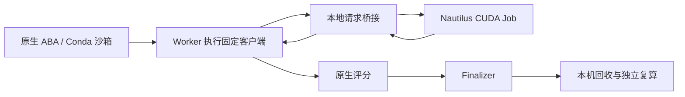

# 原生 ABA → GPU → 评分 → 交付：合成任务验收通过

本轮已在**同一次原生 ABA 运行**中完成：Setup 真实基线检查、Designer、Worker 发起 GPU 训练、原生评分、Finalizer 交付、本机回收和独立复算。原生运行编号为 `67903e2068ad48caa8518a525be7a66f`，运行状态 `completed`，原生流程约 **20.4 分钟**。这是一个八词表、64 参数的合成任务，用于验证运行通路；正式 RedSage-K 8B 新数据训练进入下一阶段。

[完整验证汇总](../results/aba-native-gpu-smoke-2026-11-12/verified-summary.json) · [资源清理检查](../results/aba-native-gpu-smoke-2026-11-12/resource-check.json) · [冻结合成任务](../data/aba-native-gpu-smoke-20261112/README.md)



## 真实执行与结果核对

原生 Setup 门槛通过、Worker 启动后，桥接程序才接受对应运行编号的请求，并提交一个 GPU Job。训练从冻结 base_model.json 开始，仅使用冻结的 train.jsonl；请求携带两份输入的 SHA256。控制机无需集群凭据，也不依赖 SSH 反向端口转发。

GPU Job 在 **RTX 2080 Ti** 上完成 **256 次真实 CUDA 更新**，训练 NLL **4.57291 → 1.17715**，模型重载差为 0，随后自动清理。Worker 收到模型后通过原生尝试验证器，原生评分和 Finalizer 验证器均通过。

| 冻结合成开发集结果 | 原始模型 | GPU 候选／最终交付 |
| --- | ---: | ---: |
| dev NLL，越低越好 | 4.5371711106 | 1.2866796262 |
| 原生 score = −dev NLL | −4.5371711106 | −1.2866796262 |
| optimizer steps | 0 | 256 |

本机用冻结 evaluator 和回收模型独立复算，与原生候选分数一致。最终模型的数值内容与 GPU 回执一致；交付的模型 JSON、训练元数据、README 和 run.py 与可信客户端确定性生成的内容逐字节一致。四个文件 SHA256 已公开。本次未另外保留生产目录的独立 hash 快照，因此这里的字节检查依据是客户端的确定性输出和 GPU 回执；同时保留了原生 Finalizer 验证通过记录。

任务输入的全部文件哈希保持不变。64 MiB 非稀疏随机文件从临时 VM 回收到本机，SHA256 一致。运行后独立检查确认本轮 Job、Pod、ConfigMap、VM、VMI 均无残留，名下活动 Pod 的 GPU 请求为 0；没有修改组员资源。控制器流程时长包含模型调用与准备，GPU 由短时 Job 独立申请并在训练结束后清理。

## 可复算资产

```bash
python scripts/verify-aba-native-gpu-smoke-20261112.py
python data/aba-native-gpu-smoke-20261112/evaluate.py \
  --model-path results/aba-native-gpu-smoke-2026-11-12/deliverable/final_model
```

[复核程序](../scripts/verify-aba-native-gpu-smoke-20261112.py)检查冻结任务哈希、四个交付文件哈希、请求输入哈希，并重新计算基线与最终模型分数。复核已通过。[CUDA 训练代码](../scripts/aba-native-gpu-worker-20261112.py)包含本次合成初值和训练样本，可在合适的 PyTorch/CUDA 环境独立运行。交付的 run.py 是训练客户端的执行记录，重新调用它需要对应的桥接服务。

## 修复与失败记录

运行基于 ABA 源码 `c8bd734cafd5a7cd609efb5f561594bde4107d5b`，加一处明确记录的兼容修正。采用真实 Conda 环境、固定 VM 镜像和原有物理沙箱，评分与权限门槛保持启用。

| 本轮遇到的问题 | 修复与验证 |
| --- | --- |
| SSH 反向端口转发失败 | NRP 模型适配器改为 VM 内部 loopback；实际原生模型工具调用成功 |
| 普通 venv 通过安装检查，却被原生沙箱拒绝 | 使用校验安装包 SHA256 的 Miniforge，管理器运行于真实 Conda 环境；原生启动通过 |
| NBTreeSearch 向不接收业务请求的 CompleteWorker.run 传入字符串 | [单行补丁](../patches/aba-c8bd734-zero-request-worker.patch)删除多余参数；参数契约测试通过，实际 Worker 成功启动并触发 GPU Job |
| 一次补丁部署脚本换行转义错误 | 修正并在本机对固定源码执行实际补丁载荷，部署前检查远端脚本语法 |
| Setup、Designer 在短预算内超时 | 提供固定基线准备模板、禁止 Setup 试训练，增加控制器角色的有限预算；保持一个候选和相同 CUDA 配方 |

[请求契约复核脚本](../scripts/check-aba-zero-request-contract-20261112.py)需在安装好的 ABA Conda 环境中传入 `--aba-root`。它同时确认修补文件哈希、无请求调用可编码，以及错误字符串请求仍被原生验证拒绝。本轮未关闭或绕过评分、目录保护和原生验证器。Setup 第一次基线检查未通过，修正后第二次通过；这个失败被保留在原生日志和公开动作列表中。

此前还有一个**独立、未由原生 ABA 发起**的 32 步 CUDA 检查，NLL 为 2.07944 → 1.45626；它与本次同运行中的 256 步训练分别记录。[独立检查回执](../results/aba-runtime-repair-2026-11-12/separate-gpu-smoke.json)。

## 适用范围与下一阶段

本轮验证了单候选的完整工程通路，使用自编合成任务；没有运行新的 8B LLM SFT，没有产生 KaliBench 官方分数，也没有使用官方 TEST 或生成封存 final64 输出。合成任务的损失下降不能解释为网络安全能力提升。正式 LLM 默认仍为 E0。

下一步将已冻结的 [64 条行为验证 TRAIN 银标](KALI_BEHAVIOR_TRAIN_2026-11-12_ZH.md)接入既有 8B 训练配方和适配器收集程序，先冻结等预算 SFT 对照，再开展少量 ABA 候选的比较。多 GiB 模型恢复、长期服务稳定性及独立泛化尚未由这次合成任务验证。
