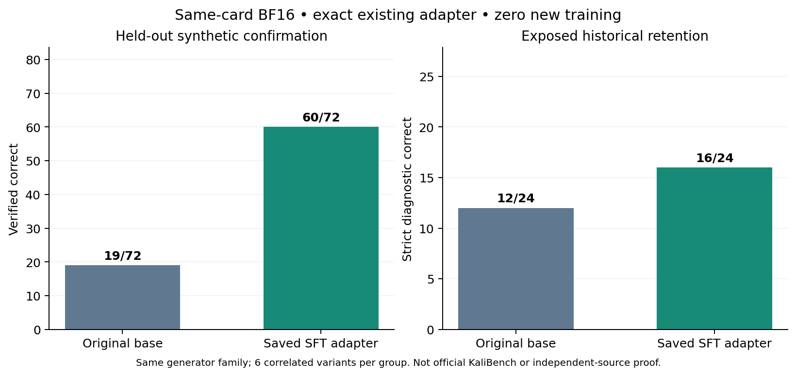

# 固定 SFT adapter 的确认评测（2026-10-26 Pacific）

**预声明确认门槛：未通过。本轮复用上一轮保存的 adapter，新增训练 0 步；原底座仍是正式默认。**

| 指标 | 原底座 | 保存的 SFT adapter |
|---|---:|---:|
| 合成确认集，夹具验证正确 | 19/72 | 60/72 |
| 确认集未识别语法，未执行 | 47 | 6 |
| 历史保持题，严格指标 | 12/24 | 16/24 |
| 输出块完整 | 96/96 | 96/96 |
| 思考闭合标签 | 0/96 | 96/96 |
| 截断 | 0 | 0 |

保守净增下界：候选验证通过数 −（底座验证通过数＋底座未识别语法数）＝ **-6**；有 **1** 个意图组保守净增为正。未识别语法可能是正确替代表达，所以验证未通过不能一律当作实际错误；下界只适用于本轮冻结的审查和合成 oracle。

逐题配对：新增验证通过 41 条，原来通过但本轮候选未通过 0 条，其中候选未识别语法 0 条。相同提取命令 14 条。总数提升不能证明每种技能均未退化。

## 调用前冻结的协议

先写 design.json，再核对并打开 72 条确认题，完成 CPU 审计、源码和数据哈希冻结后才进行模型调用。确认集 12 个意图组，每组 6 个相关变体；与 TRAIN240/DEV72 的完整题目、ID 和意图组均无重叠。所有 gold 已在最初数据构建阶段通过 Linux 合成夹具验证，原始 448 个负控制回执哈希未变。CPU 数据审计不等于独立专家审查。另行记录的描述性复用审计显示：72/72 确认题使用的文件名和工具都在 TRAIN 中出现过，虽然完整问题、gold 命令和意图组没有重叠。因此本轮只能确认同一合成课程内的迁移；该审计不新增门槛或改变评分。

模型 `RISys-Lab/RedSage-K-SFT-GRPO`，revision `843e2e3096e7de68f5c35eb16238f4909f21695a`。现有 adapter SHA256 `f69a01832afe8baba1ff460efce22324873df2bbe8ff2c370317d1db62061395` 与上一轮训练回执相同，144 个加载张量逐一精确比对；整个持久缓存只读挂载，没有重新训练、合并、选模或修改权重。

底座与候选均在同一张 NVIDIA RTX A6000 上以 BF16、同一 LoRA 拓扑运行。底座先使用零 B 的 LoRA，再加载已保存的权重；提示词和推理 tokenizer 不变，batch4、左填充、贪心、最多 1024 新 token、seed3407，不强制前缀、不修补输出。192 次生成＝两模型各（72 确认＋24 历史保持）。本轮硬件可能与早先开发实验不同，不能把跨轮数值变化全归因于学习。

CPU 评分沿用冻结源码：审查只读 argv、显式约束和本地合成文件/离线 pcap 的 stdout oracle；不执行未知语法、约束失败或截断命令，不运行模型给出的任意 shell 字符串或线上扫描。共 79 次候选命令执行，配对 gold 控制全部通过。历史保持题另外用固定原生严格解析评分。未修改老 CPU worker 的历史汇总标签，因此确认分析读取全部 144 条明确标注的记录，不使用其 DEV/TRAIN 空汇总。

| 事先规定的门槛 | 结果 |
|---|---|
| conservative_confirmation_gain_at_least4 | 未通过 |
| conservative_positive_groups_at_least2 | 未通过 |
| retention_strict_not_decreased | 通过 |
| candidate_complete_outputs | 通过 |
| candidate_think_closure | 通过 |
| candidate_no_truncation | 通过 |
| exact_saved_adapter_no_training | 通过 |

## 确认意图组

| 意图组 | 底座验证正确 | 候选验证正确 | 底座未知 | 候选未知 |
|---|---:|---:|---:|---:|
| grep-intent-4 | 0/6 | 5/6 | 0 | 0 |
| head-intent-2 | 0/6 | 1/6 | 6 | 0 |
| jq-intent-4 | 0/6 | 6/6 | 6 | 0 |
| jq-intent-7 | 0/6 | 6/6 | 6 | 0 |
| openssl-intent-0 | 6/6 | 6/6 | 0 | 0 |
| openssl-intent-1 | 6/6 | 6/6 | 0 | 0 |
| tail-intent-2 | 5/6 | 6/6 | 1 | 0 |
| tcpdump-intent-3 | 0/6 | 6/6 | 6 | 0 |
| tcpdump-intent-7 | 0/6 | 6/6 | 6 | 0 |
| tshark-intent-2 | 0/6 | 6/6 | 6 | 0 |
| tshark-intent-7 | 0/6 | 0/6 | 6 | 6 |
| wc-intent-0 | 2/6 | 6/6 | 4 | 0 |

## 解释边界与下一步

本轮未通过预先规定门槛；保留原底座，不用确认结果调参后再把这些题当作盲测。

确认题与训练/开发题仍共享生成器、工具、文件名模式和夹具，每组六变体相关，且没有独立专家 gold；这不是独立来源或官方 KaliBench 的收益证明。24 条保持题是已暴露的历史诊断面板。本轮完成后，确认集也应标记为已暴露，不能重复用于挑选候选。实验性 BPE 闭合标签训练配方继承上一轮，不代表上游默认配方。

新增优化步 0、官方 TEST 调用 0、外部 teacher 调用 0、ABA 自主数据搜索 0。单卡普通队列、CPU2/RAM12Gi，有限 Job；GPU 完成并清理后才启动 CPU1/RAM2Gi 评分。全部本轮 Job、Pod、ConfigMap、Secret 已清理，持久 adapter 未改动。GPU worker 333.2 秒，加载后平均利用率 66.5%。

公开汇总、来源哈希、通用 worker 与图表；不公开确认题和历史保持题正文/ID、原始预测/思考、权重、完整生成器/oracle 或集群配置。运行 `python3 scripts/verify-kali-bf16-confirmation.py` 可核对公开数值和哈希，不能独立重算未公开预测。

下一阶段应分别规划独立来源开发任务上的 ABA 数据生成/筛选/正确 SFT 对照；最终只在方案固定后查询官方 TEST。不得根据本次确认题定向生成训练样本后继续声称盲测。
