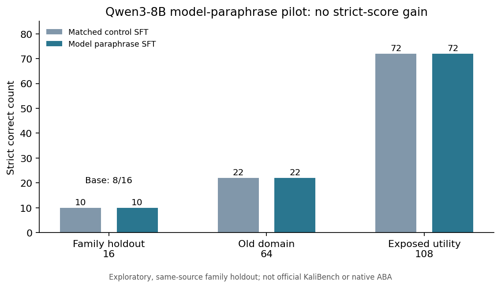

# Qwen3-8B：托管模型改写训练数据的 680 步对照试验（2026-11-02）

> 后续状态（同日更新）：原生 ABA 已在另一个 CPU 临时虚拟机上完成**独立的 16 条新操作训练数据试验**。这不改变本报告的 680 步对照结果；详见[新试验报告](KALI_NATIVE_ABA_NOVEL_DATA_PILOT_ZH_2026-11-02.md)。本报告中关于原生 ABA 因 LINSTOR 挂载受阻的描述是本轮 680 步试验结束时的历史状态。

## 研究问题与边界

上轮自编 `grep`、`tshark` 数据在相近模板上有局部收益，却未证实跨工具迁移。本轮用已有的 **32 条经 Linux 固定环境检查的安全命令任务**作为种子（8 种工具、每种工具 2 个任务家族、每家族 2 个文件变体）。在模型输出前按任务家族拆分：每种工具的一个家族作为训练种子，另一个家族留作 16 题验证。因此验证集与训练集任务家族不重合，但来源、工具与作者相同，**不是独立专家金标或官方 KaliBench TEST**。

NRP 托管模型以训练侧 16 条种子为输入，四轮提出 64 条问题改写。静态规则留下 58 条；其中 16 条将“生成命令”改写成“确认命令”，事后语义形式检查予以剔除，最终采用 **42 条**。这些训练样本继承原种子的 Linux 检查过的命令及选项元数据，**没有产生新的命令语义或重新执行每条改写问题**。验证题与参考答案均未发给改写模型。

这是一轮**NRP 托管模型按固定提示改写数据 + 固定配方 SFT**，不是 Agent 自主搜索，也不是 ABA 原生控制器自动执行完整后训练。原生 ABA 数据生成任务已单独准备；Nautilus CPU 虚拟机**两次**启动均因 LINSTOR CSI 存储卷挂载超时而未就绪，控制器未启动、没有生成原生 ABA 数据。两次尝试后均已停止虚拟机。不能把上面的 42 条称为原生 ABA 产物。

## 固定训练和评测

- 底座：固定版本的 `Qwen/Qwen3-8B`；原始训练数据为同一批 638 条 KaliBench TRAIN 来源银标。
- 对照组：638 条共同数据 + 42 条按长度近似匹配的原 TRAIN 重复样本；处理组：638 条共同数据 + 42 条 Agent 改写样本。两组均从相同初始 LoRA 权重训练 **680 次优化器更新**；步数与长度近似匹配，不代表严格相同的 token/FLOP 预算。
- 一张 A40，NF4 量化、BF16 计算、固定提示格式及贪心推理。预先冻结 16 题留出家族集、旧开发集 64 题、已暴露工具集 108 题及评分门槛；原始底座也在 16 题上推理。评分采用严格选项和值匹配，并单独记录截断。
- 正式 KaliBench TEST 未读取；模型生成的命令未在本轮执行。GPU Job 结束后清理，集群回读本项目名下的 Job/Pod/ConfigMap 为零；ABA 虚拟机为 Stopped。

## 实测结果

| 严格正确 | 原始底座 | 对照 SFT | 模型改写数据 SFT |
| --- | ---: | ---: | ---: |
| 留出任务家族 16 题 | 8/16 | **10/16** | **10/16** |
| 旧领域开发集 64 题 | — | 22/64 | 22/64 |
| 已暴露工具确认集 36 题 | — | 18/36 | 18/36 |
| 已暴露工具全集 108 题 | — | 72/108 | 72/108 |

留出 16 题上，对照与处理组逐题严格正确标志完全相同（共同正确 10、共同错误 6，新增正确 0、失去正确 0）。旧 64 题和工具 108 题也没有严格正确题的净变化或成对变化。处理组的工具 108 题截断由对照组的 **6 次降为 1 次**，但留出 16 题由 0 次变为 1 次；这属于输出稳定性的混合信号。两组各完成 680 次更新，共 1360 次；GPU 工作进程约 2696 秒，峰值 CUDA 分配约 9.57 GiB。

预先声明的探索门槛要求处理组在留出 16 题至少比对照多对 2 题，同时旧领域集退化不超过 2 题、不增加合计截断、官方 TEST 不动。后面三项通过，**主指标 0 题增益未通过**，因此不推广处理适配器。

## 事后安全功能检查

严格评分会把功能等价的选项写法判错。为确认这一影响，我们在主分数固定后，只挑出两组各 6 道严格判错的留出题，在 Linux 临时目录中用合成文件执行经过白名单检查的 `head`、`grep`、`jq` 命令；一条截断输出没有执行。**对照组 4/6、处理组 5/6** 在这些固定文件上得到预期输出。两组的 `head -n -2` 与 `grep -vi` 各有 4 条合成检查通过；`jq` 家族中，对照组两条写法报错，处理组一条通过、另一条截断。

因此，处理组在事后固定环境中有 **1 道**额外的可用 `jq` 命令，但这个结果来自看到严格分数后才选择的 6 题子集，且只证明对合成文件有效。它**不改写预先冻结的 10/16 对 10/16 主指标或失败的准入门槛**，也不能作为独立泛化证据。CPU 检查没有使用 GPU、外部目标或官方 TEST；Job 清理后本项目资源回读为零。[只含计数的功能检查摘要](../results/kali-qwen-agent-data680-2026-11-02/semantic-posthoc.json)。

## 解释与下一步

本轮仅把既有正确命令换成若干自然语言问法，缺少新的工具行为、约束组合和独立验证。数据在训练流程中确实生效，但没有让留出家族题的**预先固定严格正确数**增加；事后检查发现一条额外可用的 `jq` 命令。16 题规模小，不能据此证明“自动生成训练数据一定无用”；可以说明**这种同命令改写剂量在当前固定主指标上未显示增益**。留出题现已被查询，后续不能再当未见过的盲测集。

下一轮若继续，应让 Agent 提议**新的、可在隔离环境安全验证的训练任务语义**，先逐题检查问题、命令与输出，再固定一个全新来源的验证集；随后才值得投入下一次 GPU 对照训练。原生 ABA 控制器仍需 Nautilus 修复虚拟机存储挂载，恢复后独立执行并与本轮托管模型改写实验分别报告。公开的[聚合结果](../results/kali-qwen-agent-data680-2026-11-02/aggregate.json)不含题目、命令、逐题输出、权重或凭证。
