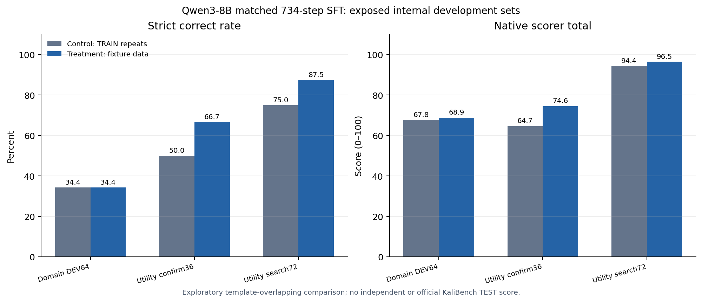

# KaliBench Qwen3-8B：734 步等步数数据试验结果（2026-11-01）

## 问题与实验边界

此前 650 步对照试验只加入 12 条新训练样本，占参数更新的 1.85%，没有看到净收益。本轮检验提高相关数据剂量是否能修复已观察到的 `grep` / `tshark` 输出问题。**这是固定数据的 SFT 比较，不是 ABA 自动后训练，也不是 KaliBench 官方 TEST 评分。**

拟用作新内部开发集的 96 条发布方 TRAIN 题，在输出前被来源审计否决：88 条的原始终端标记为运行错误，8 条为超时，0 条为执行通过。该面板和依赖它的第一版评测协议均未用于模型推理。本轮只在早已反复查看的内部 domain DEV64 与自编 utility 开发集上做探索性比较。

## 数据与方法

两组从同一个固定的 Qwen3-8B checkpoint 和**相同初始 LoRA 状态**开始，共用 638 条原训练记录，各做 734 次单样本优化更新：

| 组别 | 额外 96 条更新 |
| --- | --- |
| 对照 | 长度接近的发布方 TRAIN 记录重复项 |
| 处理 | 自编且在离线 Linux 固定文件上通过的 `grep` / `tshark` 命令样本 |

处理组新增数据覆盖 6 种狭窄意图，每种 16 个高度相关的变体，占总更新数 **13.08%**。题目及参考命令与 utility 开发集无逐字完全重复，但**语义及任务模板明显重合**。这些数据是文档辅助、固定环境执行检查过的 silver 训练候选，不是独立专家金标。

两组使用同一随机种子 3407、学习率 2×10⁻⁵、NF4 量化与 BF16 计算、LoRA `r=16` / `alpha=32`（`q_proj`、`v_proj`）、贪心生成及最多 512 个新 token。额外部分的总输入 token 为 39,309（对照）与 39,216（处理）；监督输出 token 为 2,155 与 2,208。因此更新步数一致、长度接近，但计算量并非严格完全相同。

模型权重 11/11 文件经 SHA-256 校验。原先从 Ceph 直接加载的 A40 Job 在文件系统等待中停滞，**0 步训练、0 条模型输出**，随后停止并清理。修订运行把同一份权重逐片复制并校验到节点临时盘，从本地加载；该 Job 完成 **1,468** 步、全部开发集生成，运行 **2,467.17 秒**，峰值 CUDA 分配 **9.57 GiB**。集群 Job 与 ConfigMap 已清理，官方 TEST 查询数为 0。

## 配对结果

以下“严格正确”要求工具、选项和值与参考答案一致；“原生总分”是现有 KaliBench 兼容评分器的诊断输出。两者并非命令实际执行效果。

| 已暴露开发集 | 严格正确：对照 → 处理 | 配对新增 / 丢失 | 原生总分：对照 → 处理 | 截断：对照 → 处理 |
| --- | ---: | ---: | ---: | ---: |
| Domain DEV64 | 22/64 → 22/64 | 0 / 0 | 67.78 → 68.87 | 2 → 1 |
| Utility confirm36（预设主指标） | 18/36 → **24/36** | 6 / 0 | 64.72 → 74.60 | 2 → 0 |
| Utility search72 | 54/72 → **63/72** | 9 / 0 | 94.42 → 96.53 | 0 → 0 |
| Utility 全部 108 | 72/108 → **87/108** | 15 / 0 | 84.52 → 89.22 | 2 → 0 |

预先规定的探索性门槛——主指标至少增加 3 题、旧 domain 至多少 2 题、不能增加截断、官方 TEST 不查询——**全部满足**。但全部 15 道新增严格正确题只来自与新增训练数据相近的三个自编题型：日志行号 6、日志计数 6、离线 TLS 3。其他题型没有新增严格正确题。这个结果支持“增大这些模板的训练剂量改善了这些模板的输出”，**没有证明更广泛 KaliBench 工具或独立来源的泛化**。

## 固定 Linux 文件上的行为核查

为避免只相信字符串评分，在 Nautilus 的 **CPU-only** 临时 Job 中对上述三个题型各 6 题做了离线核查：仅允许白名单内的 `grep` / `tshark` 参数，使用临时合成日志或 PCAP；不运行 shell、不开启实时抓包、不接触外部目标。18 条参考命令均在该固定环境通过；生成的 36 条候选中有 33 条被安全执行，2 条对照输出不完整，1 条对照输出不在白名单内，因而没有执行。

| 题型 | 严格正确：对照 → 处理 | 实际输出匹配参考：对照 → 处理 |
| --- | ---: | ---: |
| 日志行号，6 题 | 0 → 6 | 0 → 6 |
| 日志计数，6 题 | 0 → 6 | 1 → 6 |
| 离线 TLS，6 题 | 0 → 3 | 0 → 3 |

日志计数中有 1 条对照命令在固定环境执行成功且输出与参考相同，但严格评分判错。这证明字符串评分与实际效果不能等同。固定合成文件只验证这三个题型在这个受控环境里的行为，**不代表所有真实日志、PCAP 或 KaliBench 任务都正确**。CPU Job 已清理，未使用 GPU，未产生新模型调用。

## 结论与下一道门槛

这次受控试验解决了先前“12 条样本剂量太小，无法判断”的局部问题：在已暴露的同类模板上，96 条执行核查样本优于长度接近的重复 TRAIN 更新，且没有观察到旧 domain DEV64 的严格正确数下降。**这不是独立验证；处理组适配器暂不推广为正式模型。**

接下来需要冻结来自独立来源、标签可信且未参与本轮数据设计的验证题，再比较控制与处理，并对新增正确题做语义审计。在此之前不运行或据此调整官方 TEST。若进一步集成 ABA，应把固定 SFT 的这组结果作为数据质量/剂量基线，而不能将其误写成 ABA 已完成。

公开聚合结果：[配对评分](../results/kali-qwen-diverse-734-2026-11-01/comparison.json) · [离线行为核查](../results/kali-qwen-diverse-734-2026-11-01/semantic-audit.json) · [数据质量审计](KALI_QWEN_DATA_QUALITY_DOSE_ZH_2026-11-01.md)。公开文件不含训练数据、模型输出、适配器权重或密钥。
