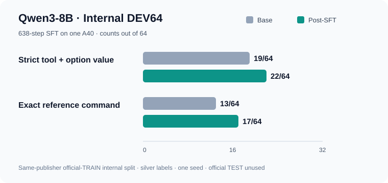

# Qwen3-8B 扩展 SFT：A40 完成，内部 DEV64 小幅提升

## 实际完成的工作

此前 RTX 3090、L40、A100、RTX A6000 和随后 RTX 4090 的有界请求均未拿到 GPU。查询 NRP 实时资源表后，改用当时有空闲容量的单张 A40，并按平台要求请求 `nvidia.com/a40`。这次 Job 成功绑定节点，运行了预先冻结的 **638 条官方 TRAIN 银标准样本、638 个优化步骤**，生成训练前后各 64 条输出，保存了适配器。运行结束后，已核查自己创建的 Job、Pod、ConfigMap 均已清理。

训练仍是固定数据的一轮 NF4 QLoRA SFT，**不是 ABA 自动生成训练数据**。模型为固定版本的 Qwen3-8B；随机种子、编码、训练样本、验证样本和评分协议在本次模型输出前已冻结。GPU worker 报告 A40 上总用时 1162.9 秒、峰值 CUDA 分配约 10.28 GB、适配器约 30.69 MB。适配器哈希和协议哈希见[汇总](../results/kali-qwen-expanded-a40-2026-10-30/summary.json)。

## 配对验证结果

64 道题来自**同一发布方的官方 TRAIN**，在本项目此前未用于模型查询，且本轮训练和验证之间没有相同题目、参考命令或规范化工具加命令组重叠。训练前后使用相同提示格式、解码设置和评分器。

| 内部 DEV64 指标 | 原始 Qwen3-8B | 本轮 SFT 后 | 配对变化 |
| --- | ---: | ---: | --- |
| 严格工具与参数值正确 | 19/64（29.69%） | 22/64（34.38%） | 新增正确 4、退化 1 |
| 与参考命令完全一致 | 13/64（20.31%） | 17/64（26.56%） | 新增一致 5、失去一致 1 |
| 发布方原生综合分 | 61.42 | 67.43 | +6.01 分 |
| 输出达到长度上限 | 1/64 | 0/64 | 少 1 条 |

严格指标按本项目诊断规则计算，不能视为官方排行榜指标。按先前训练是否出现该工具分层，已见工具从 6/32 到 7/32，未见工具从 13/32 到 15/32。这些分层每组只有 32 条，不能据此断言跨工具泛化。

## 结果如何解释

这是一项**内部开发集上的小幅正向信号**。净增只有 3 道严格正确题；一次训练种子和 64 条银标准样本不足以确认稳定收益。五条严格指标发生变化的题目已定位。其中一条退化把 `assetfinder --subs-only` 改成 `--subdomains`；[该工具上游源码](https://github.com/tomnomnom/assetfinder/blob/master/main.go)声明的是 `--subs-only`。一条提升把 `ipcrm -A` 改成 `--all`；[util-linux 手册](https://man7.org/linux/man-pages/man1/ipcrm.1.html)列出的是 `-a, --all`。这些是**部分静态核查**，其余变化仍需依据具体工具版本和任务语义复核。自动评分的“完全一致”也不等同于语义正确。

本轮没有使用 KaliBench 官方 TEST，也没有独立来源的盲测或独立人工签核。因此不把新适配器提升为默认模型，不宣称官方成绩；此前 RedSage-K 的正式默认选择保持不变。下一步应复核变化题目的命令语义，并建立版本固定、独立来源的验证集，再决定是否继续扩充数据或训练。

