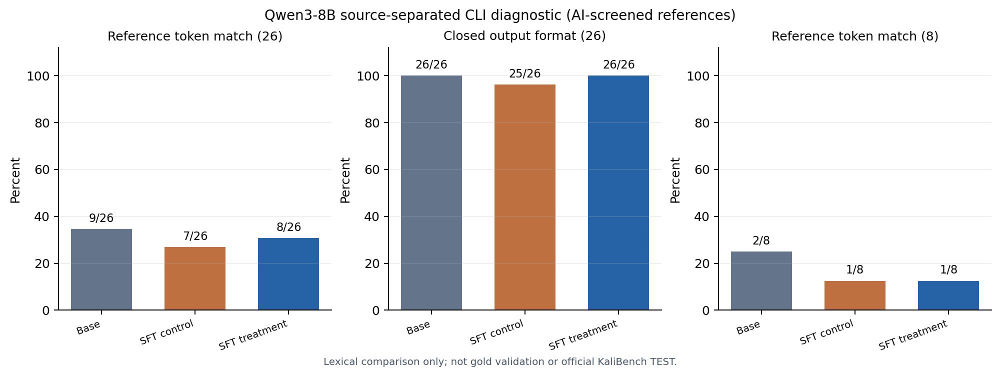

# Qwen3-8B：外部来源 26 题命令诊断（2026-11-02）

## 为什么做这一步

上一轮 734 步 SFT 在已暴露的自编 `grep` / `tshark` 开发题上提高了严格正确数，但新增正确题集中在与训练语义重合的三个模板。为检查是否有跨工具迁移，我们在模型输出前冻结了另一来源的 **26 道 CyBashBench 安全相关命令题、20 种工具**。这 20 种工具与新增的 `grep` / `tshark` 训练工具无重叠；按预先声明的规则，与 KaliBench 官方 TRAIN 的问题及参考命令没有检测到完全或近似词法重合。词法分离不保证语义或预训练分离。

这 26 条来自发布方命令，由 AI 对照文档筛查，只有 8 条附有某种安全的固定环境检查证据；**0 条获得独立人工逐题签核，参考命令不是已认证金标**。因此它们只能用于来源分离的定性诊断，不能产生正式 KaliBench 分数或用于推广模型。原先保留作最终检查的 NL2SH-ALFA TEST 与 KaliBench 官方 TEST 均未查询。

## 协议与资源

在首次模型输出前，输入、参考命令与词法评分规则分别固定。参考命令留在私有评分端，GPU 仅收到题目。对同一 26 题使用同一 Qwen3-8B checkpoint、提示词模板、贪心生成和 512-token 上限，分别推理：原始底座、734 步对照适配器、734 步处理适配器。没有新增训练步数，也**没有执行模型生成的命令**。

固定评分包括 `<output>` 格式闭合且无额外文字、是否截断、与暂定参考命令逐字相同、经 `shlex` 分词后相同、首个可执行词相同。分词匹配仍是**词法指标**，不判断功能等价、安全性或参考答案是否正确。

一张 A40 完成三组共 78 次生成；工作进程运行 **983.83 秒**，峰值 CUDA 分配 **7.05 GiB**，优化步数 **0**。Job 与 ConfigMap 已清理，集群再次读取无本项目遗留计算对象。

## 结果

| 词法诊断 | 原始底座 | SFT 对照 | SFT 处理 |
| --- | ---: | ---: | ---: |
| 26 题分词后与暂定参考命令完全相同 | **9/26** | 7/26 | 8/26 |
| 26 题格式完整、无额外文字且未截断 | 26/26 | 25/26 | 26/26 |
| 26 题首个可执行词与参考相同 | 26/26 | 24/26 | 24/26 |
| 附固定环境证据的 8 题，分词后完全相同 | **2/8** | 1/8 | 1/8 |

对照与处理适配器的 26 题配对：处理新增匹配 **1 题**、失去 **0 题**；但与原始底座配对，处理新增 **1 题**、失去 **2 题**。格式方面，处理组消除了对照组唯一一次截断。这批来源分离题**没有显示可靠的跨工具收益**。

## 对分歧的复核与结论

四题导致三组词法匹配结果不同。文档核查说明逐字匹配不能直接当作功能判断：当前 [GDB `gcore` 手册](https://sourceware.org/gdb/current/onlinedocs/gdb.html/gcore-man.html)把 PID 列为位置参数，未列出 `gcore -p`；[OpenSSL `req` 文档](https://docs.openssl.org/3.2/man1/openssl-req/)说明未传 `-key` 时可能按配置或默认值生成新密钥，因此缺少显式 `-newkey` 不必然代表功能失败。[GNU `env`](https://www.gnu.org/software/coreutils/manual/html_node/env-invocation.html)与 [GNU `printenv`](https://www.gnu.org/s/coreutils/manual/html_node/printenv-invocation.html)的参数行为也表明，输出所有以 `PATH` 开头的变量不能可靠地写成 `printenv PATH*`。[Python 文档](https://docs.python.org/3/library/http.server.html)支持用 `python3 -m http.server` 在当前目录启动简单服务器。以上均为事后 AI 文档审查，没有在目标环境执行这些模型命令，也不改动预先固定的词法计数。

**决策：保持原始底座作为基准，处理适配器不推广。**734 步 SFT 对已暴露的相近模板有局部效果；这 26 题诊断没有证实跨工具泛化。下一轮应先获得范围更广、标签可信、可安全验证的来源分离任务，再让 ABA 生成与筛选多工具训练数据；否则继续在同一模板上训练或重复查看这 26 题，只会增加过拟合风险。

[公开聚合结果](../results/kali-qwen-external26-ai-diagnostic-2026-11-02/aggregate.json)只含计数与收据哈希，不含题目、参考命令、逐题模型输出、权重或令牌。本项目预设的正式独立复核准入门仍未通过；AI 文档审查不等于人工签核。
