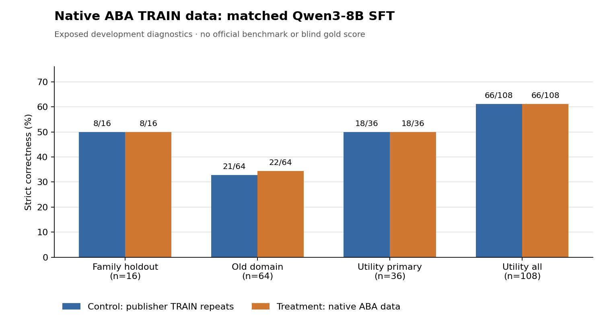

# 原生 ABA 新任务数据 → Qwen3-8B SFT 对照：完整工程循环（2026-11-02）

## 问题与边界

这轮回答一个小问题：**原生 ABA 生成并通过冻结安全夹具的 14 条新操作训练样本，替换 14 条旧 TRAIN 重复样本后，在相同步数的 Qwen3-8B SFT 中有没有可观察收益？** 原生 ABA 已先在独立的 CPU 临时虚拟机中生成 16 条候选；冻结夹具通过 14 条，另外 2 条虽在事后功能复查通过，但仍按原准入规则排除。参见[任务生成与评分器审计](KALI_NATIVE_ABA_NOVEL_DATA_PILOT_ZH_2026-11-02.md)。

数据生成使用原生 ABA 控制器；**本轮 GPU SFT 则由固定配方脚本执行，并非 ABA 控制器自主搜索训练超参数或检查点**。原生 ABA 训练数据只覆盖 `head`、`tail`、`wc`、`grep` 四种工具的四类受约束操作，每类主要是文件名变体。验证 16 题在之前的试验中已经被查询，旧领域 64 题和通用 CLI 108 题也均是已曝光开发集。所有分数仅用于工程诊断，不能称为新的盲测、KaliBench 官方分数或独立泛化证据。

## 实际执行与核对

- 底座固定为 `Qwen/Qwen3-8B`，版本 `b968826d9c46dd6066d109eabc6255188de91218`。使用一张 A40、NF4 QLoRA、BF16 计算、相同提示/解码设置。
- 两组共享 638 条既有 publisher TRAIN 数据；对照组另加 14 条按长度匹配的 TRAIN 重复样本，处理组另加 14 条原生 ABA 候选。两组各 652 次真实优化器更新，并从**同一份保存的初始 LoRA 参数**开始。新增部分总输入 token 为 **5551 对 5552**，监督目标 token 都为 **211**；这比仅匹配步数更接近，但仍不等于完全相同的 FLOP 或梯度难度。
- 模型分片在作业本地盘逐个校验哈希。基线和两组分别对相同的 16 题推理；SFT 两组再分别对旧领域 64 题和通用 CLI 108 题推理。输出文件、协议和回执哈希均通过检查。
- GPU 工作进程约 **2900 秒**，峰值 CUDA 分配约 **9.57 GiB**；共 **1304 次**优化器更新。Job/Pod/ConfigMap 在结束后删除，本项目标记的对象回读为空。官方 TEST 读取和评测 **0** 行。

## 冻结严格评分结果

| 开发集（均已曝光） | 原始底座 | 对照 SFT | ABA 数据 SFT | 对照 → 处理逐题变化 |
| --- | ---: | ---: | ---: | --- |
| 同源不同任务家族 16 题 | 8/16 | **8/16** | **8/16** | 新增 0，失去 0 |
| 旧领域 64 题 | — | **21/64** | **22/64** | 新增 1，失去 0 |
| 通用 CLI 主集 36 题 | — | **18/36** | **18/36** | 新增 0，失去 0 |
| 通用 CLI 全集 108 题 | — | **66/108** | **66/108** | 新增 0，失去 0 |

留出 16 题中，原始底座无截断；两种 SFT 都有 **2 次**达到生成上限。旧领域 64 题两组均无截断；通用 CLI 108 题两组均有 **6 次**截断。对照与处理的 16 题、36 题和 108 题严格正确标志逐题完全相同。旧领域唯一一题变化是 `wbinfo`：处理输出匹配 publisher 银标，而对照缺少选项；本次没有独立核定该银标，也不能将这一孤立变化归因于四种新增工具的学习。

冻结的探索性门槛要求处理组在 16 题上比对照至少多对 2 题，同时旧领域退化不超过 2 题、合计截断不增加、官方 TEST 不动。后三项通过，**主指标增益为 0，门槛失败**。两个适配器哈希不同，表明两组确实得到不同权重；权重差异本身不等于性能增益。

## 解释、决定和下一步

这轮已经跑通“原生 ABA 生成训练候选 → 冻结筛选 → Qwen3-8B 匹配 SFT → 相同开发集评测 → 资源清理”的完整工程链。**14 条四模板数据没有在主要开发指标上显示收益**，也没有比对照减少截断；不提升处理适配器，保留原始底座作为正式默认。此结果不能证明 ABA 无效：样本量小、结构高度重复，且评测集已曝光并缺少独立金标。

下一次投入大规模 GPU 训练前，应先增加不同工具、操作及约束组合的 ABA 训练候选；逐题核对问题、命令和离线输出；另行预先锁定与生成源分开的可靠评测集。若无法得到可靠独立标签，后续只能继续报告探索性开发结果。官方 KaliBench TEST 保持未触碰，直到模型选择和评测协议最终固定。

[公开聚合数据](../results/kali-qwen-native-aba652-2026-11-02/aggregate.json)不包含原始训练题目、逐题预测、权重、令牌或私有日志。
