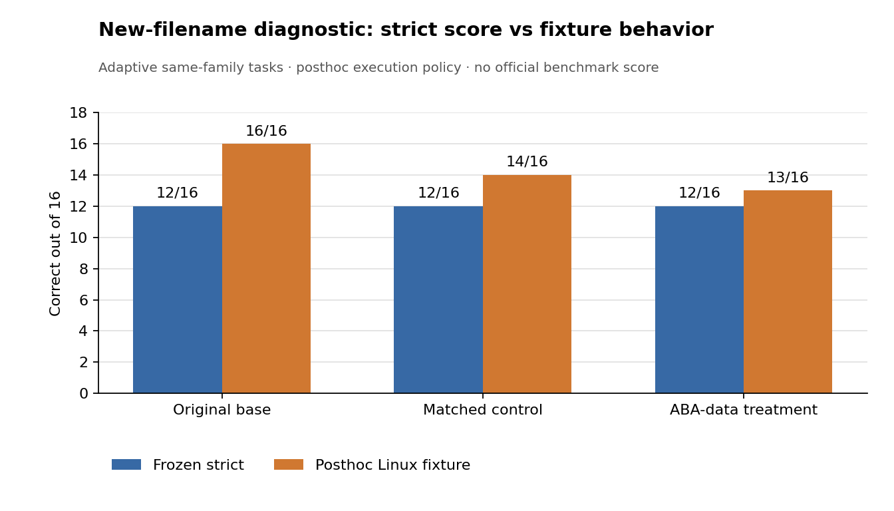

# 原生 ABA 数据的同家族新文件名诊断：严格评分与 Linux 实际行为（2026-11-02）

## 为什么补做这一轮

[前一轮真实 SFT 对照](KALI_QWEN_NATIVE_ABA652_RESULT_ZH_2026-11-02.md)在已曝光的 16 题家族留出集上得到对照与 ABA 处理组 **8/16 对 8/16**。该集主要测试不同任务家族，不能回答 14 条新增数据是否至少帮助模型处理**相同操作、新文件名**。因此在看到前一轮分数后，我们新建 16 道自编 CLI 题，每种 `head`、`tail`、`wc`、`grep` 各 4 道，文件名均不出现在这 14 条新增训练样本中。所有参考命令及临时文件内容在模型输出前固定，16/16 参考命令通过安全夹具；评分协议也在本轮模型输出前固定。

**这是根据前一轮结果追加的自编、同家族诊断，绝非独立来源盲测。**它只能检验非常近的文件名替换。原始 Qwen3-8B、匹配 SFT 对照适配器、ABA 数据 SFT 处理适配器各做 16 题贪心推理；单张 A40，只推理、0 次新优化器更新。推理 Job 和其 ConfigMap 已删除。官方 TEST 和独立金标均为 0。

## 冻结的严格分数

| 16 题 | 原始底座 | 对照 SFT | ABA 数据 SFT |
| --- | ---: | ---: | ---: |
| 工具、选项和值严格正确 | **12/16** | **12/16** | **12/16** |
| 与参考命令完全相同 | 12/16 | 12/16 | 12/16 |
| 截断 | 0 | 0 | 0 |

三组都在 `head`、`tail`、`wc` 上各对 4/4，在 `grep` 上均为 0/4；对照与处理的严格正确题逐题相同。原定的狭窄执行白名单只接受预设的规范 `grep -i -F` 写法，因此起初同样只执行和通过了 12/16。**这 12/16 是预先冻结的主评分，后续功能检查不覆盖它。**

## 事后扩大安全白名单后的 Linux 功能复查

看到输出后，检查发现有些 `grep` 命令虽不符合规范选项形式，在本题固定的字母模式和文件上仍可能得到正确内容。为区分“形式不符”和“实际效果错误”，单独制定了**事后**执行方案：只允许 `head`/`tail`/`wc` 及单文件的受限 `grep` 参数，以 argv 形式在无网络目标的 Linux CPU Job 中对预先固定的临时文本执行，设置 2 秒超时；不调用 shell。48 条预测命令全部通过安全筛查并实际执行，CPU Job 和 ConfigMap 已删除，GPU 用量 0。

| 固定文件上的输出与参考一致 | 原始底座 | 对照 SFT | ABA 数据 SFT |
| --- | ---: | ---: | ---: |
| `head`、`tail`、`wc` 合计 | 12/12 | 12/12 | 12/12 |
| `grep` | **4/4** | **2/4** | **1/4** |
| 全部 16 题 | **16/16** | **14/16** | **13/16** |

对照到处理的功能变化为**新增正确 1、失去正确 2**。底座到处理是失去 3、没有新增。对照的两条 `grep` 输出使用 Linux 不支持的选项，运行报错；处理的三条 `grep -w` 则把“允许出现在更长字符串内部”的模式误做成整词匹配，漏掉预先固定文件中的嵌入子串。底座省略了 `-F`，但本诊断的四个模式只是普通英文字母，故在**这些固定文件**上碰巧与字面量搜索输出一致；这不证明底座能处理含正则特殊字符的固定字符串。处理另有一条 `-E` 命令在这里可用，也不能推广到任意字面量模式。

## 数据质量决定

ABA 原始 16 条里，冻结夹具通过并进入 SFT 的两条 `grep` 训练题使用了“literal word”措辞，但任务原意是**固定子串**。事后处理组多次生成 `-w` 与这种措辞歧义相吻合；**因果关系尚未证实**，不能把 14 条数据中的两条直接认定为唯一原因。现在仅对**未来训练**隔离这两条有歧义的数据，并暂停复用整个高度模板化的 14 条批次。之前的冻结 14/16、实际 SFT、12/16 主分数和 16/14/13 事后功能结果均不追溯修改。

结论是具体而有限的：这批原生 ABA 数据已经跑通后训练链，却未改善预定开发指标；在追加的近家族诊断中还出现 `grep` 功能退化信号。**保留原始底座，不推广处理适配器，不直接再训练这批数据。**下一轮先明确“子串”与“整词”的文字及执行验收，再扩大工具与操作家族，并准备可靠的独立来源评测。公开的[聚合结果](../results/kali-qwen-native-infamily16-2026-11-02/aggregate.json)不含题目、预测、命令正文、权重或凭据。
