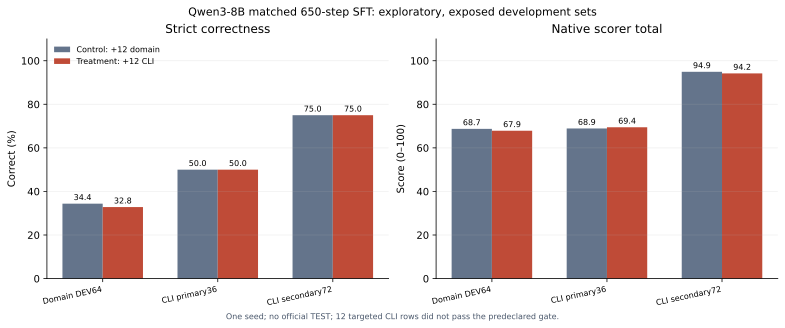

# Qwen3-8B 定向回放数据的 650 步对照实验

## 要回答的问题

前一轮用 638 条 KaliBench 官方 TRAIN 银标准样本训练 Qwen3-8B 后，同发布方内部 DEV64 严格正确数为 22/64，但自行编写的通用命令主开发集只有 18/36，且 `grep` 行号、`grep` 计数和离线 TShark TLS 三组意图各有 6/6 → 0/6 的退化。本轮检验：少量专门补足这些意图的正确训练样本，能否在**相同训练步数**下改善通用命令表现，同时保持领域结果。

## 数据与对照

我们按 [GNU grep 手册](https://www.gnu.org/s/grep/manual/grep.html)、[TShark 手册](https://www.wireshark.org/docs/man-pages/tshark.html)及 [TLS 显示过滤器文档](https://www.wireshark.org/docs/dfref/t/tls.html)编写了 12 条训练候选，覆盖六种命令意图，每种两条文件名变体。固定 Linux 离线夹具在 `grep 3.7-1build1` 和 `tshark 3.6.2-2` 下通过 **12/12**；Qwen 原生分词和目标文本往返检查通过 **12/12**。与原 638 条 TRAIN 和通用命令 DEV108 的**完全相同**问题及参考命令重叠均为零；语义意图有意与已暴露的退化题重合。这些样本仅是自行编写、文档与夹具核查过的**探索性银标准**，独立专家签核数为零。

两组均使用固定版本的 `Qwen/Qwen3-8B`、同一初始 LoRA 参数、种子、非思考提示格式、NF4 QLoRA、学习率及贪心评测。均包含相同的 638 条领域 TRAIN 样本：

| 组别 | 额外 12 条 | 总训练更新 | 额外样本总 token / 受监督 token |
| --- | --- | ---: | ---: |
| 对照组 | 从原领域 TRAIN 选择的长度匹配重复样本 | 650 | 4,832 / 237 |
| 实验组 | 12 条经 Linux 夹具验证的定向通用命令样本 | 650 | 4,830 / 238 |

这使训练步数及额外 token 数接近，但不能保证计算量完全相等。两组均从同一基础权重与初始 LoRA 状态开始，**不是**在先前的 638 步适配器上继续训练。预先设定的探索性门槛是：领域内部 DEV64 严格正确至少 22，通用命令主集36题至少22，输出截断为零，并且官方 TEST 保持未查询。DEV64 与通用命令 DEV108 均已在以前实验中使用，不能作为盲测或独立来源的领域验证。

## 结果

| 开发集 | 对照组严格正确 | 实验组严格正确 | 对照组→实验组原生综合分 | 输出截断 |
| --- | ---: | ---: | ---: | ---: |
| KaliBench 同发布方内部 DEV64 | **22/64** | **21/64** | 68.73→67.86 | 0→0 |
| 自编通用命令主集36 | **18/36** | **18/36** | 68.89→69.44 | 0→0 |
| 自编通用命令补充集72 | 54/72 | 54/72 | 94.91→94.17 | 0→0 |
| 自编通用命令全部108 | 72/108 | 72/108 | 86.23→85.93 | 0→0 |

领域 DEV64 的唯一严格正确差异是实验组把应为 `wbinfo --ping` 的选项写成了 `wbinfo ping`；领域精确参考命令匹配从 17/64 变成 16/64。通用命令 DEV108 两组的严格正确题目**完全相同**。先前退化的三个具体意图家族在两组中仍各为 **0/6**。两组都没有截断，所以不能把截断消失归因于新增的 12 条定向数据；对照组也出现了同样变化。原生综合分只适合在这些开发题上诊断，不能当成官方 KaliBench 排名。

训练后的只读错误审计确认，12 条定向样本均以正确目标格式进入训练；它们与通用命令开发题的系统提示完全相同，去掉具体问题文本后的用户提示模板也完全相同。因此没有发现此次定向数据的提示格式错配。它们仅占 **12/650（1.85%）** 次更新、**238/13,466（1.77%）** 个受监督 token；随机顺序中第一次出现于第 229 步，最后一次于第 537 步，最后 100 步没有定向样本。模型仍在 `grep` 输出中生成多余或错误选项，在离线 TLS 题中继续写出 `-tls`。样本占比及顺序可能影响学习效果，但本次实验**没有隔离检验这些机制**，不能据此确定根因。

**预设门槛失败。** 实验组在领域 DEV64 少对一道，通用主集也未达到 22/36。保留原始模型为正式对照，不提升任一新适配器，更不能声称已经修复通用命令退化。实验只用了一个随机种子；每个意图的多个文件名变体高度相关，且训练样本是根据已见退化设计的，无法推出外部泛化效果。

## 资源、边界与下一步

单张 Nautilus A40 上完成两组共 1,300 次优化更新，训练与评测 Job 用时约 1,542 秒，峰值 CUDA 分配约 10.28 GB。运行后的自建 Job、Pod 和 ConfigMap 已清理。KaliBench 官方 TEST 查询数为零；本轮是固定数据 SFT，**没有** ABA 自主生成、搜索或选择训练数据。

下一步应逐题检查失败意图的训练目标、模型输出及评分规则，避免仅凭 12 条样本再重复训练；并建立来源独立、工具版本明确、由真人独立复核的网络安全验证集。现有外部 CyBashBench 候选仍低于预设最少题数，尚不能用于模型晋级。原始问题、逐题输出、模型权重与适配器保留在私有工作目录；公开的[机器可读汇总](../results/kali-qwen-targeted-650-2026-10-31/summary.json)只含计数、协议与哈希。
