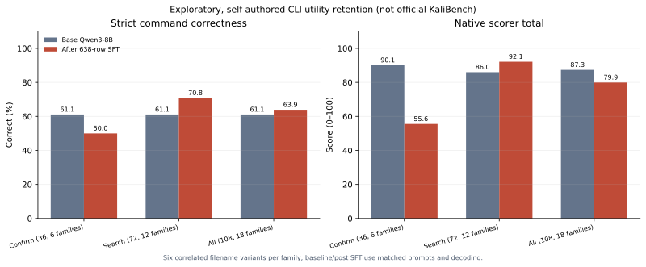

# Qwen3-8B 扩展 SFT 后的通用命令能力检查

## 目的与协议

上一轮用 638 条 KaliBench 官方 **TRAIN** 银标准样本完成了固定数据的一轮 SFT，在同一发布方的内部 DEV64 上，严格正确数从 19/64 增至 22/64。本次检查另一个风险：适配器是否损伤原始模型生成常用 Linux 命令的能力。

在读取本轮 Qwen 输出之前，冻结了一个由我们自行编写、按公开工具文档核对的 **108 题开发集**：`dev_confirm` 36 题（6 个命令意图家族）作为主要诊断，`dev_search` 72 题（12 个家族）作为补充。每个家族有 6 个仅改变文件名等细节的相关变体。原始 Qwen3-8B 与保存的 SFT 适配器使用同一批提示、相同模型版本、NF4 加载、非思考模式、贪心解码和最多 512 个新 token。此轮仅推理，没有再训练、执行生成的命令或读取 KaliBench 官方 TEST。

这些题由项目自行编写，且同一题池以前被**其他模型**查询过。虽然在冻结前没有用这批题查询本轮 Qwen，但它们**不是独立来源的网络安全验证集，也不能用于官方排名**。各家族的 6 个变体彼此相关，不能按 108 道独立题解释统计确定性。

## 配对结果

| 题集 | 严格正确：原始 → SFT 后 | 与参考命令完全一致 | 原生评分器综合分 | SFT 后截断 |
| --- | ---: | ---: | ---: | ---: |
| 主要诊断 `dev_confirm`，36 题／6 家族 | **22/36 → 18/36** | 18/36 → 18/36 | **90.06 → 55.56** | 6 |
| 补充 `dev_search`，72 题／12 家族 | 44/72 → 51/72 | 30/72 → 48/72 | 85.99 → 92.13 | 0 |
| 全部 108 题／18 家族 | 66/108 → 69/108 | 48/108 → 66/108 | **87.35 → 79.94** | 6 |

主要诊断的严格正确配对变化为 **新增 2、失去 6**；全部 108 题为新增 21、失去 18。因此只看全部题目的严格正确数增加 3 道，会掩盖重要退化。原生综合分也从 87.35 降至 79.94。分数只是本项目在这组开发题上调用 KaliBench 原生评分器的诊断结果，并非 KaliBench 官方成绩。

## 错误定位

有 **3 个完整意图家族**从 6/6 严格正确降到 0/6：

- 日志行号：原始模型生成简洁的 `grep -n` 命令；SFT 后的 6 道题都开始罗列大量参数，达到 512-token 上限仍未闭合 `<output>`，属于明显的格式与生成退化。
- 离线 TLS：原始模型使用正确的 TShark 显示过滤器；SFT 后 6 道题均把它变成不合要求的 `-tls` 写法。
- 日志计数：SFT 后 6 道题均额外加入不需要的 `--line-buffered`，导致严格参数评分失败。

另一些家族有提升，包括证书序列号、离线抓包、二进制校验和；故结果是**有得有失，而且错误成簇**。核查本轮 638 条训练样本的参考命令，`grep`、`tshark`、`openssl`、`sha256sum`、`wc`、`head`、`tail`、`jq`、`tcpdump` 均没有直接出现为主工具或命令 token。这与通用命令覆盖不足的假设相容，但**不能单凭此确定因果**；训练数据组成、单轮 SFT 参数以及模型解码行为仍需受控对照。

## 决定与下一步

继续保留原始模型作为对照，**不提升本轮适配器为默认模型**。已经核对过项目现存的 32 条 Linux 夹具通过的通用命令训练样本：它们覆盖 8 个工具、16 个意图家族，Qwen 分词与目标文本往返检查均通过，且与这 108 道诊断题没有完全相同的提问或参考命令。但它们**没有覆盖此次退化的 `grep` 行号、`grep` 计数、TShark TLS 过滤三个具体意图**；原先的行内 XML 目标格式也必须转换为本轮 Qwen 使用的换行标签格式。此前在 RedSage-K 上用这 32 条做回放也没有改善其保持集结果。因此不能把它们直接加入训练并预期修复退化。[静态核查汇总](../results/kali-qwen-utility-retention-2026-10-31/replay-feasibility.json)

下一次训练应先补齐并核查相关意图的样本，再预先冻结同等训练步数的对照、保持能力门槛和评分协议。还需要有来源独立、工具版本明确、经过独立复核的网络安全验证题，才能判断真实领域收益。现有外部 CyBashBench 候选仍未通过此前设定的验证门槛；KaliBench 官方 TEST 留到最终协议。

本次单张 A40 推理约 764 秒，峰值 CUDA 分配约 10.15 GB。运行后已直接核对用户创建的 Job、Pod、ConfigMap 均清理完成。汇总数据、模型版本与协议／回执哈希见[机器可读结果](../results/kali-qwen-utility-retention-2026-10-31/aggregate.json)；原始题目、预测和适配器保留在私有工作目录。
