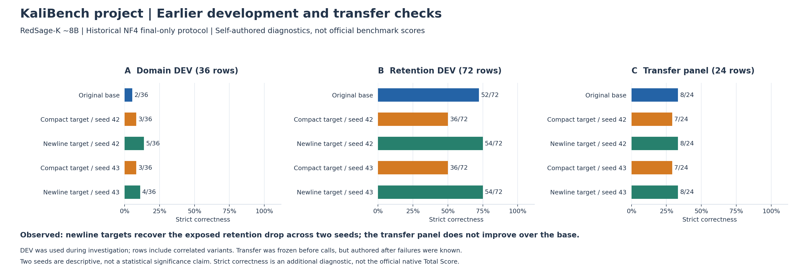
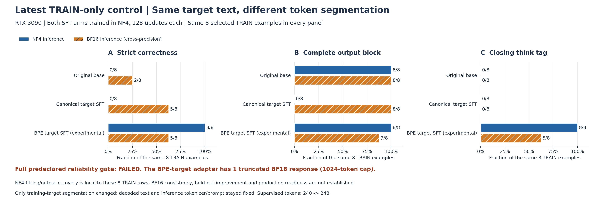
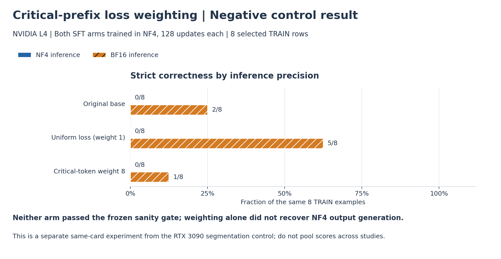

# KaliBench 当前结果图解（截至 2026-10-26）

**结论：历史开发集上的保持能力退化得到局部恢复；最新目标分段实验在 8 道训练题的 NF4 推理中达到 8/8，但完整可靠性检查仍未通过，独立泛化提升尚未证实。正式默认仍保留原底座。**

模型为 `RISys-Lab/RedSage-K-SFT-GRPO`（约 8B）。下面三张图属于不同实验阶段，不能串联成一条统一的模型能力提升曲线。图内使用英文便于组内汇报；所有柱子标出正确题数和分母，百分比坐标保持完整范围。

## 1. 历史开发集：退化恢复，但迁移题没有超过底座



| 条件 | 领域 DEV | 保持能力 DEV | 新迁移题严格正确 |
|---|---:|---:|---:|
| 原底座 | 2/36 | 52/72 | 8/24 |
| 紧凑目标，seed 42 | 3/36 | 36/72 | 7/24 |
| 换行目标，seed 42 | 5/36 | 54/72 | 8/24 |
| 紧凑目标，seed 43 | 3/36 | 36/72 | 7/24 |
| 换行目标，seed 43 | 4/36 | 54/72 | 8/24 |

换行目标使暴露开发集上的保持指标从 36/72 恢复到 54/72，两次种子结果一致；领域指标增幅较小。新迁移题中，修复候选与底座同为 8/24，没有观察到严格正确率提升。

这些是自建、包含相关变体的诊断数据，不是官方 KaliBench 测试。迁移题虽在模型调用前冻结，但在已知错误之后编写，不能视为独立专家验证。这里的严格正确率是附加诊断，并非官方原生 Total Score；两次种子也不足以建立统计显著性。

来源：[seed 复现汇总](../results/kali-seed43-replication-2026-10-25/summary.json)、[初次 CUDA 比较](../results/kali-cuda-2026-10-24/comparison.json)、[换行目标对照](../results/kali-causal-findings-2026-10-25/summary.json)。

## 2. 最新目标编码实验：NF4 局部恢复，BF16 仍有问题



同一 RTX 3090、同样 8 道已用训练题；两个训练组均使用 NF4，每组 128 步，再分别进行 NF4 和 BF16 推理。实验仅改变 `</think>` 在训练目标中的 token 分段方式；完整解码文字、最终命令、原生输入及推理 tokenizer/提示词保持不变。监督 token 总数由 240 增到 248，因而不是完全相同的 token 预算。

| 条件 | NF4 正确 | BF16 正确 | NF4 完整输出块 | BF16 完整输出块 | NF4/BF16 闭合思考标签 |
|---|---:|---:|---:|---:|---:|
| 原底座 | 0/8 | 2/8 | 8/8 | 8/8 | 0/8、0/8 |
| 规范目标训练 | 0/8 | 5/8 | 0/8 | 8/8 | 0/8、0/8 |
| 实验性 BPE 目标训练 | **8/8** | 5/8 | **8/8** | 7/8 | 8/8、5/8 |

“完整输出块”和“闭合思考标签”是不同检查，均不同于答案正确。BPE 目标训练后的 BF16 推理有 1 条达到 1024-token 上限而截断。**预先声明的完整门槛仍失败，没有选中正式候选。** 8/8 表明这些训练题能够局部拟合，不是开发集提升，也不证明唯一根因或正式部署可用。该目标编码属于显式、非规范的实验操作。

来源：[目标分段结果](../results/kali-prefix-control-2026-10-26/same-text-resegmentation.json)、[编码审计](../results/kali-prefix-control-2026-10-26/resegmentation-encoding-audit.json)。

## 3. 关键 token 损失加权：没有解决异常



这是另一张 L4 上的独立同卡对照，两组仍各训练 128 步。均匀损失与关键 token 权重 8 的两种方案，在 NF4 推理中均为 0/8，均未通过原先冻结的可靠性门槛。这个负结果说明单纯提高关键位置的损失权重不足以解决所测异常；不能与 RTX 3090 实验合并计算效果。

来源：[损失加权结果](../results/kali-prefix-control-2026-10-26/matched-control.json)。

## 当前决策与复现

- 保留原底座。先验证训练与推理精度一致的配方，再进行新 DEV 和能力保持评测。
- 本次仅从已有公开汇总绘图，没有新增训练、模型调用、GPU 占用或官方/确认集查询。
- 图中没有误差条或显著性结论；相关样本、适应性开发与协议差异限制了推断范围。
- 本图解中的原始实验数字保持不变；公开脚本核对汇总与文件哈希，不能独立重现未公开的模型输出。

绘图环境：Python 3.12、`matplotlib==3.10.7`。在仓库内执行：

```sh
python scripts/plot-kali-results.py
python scripts/verify-kali-results-figures.py
```

PNG 适合直接阅读，SVG 适合放入汇报或论文后编辑。完整数值与来源哈希见 [plotted-data.json](../results/kali-results-figures-2026-10-26/plotted-data.json)；完整实验说明见[最新结果报告](KALI_PREFIX_CONTROL_RESULT_ZH_2026-10-26.md)。
