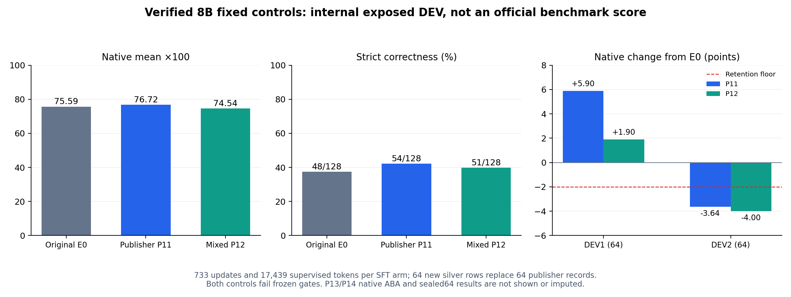

# 8B 新数据对照结果：中间报告

目前两组固定SFT已完成，原生ABA正在运行。以下不是完整搜索或最终确认结果；官方TEST使用量仍为0。

| 模型 | DEV128 strict | DEV128 native均分 | DEV1 native | DEV2 native | 预定门槛 |
| --- | ---: | ---: | ---: | ---: | --- |
| 原始E0 | 48/128 | 0.75593 | 0.75629 | 0.75558 | 保留基线 |
| P11：原733条 | 54/128 | 0.76723 | 0.81524 | 0.71921 | 第二块DEV下降超标 |
| P12：669原数据+64验证银标 | 51/128 | 0.74544 | 0.77529 | 0.71560 | 总分增益及第二块DEV保留失败 |

两组均完成733次真实非零梯度更新，17,439个监督token，144个LoRA张量改变；适配器已回收到本机并核对SHA256，重新装载后的logit最大差为0。格式错误均为0、截断均为0。P12与P11的128条原模型输出完全一致，初始LoRA字节哈希相同；首次不同训练样本出现在第15步，此前14步的loss、梯度范数及监督token记录逐项完全相同。这为本次匹配比较提供了直接一致性证据，并不证明历史运行差异的唯一原因或所有后续步骤具有统计稳定性。

本轮固定对照没有证明新数据有效。相较P11，P12的strict少3题，native均分下降0.02178（按百分制约2.18分）。事后组件分析显示，工具选择、选项F1、位置参数F1分别下降0.01563、0.04114、0.00859；native取三者均值，选项项是其中最大的数值贡献。这不是唯一因果归因。

4种新增工具在DEV中各有1题。P11/P12在这4题上的输出逐字相同，strict均0/4、native指标相同；另124题有22条输出改变，strict为1题改善、4题退步。可观察到的事实是：这套替换策略尚未改善目标题，并影响了其他工具。不能仅凭此区分新增数据内容、移除旧样本、技能组合覆盖不足、训练强度等因素。行为校验通过只证明标签在指定本地环境成立，不保证对未见题目的迁移收益。

两块DEV此前已暴露，并用于诊断和开发；64条新样本也只有32个相关任务族。这些结果不是官方排行榜成绩、独立专家金标或正式模型发布依据。原生ABA仍按冻结方案运行P13/P14，最终选择后再进行一次未查询过的64题内部确认。不能根据中间结果更换训练配方或根据最终64题重新挑模型。

数据与方案见[实验设计](KALI_VERIFIED64_8B_STUDY_2026-11-12_ZH.md)，数值见[当前汇总](../results/kali-8b-verified64-study-2026-11-12/summary.json)、[组件诊断](../results/kali-8b-verified64-study-2026-11-12/DEV-diagnosis-aggregate.json)、[前14步一致性检查](../results/kali-8b-verified64-study-2026-11-12/matched-prefix-consistency.json)。

## 原生运行的当前边界

此前原生运行 `3c8ada198aeb4af9bccb53b4d3ef400f` 完成 Setup/基线验证和两套方案设计，Worker 实际提交了 P13 单 A100 Job；它持续等待且从未分配GPU，随后按资源修订主动取消，记录保留。后继运行采用同型号/同广告驱动的五节点池，尚未产生 P13/P14 更新或成绩。之前的 CPU 控制尝试因 Setup 超时、SSH 就绪/断线处理或服务端响应类型校验失败而结束，均没有启动这两个候选的 GPU 更新；失败和修复均保留记录。当前用脱离 SSH 会话的有限期服务运行安装与控制器，连接中断后继续收集，避免误把 SSH 退出当作训练退出。备用 NRP 控制别名的中性结构化工具调用实测通过；这不是 8B 模型训练结果。

全部四组结束后将检查真实更新数、模型文件哈希、同一原模型输出、seed42 初始化、seed43 差异，以及 P12/P14 第一次更新前的损失/梯度相等，再按预先固定的选择运行一次 final64。完整结果检查器会拒绝目前这种未完成汇总；目前仅绘制两个已完成固定对照的中间结果图，没有最终结果图，也没有完整 ABA 研究成功的声明。

## 已暴露 DEV 的技能覆盖复核（事后分析）

四道目标题共需10个选项组。整套 P11 TRAIN 只覆盖其中2个；新增64条后，整套 P12 TRAIN 覆盖8个，但每个工具都没有训练行同时覆盖该题所需的选项组合。尽管单项覆盖明显扩大，这四题的 P11/P12 输出仍逐字相同、strict 均0/4；因此只能确认“单项示例可执行”不足以保证组合能力迁移，不能把64条行为验证通过当作有效增益证明。仍有2个选项组未覆盖；另外2个工具虽覆盖全部单项，也没有改善。此审计没有调用模型、读取 final64、修改任何训练行或选择规则，也不构成唯一因果证明。后续数据设计应覆盖独立构造的技能组合与特殊参数语义，不应抄入评测答案。见[可复核覆盖计数](../results/kali-8b-verified64-study-2026-11-12/target-skill-coverage-aggregate.json)。

只读精度检查也确认 P11/P12 保存的144个 LoRA张量均为FP32；这只是保存文件的直接证据，不是所有优化器状态的独立证明，也不是唯一退化原因证明。确认衔接现要求原生父进程实际退出后重读最终清理记录，训练、选择规则和 final64评分实现均未改变。

## 单节点排队后的资源修订

P13 原始排队 Job 在取消前为 Pending、无 nodeName、无训练记录，GPU分配和优化更新均为0。已有 P11/P12 不重写、不隐藏。后继 P13/P14 及最终评测允许在5个SDSC节点调度，均为 NVIDIA A100-SXM4-80GB、广告驱动615.71.09，仍为普通优先级、每次1卡，不加入保留节点容忍。资源修订发生在固定对照输出之后、任何ABA更新之前，因而不能再宣称所有组在同一物理节点。数值训练方案、数据、评分和选择门槛未变。原模型DEV128逐字一致、seed42初始化一致和P12/P14首步更新前损失/梯度一致均为强制核对；它们是必要一致性证据，不是完整跨节点复现实验或统计稳定性保证。修订和原始哈希见[协议](../results/kali-8b-verified64-study-2026-11-12/protocol.json)。
