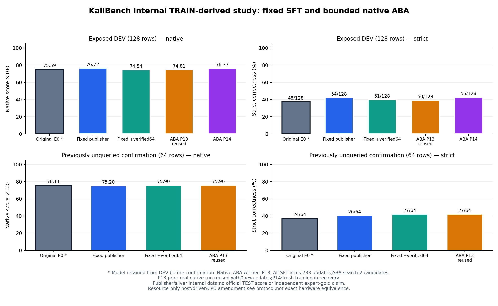

# 8B验证数据与受限原生ABA：完整实验结果

本次四组唯一模型训练、带有显式缓存恢复的原生选择和一次内部64题确认均已完成。P13在前一次原生运行训练/评分/交付；最终恢复运行复用已认证P13，仅P14进行新GPU训练，不能把P13的733步重复计为本轮新训练。实验流程完成与取得可靠增益是两回事；以下不是官方排行榜成绩。

| 模型 | DEV128 strict | native×100 | DEV1 native×100 | DEV2 native×100 | 预定门槛 |
| --- | ---: | ---: | ---: | ---: | --- |
| E0 | 48/128 | 75.593 | 75.629 | 75.558 | 原始基线 |
| P11 | 54/128 | 76.723 | 81.524 | 71.921 | 未通过 |
| P12 | 51/128 | 74.544 | 77.529 | 71.560 | 未通过 |
| P13 | 50/128 | 74.815 | 78.243 | 71.386 | 未通过 |
| P14 | 55/128 | 76.374 | 79.812 | 72.937 | 未通过 |

原生ABA在P13/P14中选择 **P13**；宿主按预先固定的保留规则，与固定对照冠军/原始E0比较后，预选 **E0**。原生搜索不会自动把Setup基线纳入候选，因此两种选择必须分开记录。确认集未参与这次选择。

## 一次内部64题确认

| 模型 | strict | native×100 | 与E0差值（分） | 格式错误 | 截断 |
| --- | ---: | ---: | ---: | ---: | ---: |
| E0 | 24/64 | 76.106 | +0.000 | 0 | 0 |
| P11 | 26/64 | 75.200 | -0.906 | 0 | 0 |
| P12 | 27/64 | 75.897 | -0.209 | 0 | 0 |
| P13 | 27/64 | 75.956 | -0.150 | 0 | 0 |

没有训练候选通过全部预定DEV门槛，继续保留原始E0；本轮未建立可靠的后训练增益。 不按确认题成绩重新选择模型，也不再使用本次确认题调参。

## 可核对的实现与边界

- 每个完成的SFT组实际完成733次非零梯度更新、17,439个监督token，四组有效训练合计2,932次更新；另有一次P13中断至少执行704次更新但没有完整适配器，已弃用、从原始权重重跑。旧任务与重跑在截至704步的全部23个已打印损失/梯度记录点完全相同；这是稀疏进度核验，不是所有步骤或硬件完全等价的证明。这部分失败成本单独披露，不能把2,932称为全部尝试总更新数。有效LoRA文件已回收到宿主并核对哈希。确认任务没有优化器更新或梯度。
- 所有新鲜E0 DEV128输出逐字一致；seed42初始化一致，seed43不同；P12/P14首次更新前的损失/梯度/token记录一致，P11/P12替换前14步记录一致。它们是本次运行的实现一致性证据，不是独立复制实验或统计稳定性保证。
- P11/P12为原SDSC节点、广告驱动615.71.09、CPU2；P13/P14及确认允许同型号A100的13主机池、广告驱动615.71.09/.10，恢复CPU2。此次预算和资源修订发生在固定对照结果及一次弃用的部分P13训练之后、任何训练后候选DEV输出之前；不能声称完全相同硬件。所有新鲜E0、初始化及首步梯度检查仍须通过，实际主机与Pod资源在汇总中保留。
- 新64条仅覆盖4种工具、32个相关任务族，为本地行为验证的AI银标。P12替换了64条原数据；这是替换策略效果，不能单独归因于数据质量。单项可执行不等于组合技能或未见题迁移有效。
- DEV128此前已暴露并用于开发；final64是此前未查询过的同一发布方TRAIN衍生银标，既非独立专家金标，也非官方TEST或来源隔离测试。官方TEST使用量仍为0。
- 原生恢复再次评分2个预注册方案，其中P13是上一真实原生运行的已认证缓存、0次新更新，P14新训练733步。它不是两个全新GPU训练都在最终运行内完成。150轮默认限制保持不变，改为Python内部长等待；到期边界误报超时另有明确源码版本修订，原始哈希备份保留，P14的排队Job未重建，数值训练/数据/评分未修改。
- ABA搜索2个预注册方案，而每个固定对照只有1个方案；不作等搜索预算优越性声明。编排使用NRP托管模型，实际被训练的仍为RedSage-K 8B。

成功训练worker耗时合计约 **1.574 GPU小时**，确认worker约 **0.172 GPU小时**；另有弃用P13的观测分配时间窗口约 **0.755 GPU小时**。成功worker含模型搬运、训练和推理，未含失败尝试；失败窗口从分配至日志结束估算，非精确释放时间。两者均非FLOP或计费测量。

[完整数值与回执](../results/kali-8b-verified64-study-2026-11-12/summary.json) · [协议与资源修订](../results/kali-8b-verified64-study-2026-11-12/protocol.json) · [四组一致性](../results/kali-8b-verified64-study-2026-11-12/four-arm-consistency.json) · [旧中断/重跑日志核对](../results/kali-8b-verified64-study-2026-11-12/discarded-vs-fresh-log-comparison.json) · [控制器客户端版本修订](../results/kali-8b-verified64-study-2026-11-12/controller-client-deadline-amendment.json) · [本轮双候选原生评分审计](../results/kali-8b-verified64-study-2026-11-12/native-score-audit.json) · [实验设计](KALI_VERIFIED64_8B_STUDY_2026-11-12_ZH.md)
