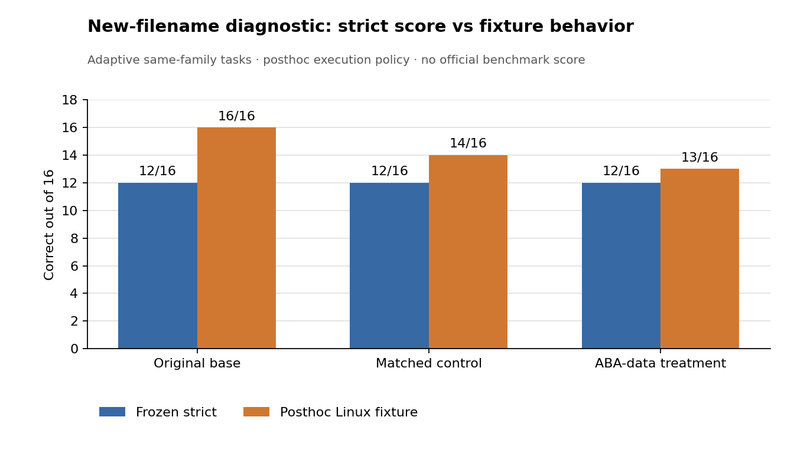
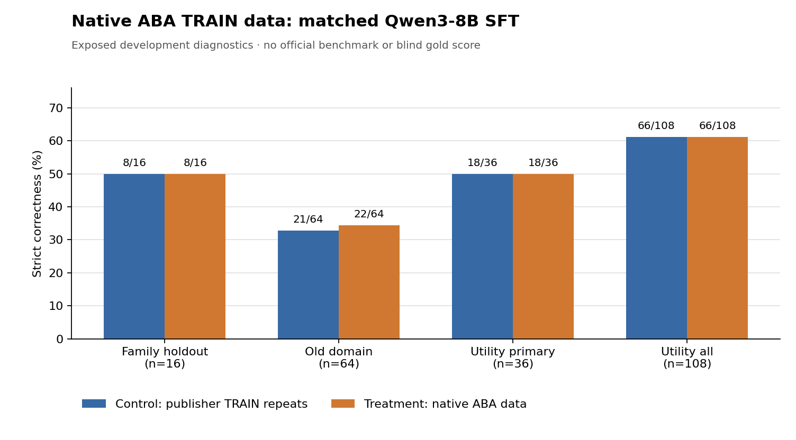
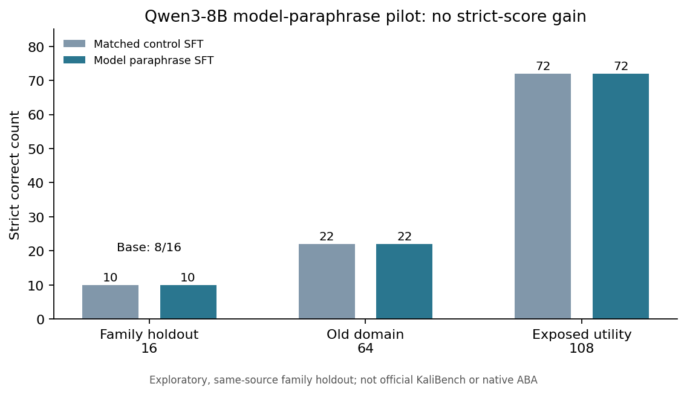
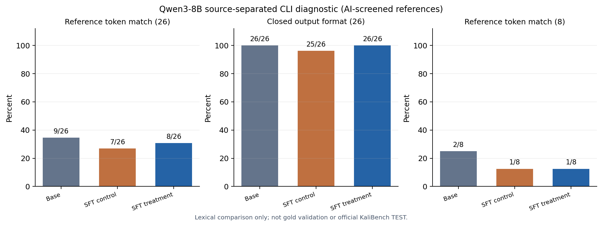
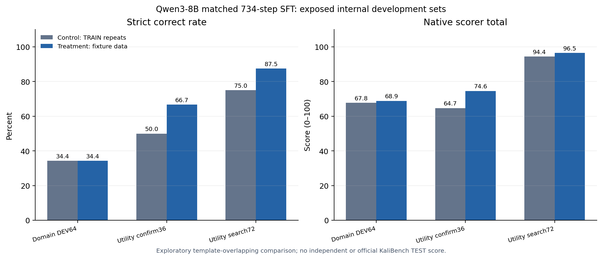

# ABA integration, label quality and replication

[All chapters](../../EXPERIMENT_LOG.md) · [Results catalogue](../../results/README.md)

**Nov 1–11, 2026.** Early ABA runs exposed ambiguous labels, retention regressions and differences between candidate selection and deployment eligibility.

## November 11, 2026 — ABA controller recovery check

The persistent ABA VM is blocked by a cluster storage-controller error. A bounded, PVC-free Linux VM successfully installed the pinned ABA source, completed its owned-tool setup, and passed the systemd/cgroup and bubblewrap prerequisites. A separate pinned-image probe copied and checksum-verified a harmless artifact before VM deletion; all temporary resources were cleaned. These are **environment checks**, with no GPU training, model output, or official TEST use. The next run still needs working model-control and GPU-worker connections plus durable collection of full-size artifacts. I also confirmed in the upstream KaliBench verifier that `PASS_EXECUTED` certifies successful command exit, not semantic correctness, so the P10 source-silver labels remain quarantined. [Recovery note](../../docs/ABA_CONTROLLER_RECOVERY_2026-11-11.md).

## November 11, 2026 — P10 source-label quality gate

P09 timed out while waiting for A100 scheduling, with no training or model outputs. P10 pre-froze a matched 733-step control replacing 14 publisher TRAIN rows with 14 AI-authored source-silver rows while keeping supervised target-token count equal. A bounded Linux CPU check then found only **8/14** commands executable in the available runtime: two `hardlink --cache-size` and four `more --exit-on-eof` labels used options that its installed utilities rejected. AI review also found that two of the `more` labels used the wrong flag for the prompt's form-feed requirement. I cancelled P10 **before GPU scheduling** and cleaned all owned resources. **No P09/P10 model score exists; E0 remains the default; official TEST remains untouched.** None of the 16 AI-authored source-silver rows are admitted to the next GPU run without version and semantic review. [Chinese audit](../../docs/KALI_P10_LABEL_QA_ABORT_ZH_2026-11-11.md) · [Sanitized summary](../../results/kali-p10-label-qa-2026-11-11/summary.json).

## November 11, 2026 — P08 exact-repeat result

P08 repeated P07 with byte-identical 733-row TRAIN payload, the same A100-SXM4 model, optimizer and seeds. It completed **733/733 nonzero-gradient updates** and passed adapter reload checks; all owned GPU resources were cleaned. On the exposed, official-TRAIN-sourced DEV128, native mean was **0.75499 E0 / 0.76543 P07 / 0.76768 P08**, and strict correctness **47 / 55 / 54 of 128**. P07/P08 outputs matched on 119/128 cases, so the small positive direction repeated once, but DEV2 declined in both runs and P08 still lost to E0 on 28/29 previously identified harm cases. The descriptive paired interval includes zero. These are operator controls, not ABA-selected or independent/official TEST gains; **E0 remains the default**. [Chinese result](../../docs/KALI_P08_EXACT_REPLICA_RESULT_ZH_2026-11-11.md) · [Sanitized aggregate](../../results/kali-p08-replica-2026-11-11/aggregate.json).

## November 11, 2026 — P08 exact-repeat protocol frozen

Before any P08 model output, a one-A100 repeat of P07 was frozen with byte-identical training payload and encoded rows, plus the same model, optimizer and inference settings. The only protocol differences are candidate ID and metadata. It will test whether P07's small positive internal-DEV result is reproducible; it remains an operator control on exposed publisher-silver TRAIN development data, with no official TEST or sealed final64 use and no model promotion. The server-side Kubernetes dry run passed. [Chinese pre-run record](../../docs/KALI_P08_EXACT_REPLICA_PREP_ZH_2026-11-11.md).

## November 11, 2026 — repeatable regression mechanism audit

A read-only, aggregate audit identified a concrete interaction behind the recurring positional-score losses. In the 638 original SFT targets, known value-taking flags used a space **432 times** versus an equals sign **9 times**. After training, outputs with out-of-reference flags followed by a space and value rose from **10/128 for E0** to **35–37/128** across P04–P07. The frozen scorer treats the value after an unrecognized flag as an extra positional argument, while `--flag=value` does not create that extra positional token. On **four matched cases**, E0 and every trained arm differ only in this surface syntax after token normalization, with the same score loss in all four trained arms. On the 29 cases harmed in all three prior runs, P07 still produced out-of-reference flags on 25 and extra parsed positionals on 24. Many reference flag groups were absent from same-tool training examples, so this is a combined syntax/scoring and option-coverage problem, not a corrected model. A hypothetical parser counterfactual is diagnostic only; all official and frozen scores remain unchanged. [Chinese cause report](../../docs/KALI_SFT_SYNTAX_ROOT_CAUSE_ZH_2026-11-11.md) · [Aggregate](../../results/kali-sft-syntax-audit-2026-11-11/aggregate.json).

A follow-up source audit found no ready-to-admit new rows in the current screened, publisher-verified TRAIN pool: 925 of 936 rows are already in P07 training/internal DEV/sealed final, while the remaining 11 were excluded by predeclared command-group rules. Eighteen publisher-verified rows outside the screened pool remain held for nonperfect reference/scorer roundtrips and cover none of the missing required flag groups in the recurring harm subset. [Sanitized source-gap aggregate](../../results/kali-source-gap-2026-11-11/aggregate.json).

## November 11, 2026 — P07 exploratory coverage result

The operator-prepared P07 control completed **733/733 nonzero-gradient A100 updates** on 733 publisher-verified TRAIN rows. On the already exposed, official-TRAIN-sourced internal DEV128, strict correctness changed **47 → 55/128** and native mean **0.75499 → 0.76543**; DEV1 improved while DEV2 declined. The descriptive paired interval for the mean difference includes zero, and all 29 cases that had declined in P04/P05/P06 still declined under P07. P07 passed its frozen internal gates but is neither ABA-selected nor independently validated, so **E0 remains the default**. Official TEST and sealed final64 were untouched. [Chinese result and limitations](../../docs/KALI_P07_COVERAGE_RESULT_ZH_2026-11-11.md) · [Sanitized scores](../../results/kali-p07-coverage-2026-11-11/score.json).

## November 11, 2026 — P07 coverage control frozen

After P05 and P06 failed the native-score gate, an operator-prepared P07 control was frozen before any P07 outputs: the prior 638 verified publisher TRAIN examples plus **95** additional verified, command-group-screened examples covering **31 new tools**. All 638 old tokenizations reproduced exactly; all 95 new targets self-scored full under the locked native and strict checks. P07 is limited to one A100 and the already exposed 128-row internal DEV, with official TEST and sealed final64 untouched. It is an exploratory data-coverage control, not an ABA-selected candidate or an independent validation. [Pre-run protocol](../../docs/KALI_P07_COVERAGE_CONTROL_PREP_ZH_2026-11-11.md).

## November 11, 2026 — P06 seed control

The pre-frozen P06 operator control completed **638/638 nonzero-gradient A100 updates** and 128 internal DEV predictions; its adapter reload was exact and all owned resources were cleaned. Changing the data-order seed from 42 to 43 did not recover the native score: E0 **0.75499**, P04 operator control **0.77569**, ABA-selected P05 **0.75252**, and P06 **0.73916**. P06 strict correctness was **48/128** versus E0's **47/128**, but its predeclared native-score gate failed. P04's one-run positive DEV result is not stable evidence; P06 is not ABA-selected, and none of these scores use official TEST. [Chinese report](../../docs/KALI_ABA_P06_SEED_CONTROL_ZH_2026-11-11.md) · [Aggregate](../../results/kali-aba-seed-control-2026-11-11/aggregate.json).

## November 11, 2026 — P05 regression cause audit

A read-only paired audit isolated the observed score regression: relative to the base, P05 improved mean tool score by **0.03906** and option F1 by **0.01018**, but positional F1 fell by **0.05667**, leaving native total **0.75499 → 0.75252**. In 27 of 28 cases with a positional-score decline, the scorer parsed additional positional tokens, often because unrecognized options leave their following values as positionals. P04 and P05 shared the same data, optimizer, model and inference settings, and their base outputs matched 128/128; their trained outputs differed on 18/128, accounting for their entire score difference. Their logged first-step gradient norms already differed, so the exact source of training divergence remains unproven. The 638 supervised targets all self-score 1.0 under the pinned native scorer. E0 remains selected; none of these results are an official TEST score. [Chinese cause audit](../../docs/KALI_ABA_P05_CAUSE_AUDIT_ZH_2026-11-11.md) · [Aggregate](../../results/kali-aba-p05-cause-2026-11-11/aggregate.json).

## November 11, 2026 — native ABA P05 training and frozen development score

After native Setup and reviewer gates passed, ABA selected P05 and its Worker submitted one real A100-SXM4-80GB Job. P05 completed **638/638 nonzero-gradient optimizer steps** and changed 144 LoRA tensors. On two official-TRAIN-sourced internal development panels (128 questions total), strict correctness rose **47/128 → 51/128**, but mean native score fell **0.75499 → 0.75252**. The predeclared native-score-improvement gate failed, so **E0 remains selected and P05 is not promoted**. A separate CPU-only native recovery scored the existing P05 at **−1**, selected E0 at **0**, and delivered four E0 files with exact baseline byte matches; it launched no new GPU Job. The original GPU run and recovery were separate because of a Broker receipt-field error, so this was not one uninterrupted run. P04, an earlier operator-run matched-learning-rate control, reached 54/128 and 0.77569; it was not ABA-selected, and the difference between P04 and P05 has not been isolated. Official TEST and sealed final64 were untouched. These are publisher-silver TRAIN development results, not an official benchmark score or independent validation. [Chinese audit](../../docs/KALI_ABA_PUBLISHER_P05_2026-11-11_ZH.md) · [Sanitized aggregate](../../results/kali-aba-p05-2026-11-11/summary.json) · [Native recovery audit](../../results/kali-aba-p05-2026-11-11/native-recovery.json).

## November 10, 2026 — publisher-TRAIN ABA candidate results

A new operator-run RedSage-K 8B candidate P01 completed 505 real BF16 LoRA updates on publisher-verified KaliBench TRAIN. On two internal TRAIN-sourced DEV panels combined, strict correctness fell **47/128 → 0/128**, native mean total score **0.7550 → 0.2161**, and all 128 P01 responses were a single newline. P01 fails the frozen guard gates and is **not adopted**. [Chinese audit](../../docs/KALI_ABA_PUBLISHER_P01_2026-11-10_ZH.md) · [Sanitized aggregate](../../results/kali-redsage-aba-publisher-p01-2026-11-10/summary.json).

Native ABA then selected P02 (`638` publisher-TRAIN rows, learning rate `5e-6`) and its Worker submitted one real A100 Job after Setup gates passed. The candidate completed **638/638 nonzero-gradient updates**, but internal DEV strict correctness fell **47/128 → 2/128**, native mean total score **0.7550 → 0.2292**, and format errors rose **5 → 126**. P02 is **not adopted**. A Broker receipt-field mismatch stopped that original native run after successful GPU collection. A separate **CPU-only native ABA recovery** revalidated the existing P02 receipt, scored P02 at −1, completed Setup and finalizer verification, and delivered the original E0 zero-step baseline with four byte-identical artifacts. It launched **no new GPU Job**; this is recovery of the earlier trained candidate, not a single clean end-to-end native run or evidence of a training gain. The regression was traced to premature EOS after one newline token. A matched operator-run P04 control changed only the training learning rate to `1e-5`; after an initial unscheduled attempt, it completed 638 updates on an A100-SXM4 and restored the expected output prefix in **128/128** internal DEV responses. P04 strict correctness was **54/128**, native mean **0.7757**, with zero format errors; all five development gates passed. This strongly supports low learning rate as P02's format-collapse trigger, but P04 was **not agent-selected or promoted**, and the modest score gain lacks independent validation. Official TEST and sealed final64 remain untouched. [Chinese result audit](../../docs/KALI_ABA_PUBLISHER_P02_2026-11-10_ZH.md) · [Cause investigation and P04 control](../../docs/KALI_P02_COLLAPSE_CAUSE_AUDIT_ZH_2026-11-10.md) · [Sanitized aggregate](../../results/kali-p02-collapse-cause-audit-2026-11-10/summary.json).

## November 10, 2026 — fresh 64-row RedSage confirmation found mixed results

After the 638-step publisher SFT showed a small gain on one 64-row internal panel, I froze a second disjoint 64-row publisher-TRAIN panel before querying the model on those rows. On the **same A100**, strict option-value correctness was **19/64 base → 22/64 SFT638** (seven gains, four losses), while the official native scoring code's mean total score **fell 0.7537 → 0.7197**. Across the two panels combined descriptively, strict correctness was **47/128 → 52/128** but native mean score was **0.7550 → 0.7510**, with unseen-tool strict correctness **4/12 → 3/12**. Format errors fell **5 → 0**. The second panel was selected after the first result was known; both panels are publisher silver TRAIN, not official TEST or independent expert gold. These mixed metrics do **not** justify promoting the SFT model, and E0 remains the formal default. All personal GPU resources were cleaned. [Chinese result and case audit](../../docs/KALI_REDSAGE_PUBLISHER_CONFIRM64_RESULT_ZH_2026-11-10.md) · [Sanitized aggregate](../../results/kali-redsage-publisher-confirm64-2026-11-10/summary.json).

## November 10, 2026 — publisher-aligned RedSage SFT completed

After finding that C13's eight generic CLI training tools have **zero** screened publisher-verified `PASS_EXECUTED` examples in KaliBench TRAIN, I canceled the pending CyBashBench Job before GPU allocation and switched to the target benchmark. A deterministic 64-row internal holdout was frozen from publisher-verified KaliBench TRAIN before any RedSage output on those rows. It excludes all 638 prospective SFT TRAIN rows and the earlier DEV64 by ID; command groups do not overlap the 638 training rows. The panel has 56 examples with tools represented in the 638-row training set and eight with unseen tools. Gold references are absent from the worker input; all 64 gold commands pass pinned native and strict scorer checks. On the same A100, **base strict correctness was 28/64 and C13 was 23/64** (one gain, six losses); native mean score fell **0.7563 → 0.6452**. The completed Job and all owned resources were cleaned. C13 is **not promoted**. [Detailed Chinese result](../../docs/KALI_REDSAGE_PUBLISHER_HOLDOUT_RESULT_ZH_2026-11-10.md) · [Sanitized aggregate](../../results/kali-redsage-publisher-holdout64-2026-11-10/summary.json) · [Attempt ledger](../../results/kali-redsage-publisher-holdout64-prep-2026-11-10/attempts.json).

The same 638 publisher `PASS_EXECUTED` / `ACCURATE` TRAIN rows were encoded with the pinned RedSage tokenizer and native empty-think completion format: 15,142 supervised tokens, maximum sequence length 520. A separately frozen BF16 LoRA run completed **638 real optimizer steps** on one A100, with 638 nonzero-gradient steps and exact adapter reload probe. On the same 64-row internal holdout, strict correctness was **28/64 base → 30/64 publisher SFT** (three gains, one loss); unseen-tool strict correctness stayed **3/8**. Native mean score rose **0.7563 → 0.7823**, and format errors fell **3 → 0**. The gain is small and comes from publisher silver TRAIN internal holdout selected after earlier development findings; it is not official TEST, independent expert validation, a leaderboard score, or native ABA multi-candidate search. Both A100 Jobs were cleaned; E0 remains the formal default. [Chinese SFT result and case audit](../../docs/KALI_REDSAGE_PUBLISHER_SFT638_RESULT_ZH_2026-11-10.md) · [Sanitized aggregate](../../results/kali-redsage-publisher-sft638-2026-11-10/summary.json) · [Preparation protocol](../../docs/KALI_REDSAGE_PUBLISHER_HOLDOUT_PREP_ZH_2026-11-10.md).

## November 10, 2026 — C13 case audit and canceled external transfer diagnostic

A paired audit of the already exposed DEV72 found **18 gains and 3 losses**. Twelve gains are concentrated in two six-variant `tcpdump` and `wc` groups; all three losses omit required fixed-string `grep -F`. TRAIN and DEV have zero exact normalized question or named template-group overlap, but share the same eight tools and project-authored construction. The frozen C13 gate still fails and E0 remains selected. [Chinese case audit](../../docs/KALI_ABA_C13_PAIRED_AUDIT_ZH_2026-11-10.md) · [Sanitized group counts](../../results/kali-aba-c13-paired-audit-2026-11-10/aggregate.json).

For a separate transfer check, 26 source-separated CyBashBench cases with **provisional AI-screened publisher references** were frozen before RedSage outputs. One inference-only GPU attempt was stopped during slow weight staging, and a west-only attempt waited its 15-minute scheduling limit without a GPU. A third ordinary-priority west-only Job was canceled **before GPU allocation or model output** after a dataset-alignment audit: C13's eight generic CLI training tools have no `PASS_EXECUTED` examples in the screened KaliBench publisher TRAIN source. All three attempts were cleaned. These cases are not independently certified gold and cannot satisfy the project's formal 32-case validation gate. No official KaliBench TEST rows or new optimizer steps were used. The next diagnostic will use a frozen internal holdout from publisher-verified KaliBench TRAIN.

## November 9, 2026 — C13 trained and scored; frozen gate failed

The queued C13 Job eventually ran on one L40S. The frozen RedSage-K 8B recipe completed **240 real optimizer steps**; adapter save/reload matched, and the safe CPU fixture scorer evaluated all 176 development-arm records. On historically exposed DEV72, strict correctness changed **29/72 → 44/72**; retention24 changed **12/24 → 13/24**, with no output truncations. The **pre-frozen conservative gate failed**: its lower-bound DEV gain was **−4** after accounting for 19 unsupported base commands, and only **1** template group passed the conservative positive-gain test (2 required). This promising raw development gain is not independent validation or an official KaliBench score. **E0 remains the default; C13 is not promoted.** The CPU scorer needed an infrastructure-only retry using the official Ubuntu HTTPS base repository; the frozen worker and scoring input were unchanged. All owned GPU and CPU Job resources were cleaned; official TEST use stayed at zero. [Chinese result and limitations](../../docs/KALI_ABA_C13_RESULT_ZH_2026-11-09.md) · [Sanitized aggregate](../../results/kali-aba-c13-2026-11-09/summary.json).

## November 9, 2026 — historical C13 queue submission

After the bounded scheduling diagnostics below, one ordinary-priority C13 training Job was submitted to Nautilus and initially stayed Pending for a compatible GPU. The queue wait was bounded to seven days; actual Pod runtime was capped at one hour, and logs were saved to private persistent storage. At this snapshot it was a resource request without a new result. Its completed outcome is reported above.

## November 9, 2026 — review gate and GPU scheduling follow-up

Two more bounded native ABA attempts reached Setup verification; the reviewer did not finish within its effective time budget, so the independent reviewer gate prevented new training. A short central RTX 4090 probe ran successfully with the same cache PVC, but subsequent C13 training Jobs stayed Pending despite an audited allocation-only revision across compatible GPUs. Two broad C13 attempts each timed out after about 15 minutes; a separate single-A100 100-second probe also remained Pending. **No new optimizer steps, adapter, development score, or official TEST query resulted**. All owned cluster resources were cleaned, the controller VM stopped, and E0 remains the default. [Chinese diagnosis and next conditions](../../docs/KALI_ABA_RESOURCE_AND_REVIEW_FOLLOWUP_2026-11-09_ZH.md).

## November 9, 2026 — controller restored; native ABA blocked by GPU scheduling

A newly created NRP credential passed both model listing and a minimal generation request. A fresh bounded native ABA run passed Setup verification and review, and its designer selected the frozen C13 recipe. The Worker successfully used short `submit` and `wait` calls, resolving the earlier two-minute tool-call mismatch. C13's ordinary-priority A100 Pod remained unschedulable for the 15-minute wait window, so **no new training, candidate score, or official TEST evaluation occurred**. The run was stopped after the failure; all owned Jobs and Pods were removed and the VM stopped. The original E0 model remains selected. [Chinese follow-up](../../docs/KALI_NATIVE_ABA_ASYNC_ATTEMPT_2026-11-09_ZH.md).

## November 9, 2026 — ABA multi-candidate smoke and controller access

Two distinct RedSage-K 8B recipes completed real one-GPU training and safe development scoring. C02 changed DEV strict correctness **28/72 → 29/72** and C04 **28/72 → 26/72**; neither passed the frozen exploratory adoption gate, so the original base remains selected. Both adapters reloaded correctly and all owned cluster jobs were cleaned. A bounded native ABA three-evaluation pilot was prepared, but its first Setup failed before proposing a new candidate because the NRP controller-model generation API returned **HTTP 403**. The token could list models, while minimal generation requests to three aliases were denied. There is **no native multi-candidate search or official TEST result yet**. [Chinese report](../../docs/KALI_ABA_SEARCH_SMOKE_2026-11-09_ZH.md) · [Sanitized aggregate](../../results/kali-aba-search-smoke-2026-11-09/summary.json).

## November 2, 2026 — native ABA recovery audit

A read-only replay of the raw predictions confirmed the prior 8/16 primary strict score for base/control/treatment and 66/108 for both SFT arms on the exposed CLI panel. The same two validation questions drove both SFT arms into 512-token unclosed option loops while the base ended normally; this does not identify a unique cause. A historical 638-row SFT had already produced the same six `grep` utility truncations (base zero), showing the 14 new ABA rows were not necessary for those six failures. All four raw native-ABA `grep` candidate questions used ambiguous “literal word” wording for substring intent, and two entered SFT. A separate, explicitly **posthoc operator-reworded** 16-row diagnostic copy passed 32/32 local safe fixture checks, but has only four templates and **zero rows admitted for future training**. No new model calls, GPU training, independent gold, or official TEST. [Chinese audit and next-run gates](../../docs/KALI_ABA_RECOVERY_AUDIT_ZH_2026-11-02.md) · [Sanitized aggregate](../../results/kali-aba-recovery-audit-2026-11-02/aggregate.json).

## November 2, 2026 — native ABA SFT in-family diagnostic

An adaptive 16-question, same-operation/new-filename CLI diagnostic was frozen before its own model outputs, after the matched SFT result below was known. Base, matched control, and ABA-data treatment each scored **12/16** on the pre-frozen strict metric. A separate **post hoc** CPU-only Linux fixture execution of all 48 generated commands found **16/16 base, 14/16 control, 13/16 treatment** on these specific benign files. The treatment's three `grep -w` outputs missed embedded substrings; two control outputs used invalid `grep` options. The strict score is unchanged. The two frozen-admitted ABA `grep` TRAIN questions used ambiguous “literal word” wording for a substring task; they are quarantined from future training, without asserting causation or rewriting this completed run. This is adaptive, same-family evidence with no independent gold or official TEST; **do not promote the treatment adapter or reuse this 14-row batch as-is**. The existing formal default model choice is unchanged. All GPU and CPU jobs were cleaned. [Chinese report](../../docs/KALI_QWEN_NATIVE_INFAMILY16_DIAGNOSTIC_ZH_2026-11-02.md) · [Sanitized aggregate](../../results/kali-qwen-native-infamily16-2026-11-02/aggregate.json).

## November 2, 2026 — native ABA data entered matched Qwen3-8B SFT

After the native ABA TRAIN candidate pilot below, the **14/16 rows accepted by its frozen fixture** entered a real, matched Qwen3-8B A40 SFT comparison. Both arms shared 638 publisher TRAIN rows and completed 652 optimizer steps from the same initial LoRA weights; control added 14 length-matched publisher repeats, treatment added 14 ABA-generated new-operation rows. Added input tokens were 5,551 vs 5,552 and supervised target tokens were 211 in each arm. On historically exposed development data, strict correctness was **8/16 vs 8/16** on the primary family holdout, **21/64 vs 22/64** on old domain DEV, and **66/108 vs 66/108** on the utility panel. Both arms had two holdout and six utility truncations. The pre-frozen exploratory gain gate failed; **do not promote the treatment adapter**. This closes one data-generation-to-training engineering loop, with no independent gold, official TEST score, or ABA-controlled hyperparameter search. The GPU job was cleaned. [Chinese report](../../docs/KALI_QWEN_NATIVE_ABA652_RESULT_ZH_2026-11-02.md) · [Sanitized aggregate](../../results/kali-qwen-native-aba652-2026-11-02/aggregate.json).

## November 2, 2026 — native ABA TRAIN task-generation pilot

The native ABA controller completed a bounded, CPU-only run in an ephemeral Nautilus VM and delivered **16 new-operation CLI question/command candidates** across `head`, `tail`, `wc`, and `grep`. The operations differ from the eight TRAIN source examples (lines rather than bytes/words; case-insensitive substring rather than case-sensitive whole-line matching). The **frozen TRAIN fixture accepted 14/16**. A separate, explicitly **post hoc** two-fixture audit found that the other two `grep -i -F` commands also behave as requested: the frozen scorer demanded lowercase pattern-token spelling even though `-i` ignores case. The frozen 14/16 score is unchanged. The generated rows still cover only **four tightly constrained intent templates**. At this pilot stage they had not entered SFT; the later matched Qwen3-8B experiment above used the 14 frozen-accepted rows. This data-generation pilot itself did not use official TEST, independent validation, or GPU training and did not establish model improvement. The VM was deleted after artifact collection. [Chinese report](../../docs/KALI_NATIVE_ABA_NOVEL_DATA_PILOT_ZH_2026-11-02.md) · [Sanitized aggregate](../../results/kali-native-aba-novel-2026-11-02/aggregate.json).

## November 2, 2026 — hosted-model TRAIN paraphrase pilot

A hosted model proposed 64 paraphrases of 16 fixture-checked TRAIN seeds across eight CLI tools. After static and semantic-form screening, **42** were used in a matched 680-update Qwen3-8B SFT comparison. On 16 pre-frozen, same-source family-held-out questions, strict correctness was **8/16 base, 10/16 matched control, 10/16 model-paraphrase treatment**; old DEV64 remained **22/64** for both SFT arms, and exposed utility108 remained **72/108**. Treatment reduced utility108 truncations from 6 to 1, but produced one truncation on the 16-question holdout. The predeclared primary gain gate failed, so the adapter was not promoted. A narrow **posthoc**, CPU-only synthetic-fixture check of six strict misses per arm found **4/6 control vs 5/6 treatment** functionally matched fixture output; it does not revise the frozen strict score. This is hosted-model paraphrase data plus fixed SFT, **not autonomous agent search, native ABA automation, or an official benchmark score**. Two bounded native ABA CPU VM starts were blocked by a LINSTOR volume-attach timeout before the controller ran; the VM is stopped. [Chinese report](../../docs/KALI_QWEN_AGENT_DATA680_ZH_2026-11-02.md) · [Main aggregate](../../results/kali-qwen-agent-data680-2026-11-02/aggregate.json) · [Posthoc fixture aggregate](../../results/kali-qwen-agent-data680-2026-11-02/semantic-posthoc.json).

## November 2, 2026 — source-separated AI-only diagnostic

The Qwen3-8B base and both matched 734-step SFT adapters were compared on **26 source-separated CyBashBench CLI questions covering 20 tools**. The provisional publisher references were AI-screened, with no independent human gold signoff. Tokenized exact-reference matches were **9/26 base, 7/26 control, 8/26 treatment**; on the eight cases with some safe-fixture evidence, they were **2/8, 1/8, 1/8**. Treatment recovered the control's one truncated output, but this panel gives **no reliable evidence of cross-tool transfer**. These are lexical, nonofficial diagnostics; no generated commands were executed, no optimizer steps were run, and neither adapter was promoted. [Chinese report](../../docs/KALI_QWEN_EXTERNAL26_AI_DIAGNOSTIC_ZH_2026-11-02.md) · [Aggregate](../../results/kali-qwen-external26-ai-diagnostic-2026-11-02/aggregate.json).

## November 1, 2026 — source-quality correction and larger SFT data dose

An attempted fresh 96-item internal KaliBench TRAIN development panel was **invalidated before any model query**: its publisher terminal labels were 88 runtime errors and 8 timeouts, with zero successful executions. All 936 successful-execution items in our 3,376-item screened TRAIN file were already in the earlier Qwen training/development split. The dependent first 734-step evaluation protocol was canceled, and its GPU attempts produced no model outputs or optimizer steps.

Separately, 96 self-authored `grep`/offline `tshark` training candidates across six correlated intent families passed 96/96 benign Linux fixtures on Nautilus. A revised, explicitly exploratory study compares 734-step Qwen3-8B SFT arms: the same original 638 rows plus 96 length-matched publisher TRAIN repeats, versus plus 96 fixture-checked utility rows. The primary utility and old domain sets are already exposed development data; there is no independent or official TEST evaluation, and no automatic model promotion. [Chinese report and protocol](../../docs/KALI_QWEN_DATA_QUALITY_DOSE_ZH_2026-11-01.md) · [Sanitized aggregate](../../results/kali-qwen-data-quality-2026-11-01/summary.json).

**Completed matched result:** both arms finished 734 updates on one A40. Strict utility confirm improved **18/36 → 24/36** and all utility **72/108 → 87/108**, while old domain DEV64 stayed **22/64 → 22/64** and truncations decreased. The predeclared exploratory gate passed. **All 15 gained utility items fall in three exposed, self-authored template families** that overlap the added training data; this is local template improvement, not independent or official KaliBench generalization. A CPU-only offline command audit found reference-output matches of **0→6/6** for log line numbers, **1→6/6** for log counts, and **0→3/6** for offline TLS, including one control answer the strict scorer missed. No adapter was promoted. [Chinese result and limitations](../../docs/KALI_QWEN_DIVERSE_734_RESULT_ZH_2026-11-01.md) · [Paired aggregate](../../results/kali-qwen-diverse-734-2026-11-01/comparison.json) · [Offline audit](../../results/kali-qwen-diverse-734-2026-11-01/semantic-audit.json).

