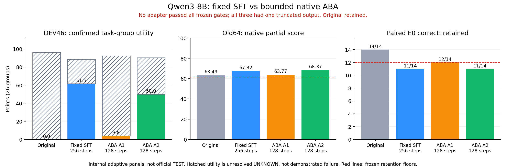
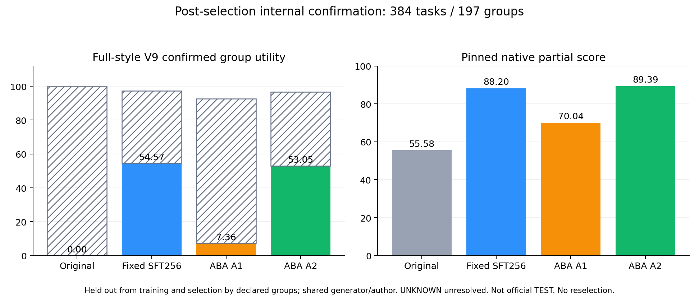
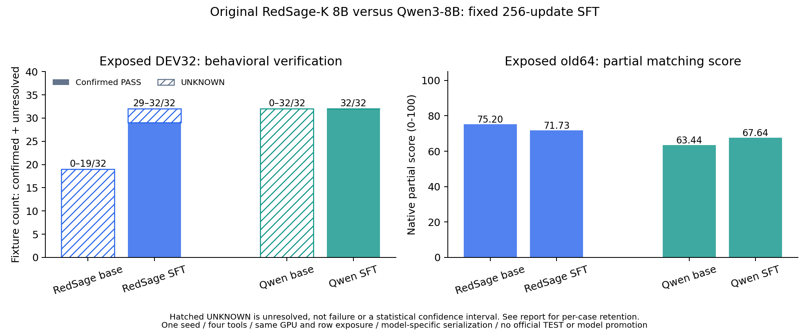
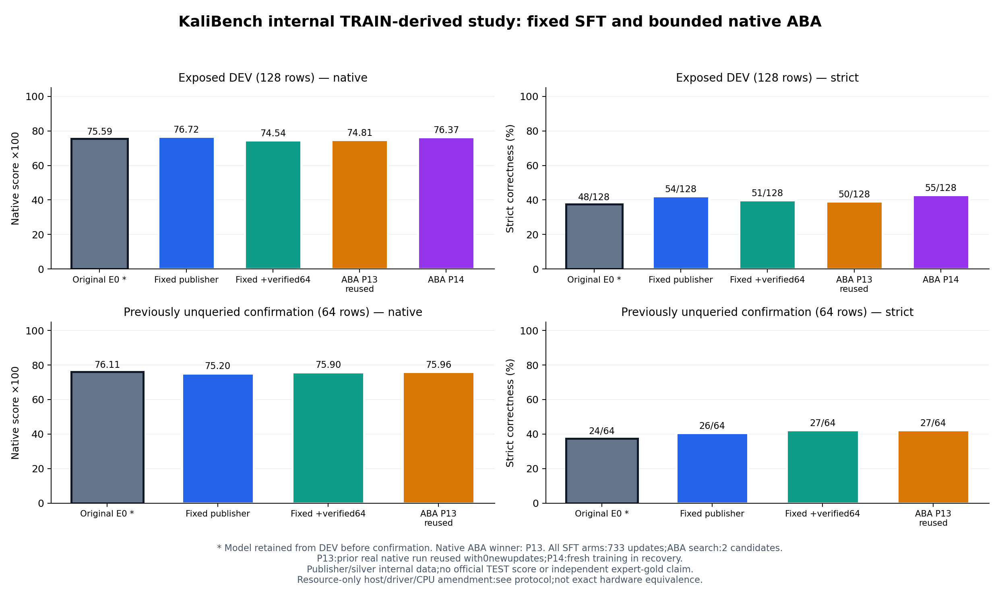

# ABA candidates versus fixed training

[All chapters](../../EXPERIMENT_LOG.md) · [Results catalogue](../../results/README.md)

**Nov 12–15, 2026.** Fixed SFT and ABA candidates were evaluated against frozen retention criteria. Confirmation results and negative findings are recorded alongside the original selection rules.

## November 15, 2026 — native Qwen3-8B ABA versus fixed SFT completed

Expanded selection DEV to **46 tasks / 26 groups / 9 tools** and strengthened old-capability retention with both historical and paired-base correct-case checks. The actual native ABA framework completed **Setup → Designer → two real GPU candidates → scoring → Finalizer**, selecting learning rates `1e-5` and `3e-5`. Both candidates started from original **Qwen3-8B** and trained **128 updates each**; their combined 256 updates and 31,100 target tokens match the previous fixed SFT's total exposure, rather than its per-candidate steps or end-to-end compute. The fixed adapter was reused and reevaluated, not retrained in this round.

**No adapter passed all frozen DEV gates; original Qwen3-8B remains retained.** Fixed SFT and A2 each retained only **11/14** paired-base correct old cases, below the required 12/14; A1 retained 12/14 but still truncated one old response. All three adapters had one truncation on DEV46+old64. Native ABA selected A1 using penalties among ineligible candidates; that selection is **not evidence that A1 beats fixed SFT**.

After freezing selection, all four model states were evaluated once on **384 internal confirmation tasks / 197 groups**, with a stronger full-style oracle. No retraining or reselection used confirmation:

| Frozen model | Internal confirm384 native points | Strict matches | Confirmed group utility | Frozen DEV eligibility |
|---|---:|---:|---:|---|
| Original Qwen3-8B | 55.58 | 0/384 | 0.00 | Pass |
| Fixed SFT, 256 steps | 88.20 | 209/384 | 54.57 | Fail |
| ABA A1, 128 steps | 70.04 | 20/384 | 7.36 | Fail |
| ABA A2, 128 steps | 89.39 | 207/384 | 53.05 | Fail |

A2's slightly higher native partial score did **not** translate into better strict matches or confirmed group utility than fixed SFT. Baseline has 383 unresolved behavior cases and one invalid output; **zero confirmed utility or strict matches does not mean zero semantic ability**. The holdout shares its author/generator and is dominated by PyInstaller and clang-format (308/384); it is **not official KaliBench TEST or an external expert test**. Confirmation truncations were 1/1/2/1 for base/fixed/A1/A2, so retaining the base does not claim error-free outputs.

Completed **2,244 subject-model responses**, including DEV base repeats/reload checks, 1,536 confirmation responses and 32 adaptive DEV decoding diagnostics; native controller turns and CPU checks are separate. Official TEST queries and old final64 requeries stayed at **0**. Sixteen CPU regression tests passed; actual updates, hashes, adapter reloads and delivered native artifacts were verified. One A10 was used sequentially; GPU/CPU Jobs and the native CPU VM are cleaned, with persistent caches and private adapters retained.

[Chinese result, failure analysis and limitations](../../results/kali-qwen-native-aba-2026-11-15/RESULT_ZH.md) · [Machine-readable results](../../results/kali-qwen-native-aba-2026-11-15/summary.json) · [Code and reproduction conditions](../../docs/KALI_QWEN_NATIVE_ABA_2026-11-15_ZH.md) · [Private-generator/public-runtime dependency audit](../../results/kali-qwen-native-aba-2026-11-15/dependency-audit.json).

## November 15, 2026 — original-model SFT comparison completed

Completed the repaired-oracle pilot on **one RTX 3090**, with **256 actual updates per original model**, four verified exported checkpoints, and **912 generation tasks**. On exposed four-tool DEV32, final **Qwen3-8B passed 32/32 fixtures** and **RedSage-K passed 29/32 with 3 UNKNOWN**. Old64 native partial scores changed **63.44→67.64 for Qwen** and **75.20→71.73 for RedSage**; previously strict-correct retention was **11/13** and **16/20**, respectively. Neither model is free of per-case regression.

Qwen is a useful next ABA starting-point candidate under this pilot recipe, while RedSage remains the stronger old-panel reference in absolute score. **Qwen baseline fixture outcomes are all UNKNOWN, not 0% semantic success**; this prevents claiming a proven 32-case behavioral gain. The comparison is one seed, shared four-tool fixtures and model-specific serialization, with **no official TEST, independent confirmation or model promotion**. Pilot compute/scoring Jobs are cleaned; a dedicated 8Gi cache is retained.

[Results, interpretation and limitations](../../results/kali-two-model-sft-2026-11-15/RESULT_ZH.md) · [Machine-readable results](../../results/kali-two-model-sft-2026-11-15/summary.json) · [Frozen numerical protocol and pre-output infrastructure amendments](../../results/kali-two-model-sft-2026-11-15/protocol.json).

## November 15, 2026 — dry-run oracle fixed; two-model pilot prepared

Validated a versioned **hardlink dry-run oracle v6** on util-linux 2.37.2 and uniformly rescored **1,536 saved responses**, with no new model calls. Six Linux regression controls and five local unit tests passed. All eight main replay/KL-stage outcomes were unchanged relative to v5; historical scores are preserved. [Repair and review](../../results/kali-preview-v6-review-2026-11-15/RESULT_ZH.md).

Prepared a fixed **original RedSage-K 8B versus original Qwen3-8B** pilot: fresh LoRA, the same 256 TRAIN rows and update order, 256 planned updates per model, model-specific serialization. **No new model-training result exists at this publication snapshot**; the controller waits for another authorized GPU task. [Frozen protocol](../../results/kali-two-model-sft-2026-11-15/protocol.json) · [Current pilot status](../../results/kali-two-model-sft-2026-11-15/status.json).

## November 15, 2026 — replay/KL diagnostic and implementation review

Three bounded 256-update controls on four authored tool domains completed training and development scoring. Replay-only scored **69.34** on the old native panel with **30/32** new DEV fixture passes; replay+KL scored **75.88** with **29/32**, and stronger KL **77.01** with **28/32**. E0 old native score was **75.20**. The KL arms retained **18/20** previously strict-correct old cases; no arm passed all frozen gates, and the conditional decision is **stop / no promotion**. These are operator controls, not a new native ABA search or official benchmark scores.

Read-only review reproduced **1,152 saved primary-stage predictions' scores** and checked **512 update traces**. It also identified a **dry-run oracle blind spot**: unchanged files and a successful return do not establish correct preview behavior. Existing fixture PASS counts are disclosed with that limitation; frozen scores were not silently rewritten. [Chinese review and next steps](../../docs/KALI_EXPERIMENT_REVIEW_2026-11-15_ZH.md) · [Aggregate results](../../results/kali-functional-review-2026-11-15/summary.json) · [Implementation audit](../../results/kali-functional-review-2026-11-15/implementation-audit.json).

## November 13, 2026 — append versus replay follow-up

Completed the four-arm append-versus-replay diagnostic: all original 733 TRAIN rows retained, 797 actual updates and 19,065 supervised tokens per arm. The appended verified64 effect was -2.417 native points at seed42 and +0.421 at seed43; strict changes were -3 and 0. All four arms failed the frozen DEV panel retention gate, so no model is promoted. A18 completed after an explicitly requested retry of its queue-only failure, preserving numerical protocols and matching A17’s A100 80GB PCIe product. Only exposed DEV128 was evaluated; no official TEST or final64 re-query. [Frozen design](../../results/kali-8b-append64-study-2026-11-13/DESIGN_ZH.md) · [Completed status](../../results/kali-8b-append64-study-2026-11-13/status.json) · [Actual results](../../results/kali-8b-append64-study-2026-11-13/RESULT_ZH.md).

## November 12, 2026 — completed bounded 8B study

Completed **four unique real 8B SFT arms**, with 733 nonzero-gradient updates each, **two native-scored ABA candidates**, and **one frozen 64-example internal confirmation**. Recovery reused previously native-trained, scored and finalized P13 with **0 new updates**; only P14 was freshly trained in the final native run. The native winner was **P13**, while the predeclared DEV retention rules kept **E0**.

On the previously unqueried internal 64-example panel, E0 scored **24/64 strict and 76.11 native points**; P13 scored **27/64 and 75.96**. Strict correctness increased, but native score did not. No trained candidate is promoted, and **reliable improvement has not been established**. Official TEST queries: **0**. These are publisher-TRAIN/silver internal results, not leaderboard scores.

[Detailed results and limitations](../../docs/KALI_VERIFIED64_8B_RESULT_2026-11-12_ZH.md) · [Machine-readable results](../../results/kali-8b-verified64-study-2026-11-12/summary.json). Resource amendment and controller recovery remain disclosed in the frozen protocol.

The dated entries below are historical snapshots; earlier statements about pending work describe their status at that time. The completed study and current decision are reported above.

## November 12, 2026 — behavior-verified TRAIN supplement

I froze **64 new authored TRAIN rows across 32 task families and four tools** after actual Linux behavior checks and paired wrong-command checks. Four of 68 candidates remain quarantined. All 64 admitted labels self-score 1.0 with the pinned native scorer and pass RedSage prompt masking, think-prefix/EOS round-trip and no-truncation checks. These are exploratory, AI-authored local-runtime silver labels; no new LLM training or independent gain is claimed. [Chinese report and reproduction](../../docs/KALI_BEHAVIOR_TRAIN_2026-11-12_ZH.md) · [TRAIN data](../../data/kali-behavior-train-2026-11-12/train.jsonl) · [Manifest](../../results/kali-behavior-train-2026-11-12/manifest.json).

A single native ABA run now completed **Worker → real GPU Job → native scoring → Finalizer delivery**, with **256 CUDA updates** on a synthetic eight-token model. Local rescoring matches the native result, delivered files match the trusted client output, 64 MiB artifact recovery passed, and all owned run resources were cleaned. This verifies the engineering path; new 8B SFT and KaliBench gains remain for the next stage. [Verified runtime report and reproduction](../../docs/ABA_RUNTIME_REPAIR_2026-11-12_ZH.md) · [Receipt](../../results/aba-native-gpu-smoke-2026-11-12/verified-summary.json).

## November 12, 2026 — remaining TRAIN source survey

A read-only, split-safe check found only **3** publisher TRAIN records matching option groups absent from P07 training on repeatedly harmed development tools; all three have `PASS_RUNTIME_ERROR` rather than successful execution, so **none is directly admitted**. Three existing authored pools (108, 156, and 32 rows) have zero matching tool-and-option-group overlap. This narrows the next step to new behaviorally verified, diverse TRAIN data before another GPU comparison. No official TEST, new model output, or GPU was used. [Chinese audit](../../docs/KALI_PUBLISHER_REMAINDER_AUDIT_2026-11-12_ZH.md) · [Aggregate](../../results/kali-publisher-remainder-2026-11-12/aggregate.json).

A separate bounded CPU-only namespace probe found 5 of the 19 repeatedly harmed tools in the pinned training image; 14 need a different validation runtime. Its Job and ConfigMap were cleaned. [Tool availability](../../results/kali-publisher-remainder-2026-11-12/tool-availability.json).

## November 12, 2026 — P10 label disposition frozen

A bounded CPU-only check identified the pinned runtime as util-linux 2.37.2 and tested `hardlink --dry-run --exclude` against harmless duplicate files. Of 16 AI-authored source-silver rows, **2** now have local-runtime behavioral fixture support and are eligible only for exploratory training; **14** remain quarantined for ambiguous task scope, missing behavioral evidence, unsupported options, semantic mismatch, or an absent tool. Two related rows are too narrow for a useful GPU comparison, so no new model was trained or promoted. Official TEST remains untouched. [Chinese audit](../../docs/KALI_P10_SEMANTIC_QA_2026-11-12_ZH.md) · [Aggregate](../../results/kali-p10-semantic-qa-2026-11-12/summary.json).
