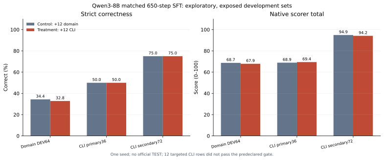
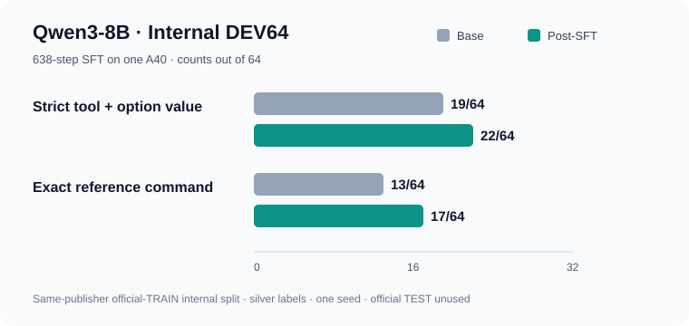
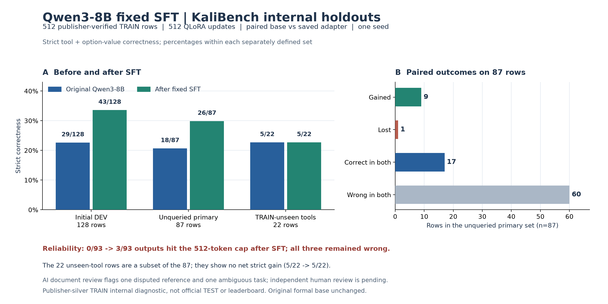
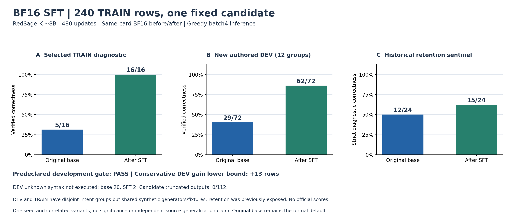
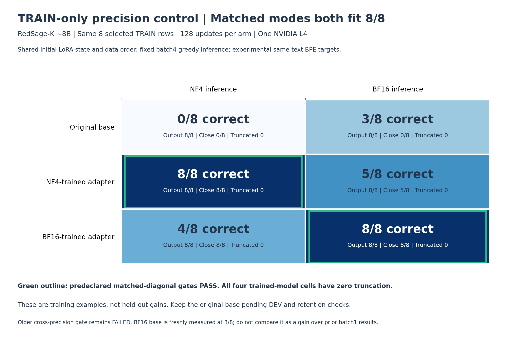
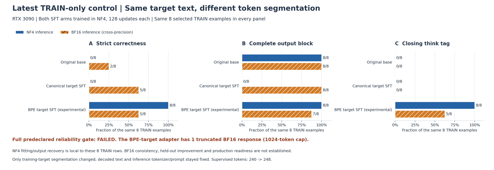

# Fixed SFT, output format and retention

[All chapters](../../EXPERIMENT_LOG.md) · [Results catalogue](../../results/README.md)

**Oct 24–31, 2026.** Qwen3-8B improved on an internal development set. Changes in command format, label quality and the mix of training examples motivated checks on utility and unseen tools.

## Previous controlled result — October 31, 2026

**Latest controlled SFT result:** a one-A40, 650-step-per-arm comparison kept the same 638 original KaliBench TRAIN rows and initial Qwen3-8B LoRA state. The control added 12 length-matched repeats of domain TRAIN rows; treatment added 12 self-authored, documentation-grounded CLI rows that passed fixed Linux fixtures. On **previously exposed development sets**, treatment scored **21/64 vs control 22/64** strict on domain DEV64 and **18/36 vs 18/36** on the primary CLI panel. Both arms had zero truncations and the three previously regressed CLI families remained **0/6 each**. Read-only failure audit found matching prompt templates and correctly encoded targets; targeted examples contributed only 1.85% of updates, a possible but unproven explanation for the missing gain. The predeclared exploratory gate **failed**; neither adapter is promoted. This is fixed-data SFT, not ABA, independent cyber validation or official KaliBench evaluation. [Chinese report](../../docs/KALI_QWEN_TARGETED_REPLAY_650_ZH_2026-10-31.md) · [Aggregate and chart](../../results/kali-qwen-targeted-650-2026-10-31/summary.json).

**Scorer versus execution audit:** on one fixed offline Linux fixture, all 18 references executed successfully. The strict scorer assigned 0/6 to `grep` log counting for both arms, but the control produced the reference output on **6/6** cases while treatment produced it on **0/6**; treatment used an unrecognized `--literal` flag. The other two previously regressed families produced the reference output on 0/6 in both arms. This narrow fixture does not replace benchmark scoring; the SFT gate remains failed. [Sanitized execution aggregate](../../results/kali-qwen-targeted-650-2026-10-31/semantic-audit.json).

**Earlier Qwen utility retention check:** a frozen, self-authored 108-question CLI development panel was run on one A40 using the same Qwen3-8B base and saved 638-row SFT adapter. On the primary 36-question subset, strict correctness **fell from 22/36 to 18/36**; six correlated `grep -n` cases ran to the 512-token cap without closing the output. Across all 108 questions strict correctness rose only **66→69**, while the native diagnostic total **fell 87.35→79.94**. This is a narrow exploratory development check, not independent-source cybersecurity validation or an official KaliBench score; the adapter remains unpromoted. That earlier check used inference only and no official TEST. [Chinese result](../../docs/KALI_QWEN_UTILITY_RETENTION_ZH_2026-10-31.md) · [Aggregate and chart](../../results/kali-qwen-utility-retention-2026-10-31/aggregate.json).

**External validation gate:** a private 31-case CyBashBench review packet and blank independent-review form are ready. Six cases still depend on context or tool version; no cases have independent human signoff, and the 32-case minimum remains unmet. A pinned 300-question NL2SH-ALFA test file was examined only for provenance and exact overlaps; it is reserved as a future general Bash retention check, not used for model selection or cybersecurity validation. [Chinese next-stage report](../../docs/KALI_EXTERNAL_VALIDATION_GATE_ZH_2026-10-31.md) · [Sanitized summary](../../results/kali-external-validation-gate-2026-10-31/summary.json).

**External review V2:** one lower-provenance, same-source CyBashBench `nl2bash` item was added to the **review queue**, bringing it to 32 candidates. It is explicitly an adaptive supplement; it adds no source diversity. The merged blank-review gate reports **0 independent human signoffs, 0 verified tool versions, and NOT_ADMITTED**. No model queried these items. [Chinese review status](../../docs/KALI_EXTERNAL_REVIEW_V2_ZH_2026-10-31.md) · [Aggregate](../../results/kali-external-review-v2-2026-10-31/summary.json).

**External review V3 (November 1):** documentation-aided AI review of V2 found two more clear question/reference mismatches and nine cases needing context. After removing the two, six security-adjacent `misc` cases from the same pinned source were added to a **36-case adaptive review queue**. This is still **NOT_ADMITTED**: 0 independent human signoffs and 0 verified target tool versions. The initial static triage used no model, training, official TEST, GPU, or publisher-command execution. [Chinese case audit](../../docs/KALI_EXTERNAL_CYBASH_REVIEW_V3_ZH_2026-11-01.md) · [Sanitized aggregate](../../results/kali-external-review-v3-2026-11-01/summary.json).

**Safe Linux spot checks:** the first bounded CPU-only Nautilus Job passed 10/10 synthetic tool-behavior checks and was cleaned up. These support narrow observations for 11 review items, including the `strings` length boundary and `sort` chronology error; none constitutes independent semantic signoff. No GPU, model, official TEST, live capture, external scan, or untrusted `ldd` was used. [Sanitized receipt](../../results/kali-external-review-v3-2026-11-01/linux-safe-fixtures.json).

**AI-only diagnostic branch:** at Minhao's request, all 36 V3 cases received AI-assisted triage without human review. Ten ambiguous cases were excluded from a **26-case, 20-tool provisional diagnostic**. Two bounded CPU-only Jobs passed **20/20** synthetic checks; 13/26 provisional cases have some narrow fixture evidence. These labels remain unverified publisher references, so this derivative is for qualitative debugging, not formal validation or model selection. No candidate model or official TEST was queried. [Chinese protocol and result](../../docs/KALI_CYBASH_AI_ONLY_DIAGNOSTIC_ZH_2026-11-01.md) · [Sanitized aggregate](../../results/kali-external-review-v3-2026-11-01/ai-only-diagnostic.json) · [Second CPU receipt](../../results/kali-external-review-v3-2026-11-01/linux-safe-fixtures-extended.json).

**Publisher TRAIN coverage:** a read-only audit of all 3,504 official KaliBench TRAIN rows found zero direct examples of 12 common CLI tools examined in the utility-retention study, including `grep`, `tshark`, `openssl`, and `nmap`, under both publisher `tool_name` and executable-first-token counts. This is a coverage observation, not a causal diagnosis or official TEST result. A limited second-source survey found no immediately admissible, task-matched external cyber panel among the sources checked. [Chinese report](../../docs/KALI_TRAIN_COVERAGE_AND_SOURCE_SURVEY_ZH_2026-11-01.md) · [Coverage aggregate](../../results/kali-train-tool-coverage-2026-11-01/summary.json).

**Expanded Qwen result:** after unsuccessful bounded GPU scheduling attempts, one A40 Job completed the frozen 638-row/359-tool SFT with 638 optimizer steps. On a fresh, same-publisher official-TRAIN internal DEV64, strict tool/option correctness changed **19/64 → 22/64** (4 gained, 1 lost); exact reference command changed **13/64 → 17/64**. This is a modest, one-seed silver-label development result, **not an official KaliBench score or independent-source validation**. No official TEST or ABA-generated training data were used; the adapter is not automatically promoted. [Chinese result and limitations](../../docs/KALI_QWEN_EXPANDED_A40_RESULT_ZH_2026-10-30.md) · [Aggregate](../../results/kali-qwen-expanded-a40-2026-10-30/summary.json) · [Earlier scheduling report](../../docs/KALI_QWEN_EXPANDED_TRAIN_PREP_ZH_2026-10-30.md).

**External validation intake update:** case-by-case AI static triage of the 36 proposed CyBashBench-source questions found five clear task/reference mismatches and six context-dependent cases. Removing only the five clear mismatches leaves **31 questions**, below the predeclared 32-question minimum; the unchanged gate returns **NOT_ADMITTED**. This subset will not be treated as a frozen holdout. AI review is not independent human signoff; no model queries, GPU jobs, command executions or official TEST access occurred. Existing model decisions are unchanged. [Chinese audit](../../docs/KALI_QWEN_EXTERNAL_LABEL_AUDIT_ZH_2026-10-30.md) · [Sanitized aggregate](../../results/kali-qwen-external-ai-audit-2026-10-30/summary.json).

A fixed 512-step NF4 QLoRA SFT run adapted **Qwen3-8B** using 512 publisher-verified KaliBench official-TRAIN examples. The same saved adapter was then compared with the unchanged base under a matched inference protocol. All sets below are **internal splits of official TRAIN**, with publisher silver labels; these are **not official benchmark or leaderboard scores**.

| Strict tool + option-value diagnostic | Original Qwen3-8B | After fixed SFT | Reading |
| --- | ---: | ---: | --- |
| Initial internal DEV | 29/128 | 43/128 | Positive pilot signal |
| Previously unqueried, command-group-separated primary DEV | 18/87 | 26/87 | 9 gained, 1 lost |
| TRAIN-unseen tools within the primary 87 | 5/22 | 5/22 | No net cross-tool gain |

**Reliability limit:** three post-SFT outputs among all 93 previously unqueried inputs hit the 512-token cap and repeated content; the base had none. This is one training seed, with no independent-source blind validation or official TEST use. ABA automated data generation/search has **not** been run in this Qwen study. The original RedSage-K remains the formal default; the Qwen adapter is a candidate under review.

One initial DEV prompt contained its reference command; excluding it leaves strict correctness **28/127 → 42/127**. The separately selected 87-row primary set has no prompt-embedded reference commands or exact normalized tool-plus-command overlap with the prior TRAIN/DEV sets. Semantic near-duplicates remain possible.

**Preliminary source review:** of the nine automatically scored gains on the primary set, seven are supported by tool documentation, one reference (`lvmconfig`) conflicts with its tool manual, and one (`hardlink`) needs task interpretation. Excluding only the disputed reference yields **18/86 → 25/86** as a sensitivity check; it does not replace the frozen automatic **18/87 → 26/87** result. No independent human semantic signoff has occurred. [Review summary](../../results/kali-qwen-confirmation-2026-10-28/source-review-summary.json).

**TRAIN data audit:** all 512 SFT records match the frozen publisher-verified files and target format. They span 275 tools, but 165 tools have only one example; 14 records share five normalized tool-command groups. This is a read-only static audit, with **0 independently human-reviewed labels** and no new model run. [Chinese audit](../../docs/KALI_QWEN_TRAIN512_DATA_AUDIT_ZH_2026-10-28.md) · [Sanitized aggregate](../../results/kali-qwen-train512-audit-2026-10-28/summary.json) · [Next experiment draft](../../docs/KALI_QWEN_NEXT_EXPERIMENT_PROTOCOL_DRAFT_ZH_2026-10-28.md).

An exploratory breakdown of the already queried 87-row set shows strict correctness **5→5** for 22 tools unseen in training, **9→12** for 37 rows whose tool appeared once, and **4→9** for 28 rows whose tool appeared at least twice. This is post hoc and cannot establish a causal coverage effect. [Aggregate breakdown](../../results/kali-qwen-train512-audit-2026-10-28/coverage-posthoc.json).

**October 29 receipt-screen ablation:** a TRAIN-only check found 111/512 publisher `PASS_EXECUTED` receipts with environment-failure text or truncated output, despite zero exit codes. This is a review cue, not proof of bad command labels. A separate 401-unique-row, 512-step SFT candidate completed on one RTX3090 but scored **39/128** versus the original adapter's **43/128** on the same already exposed internal DEV; its post-training exact-command count was **32 vs 36**, with **1 vs 0** truncations. Screening removed all examples for 43 tools. Keep the original adapter; do not promote the screened candidate. [Chinese report](../../docs/KALI_QWEN_RECEIPT_SCREEN_ZH_2026-10-29.md) · [Aggregate comparison](../../results/kali-qwen-receipt-screen-2026-10-29/comparison.json).

**October 29 AI source-review pilot:** seven TRAIN references with documented task/command conflicts were provisionally quarantined; 505 unique publisher-TRAIN rows then entered a real 512-step Qwen SFT run. On the same exposed internal DEV128, strict correctness was **44/128**, versus **43/128** for the original adapter and **39/128** for the blanket receipt screen. Exact gold-command matching was **36/128** for both the new and original adapters; native total score was slightly lower for the new one (**68.74 vs 69.10**). The remaining 42 receipt-flagged and 401 other rows are uncertified publisher silver, human signoffs remain **zero**, and there is no blind-source result. This is a development ablation, not a model promotion or official benchmark score. [Chinese review and result](../../docs/KALI_QWEN_AI_REVIEW_ZH_2026-10-29.md) · [Aggregate comparison](../../results/kali-qwen-ai-review-2026-10-29/comparison.json).

**Next-stage preparation:** a private 52-case independent-review packet is ready (10 priority, 42 follow-up). A pinned, external CyBashBench source yielded 36 deduplicated command-generation review candidates across 24 tools, with no detected exact or high-similarity overlap against prior Qwen TRAIN/DEV records. All 36 still lack independent command-label review and target-version checks, so the gate reports **NOT_ADMITTED**: this is not a frozen blind holdout or a new model result. No additional model calls, GPU jobs or KaliBench official TEST use. [Chinese intake report](../../docs/KALI_QWEN_NEXT_GATE_ZH_2026-10-29.md) · [Aggregate](../../results/kali-qwen-next-gate-2026-10-29/summary.json).

[Full Chinese result and error audit](../../docs/KALI_QWEN_UNQUERIED_CONFIRMATION_ZH_2026-10-28.md) · [Public aggregate](../../results/kali-qwen-confirmation-2026-10-28/summary.json) · [Figure source](../../scripts/plot-kali-qwen-confirmation.py) · [Reproduction scope](../../docs/REPRODUCTION.md). Check the public arithmetic and figure hashes with `python3 scripts/verify-kali-qwen-confirmation-public.py`. Raw questions, predictions, labels, model weights and the adapter are not in this repository.

## Experiment log (newest first)

The dated entries below preserve earlier engineering work and negative results. Read the current result above for the latest model decision.

## October 30 — expanded Qwen SFT frozen, GPU scheduling unsuccessful

Prepared 638 unique publisher-TRAIN rows and a new internal DEV64 before any new model output. Three sequential bounded single-GPU requests remained Pending and were cleaned; training and evaluation did not execute. [中文报告](../../docs/KALI_QWEN_EXPANDED_TRAIN_PREP_ZH_2026-10-30.md) · [Aggregate](../../results/kali-qwen-expanded-prep-2026-10-30/summary.json).

## October 30 — external candidate label audit

Audited all 36 fixed CyBashBench-source candidate labels without executing their commands or querying a model. Five clear mismatches make the original 32+ row external panel infeasible without new reviewed source data. The 31-row exclusion derivative still fails admission; no blind holdout was frozen. [中文报告](../../docs/KALI_QWEN_EXTERNAL_LABEL_AUDIT_ZH_2026-10-30.md) · [Aggregate](../../results/kali-qwen-external-ai-audit-2026-10-30/summary.json).

## October 29 — independent-review packet and external-source intake gate

Prepared a private 52-case evidence packet and blank human review form; no signatures were inferred. Screened a pinned public CyBashBench task file down to 36 external-source NL-to-command candidates and ran a static, no-execution overlap gate against existing Qwen TRAIN512, DEV128 and exposed DEV93. No exact or thresholded near overlaps were found, but all 36 remain unadmitted because command semantics/tool versions have not been independently reviewed. This panel is a potential secondary transfer check, not a KaliBench domain blind set. [中文报告](../../docs/KALI_QWEN_NEXT_GATE_ZH_2026-10-29.md) · [Aggregates](../../results/kali-qwen-next-gate-2026-10-29/summary.json).

## October 29 — AI source review and 505-row development SFT

Reviewed the 111 receipt-flagged TRAIN records against primary tool documentation without running benchmark commands. Kept 62 under a tool-name-to-documentation screen (not per-case semantic certification), provisionally quarantined seven with case-specific source conflicts, and left 42 environment-confounded cases unresolved; the other 401 records were not independently reviewed. A bounded one-RTX3090 512-step SFT on the 505-row derivative completed and cleaned its GPU resources. Exposed internal DEV strict correctness was **29/128 before → 44/128 after**, one more than the original 512-row adapter, but exact gold-command matching stayed **36/128** and native total score was lower. No independent human signoff, official TEST use, blind validation, automatic promotion, or ABA data generation. [中文报告](../../docs/KALI_QWEN_AI_REVIEW_ZH_2026-10-29.md) · [Aggregates](../../results/kali-qwen-ai-review-2026-10-29/comparison.json).

## October 29 — terminal-receipt screen and negative SFT ablation

Audited publisher TRAIN terminal receipts without executing their commands. Kept 401/512 records lacking specified environment-failure cues and held 111 for effect review; zero independent human verdicts. The resulting finite 512-step Qwen SFT run used 401 unique rows, with 111 repeated once. It reduced tool coverage from 275 to 232 and scored **39/128** strict on reused internal DEV, below the original 512-unique-row adapter's **43/128**. Baseline responses were identical. Five rows favored the original adapter and one the screened adapter; source-level AI checks suggest the sole screened gain may be an automatic-scoring false positive. No official TEST, independent-source validation or model promotion. [中文报告](../../docs/KALI_QWEN_RECEIPT_SCREEN_ZH_2026-10-29.md) · [Aggregates](../../results/kali-qwen-receipt-screen-2026-10-29/comparison.json).

## October 28 — Qwen3-8B TRAIN512 static audit and review preparation

Rechecked the frozen 512-row publisher-verified official-TRAIN SFT set without running commands or model inference. All targets have the expected envelope; 512 normalized questions are unique, with 503 normalized tool-command groups. Five questions explicitly contain their reference command; these are review cues rather than proven leakage. A private all-row review queue, priority 64, deterministic sample 32, and blank independent 13-case adjudication form are ready. No human signoff, new SFT, official TEST, or independent-source result occurred. [中文数据审计](../../docs/KALI_QWEN_TRAIN512_DATA_AUDIT_ZH_2026-10-28.md) · [Aggregate](../../results/kali-qwen-train512-audit-2026-10-28/summary.json) · [Protocol draft](../../docs/KALI_QWEN_NEXT_EXPERIMENT_PROTOCOL_DRAFT_ZH_2026-10-28.md).

## October 28 — Qwen3-8B unqueried internal DEV confirmation

Froze 93 previously unqueried KaliBench official-TRAIN internal DEV inputs before generating any outputs. The predeclared primary 87 exclude six normalized tool+gold-command groups shared with earlier DEV and contain no prompt-embedded gold commands. With the same Qwen3-8B base and saved adapter, strict correctness rose **18/87 → 26/87** (9 gained, 1 lost); exact command matching rose **14/87 → 22/87**. Among 22 primary rows whose tools were absent from the 512-row TRAIN set, strict correctness stayed **5/22 → 5/22**. Mechanical case triage found three new 512-token repetitive truncations; independent semantic review is pending. This is a one-seed silver-label internal holdout result, not official TEST, external validation, or ABA. The original formal default remains unchanged. [中文复测与误差审计报告](../../docs/KALI_QWEN_UNQUERIED_CONFIRMATION_ZH_2026-10-28.md) · [Aggregate results](../../results/kali-qwen-confirmation-2026-10-28/summary.json) · [Mechanical triage](../../results/kali-qwen-confirmation-2026-10-28/mechanical-triage.json). Offline check: `python3 scripts/verify-kali-qwen-confirmation-public.py`.

## October 28 — Qwen3-8B publisher-TRAIN SFT cycle completed

Ran a matched, one-RTX3090 NF4 QLoRA baseline → 512-step SFT → internal-DEV evaluation on 512/128 publisher-verified KaliBench TRAIN rows. Strict option-value correctness rose **29/128 → 43/128**; exact command matching rose **25/128 → 36/128**. Paired strict transitions: 17 gained, 3 lost. One DEV prompt embeds its gold command; excluding it gives 28/127 → 42/127 strict. The saved adapter was SHA-256 verified on the PVC and all owned Jobs/Pods/ConfigMaps were cleaned. This is a one-seed **official-TRAIN internal development** result, not official TEST, external validation, an ABA search, or a promotion decision. [中文结果报告](../../docs/KALI_QWEN_OFFICIAL_SFT_RESULT_ZH_2026-10-28.md) · [Aggregate results](../../results/kali-qwen-official-executed-pilot-2026-10-28/cycle-summary.json).

## October 28 — publisher-verified KaliBench TRAIN pilot for Qwen3-8B

Replaced the pending-review synthetic rows for this second-base pilot with publisher-verified KaliBench TRAIN records. After the existing scorer-consistency screen, 936 records have the stronger terminal `PASS_EXECUTED` label; a fixed group split selected 512 TRAIN and 128 internal DEV rows with no exact query or canonical-command overlap. Qwen-native encoding passed 512/512 prompt-masking and target/EOS checks; DEV inputs contain no gold. These are publisher-verified **silver** labels, not independent expert gold. **No weights were downloaded, model run, GPU job, optimizer step or official TEST evaluation occurred in this preparation.** [中文报告](../../docs/KALI_QWEN_OFFICIAL_TRAIN_PILOT_ZH_2026-10-28.md) · [Aggregate receipt](../../results/kali-qwen-official-executed-pilot-2026-10-28/summary.json).

## October 28 — Qwen3-8B TRAIN encoding and review packet

Prepared Qwen-native, nonthinking TRAIN encodings for all 240 prior synthetic rows: prompt labels masked 240/240, target/EOS labels supervised 240/240, six negative controls rejected. The private encoded rows are explicitly **not approved for training**; an independent 40-group review packet is pending. The pinned model has five published weight shards totaling ~15.26 GiB, but no weights were downloaded, GPU Job submitted, or model call made. [中文准备报告](../../docs/KALI_QWEN_SECOND_BASE_PREP_ZH_2026-10-28.md) · [Aggregate receipt](../../results/kali-qwen-second-base-prep-2026-10-28/summary.json). Offline check: `python3 scripts/verify-kali-qwen-second-base-prep-public.py`.

## October 28 — second-base decision and Qwen3-8B preflight

Selected public, Apache-2.0-labelled `Qwen/Qwen3-8B` as a future general-model control alongside the specialized RedSage-K. Tokenizer-only checks passed on all 240 existing TRAIN prompts. Qwen's native prompt does **not** end at the open `<think>` token required by the prior RedSage worker, so swapping model IDs would invalidate that run. A full second-base training cycle is deferred until data review and a separate model-native protocol are complete. No weights, model inference, GPU job, optimizer step or official TEST were used. [中文决策与预检](../../docs/KALI_SECOND_BASE_DECISION_ZH_2026-10-28.md) · [Aggregate receipt](../../results/kali-qwen3-8b-second-base-2026-10-28/summary.json). Offline check: `python3 scripts/verify-kali-second-base-preflight-public.py`.

## October 28 — external utility candidate intake

Pinned an Apache-2.0-labelled public Linux command dataset and screened 8,669 pairs into 23 **review-pending** generic utility candidates. Fifteen have automatic risk flags; two may run indefinitely. None is training gold or a blind test. No dataset command, model, GPU, ABA generation or official TEST was run. The original base remains the formal default. [中文审核报告](../../docs/KALI_EXTERNAL_UTILITY_INTAKE_ZH_2026-10-28.md) · [Aggregate receipt](../../results/kali-external-utility-intake-2026-10-28/summary.json). Verify with `python3 scripts/verify-kali-external-utility-intake-public.py`.

## October 26 — 240-row matched-BF16 SFT

Completed one frozen 480-update SFT candidate and 224 before/after generations. Verified authored DEV: **29/72 → 62/72**; historical retention strict: **12/24 → 15/24**. Conservative DEV gain lower bound **+13** after accounting for unreviewed baseline syntax. Predeclared development gate: **PASS**. **Original base retained; no official/independent-source gain, protected-confirmation query or new ABA search claimed.**

[中文完整报告与逐组结果](../../docs/KALI_BF16_240_SFT_ZH_2026-10-26.md) · [Aggregate evidence](../../results/kali-bf16-240-sft-2026-10-26/summary.json). Offline check: `python3 scripts/verify-kali-bf16-240-result.py`.

## October 26 — matched training / inference precision

Completed a frozen TRAIN-only 2x2 precision study: 256 real optimizer updates and 48 generations, same initial LoRA state, same eight BPE-target training rows. Both matched-diagonal gate: **PASS**. All cross-precision outputs are reported. **Keep the original base; no held-out gain or new 240-row SFT/ABA claim.** Batch4 inference uses fresh same-job baselines; the older failed cross-precision gate is unchanged.

[中文完整对照](../../docs/KALI_MATCHED_PRECISION_ZH_2026-10-26.md) · [All six readouts](../../results/kali-matched-precision-2026-10-26/summary.json). Offline check: `python3 scripts/verify-kali-matched-precision.py`.

## Results figures — October 26, 2026

[中文结果图解与限制](../../docs/KALI_RESULTS_FIGURES_ZH_2026-10-26.md) · [TRAIN-only diagnostic](../../results/kali-results-figures-2026-10-26/02-train-segmentation-control.svg) · [Earlier DEV and transfer](../../results/kali-results-figures-2026-10-26/01-development-and-transfer.svg). These are separate diagnostic studies, not official benchmark scores. The original base remains the default; the full reliability gate has not passed.

## October 26 later results — target representation and precision limits

Completed **512 additional real 8B optimizer updates and 96 generations** across two matched TRAIN-only controls. Critical-prefix loss weighting did not fix premature EOS. In a separate same-card target-representation control, keeping **all decoded training text and inference inputs unchanged**, an explicit experimental BPE target segmentation increased NF4 TRAIN correctness from **0/8 to 8/8**, with all eight closing/output tags complete.

The same adapter evaluated in BF16 achieved **5/8**, with **one truncated response** and incomplete tag closure. **The full predeclared gate still failed. Keep the original base; no new 240-row SFT, ABA search, official TEST, sealed validation, confirmation or external teacher calls.** These are selected training questions, not held-out performance or a universal root-cause proof. The target segmentation is noncanonical and is not yet an adopted deployment recipe.

All jobs, Pods, ConfigMaps and Secrets were cleaned. CPU row inspection excluded simple all-zero or exact-EOS-duplicate closing-token rows; it does not prove corruption. Eight grounded short-rationale targets were prepared and schema-checked but remain untrained. Recorded GPU utilization includes loading overhead and the inefficient 0.5-CPU RTX3090 run; the next matched-precision design proposes more CPU and batched inference and has not executed.

[中文完整结果与限制](../../docs/KALI_PREFIX_CONTROL_RESULT_ZH_2026-10-26.md) · [Stage status](../../results/kali-prefix-control-2026-10-26/stage-status.json) · [Next design, not executed](../../results/kali-prefix-control-2026-10-26/next-matched-precision-design.json). Offline check: `python3 scripts/verify-kali-prefix-control-result.py`.

## October 26 follow-up — fixed-weight prefix diagnosis

Completed **56 additional TRAIN-only generations and zero new optimizer steps** on one L4. Cache on/off and two adapter loading paths produce identical token sequences on all eight rows. At the required closing-think position, the NF4 adapter assigns only **0.72%** mean probability to the target token versus **46.85%** to EOS. This localizes the premature-ending decision; it does not establish every upstream cause.

Prepared a matched uniform-versus-critical-prefix-weight SFT control and checked its causal loss/mask mathematics on CPU. **Repair training has not executed:** ordinary GPU and approved single-A100 attempts reached bounded scheduling waits without allocation, then cleaned all objects. No larger 240-row SFT or new ABA search has started; keep the original base. Official, sealed, confirmation and external teacher calls remain zero.

[中文诊断与修复状态](../../docs/KALI_PREFIX_FOLLOWUP_ZH_2026-10-26.md) · [Recorded status](../../results/kali-prefix-followup-2026-10-26/stage-status.json). Offline evidence check: `python3 scripts/verify-kali-prefix-followup.py`. This is a TRAIN diagnostic, not an official benchmark score.

## October 26, 2026 — training recall, microfit controls and verified SFT data

Completed a real TRAIN-recall diagnostic (168 generations) and two matched eight-example 8B microfit arms (256 optimizer updates, 48 generations). Existing-adapter NF4 corrections improve only **4/22→5/22**. The higher-rate microfit reduces TRAIN NLL by **92%**, yet emits newline then EOS for all eight NF4 tasks. **Both predeclared training-sanity gates failed. Keep the original base; the new 240-row SFT and new ABA search have not started.** Fixed-weight cache/prefix diagnosis is prepared; see its recorded status rather than assuming a root cause.

Prepared **240 TRAIN / 72 DEV / 72 protected confirmation** examples across **40 / 12 / 12 intent groups**. All **384 gold commands and 448 negative checks** passed Linux execution. Six variants per intent are correlated; independent human review remains absent. Released authored TRAIN/DEV, eight byte-matched audited input fixtures, a strict configuration-driven optimizer, native input encoder, local-weight training CLI and aggregate evidence. Official TEST, old sealed validation, new confirmation and external teacher calls remain zero.

[中文执行报告](../../docs/KALI_SFT_PROGRESS_ZH_2026-10-26.md) · [English report](../../docs/KALI_SFT_PROGRESS_2026-10-26.md) · [Data and limitations](../../data/benchkit/kali-verified-sft-v1/README.md) · [Stage status](../../results/kali-sft-progress-2026-10-26/stage-status.json). Offline check: `python3 scripts/verify-kali-sft-progress.py`. These public checks do not independently reproduce private model outputs or prove generalization.

## October 25, 2026 — scoring repair and matched learning diagnosis

Fixed two reviewed OpenSSL option-order false negatives: the prior12-row developer result is **4→4** under contract-v2, with historical scores/gates preserved. Old training NLL decreases in NF4 but not BF16; this alone does not explain DEV outcomes.

Two fresh matched42-step arms completed on one NVIDIA L4. BF16/native DEV: original **4/12**, style control **5/12**, corrected-data mix **4/12**. Retention strict: **12/24 → 13/24 / 13/24** respectively. These small exposed diagnostics do not establish generalization; **keep the original base**. No sealed-validation/official TEST or external teacher calls. Owned GPU jobs cleaned.

Released a reviewed command contract, explicit future DEV entrypoint, opt-in native completion encoder,43 generic regression checks and aggregate causal evidence. This is an operator-fixed diagnostic, not a new ABA search. [中文原因分析](../../docs/KALI_LEARNING_DIAGNOSIS_ZH_2026-10-25.md) · [English report](../../docs/KALI_LEARNING_DIAGNOSIS_2026-10-25.md) · [Aggregates](../../results/kali-learning-diagnosis-2026-10-25/summary.json). Check: `python3 scripts/verify-kali-learning-publication.py`.

## October 25, 2026 — native inference and 42-step ABA pilot

Completed one actual 42-step LoRA candidate with BF16/native-prompt before/after evaluation. **Retention strict: 13/24 → 13/24.** The new developer exact-argv count changed **4/12 → 2/12**; offline checks verified that both apparent losses are equivalent OpenSSL option ordering. Each model has **4/12 fixture-verified passes, with 9 commands executed and 3 not executed**. These checks show no improvement. **Keep the original base; sealed validation and official TEST queries remain zero.**

Separately, changing the untrained base's inference protocol on the same exposed 24 tasks gives 8/24 under the historical NF4/final-only setup vs 13/24 with model-card-aligned BF16/native usage. **That difference is not a training gain or a single-factor causal result.** All results are small self-authored development diagnostics, not official KaliBench scores.

Independent checks rejected an initial Finalizer delivery of task inputs. A cached native controller replay produced the required four baseline model artifacts, without additional optimizer steps or GPU jobs. Native gates, adapter reload, exact delivery bytes and final cleanup were independently checked. Training data/scaffold were operator-provided; no autonomous data-search claim. Historical scientific records below remain unchanged.

[Full report](../../docs/KALI_NATIVE_FAMILY_PILOT_2026-10-25.md) · [中文报告](../../docs/KALI_NATIVE_FAMILY_PILOT_ZH_2026-10-25.md) · [Aggregates](../../results/kali-native-family-2026-10-25/summary.json) · [Native supervision helper](../../scripts/kali_native_completion.py). Offline consistency check: `python3 scripts/verify-kali-native-publication.py` (does not rerun private model inference).

## October25,2026 — second-seed replication and transfer limits

Seed43 repeated the retention recovery **36/72→54/72**, with domain strict **3/36→4/36** (seed42:3/36→5/36). Both compact/newline arms completed128 steps. A newly frozen24row transfer panel showed **8/24strict and10/24verified execution for both repaired models, equal to the base**; certificate, filename/quoting and offline-capture constraints remain. **Keep the original base as formal default; do not claim broad improvement.**

Completed450 generations,256 new optimizer steps,24gold prevalidation executions and144 postvalidation records (133executed,11not executed). The panel was authored after prior errors were known, not independent expert/official validation. No tuning or extra candidates followed. Resources were cleaned. Historical results below remain unchanged.

[Replication report](../../docs/KALI_SEED43_REPLICATION_2026-10-25.md) · [中文说明](../../docs/KALI_SEED43_REPLICATION_ZH_2026-10-25.md) · [Aggregates](../../results/kali-seed43-replication-2026-10-25/summary.json) · [Opt-in target formatter](../../scripts/kali_target_envelope.py). Offline check: `python3 scripts/verify-kali-seed43-publication.py`.

## October 25, 2026 — causal investigation and recovery candidate

Changing only the TRAIN target envelope to use internal newlines recovered retention **36/72 → 54/72** and domain strict **3/36 → 5/36**, compared with V3. All18 original new strict regressions recovered;579 fresh CPU checks supported the execution conclusions. A separate fixed-weight, bidirectional output-prefix intervention (18 generations, zero training;108 fresh Linux checks) reproduced and removed the same filename error in three correlated counting variants.

These are one-seed exposed-development diagnostics, **not official KaliBench scores or independent validation**. Target token count/loss weighting also changed. The prefix mechanism was tested on one counting family, not all tasks. The candidate passes the development gate; keep the original base as the formal default pending independent replication. Later cause studies are operator-fixed experiments, not new native ABA search cycles. Historical results below remain unchanged.

[Full findings](../../docs/KALI_CAUSAL_FINDINGS_2026-10-25.md) · [中文说明](../../docs/KALI_CAUSAL_FINDINGS_ZH_2026-10-25.md) · [Aggregate evidence](../../results/kali-causal-findings-2026-10-25/summary.json). Offline check: `python3 scripts/verify-kali-causal-findings.py`.

## October 24, 2026 — V3 tool-aware replay completed

Replaced the previous 32 unrelated utility replay rows with 32 Linux-validated tool-aware rows, keeping the 96 domain rows and numerical recipe fixed. Completed a fresh matched baseline, native ABA orchestration, 128 optimizer steps and 108 post-training development predictions on one RTX A6000. **Domain strict: 2/36 → 3/36; retention: 52/72 → 36/72. Keep the original base.** These strict counts match the previous V1 adapter; all 72 extracted retention commands are identical across the two adapters, despite verified new training data, changed losses and a different adapter hash.

This is an exposed source-silver development experiment, not an official KaliBench result or independent holdout validation. Operator-authored data; no autonomous ABA data-generation claim. A metric-name mismatch caused one zero-update control failure before a fresh successful native run; guards and scoring were retained. Official TEST and old confirmation queries: zero. Owned GPU jobs were cleaned and the CPU VM stopped. Inference GPU utilization was low and needs optimization before repeated runs.

[V3 report](../../docs/KALI_REPLAY_V3_RESULT_2026-10-24.md) · [Public evidence and offline verification](../../docs/KALI_REPLAY_V3_PUBLICATION_2026-10-24.md) · [V3 comparison](../../results/kali-replay-v3-2026-10-24/comparison.json).

The V1 scientific records below remain historical. Neither completed experiment should be relaunched automatically.

## October 24, 2026 — native ABA post-training completed

Completed real128-step LoRA post-training of `RISys-Lab/RedSage-K-SFT-GRPO` (~8.19B) on one RTX A6000, matched108-row before/after development evaluation, and native ABA delivery verification. Domain strict correctness **2/36 → 3/36**; utility retention **52/72 → 36/72**. **Keep the original base; do not promote this adapter.** This is a fixed-recipe engineering result on exposed source-silver development data, not an official benchmark score or autonomous data-generation result. Official tests and new confirmation data remain untouched. All owned GPU jobs were removed and the CPU VM stopped; private adapter data retained.

[Full report](../../docs/KALIBENCH_CUDA_POSTTRAIN_REPORT_2026-10-24.md) · [Published evidence and verification](../../docs/KALI_CUDA_PUBLICATION_2026-10-24.md) · [Aggregate comparison](../../results/kali-cuda-2026-10-24/comparison.json).

This completion supersedes historical pending/running statements below. Do not relaunch the completed experiment. Published files contain general source, aggregate results and numerical receipt excerpts. Internal operational scripts, cluster metadata, weights, credentials, raw predictions and protected evaluation data are excluded.
