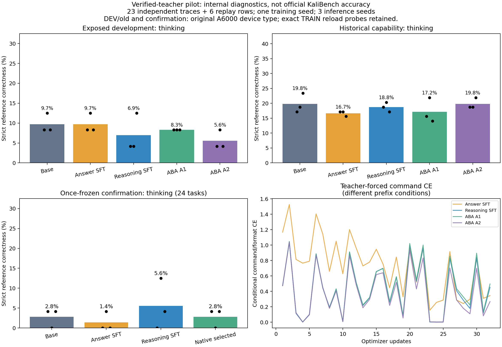
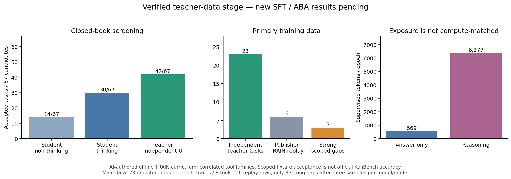
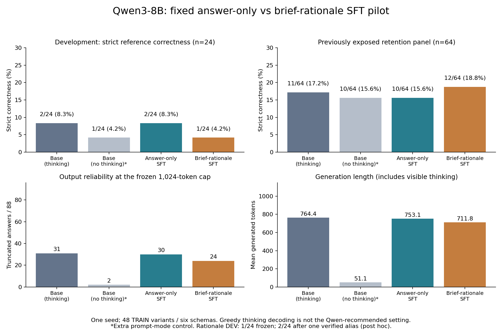
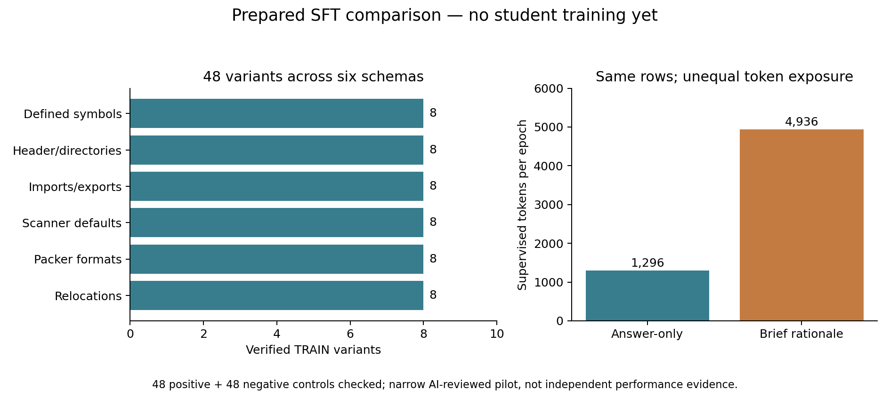
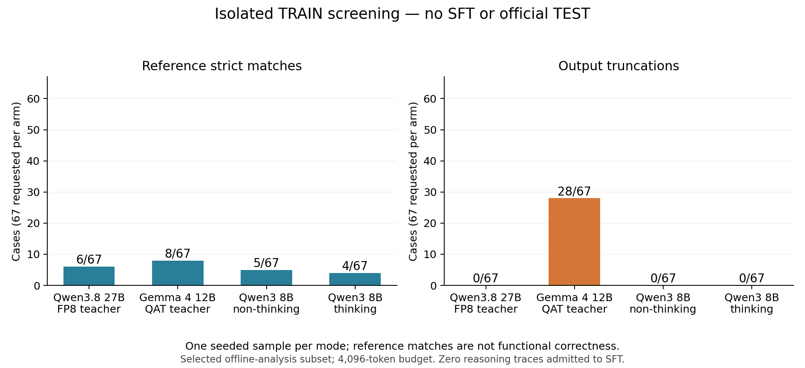
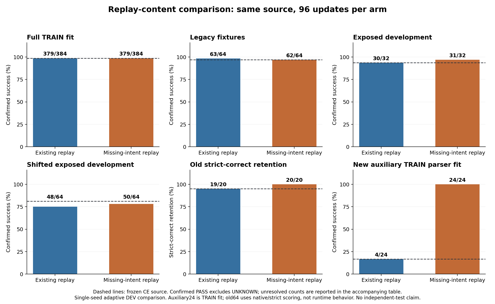

# Student baselines and teacher supervision

[All chapters](../../EXPERIMENT_LOG.md) · [Results catalogue](../../results/README.md)

**Nov 16–18, 2026.** Paired answer-only and reasoning experiments established what the student could already solve, which teacher examples qualified, and how often the trained models retained earlier skills.

## Verified teacher reasoning: completed internal study (started 2026-11-17)

Completed the independent-teacher data → paired SFT → native completion of two original-native-trained checkpoints (0 new completion steps) → once-frozen internal confirmation cycle on original Qwen3-8B. Only 23 primary traces; 3 low-success gap candidates, of which just 1 has repeated certified student failures in both modes (2 remain uncertain); one training seed. Retained model: **E0**. No trained adapter met the predefined retention gate. Thinking confirmation reasoning-minus-answer: **+4.17 pp**. This is **not an official KaliBench/CyberGym score**. [Audited final report](../../results/kali-verified-teacher-stage-2026-11-17/FINAL_RESULT_ZH.md) · [Results figure](../../results/kali-verified-teacher-stage-2026-11-17/final-results.png).

Research code and traceable experiment summaries for adapting open-weight language models to cybersecurity tasks. Minhao's current experiment is **KaliBench**; AthenaBench preparation and an eventual CyberGym transfer are separate work.

## November 17, 2026 — historical independent-teacher preparation checkpoint

Verified **23 independent-U teacher reasoning tasks / 8 tools**, plus **6 verified publisher TRAIN replay rows**. Only **3** tasks meet the three-sample teacher-pass/student-low-pass gap rule. The broader64-task/32-gap target was not reached; this is a limited feasibility study. On the separate67-task authored TRAIN candidate pool, untrained Qwen3-8B passes **30/67 thinking** and **14/67 non-thinking**, versus teacher **42/67** on the first independent attempt. These are scoped fixture checks, not official KaliBench accuracy.

**Evidence correction:** the three low-success-rule candidates contain **only one gap with repeated certified student failures in both modes**; two remain limited by UNKNOWN checks. Training rows and scoring are unchanged. [Correction and counts](../../results/kali-verified-teacher-stage-2026-11-17/CORRECTION_ZH.md). The preparation figure’s gap count refers to the original rule, not three certified failures.

At this historical preparation checkpoint, full execution was still pending. The completed audited study is now reported above; the original preparation figures and aggregates below are preserved. Official TEST stays untouched.

[Chinese protocol and limitations](../../results/kali-verified-teacher-stage-2026-11-17/RESULT_ZH.md) · [Verified preparation aggregates](../../results/kali-verified-teacher-stage-2026-11-17/preparation-summary.json) · [Execution status](../../results/kali-verified-teacher-stage-2026-11-17/STATUS.md) · [Core code snapshots](../../code-snapshots/teacher-sft-20261117/README.md).

## November 17, 2026 — matched SFT pair completed; no validated improvement

Completed **both original-Qwen3-8B SFT arms (48 updates each)**, **264 paired evaluation responses**, and **88 additional untrained-base non-thinking control responses** on one **A100 80GB**. Initialization, data/order, gradients, saved adapters, reloads and local re-scoring were verified. GPU resources are cleaned. These are internal panels, not official KaliBench leaderboard results.

| Model state | Frozen DEV strict /24 | Exposed old-panel strict /64 | Truncated /88 | Retained base-correct old cases |
|---|---:|---:|---:|---:|
| Original base, thinking enabled | 2 | 11 | 31 | reference |
| Answer-only-target SFT, thinking enabled | 2 | 10 | 30 | 9/11 |
| Brief-rationale-target SFT, thinking enabled | 1† | 12 | 24 | 10/11 |
| Untrained base, non-thinking control | 1 | 10 | 2 | separate diagnostic |

† The sole DEV decrease is a **source-verified valid option alias omitted by the frozen scorer**. A separately reported, post-hoc alias sensitivity gives **2/24 for all three main arms**; frozen scores remain unchanged. Neither adapter passes the predeclared 95% old-case retention guard, so **the original base is retained**.

Both training losses decreased, but new-task accuracy did not improve. Answer-only training did **not** make the model emit empty thinking blocks on these evaluation prompts. Disabling thinking without training greatly reduced truncation without improving strict correctness. The 48 solution-conditioned short explanations cover only six schemas; this does **not** test the full benefit of independently solved teacher reasoning traces. Greedy thinking decoding with a 1,024-token cap is also a limitation relative to Qwen's recommended settings.

[Detailed Chinese report and cause analysis](../../results/kali-rationale-sft-results-2026-11-17/RESULT_ZH.md) · [Aggregate results and alias sensitivity](../../results/kali-rationale-sft-results-2026-11-17/summary.json) · [Training diagnostics](../../results/kali-rationale-sft-results-2026-11-17/training.png). Run `python3 scripts/verify-kali-rationale-results-20261117.py` to check public aggregate math and artifact hashes. Raw data and per-case evidence remain private. Confirmation24 and official TEST remain unqueried; this completed fixed SFT pilot is not a new ABA search.

## November 17, 2026 — grounded rationale data and matched SFT pilot prepared

Prepared **48 source-grounded, solution-conditioned teacher explanations** across six TRAIN schemas/five offline-analysis tools. All **48 positive commands and 48 negative controls** passed the intended acceptance checks on benign fixtures. Two earlier explanations were corrected; **36 new explanations remain unchanged and 12 are explicitly AI-edited**. This is a narrow AI-reviewed pilot, not independent teacher-solved benchmark success or raw native reasoning traces.

Both original-Qwen3-8B arms now have the same questions, final commands, prompts, initialization plan and row order: **answer-only versus short rationale + answer**, each planned for **4 epochs / 48 updates**. Official-template encoding, prompt masking and EOS checks passed for **96 rows**. Five CPU tests and both training/evaluation preflights passed. **At this preparation checkpoint, student SFT had not yet run; the completed execution is reported above.**

The arms are matched on example exposure, not compute: supervised tokens per epoch are **1,296 versus 4,936**. DEV24 and exposed old64 evaluation are prepared for base plus two final adapters; confirmation24 and official TEST remain unqueried. The CPU fixture job is cleaned and no GPU job was submitted in this preparation stage.

[Chinese protocol, provenance and limitations](../../results/kali-rationale-sft-prep-2026-11-17/RESULT_ZH.md) · [Sanitized preparation summary](../../results/kali-rationale-sft-prep-2026-11-17/summary.json) · [Frozen training configuration](../../results/kali-rationale-sft-prep-2026-11-17/protocol.json).

## November 16, 2026 — student baselines and teacher-gap verification completed

Completed both **original Qwen3-8B** modes on one **A10** and collected all **268 teacher/student responses** on the isolated 67-row offline-analysis TRAIN screen. No SFT/ABA training or DEV/confirmation/official TEST query occurred.

| Arm | Native partial ×100 | Native exact | Supplemental strict | Truncated |
|---|---:|---:|---:|---:|
| Qwen3.8-27B-FP8 teacher | 60.86 | 6/67 | 6/67 | 0 |
| Gemma 4 12B QAT teacher | 43.74 | 9/67 | 8/67 | 28 |
| Original Qwen3-8B non-thinking | 57.61 | 5/67 | 5/67 | 0 |
| Original Qwen3-8B thinking | 59.63 | 5/67 | 4/67 | 0 |

Thinking rescued 3 strict matches but lost 4, using about **10× inference time**. Among **6 unique teacher-pass / both-student-fail score gaps**, controlled benign-file checks confirmed **4 local task gaps**; **1 reference-scope ambiguity and 1 tool XML-output defect remain held**. Checks repeated on two tool versions; none of the generated binaries was executed. All student/review resources are cleaned.

Of the four supported gaps, **2 brief explanations are useful seeds and 2 require correction**. No full native reasoning trace is admitted to SFT. Source records all carry publisher `PASS_RUNTIME_ERROR`; neither these labels nor reference matching certify functional correctness. This custom small TRAIN screen is **not an official KaliBench score or proof of a dominant teacher**.

[Chinese results, checks and limitations](../../results/kali-teacher-screen-2026-11-16/RESULT_ZH.md) · [Sanitized aggregate metrics](../../results/kali-teacher-screen-2026-11-16/aggregate.json). Individual questions, outputs and provenance remain private.

## November 16, 2026 — three diagnostic studies completed and verified

Completed the matched objective comparison (v11), directory/batch/cache probe (v12), and replay-content comparison (v13). These are **fixed operator-run RedSage 8B continuation diagnostics, not a new native ABA search or official KaliBench evaluation**. The earlier native Qwen ABA study is documented separately below.

| Current replay study | Frozen CE source | More existing-intent replay | Missing-intent replay |
|---|---:|---:|---:|
| Actual continuation updates | 0 in v13 | 96 | 96 |
| Full TRAIN functional PASS | 379/384 from v11 | 379/384 | 379/384 |
| Previously correct original old cases retained | 19/20 | 19/20 | **20/20** |
| Old64 strict correctness | 24/64 | 23/64 | **25/64** |
| Legacy functional fixtures PASS | 62/64 | 63/64 | 62/64 |
| Exposed DEV32 PASS | 30/32 | 30/32 | **31/32** |
| Shifted exposed DEV64 PASS | 52/64 | 48/64 | **50/64** |

Adding missing intent coverage recovered the old port-setting case and preserved all 24 source-correct old cases. Parser-only auxiliary TRAIN fit increased from **4/24 to 24/24**, while existing replay stayed at 4/24. However, both continuations lost two previously passing shifted PyInstaller cases by omitting `--noupx`; missing-intent replay still fails the frozen legacy and shifted-development gates. **This is a targeted recovery, not a complete solution or independent generalization gain. Neither endpoint is promoted.** UNKNOWN cases remain unresolved, not counted as known failures or successes.

The earlier objective comparison improved TRAIN fit **353→379/384** with direct CE, but shifted DEV declined **56→52/64**. The no-training root substitution study found **0/12 versus 8/12 confirmed PASS** on selected shared-template cases, across four batch/cache settings; original-root outcomes include 10 UNKNOWN. This sensitivity predates the later continuation and is not proof of training-induced directory memorization.

All 576 updates across v11/v13, exported adapter hashes, paired outcomes and resource cleanup were checked. The batch's 14 owned Jobs are terminal and cleaned (13 successful, one zero-update failed preflight retained in the audit); GPU containers ran sequentially, totaling **3.70 container-hours**, including staging/inference/waits. Official TEST and this phase's fresh confirmation64 queries stayed at **0**.

[Full Chinese results, figures and causal limitations](../../results/kali-mode-repair-2026-11-16/RESULT_ZH.md) · [Verified per-arm results](../../results/kali-mode-repair-2026-11-16/v13-analysis.json) · [Completed status and next research step](../../results/kali-mode-repair-2026-11-16/remaining-status.json) · [Resource and export audit](../../results/kali-mode-repair-2026-11-16/v13-batch-resource-audit.json).

## November 16, 2026 — full-TRAIN fitting and retention diagnosis

Two RedSage continuation arms completed 192 updates each. Fixed-prefix and student-prefix distillation passed **352/384** and **338/384** full TRAIN fixtures, respectively; both retained **19/20** originally correct old cases. Neither passed all gates. New PyInstaller mode contrasts remain underfit; hardlink fits TRAIN but is sensitive to directory/context changes. **44→56/64 on the exposed combination development panel is adaptive development gain, not independent generalization.**

The single-GPU direct-CE diagnosis completed 128 updates on 16 balanced TRAIN rows. Final microfit functional PASS was **16/16**, and full TRAIN-panel PASS was **64/64**. These are fitting diagnostics, with no old-retention or independent-test claim. [Verified results, figure and next-stage protocol](../../results/kali-mode-repair-2026-11-16/RESULT_ZH.md).
