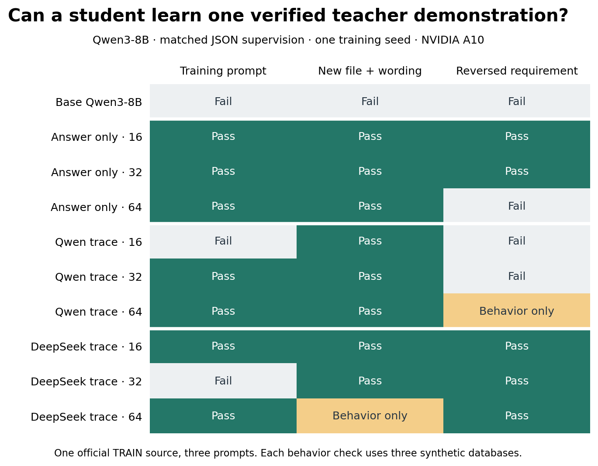
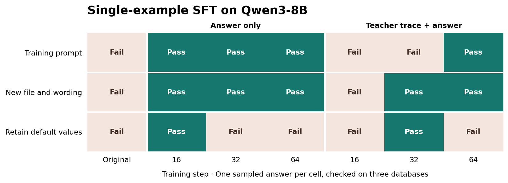
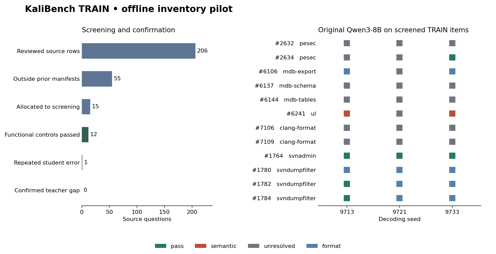
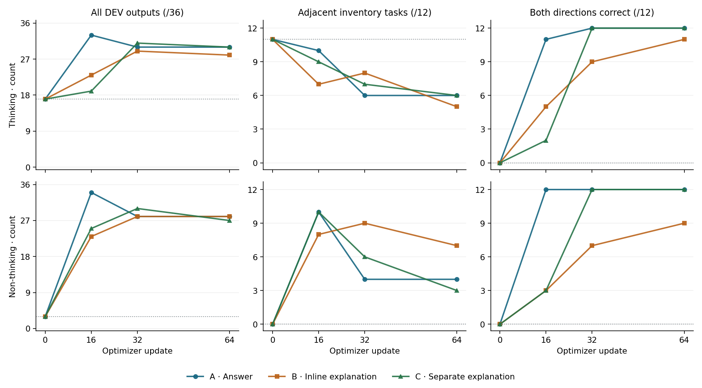
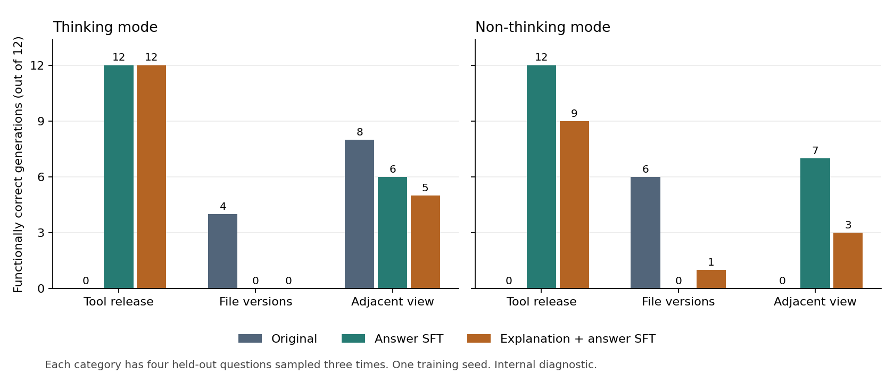
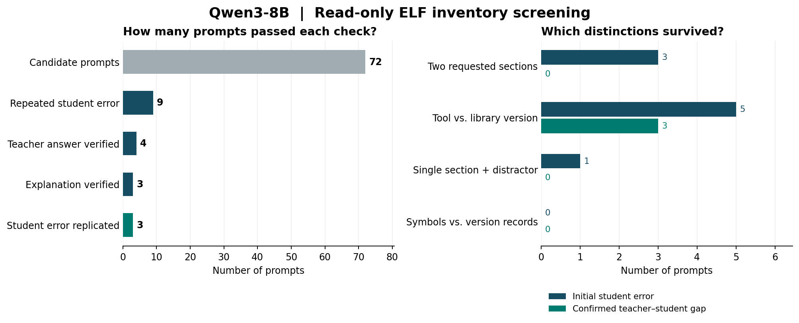

# Teacher traces and transfer

[All chapters](../../EXPERIMENT_LOG.md) · [Results catalogue](../../results/README.md)

**Nov 19–23, 2026.** The student could copy verified teacher demonstrations. On other sources, the advantage varied with the task and how responses were scored.

## November 23, 2026 — Replicating teacher SFT on a second training example

On a function-listing example and its three variants, the original Qwen3-8B chose the correct option but omitted the program name in all eight responses. Answer-only and Qwen trajectory SFT each passed 8/8. Both teacher-trained models reproduced their own demonstration twice on the original prompt. On two other compiler tasks, Qwen trajectory SFT preserved the base model’s 4/4, while answer-only and DeepSeek trajectory SFT each passed 2/4. Eight more sources were screened, taking the cumulative count to 64, of which three qualify. [Full protocol, scores and figures](../../results/teacher-transfer-2026-11-23/RESULT_ZH.md)

## November 23, 2026 — Do teacher trajectories improve transfer or change the answer format?

On five new KaliBench TRAIN sources, original Qwen3-8B passed **15/15**, answer-only SFT **12/15**, Qwen trajectory SFT **11/15**, and DeepSeek trajectory SFT **11/15** under the single-command JSON protocol. Replaying equivalent two-step operations and unambiguously recoverable answers changed the two trajectory results to **15/15** and **12/15**, respectively. Across all eight prospectively chosen sources, primary scores were **23/24**, **21/24**, **18/24**, and **17/24**. Three decoding seeds were used per source.

On the historical module-list request, explicitly asking the original student to check the executable yielded **3/3**, a length-matched neutral note **2/3**, and the teacher's same-question explanation **0/3**. On the schema request all four prompts reproduced the same misspelling; a one-character command edit restored **12/12**. The source screen now covers **56** origins, with **3** meeting the training criterion.

[Chinese report](../../results/constraint-audit-2026-11-23/RESULT_ZH.md) · [Results figure](../../results/constraint-audit-2026-11-23/comparison.png) · [Per-draw scores](../../results/constraint-audit-2026-11-23/transfer.json) · [Recount](../../results/constraint-audit-2026-11-23/recount.py)

## November 23, 2026 — Screening new KaliBench TRAIN sources

Original Qwen3-8B passed **55/57** draws on **19 newly screened sources**. On two static file-report questions, replacing a plugin error with the actual installed help changed the student's score from **0/6 to 6/6** with matched seeds. The unchanged control passed **3/3 in both conditions**. The two remaining errors on new sources both omitted an output name and each recovered with that single edit.

On reversed requests for three previously identified sources, the student passed **3/9**, the Qwen teacher **9/9**, and the DeepSeek teacher **7/9**. The study now has **3 qualifying original sources across 51 screened**. Two have matched labels for both directions in all five arms. The eight-source threshold for multi-source SFT remains unmet.

[Results figure](../../results/paired-source-wave-2026-11-23/screening-results.png) · [Chinese report](../../results/paired-source-wave-2026-11-23/RESULT_ZH.md) · [Paired help experiment](../../results/paired-source-wave-2026-11-23/help-replay.json) · [Recount](../../results/paired-source-wave-2026-11-23/recount.py)

## November 23, 2026 — What did the student learn from a teacher explanation?

All five Qwen3-8B training conditions passed the original database question in **6/6** draws. On three variants of that question, repeated across three training seeds, answer-only SFT passed **17/18**. Adding a 59-token target explaining why the original question required suppressing field defaults gave **8/18**. When the request explicitly reversed that condition, answer-only passed **6/6** and the explanation arm **0/6**. Changing just the defaults option restored correct execution in four of those six failures.

On three further KaliBench TRAIN questions chosen before generating the student outputs, the previous answer-only checkpoint passed **9/9**, the base **8/9**, the Qwen trajectory checkpoint **7/9**, and the DeepSeek trajectory checkpoint **6/9**. Each question had three sampled responses and two native test fixtures. These counts measure diagnostic transfer on three sources. The official test split remains sealed.

[Chinese report](../../results/schema-factor-2026-11-23/RESULT_ZH.md) · [Results figure](../../results/schema-factor-2026-11-23/diagnostics.png) · [Frozen protocol](../../results/schema-factor-2026-11-23/PROTOCOL.md) · [Per-draw audit](../../results/schema-factor-2026-11-23/audit.py)

## November 22, 2026 — Single-example recall and cross-tool transfer

Qwen3-8B reproduced the full Qwen and DeepSeek teacher trajectories on the original training prompt at step 64 (1,027 and 430 tokens). On two other previously screened TRAIN questions, the DeepSeek-trained checkpoint passed **5/6** strict checks, the base model **2/6**, the Qwen-trained checkpoint **1/6**, and answer-only **0/6**. The DeepSeek gain came entirely from one LLVM question where it supplied the missing executable in all three draws. Each draw was checked on two files. These are diagnostic results from one training source and one training seed.

[Chinese report and figure](../../results/teacher-recall-2026-11-22/RESULT_ZH.md) · [Per-draw scores and replay](../../results/teacher-recall-2026-11-22/transfer.json) · [Recount](../../results/teacher-recall-2026-11-22/recount.py)

## November 22, 2026 — What did teacher supervision change on a matched pair?

On a same-file schema task, the original Qwen3-8B passed **0/6** because of one misspelled option. Correcting one character in each saved command recovered **6/6**. At step 64, the Qwen trajectory checkpoint passed **6/6**, answer-only **4/6**, and DeepSeek trajectory **4/6**. The answer-only checkpoint passed both directions with both decoding seeds, then dropped the required option both times when an irrelevant sentence was added. These six responses come from one source.

Across 10 additional read-only TRAIN sources, the teachers each passed **30/30** strictly and the student passed **28/30**. Both misses had a correct command and an invalid JSON escape in the explanation. The total is three verified gap sources across 29 screened, below the eight-source threshold for multi-source SFT.

[Chinese report and figure](../../results/condition-explanations-2026-11-22/RESULT_ZH.md) · [One-character replay](../../results/condition-explanations-2026-11-22/one-edit-grades.json) · [Offline recount](../../results/condition-explanations-2026-11-22/recount.py)

## November 22, 2026 — Can Qwen3-8B learn a verified teacher example?

On one read-only KaliBench TRAIN source and two same-source variations, the base student passed **0/3**. At step 16, answer-only SFT and DeepSeek trajectory SFT each passed **3/3**. Qwen teacher trajectory SFT passed **1/3**. At step 64, all three passed **2/3** under strict scoring. Both trajectory-trained students generated the correct command on all three prompts, with one JSON-format error each.

Across 19 screened TRAIN sources, **two** had verified examples from both teachers and a repeatable student error. This fell below the prespecified eight-source threshold for multi-source training. The official test set remains untouched.

[Chinese report](../../results/readonly-teacher-match-2026-11-22/RESULT_ZH.md) · [Per-source evidence](../../results/readonly-teacher-match-2026-11-22/screen-summary.json) · [Offline recount](../../results/readonly-teacher-match-2026-11-22/recount.py)

## November 22, 2026 — Which repair preserves both directions of a schema request?

On three new pairs of prompts, sampled twice and scored on three databases, the existing answer-only step-16 adapter passed **12/12** responses. Adding an opposite-direction example at the same 16-step budget passed **8/12**. Adding a separate short teacher-explanation task passed **6/12** at a 1,024-token cap and **11/12** at 4,096. All four failures of paired answer-only training passed after correcting a single constraint flag. On a matched A10 inference run, disabling thinking removed both truncations and changed correctness from 10/12 to 9/12. These probes cover one read-only tool.

[Chinese report and sources](../../results/access-paired-repair-2026-11-22/RESULT_ZH.md) · [Per-response checks](../../results/access-paired-repair-2026-11-22/results.json) · [Offline recount](../../results/access-paired-repair-2026-11-22/verify.py)

## November 22, 2026 — Reproduced a documented Access schema error

On one read-only KaliBench TRAIN question with the same installed-tool help, original Qwen3-8B passed **0/3**, Qwen3.8-27B-FP8 **3/3**, and DeepSeek 4.1 Flash **2/3**. Fixing one character in each historical student response restored the reference output on all three database fixtures. These are repeated draws on one question.

Single-example Qwen3-8B SFT fixed the error. Answer-only training passed all three prompts at step 16. At step 64 both arms passed the training prompt and a new-file prompt, and both failed the request to retain defaults. Each cell below is one sampled response evaluated against three databases.

[Chinese report](../../results/access-schema-2026-11-22/RESULT_ZH.md) · [Training losses and checkpoint results](../../results/access-schema-2026-11-22/sft.json) · [Verification script](../../results/access-schema-2026-11-22/verify.py)

## November 21, 2026 — DeepSeek 4.1 Flash blind teacher screen

On four selected read-only KaliBench TRAIN questions, DeepSeek passed **3/12** blind attempts at a 1,200-token cap and **2/12** at 4,096. Only the explicit-text question met the two-of-three threshold. All five correct responses contained unsupported option claims in the raw trace. The final answers and visible explanations passed on those draws. No raw-trace SFT was started.

The original Qwen3-8B passed **1/12 blind** and **8/12 with tool help** on fresh seeds. On the one confirmed blind gap (PE text), documentation took the student from 0/3 to 3/3.

[Chinese report](../../results/deepseek41-blind-readonly/RESULT_ZH.md) · [Per-response checks and token audit](../../results/deepseek41-blind-readonly/teacher-summary.json)

## November 20, 2026 — Blind teacher versus the same teacher with tool help

On four selected KaliBench TRAIN questions where Qwen3-8B repeatedly used invalid parameters, the same-family teacher passed both execution and explanation checks on **2/12 blind responses** and **12/12 with the installed tools’ help**. None of the four reached the blind threshold of two passes in three attempts. No student retraining was triggered. Both PE questions test the same output-format skill.

[Results and paired comparison figure](../../results/qwen-parameter-gap-pilot/RESULT_ZH.md) · [Per-response checks](../../results/qwen-parameter-gap-pilot/summary.json) · [Offline recount](../../results/qwen-parameter-gap-pilot/verify.py)

## November 20, 2026 — Official TRAIN inventory screening

Two rounds of source review produced 12 offline, read-only questions with verified positive and negative controls. Original Qwen3-8B passed 6/36 generations. One question met the initial repeated semantic-error criterion. The same-family teacher passed 0/3 blind draws on that question. No new example met the full teacher–student gap criterion, so the original checkpoint was retained and no new SFT or ABA run was started. These are selected TRAIN questions; official TEST remained sealed.

[Chinese report and error analysis](../../results/official-train-inventory-2026-11-20/RESULT_ZH.md) · [Per-question results and offline recount](../../results/official-train-inventory-2026-11-20/summary.json)

## November 20, 2026 — Matched answer-prefix SFT on paired inventory tasks

Three Qwen3-8B adapters learned the same four inventory prompts for 64 updates. On 12 independent development prompts sampled three times each in thinking mode, the original model passed **17/36**. At step 64, answer-only SFT passed **30/36**, inline-explanation SFT **28/36**, and separate-explanation SFT **30/36**. The separate-explanation arm used exactly the same direct-answer inputs and labels as the answer-only arm. On paired draws it gained 0 passes and lost 0 relative to answer-only at step 64. All nine adapters were saved, reloaded, and verified. The curves show internal development results from one training seed.

[Chinese report and regression analysis](../../results/readelf-prefix-control-2026-11-20/RESULT_ZH.md) · [Checkpoint metrics and weight hashes](../../results/readelf-prefix-control-2026-11-20/summary.json)

## November 19, 2026 — Can Qwen3-8B transfer a one-example teacher demonstration?

After 32 updates, Qwen3-8B reproduced the teacher’s short explanation and answered the training question correctly. On 12 held-out read-only inventory prompts sampled three times each in thinking mode, the original model passed **12/36**, answer-only SFT **18/36**, and explanation-plus-answer SFT **17/36**. Both trained models passed **12/12** on questions about the tool’s own version and **0/12** when asked for version records inside the file.

A separate screen of 48 official KaliBench TRAIN candidates yielded no new cases meeting the repeated semantic-error criterion. The original model was retained. [Chinese report](../../results/readelf-transfer-2026-11-19/RESULT_ZH.md) · [Aggregate results](../../results/readelf-transfer-2026-11-19/summary.json)

## November 19, 2026 — Qwen3 teacher–student screening on read-only ELF inventory

Across **72 internal candidate prompts**, Qwen3-8B repeatedly made a semantic error on 9. The Qwen3.8-27B-FP8 teacher produced verified answers on at least two of three attempts for 4 of those prompts. **Three** also passed explanation review and a fresh student retest. All three concerned the distinction between the reader’s own version and version information inside a library. The study required 8 prompts across 3 task types to start training, so it ended at screening. The official KaliBench test set stayed sealed.

[Chinese report](../../results/readelf-screening-2026-11-19/RESULT_ZH.md) · [Aggregate results](../../results/readelf-screening-2026-11-19/summary.json)

On 24 fresh SQLite evidence files, original Qwen3-8B, answer SFT and evidence SFT scored **0/24, 0/24 and 0/24**. [Paired experiment and training-data verification](../../results/defensive-sqlite-metadata-2026-11-18/README_ZH.md).
