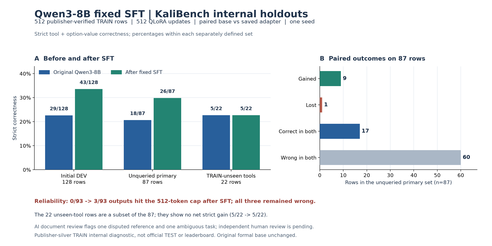
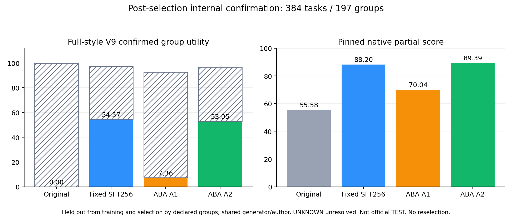

# Results by research question

[Project overview](../README.md) · [中文阅读指南](../docs/README.md) · [Chronological experiment log](../EXPERIMENT_LOG.md)

## Three comparisons to read first

| Question | Result | Evidence |
| --- | --- | --- |
| Does a teacher trajectory transfer? | The Qwen-trained student retained both comparison tasks on the second example. Across eight prospective sources in the earlier study the base led all adapters. | [Second example](teacher-transfer-2026-11-23/RESULT_ZH.md) · [Eight-source comparison](constraint-audit-2026-11-23/RESULT_ZH.md) |
| Does ABA outperform fixed SFT? | Two ABA candidates completed training. Neither met all retention and output-completion requirements. | [Decision and paired measurements](kali-qwen-native-aba-2026-11-15/RESULT_ZH.md) |
| What improved under ordinary SFT? | Internal development correctness rose from 18/87 to 26/87. Both models passed 5/22 on tools absent from training. | [Error analysis](../docs/KALI_QWEN_UNQUERIED_CONFIRMATION_ZH_2026-10-28.md) · [Figure](kali-qwen-confirmation-2026-10-28/before-after.png) |

View figures from the fixed SFT and ABA comparisons

**Fixed SFT.** The same Qwen adapter improved strict correctness on the 87-example internal panel, with no change on its 22 unseen-tool examples.

**Native ABA.** Fixed SFT and the two ABA candidates were scored on the same 384 internal confirmation examples after selection. The panel shares its generator with development and concentrates on two tools. The development retention criteria determined which candidates were eligible. [Study protocol and limitations](kali-qwen-native-aba-2026-11-15/RESULT_ZH.md)

## All result collections

Expand a research topic to find its study folders and stand-alone result files. A date identifies the corresponding record.

Teacher supervision and transfer (20)

- [Second training example and cross-task retention](teacher-transfer-2026-11-23/RESULT_ZH.md) · [records](teacher-transfer-2026-11-23/) · 2026-11-23
- [Prospective transfer on eight sources and output-format replay](constraint-audit-2026-11-23/RESULT_ZH.md) · [records](constraint-audit-2026-11-23/) · 2026-11-23
- [Exact teacher recall and transfer to known student weaknesses](teacher-recall-2026-11-22/RESULT_ZH.md) · [records](teacher-recall-2026-11-22/) · 2026-11-22
- [Effect of a conditional explanation when the request is reversed](schema-factor-2026-11-23/RESULT_ZH.md) · [records](schema-factor-2026-11-23/) · 2026-11-23
- [Matched prompts with and without a task condition](condition-explanations-2026-11-22/RESULT_ZH.md) · [records](condition-explanations-2026-11-22/) · 2026-11-22
- [Paired requests and calibration of tool help](paired-source-wave-2026-11-23/RESULT_ZH.md) · [records](paired-source-wave-2026-11-23/) · 2026-11-23
- [Single-example fit across checkpoints](readonly-teacher-match-2026-11-22/RESULT_ZH.md) · [records](readonly-teacher-match-2026-11-22/) · 2026-11-22
- [Paired repairs on a database schema request](access-paired-repair-2026-11-22/RESULT_ZH.md) · [records](access-paired-repair-2026-11-22/) · 2026-11-22
- [Reproduction of the schema error](access-schema-2026-11-22/RESULT_ZH.md) · [records](access-schema-2026-11-22/) · 2026-11-22
- [Blind DeepSeek teacher screening](deepseek41-blind-readonly/RESULT_ZH.md) · [records](deepseek41-blind-readonly/)
- [Official TRAIN source screening](official-train-inventory-2026-11-20/RESULT_ZH.md) · [records](official-train-inventory-2026-11-20/) · 2026-11-20
- [Matched answer prefixes](readelf-prefix-control-2026-11-20/RESULT_ZH.md) · [records](readelf-prefix-control-2026-11-20/) · 2026-11-20
- [Transfer after a single read-only demonstration](readelf-transfer-2026-11-19/RESULT_ZH.md) · [records](readelf-transfer-2026-11-19/) · 2026-11-19
- [Screening for repeated student errors](readelf-screening-2026-11-19/RESULT_ZH.md) · [records](readelf-screening-2026-11-19/) · 2026-11-19
- [SQLite evidence on new files](defensive-sqlite-metadata-2026-11-18/README_ZH.md) · [records](defensive-sqlite-metadata-2026-11-18/) · 2026-11-18
- [Audited teacher SFT study and corrections](kali-verified-teacher-stage-2026-11-17/RESULT_ZH.md) · [records](kali-verified-teacher-stage-2026-11-17/) · 2026-11-17
- [Paired answer and rationale SFT results](kali-rationale-sft-results-2026-11-17/RESULT_ZH.md) · [records](kali-rationale-sft-results-2026-11-17/) · 2026-11-17
- [Preparation of rationale and replay data](kali-rationale-sft-prep-2026-11-17/RESULT_ZH.md) · [records](kali-rationale-sft-prep-2026-11-17/) · 2026-11-17
- [Student baselines and teacher gap checks](kali-teacher-screen-2026-11-16/RESULT_ZH.md) · [records](kali-teacher-screen-2026-11-16/) · 2026-11-16
- [Qwen parameter-selection pilot](qwen-parameter-gap-pilot/RESULT_ZH.md) · [records](qwen-parameter-gap-pilot/)

ABA search, fixed controls and replication (21)

- [Native Qwen ABA versus fixed SFT](kali-qwen-native-aba-2026-11-15/RESULT_ZH.md) · [records](kali-qwen-native-aba-2026-11-15/) · 2026-11-15
- [Original-model comparison under fixed SFT](kali-two-model-sft-2026-11-15/RESULT_ZH.md) · [records](kali-two-model-sft-2026-11-15/) · 2026-11-15
- [Appending examples versus matched replay](kali-8b-append64-study-2026-11-13/RESULT_ZH.md) · [records](kali-8b-append64-study-2026-11-13/) · 2026-11-13
- [Bounded eight-billion-parameter study](kali-8b-verified64-study-2026-11-12/) · 2026-11-12
- [RedSage candidate P01](kali-redsage-aba-publisher-p01-2026-11-10/) · 2026-11-10
- [RedSage candidate P02](kali-redsage-aba-publisher-p02-2026-11-10/) · 2026-11-10
- [P02 collapse analysis](kali-p02-collapse-cause-audit-2026-11-10/) · 2026-11-10
- [P05 training and frozen development scoring](kali-aba-p05-2026-11-11/) · 2026-11-11
- [P05 regression analysis](kali-aba-p05-cause-2026-11-11/) · 2026-11-11
- [P06 training-seed control](kali-aba-seed-control-2026-11-11/) · 2026-11-11
- [P07 coverage experiment](kali-p07-coverage-2026-11-11/) · 2026-11-11
- [P08 exact-repeat experiment](kali-p08-replica-2026-11-11/) · 2026-11-11
- [Regressions shared across candidate runs](kali-aba-crossrun-harm-2026-11-11/) · 2026-11-11
- [C13 training and evaluation](kali-aba-c13-2026-11-09/) · 2026-11-09
- [Paired audit of C13 results](kali-aba-c13-paired-audit-2026-11-10/) · 2026-11-10
- [Early controller search check](kali-aba-search-smoke-2026-11-09/) · 2026-11-09
- [Controller recovery audit](kali-aba-recovery-audit-2026-11-02/) · 2026-11-02
- [Matched training with ABA-generated examples](kali-qwen-native-aba652-2026-11-02/) · 2026-11-02
- [Same-operation transfer to new filenames](kali-qwen-native-infamily16-2026-11-02/) · 2026-11-02
- [ABA training-data generation pilot](kali-native-aba-novel-2026-11-02/) · 2026-11-02
- [Agent-generated data pilot](kali-qwen-agent-data680-2026-11-02/) · 2026-11-02

Fixed SFT, format and retention (26)

- [Qwen internal confirmation on 87 previously unqueried examples](kali-qwen-confirmation-2026-10-28/) · 2026-10-28
- [Publisher TRAIN baseline and fixed SFT](kali-qwen-official-executed-pilot-2026-10-28/) · 2026-10-28
- [Expanded publisher training run](kali-qwen-expanded-a40-2026-10-30/) · 2026-10-30
- [Expanded run preparation](kali-qwen-expanded-prep-2026-10-30/) · 2026-10-30
- [Retention on general command-line tasks](kali-qwen-utility-retention-2026-10-31/) · 2026-10-31
- [Matched 650-step replay experiment](kali-qwen-targeted-650-2026-10-31/) · 2026-10-31
- [Matched 734-step data expansion](kali-qwen-diverse-734-2026-11-01/) · 2026-11-01
- [RedSage fixed SFT on publisher data](kali-redsage-publisher-sft638-2026-11-10/) · 2026-11-10
- [Publisher holdout preparation](kali-redsage-publisher-holdout64-prep-2026-11-10/) · 2026-11-10
- [Publisher holdout result](kali-redsage-publisher-holdout64-2026-11-10/) · 2026-11-10
- [Fresh publisher confirmation](kali-redsage-publisher-confirm64-2026-11-10/) · 2026-11-10
- [240-example BF16 training comparison](kali-bf16-240-sft-2026-10-26/) · 2026-10-26
- [BF16 confirmation run](kali-bf16-confirmation-2026-10-26/) · 2026-10-26
- [Matched training and inference precision](kali-matched-precision-2026-10-26/) · 2026-10-26
- [Fixed-weight prefix comparison](kali-prefix-control-2026-10-26/) · 2026-10-26
- [Output-prefix follow-up](kali-prefix-followup-2026-10-26/) · 2026-10-26
- [October results figures](kali-results-figures-2026-10-26/) · 2026-10-26
- [Second-seed replication](kali-seed43-replication-2026-10-25/) · 2026-10-25
- [Initial regression diagnosis](kali-causal-findings-2026-10-25/) · 2026-10-25
- [Training recall and fitting checks](kali-learning-diagnosis-2026-10-25/) · 2026-10-25
- [Output-mode repair](kali-mode-repair-2026-11-16/RESULT_ZH.md) · [records](kali-mode-repair-2026-11-16/) · 2026-11-16
- [SFT syntax errors](kali-sft-syntax-audit-2026-11-11/) · 2026-11-11
- [Early supervised training results](kali-sft-progress-2026-10-26/) · 2026-10-26
- [Native model-family pilot](kali-native-family-2026-10-25/) · 2026-10-25
- [Tool-aware replay](kali-replay-v3-2026-10-24/) · 2026-10-24
- [First CUDA training cycle](kali-cuda-2026-10-24/) · 2026-10-24

Data selection, evaluation and reference quality (26)

- [Behavior-verified TRAIN supplement](kali-behavior-train-2026-11-12/) · 2026-11-12
- [Remaining publisher sources](kali-publisher-remainder-2026-11-12/) · 2026-11-12
- [Functional evaluation review](kali-functional-review-2026-11-15/) · 2026-11-15
- [Evaluation protocol review](kali-preview-v6-review-2026-11-15/RESULT_ZH.md) · [records](kali-preview-v6-review-2026-11-15/) · 2026-11-15
- [Task-quality admission rule](kali-task-quality-gate-2026-10-28/) · 2026-10-28
- [Targeted training-data intake](kali-targeted-intake-2026-10-28/) · 2026-10-28
- [Tool coverage in training data](kali-train-tool-coverage-2026-11-01/) · 2026-11-01
- [Source coverage gaps](kali-source-gap-2026-11-11/) · 2026-11-11
- [P10 label-quality check](kali-p10-label-qa-2026-11-11/) · 2026-11-11
- [P10 semantic review](kali-p10-semantic-qa-2026-11-12/) · 2026-11-12
- [Audit of 512 publisher TRAIN rows](kali-qwen-train512-audit-2026-10-28/) · 2026-10-28
- [AI review of training labels](kali-qwen-ai-review-2026-10-29/) · 2026-10-29
- [Screening training rows by execution records](kali-qwen-receipt-screen-2026-10-29/) · 2026-10-29
- [Data-quality and training-dose experiment](kali-qwen-data-quality-2026-11-01/) · 2026-11-01
- [External candidate label review](kali-qwen-external-ai-audit-2026-10-30/) · 2026-10-30
- [AI-reviewed external diagnostic](kali-qwen-external26-ai-diagnostic-2026-11-02/) · 2026-11-02
- [External validation admission decision](kali-external-validation-gate-2026-10-31/) · 2026-10-31
- [Third external-source review](kali-external-review-v3-2026-11-01/) · 2026-11-01
- [Second external-source review](kali-external-review-v2-2026-10-31/) · 2026-10-31
- [General utility source intake](kali-external-utility-intake-2026-10-28/) · 2026-10-28
- [External review preparation](kali-qwen-next-gate-2026-10-29/) · 2026-10-29
- [Model-generated data proposal pilot](kali-model-proposal-pilot-2026-10-28/) · 2026-10-28
- [Candidate data pilot](kali-next-data-pilot-2026-10-27/) · 2026-10-27
- [Post hoc error audit](kali-posthoc-audit-2026-10-27/) · 2026-10-27
- [Held examples and triage](kali-hold-triage-summary.json)
- [Initial data audit](data-audit-summary.json)

Benchmark selection and engineering checks (18)

- [Synthetic ABA training check](aba-synthetic-validation.json)
- [Native ABA GPU smoke test](aba-native-gpu-smoke-2026-11-12/) · 2026-11-12
- [ABA runtime recovery](aba-runtime-repair-2026-11-12/) · 2026-11-12
- [Local 8B pilot](kali-mlx/)
- [Second base model preparation](kali-qwen-second-base-prep-2026-10-28/) · 2026-10-28
- [Qwen3-8B second-model decision](kali-qwen3-8b-second-base-2026-10-28/) · 2026-10-28
- [AthenaBench output-prefix comparison](athena-prefix-comparison-2026-10-21.json) · 2026-10-21
- [Local AthenaBench prefix check](athena-native-prefix-local.json)
- [Local AthenaBench alternative output format](athena-without-opening-think-local.json)
- [Benchmark scorer audit](benchkit-scorer-audit-summary.json)
- [Cisco scoring fixture](benchkit-tiny-cisco-v2.json)
- [RedSage scoring fixture](benchkit-tiny-redsage-v2.json)
- [Feyospace GPU inference](feyospace-gpu-smoke.json)
- [Feyospace synthetic QLoRA check](feyospace-qlora-synthetic.json)
- [Full CyberForge source lineage](cyberforge-full-lineage-summary.json)
- [Initial CyberForge lineage audit](cyberforge-lineage-summary.json)
- [October publication checks](publication-checks-2026-10-21.json) · 2026-10-21
- [Initial CPU validation](cpu-validation.json)

