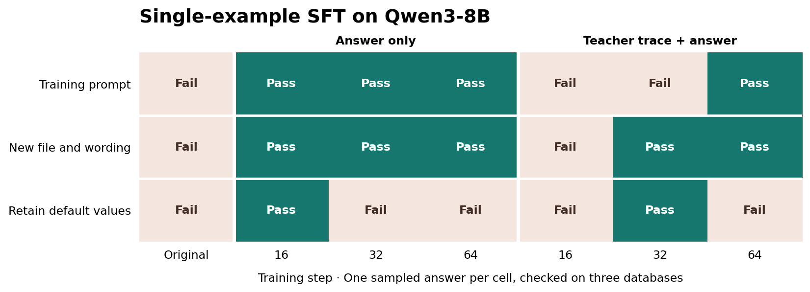

# 一字符造成的师生差距

KaliBench TRAIN 的 sample_6137 要求从 Access 文件导出最简表定义。三次重新采样中，原始 Qwen3-8B 都把已展示在帮助页里的 `--no-not_empty` 写成了 `--no-not-empty`。在本实验锁定的 mdbtools 0.9.1 中，这一个字符足以让程序退出。

| 模型 | 同一帮助页下，同时通过执行和简短解释的抽样 |
|---|---:|
| Qwen3-8B，原始 BF16 | 0/3 |
| Qwen3.8-27B-FP8，启用思考 | 3/3 |
| DeepSeek-V4.1-Flash-1017 | 2/3 |

每份回答都在三套独立构造的数据库上执行，并与相应的参考 SQL 比较。三个种子重复的是同一道题。给三条历史学生回答各修正一个字符，三套数据库上的输出均与参考答案一致。对正确答案施加反向改动，三套均报错退出。额外的数据库含真实默认值 37，显式要求默认值时该值出现在输出中。在这个版本和后端，第一个历史回答省略禁用默认值的开关，没有引起另一个可观察的差异。

按预先记录的顺序，保留同系列教师的第一份合格示范。其解释核对了帮助页中的下划线拼写。筛选使用 JSON 回答，单题训练探针使用 XML 标签包裹命令，两组共享目标格式，并另测该格式的训练前基线。两组提示掩码均含 275 个 token，答案均为 39 个 token，思考组额外监督 1,027 个教师 token。托管教师服务的内部计算预算并未统一。此记录只支持本题在给定文档、版本和采样设置下存在能力差距。

运行 `python3 verify.py` 可从保存的逐次执行结果重新计数。[逐次结果](screen.json)。

## 单题过拟合和迁移

原始 Qwen3-8B 使用一张 RTX A6000 训练。两组从相同的 LoRA 权重出发，学习同一条正确命令。A 组只监督答案和固定格式，B 组额外监督教师返回的完整轨迹。两组各训练 64 步，在第 16、32、64 步保存并重新加载适配器，校验重载前后的权重。每个检查点在三个提示上自由生成一次，每条命令在三套数据库上执行。通过要求三个数据库的结果都与参考 SQL 一致。

| 设置 | 步数 | 原题 | 换文件并改写题意 | 反向要求保留默认值 |
|---|---:|---|---|---|
| 原始学生 | 0 | 失败 | 失败 | 失败 |
| 仅答案 | 16 | 通过 | 通过 | 通过 |
| 仅答案 | 32 | 通过 | 通过 | 失败 |
| 仅答案 | 64 | 通过 | 通过 | 失败 |
| 教师轨迹＋答案 | 16 | 失败 | 失败 | 失败 |
| 教师轨迹＋答案 | 32 | 失败 | 通过 | 通过 |
| 教师轨迹＋答案 | 64 | 通过 | 通过 | 失败 |

第 64 步，B 组在原题的自由生成解释里主动核对了下划线，生成的命令在三个数据库中都正确。答案单独训练在第 16 步就修复了同一错误。第 64 步的两组通过了相同的两题。这项结果支持学生能学会这个具体的参数选择，额外轨迹的泛化收益仍待验证。

两组的反向题失败方式不同。A 组在第 32、64 步错误启用了非空约束，命令成功退出，却在三套数据库中的两套导出了错误 SQL。B 组在第 16 步仍使用错误拼写，在第 32 步通过反向题，第 64 步缺少思考结束标记，未通过完整格式评分。原始 21 次生成全部在长度上限前终止。教师强制下，B 组轨迹 token 的平均交叉熵从 2.212 降至 0.045，但是自由生成没有逐字复现教师轨迹。拟合轨迹、正确作答、泛化到新要求是三个可分别检验的问题。

学习率 0.0001，LoRA rank 16、alpha 32，只更新 q_proj 和 v_proj。两组对答案 token 取平均损失的权重均为 1，对格式取 0.1，B 组另对轨迹 token 的平均损失取 0.5。使用一个训练种子和一个评测种子。筛选时教师按 JSON 回答，训练自由生成使用 XML 标签包裹命令；原始教师轨迹中保留了关于 JSON 回答的讨论。格式变化可能影响结果，本轮无法单独估计其作用。

[逐检查点原生结果与权重哈希](sft.json) · [训练实现](single_sample_trainer.py) · [Qwen3-8B 模型卡](https://huggingface.co/Qwen/Qwen3-8B) · [Hugging Face SFT 训练文档](https://huggingface.co/docs/trl/en/sft_trainer)

### 复核两个格式异常

重新载入 B 组第 32、64 步的适配器，在同一型号 GPU、相同批次和种子下重放六次生成。六次的输出长度与原评分器读取的最终文本均一致。此前记为“没有最终命令”的两次都正常结束，都含有完整的输出标签，但缺少思考结束标记。

- **第 32 步原题**的标签内有正确命令，在三套数据库上均通过。严格评分为 2/3；只看命令行为为 **3/3**。
- **第 64 步反向题**同时有参数错误。恢复命令后，工具在三套数据库上均因未知选项 `--no-no-empty` 返回错误。放宽格式后的成绩仍为 **2/3**。

图中保留预先定义的严格结果。这个复核能区分输出协议错误和实际参数错误。[复验计数与原生执行结果](format-replay.json)

## 另四道官方训练题

在另外 10 个候选工具中做了来源与重叠检查。为 6 道候选题构造了正反对照，其中 4 道能在两组固定文件上稳定区分正确与错误命令，进入原始学生筛查。涉及静态挂载表筛选、工具版本查询、工作区状态和当前分支。另两题的日志回放与重命名预览对照未通过，未纳入分母。

四道合格题各抽样三次，原始 Qwen3-8B **12/12** 通过程序执行，因而未产生额外的“教师会、学生反复错”案例。学生筛查从等待的 CPU 路线迁到 RTX A6000；12 个完整回答均来自同一 GPU 环境。Access 题的九次对照、两组 SFT 和这四道新题是三种不同的分母。

本轮获得 1 个符合条件的独立来源。方案中多题训练要求至少 8 个来源、覆盖 3 类技能。此次保留原始模型，未启动多题训练或 ABA，未查询官方测试集。[四题的命令、种子和两套文件的执行结果](extra-screen.json)。
