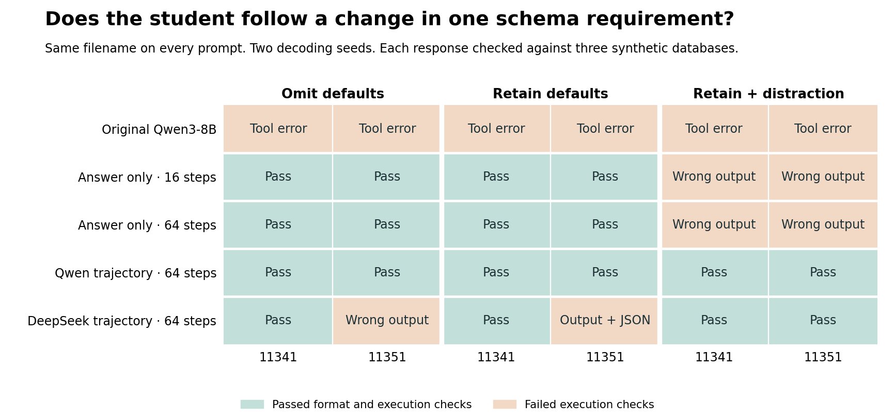

# 教师解释能否帮助学生判断条件？

这一轮扩展了教师与学生的配对筛查，也用已有适配器补做了同文件的条件反转诊断。基础学生为 Qwen3-8B。两个教师接口实际返回 Qwen3.8-27B-FP8 与 DeepSeek-V4.1-Flash-1017。

**同文件正反题上，第 64 步的 Qwen 轨迹组严格通过 6/6，仅答案组和 DeepSeek 轨迹组各为 4/6。** 原始学生为 0/6，但把每条命令中同一个参数里的连字符改成下划线，六条命令都在三套数据库上通过。学生在这些输入上已经选对是否保留默认值；原始得分低有一个可独立修复的拼写原因。[原答案与最小改动](one-edit-witness.json) · [逐条回放](one-edit-grades.json)

## 新的师生差距

本轮审查了 18 个候选来源，其中 14 个是新增训练分配，4 个只出现在过往训练分配中。共有 10 个通过校准并由三种模型各回答三次。按输出 JSON 合法且通过本地行为核验的口径，Qwen 教师为 **30/30**，DeepSeek 教师为 **30/30**，原始学生为 **28/30**。筛查使用相同题面和帮助材料。在本轮之前已筛查 19 个其他官方 TRAIN 来源。

数据库 JSON 导出题提供了一个可定位的例子。学生三次都正确保留了控制字符；其中两次在外层 JSON 解释字段中把 Unicode 转义占位符写成了非法转义。两次均只在解释中补一个反斜杠就能通过 JSON 解析，提取出的原命令逐字相同，在两套数据库上均有正确行为。两位教师各取得 3/3，且各有一条核验过的原始示范。本例提供了协议格式方面的训练材料。学生全部 30 次筛查的原始命令均能得到正确行为，其中 2 次因解释转义丢失严格分。可在本地直接重现解释字符串的解析错误。[三条原始可见回答](format-replay.json)。其余新增来源的逐项结果见[模型筛查记录](evidence.json)。

合计 **3/29 个已筛查题源**符合师生差距的宽口径。其中两个具有经执行验证的命令错误，一个属于输出协议。尚未达到多题训练预设的八个来源。独立确认集、能力保持集和官方 TEST 均未调用，本轮没有启动新的 SFT。

## 固定文件名的诊断

前一轮的数据库反向题同时改变了文件名和默认值要求。本轮将三种提示都绑定到同一文件名、同一帮助信息和三套合成数据库。第一题要求排除默认值，第二题仅反转这一要求；第三题在第二题中加入无关的日期信息。每种配方使用相同的两个生成种子，原模型和四个已保存适配器共生成 30 条新回答，每条上限 4,096 token。训练题源只有一个。适配器由既有发现选出，本轮是诊断性复验。

| 已保存检查点 | 正反均行为正确 | 正反均严格通过 | 反题与干扰题均行为正确 | 全部回答严格通过 | 生成 token 合计 |
|---|---:|---:|---:|---:|---:|
| 原始 Qwen3-8B | 0/2 | 0/2 | 0/2 | 0/6 | 3,431 |
| 仅答案，第 16 步 | 2/2 | 2/2 | 0/2 | 4/6 | 610 |
| 仅答案，第 64 步 | 2/2 | 2/2 | 0/2 | 4/6 | 612 |
| Qwen 教师轨迹，第 64 步 | 2/2 | 2/2 | 2/2 | 6/6 | 5,904 |
| DeepSeek 教师轨迹，第 64 步 | 1/2 | 1/2 | 1/2 | 4/6 | 2,490 |

每个“/2”对应两个生成种子。严格通过要求输出正常结束、JSON 合规且在三套数据库上均符合参考输出。仅行为通过允许从多个可解析 JSON 对象中提取唯一命令后进行原样回放。生成截断、无法唯一提取命令和执行错误分别记录。两个种子和多个文件均不构成独立题源。[逐条诊断](adapter-grades.json) · [模型和适配器版本](protocol.json)

两个仅答案检查点都能在两次采样中正确处理原来的正反要求。题末加上“数据库在星期二送达”之后，它们都省略了启用默认值的选项，实际产生了相反的输出。四条失败命令各自只补上这个选项，均恢复为严格通过。Qwen 教师轨迹组在两个种子下都保留了正确行为，六条回答共生成 5,904 个 token；同一步的仅答案组使用 612 个。这个差异来自一个题源和一个训练种子。它支持进一步检验对无关措辞的稳定性，尚不足以证明教师解释带来了跨任务的条件推理能力。

DeepSeek 轨迹组在一个种子上三条全对，在另一个种子上只通过了干扰题。后一个种子中，正题单独补上禁止非空约束的选项即可恢复；反题补上默认值选项后行为恢复，但保留下来的 JSON 格式错误仍使其无法严格通过。所有改动仅用于错误归因，原始得分使用未修正回答。[最小改动与原命令](adapter-edit-witness.json) · [改动后的行为与格式评分](adapter-edits.json)

## 短解释对照和 SFT 核验

DeepSeek 为已入选的三个题源分别提供了说明决定条件的短句（D）和长度匹配的同题背景（E）。Qwen3-8B 分词后，数据库结构题为 22 对 22 个 token，函数清单题为 25 对 25 个，JSON 协议题为 26 对 26 个。JSON 题的最终短句把外层字符串转义作为独立语法要求。两个数据库工具的任务不同，前者改变 SQL 结构，后者考察导出结果与外层 JSON 协议。

每个来源的五个配方具有完全相同的题面、答案、可见解释及格式 token ID。使用真实标签和合成 logits 测试了因果语言建模的一位偏移及每项损失的梯度权重。按来源先平均、再按批次平均后，答案权重为 1，格式为 0.1，有辅助内容时为 0.5，其余位置为零。这个单元测试验证损失计算。D/E 的新训练与泛化效果仍待数据门槛满足后评测。[分词及说明文本](matched-labels.json) · [梯度核验](loss-check.json) · [冻结的多题实验协议](multisource-protocol.json)

三个训练来源各准备了原意、同义、反向和加入干扰的四种提示。对既有两题每种提示使用三个夹具，对新增 JSON 转义题使用两个夹具，共有 32 次正反参考输出检查。同义题和反向题在同一个文件上单独反转条件。反向题和干扰题应有相同的参考结果。计数单位是夹具检查，12 个提示均为三个训练源的诊断变体。[参考结果哈希](pairs.json)

## 数据和计算核对

分区显示工具的一条发布方参考指令使用了互斥参数，去掉冲突后得到正确输出。旧版本日志工具缺少所要求的 JSON 选项。另一个 LVM 案例的参考命令只列出当前显式配置，完整模式会返回更多配置段。这些来源均未作为学生错误。三个缺少合适注册表或日志文件读取环境及判别样本的候选也记录在清单中。源文件均为合成数据。[参考命令和版本校验](calibration.json)

本轮 GPU 作业按顺序使用单卡，5 个 GPU 作业从提交后的作业开始时间到结束时间合计约 41.1 分钟，含排队、加载和推理。所有列出的作业均已回收。实验包提供离线复算命令 `python3 results/condition-explanations-2026-11-22/recount.py`，使用已保存的逐项记录。[计算资源记录](compute.json)
