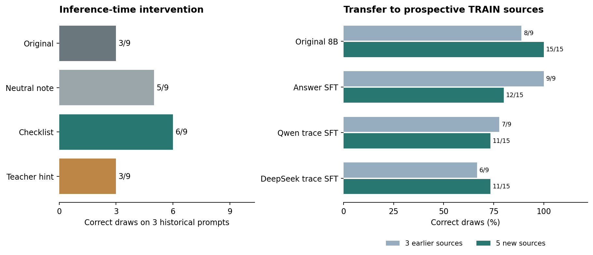

# KaliBench 任务约束与教师解释的作用

本轮回答两个不同的研究问题。第一，给原始学生不同提示，能否恢复历史上反复出错的行为？第二，已经训练好的教师轨迹 SFT 检查点，在训练用例以外能否优于仅答案 SFT？前者固定权重并改变提示，后者固定提示并改变权重。

## 原始学生收到哪类提示后改对了

| 提示条件 | JSON 导出 | 表结构 | 全局变量列表 | 合计 |
| --- | ---: | ---: | ---: | ---: |
| 原题与工具说明 | 3/3 | 0/3 | 0/3 | 3/9 |
| 加一句中性提醒 | 3/3 | 0/3 | 2/3 | 5/9 |
| 要求检查可执行程序名和拼写 | 3/3 | 0/3 | 3/3 | 6/9 |
| 附上 Qwen 教师在同一题的正确可见解释 | 3/3 | 0/3 | 0/3 | 3/9 |

程序名提醒让三次模块列表回答都包含了程序名。中性文字也让其中两次恢复，因此针对性提醒相对同长度对照仅多通过 **1 次**。三道题上，中性提醒和检查提醒分别为模型增加了完全相同的提示 token 数。教师解释更长，三条都包含正确选项，三条都没有写出程序名。这一对照测量的是读到这条具体提示之后的表现。教师提示本身提供了选项，分数不能用来证明模型获得了独立推理能力。[提示词条件](protocol.json) · [逐题分词核验](hint-exposure.json) · [可见回答特征](response-features.json)

表结构题中，工具帮助和教师解释都给出了正确的下划线拼写。四个条件、每个条件三个种子，共 12 次生成，学生都写成了短横线。用锁定版本的 Qwen 分词器比较，两种拼写在检查的三个上下文中长度相同，且都能无损编码。因此本例能够排除“分词器无法表示下划线”和“正确写法必须生成更多 token”这两个简单解释。12 份回答分别只修正这一个字符，12/12 恢复；只显式补充关系约束时为 0/12。模型内部为何偏好另一种拼写仍是开放问题。[分词对照](token-spellings.json) · [单项及组合修复](spelling-replay.json)

## 命令通过后，解释是否也对

对上一轮 10 个已通过单项修复回放的回答另做文字复核。学生的 3 份表结构解释和 DeepSeek 的 2 份解释重复了错误的选项拼写，一份学生解释错误声称会默认生成指定前缀。另外 3 份只描述子操作、没有说明程序名，一份说明了共享库内部的 SONAME、却没有覆盖磁盘文件名。已逐条记录证据和修订后的可见解释。修订由本次分析撰写，未混入教师原始示范。[逐条复核](explanation-repairs.json)

## 未参与适配器训练的新题

共筛选 6 个新的官方 TRAIN 来源。在两个不同的合成文件上验证参考行为并改变关键条件作为负对照。3 道目标文件元数据题与 2 道静态签名报告题通过校准；两道签名报告题属于相近意图。YARA 题的发布者参考被锁定版本拒绝。文档推荐的短参数和等号参数均能编译本地无害规则，并正确区分匹配与不匹配文件。该题单列为参考修复，不加入模型分母。[原生检查记录](controls.json) · [LLVM 工具说明](https://llvm.org/docs/CommandGuide/llvm-objcopy.html) · [YARA 命令行说明](https://yara.readthedocs.io/en/stable/commandline.html)

对调试链接题还做了跨文件格式复核。最初的提取器未能确认两份 PE 文件中的结果。直接解析节表、长节名、有效内容和 CRC 后，两份参考文件都通过。ELF 清理题额外保留了一个普通局部符号，能区分“只去掉编译器临时符号”和误删更多符号。[LLVM 符号过滤说明](https://llvm.org/docs/CommandGuide/llvm-strip.html)

## 既有 SFT 检查点能否迁移

四组使用同一锁定版本的 Qwen3-8B，三个既有适配器均为第 64 步，逐个核对权重 SHA-256。新题在查看本轮学生结果前冻结。每个题目与种子的组合都在四个模型上配对。第一批三题的 9 条原始学生回答在另一个作业中重跑，分数和可见回答哈希 **9/9 完全一致**。两份合成 PE 文件还分别核验了 12 条调试链接回答的节名与 CRC，**24/24** 通过。

| 统计范围 | 原始 8B | 仅答案 SFT | Qwen 轨迹 SFT | DeepSeek 轨迹 SFT |
| --- | ---: | ---: | ---: | ---: |
| 本轮 5 个新来源，按单条命令与 JSON 协议评分 | 15/15 | 12/15 | 11/15 | 11/15 |
| 此前预先选定的 3 个来源，同一批检查点 | 8/9 | 9/9 | 7/9 | 6/9 |
| 合计 8 个预先选定来源 | **23/24** | **21/24** | **18/24** | **17/24** |
| 此前专挑的 2 个已知学生弱点，单独列示 | 2/6 | 0/6 | 1/6 | 5/6 |

在 8 个预先选定的来源上，Qwen 轨迹组相对仅答案组有 0 个配对胜出、3 个落后；DeepSeek 组有 1 个胜出、5 个落后。依次移除任意一个来源，两组相对仅答案组的净差仍分别为 −3 至 −2、−5 至 −1 题次。因为两道签名报告题很相似，另按工具等权复算，原始、仅答案、Qwen 轨迹及 DeepSeek 轨迹组分别为 94.4%、91.7%、77.8%、72.2%。这些是特定训练检查点的描述性小样本结果。已知弱点组与新来源的结论不同，说明选题方式会影响观察到的增益。[训练权重与冻结方案](transfer-protocol.json) · [逐题配对结果](transfer.json) · [复算](recount.py)

### 为什么两个 11/15 的含义不同

- **Qwen 轨迹组**的 4 次协议失败，3 次把正确过程写成两个串联的工具调用。分别在两份输入上按原顺序执行，两步都达到了题目要求。另一次在末尾生成了可提取的正确 JSON，但缺少约定的思考结束标记。恢复 JSON 后，原命令也通过了原生验证。在事后放宽输出协议的口径下，这组达到 **15/15**。
- **DeepSeek 轨迹组**有两次在分离调试信息时交换了输入与输出文件名，第一步即失败；另一次用两个独立的字符串代替 JSON 对象，恢复包装后命令通过。剩余一次达到 4,096 token 上限，未交付 JSON 命令。放宽相同协议后为 **12/15**。还有一条回答显式写成了 `text` 而非 `.text`，工具默认保留目标节，因此按实际行为计分通过，同时在记录中注明参数不准确。
- **仅答案组**的 3 次失败都来自同一道调试信息题，把两个处理步骤合并成了工具不能正确执行的一次调用；宽松口径仍为 **12/15**。原始学生在两种口径下均为 **15/15**。

宽松口径为事后诊断，用于分解失败机制。主表始终保留原始回答的单命令与格式约定。在这些新来源上有证据支持 Qwen 轨迹检查点保留了操作语义，同时降低了协议可靠性。这个现象尚不能证明教师解释能提升学生跨来源的任务能力。[逐条原生回放](semantic-replays.json)

## 当前决策

保留原始 Qwen3-8B 作为对照与首选执行模型。已经确认两类历史差距，也验证了学生在单点训练后能复现教师示范。对当前筛选目标，累计 **56 个筛查来源、3 个合格来源**，其中两个具备完整的双方向五组标签。本轮五个新来源原始学生都是 3/3，未触发新的教师调用。与研究方案中要求的至少 8 个独立合格训练来源仍差 5 个。本轮沿用已存在的适配器完成迁移评测；没有新启动 SFT 或 ABA，没有用官方测试集筛题或挑模型。有目的的选题、同工具的近似题、一个训练来源的适配器和单一训练种子都限制了外推。[来源计数](source-accounting.json) · [算力回收](resources.json)

在本目录执行 `python3 recount.py` 可从本轮和前两轮的逐次记录复算，`python3 figure.py` 可重绘结果图。[合成文件与原生评分器](native/README.md)
