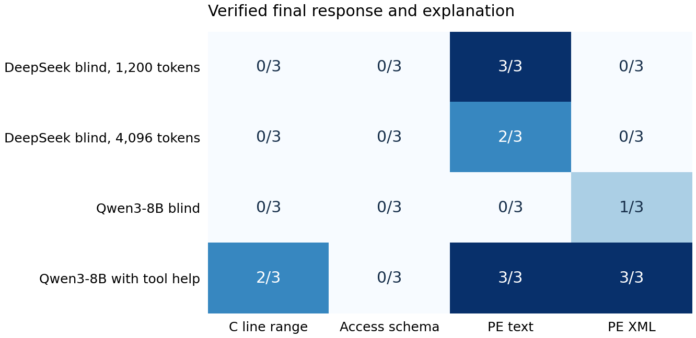

# DeepSeek 4.1 Flash 在四道只读 TRAIN 题上的盲答与推理核验

四题来自原始 Qwen3-8B 反复用错参数的历史样本。教师为 NRP 返回的 DeepSeek-V4.1-Flash-1017，开启 high 思考，无参考答案或文档。两种预算各对四道原题使用相同的三个指定种子。每次通过同时要求最终命令在两套无可执行载荷的合成输入上行为正确、满足只读约束，且公开解释正确。教师返回的原始推理另作事实核验。

| TRAIN 题 | Qwen 27B 盲答（先前，关闭思考） | DeepSeek 1,200 token | DeepSeek 4,096 token |
| --- | ---: | ---: | ---: |
| 7106，C 源码行范围 | 1/3 | 0/3 | 0/3 |
| 6137，Access 最小表定义 | 0/3 | 0/3 | 0/3 |
| 2632，PE 元数据显式文本格式 | 1/3 | 3/3 | 2/3 |
| 2634，PE 元数据 XML | 0/3 | 0/3 | 0/3 |
| 合计 | 2/12 | 3/12 | 2/12 |

1,200 token 时有四次截断（三次 Access，一次 XML）。4,096 token 时 12 次均正常结束。长预算补全了回答，Access 题仍写错选项或未去除全部约束，XML 题仍使用不适用的参数。行范围题正确使用冒号，但六次都请求原地修改源文件，与系统提示要求只读相冲突。长预算文本题的第三次回答自行要求把结果写入新文件。涉及写入的命令均未执行。

两组共五条通过的回执都来自同一道文本题。其最终命令和简短解释正确，但逐条查看未编辑的轨迹，发现三条在用法列表或帮助示例中写出不支持的短帮助选项，另外两条提到不存在的详细输出选项。固定版本的二进制接受长帮助选项和大写版本选项，拒绝短帮助选项、小写版本字母和长详细输出选项。部分说法出现在带有不确定语气的回忆中，本实验将它们标为不宜直接模仿的片段；这项筛选没有测量这些片段对训练的实际影响。

对五条回执分别进行 Qwen3-8B 分词核验，答案组与轨迹组监督的答案 token 完全相同，用户提示已屏蔽，轨迹和答案末尾均保留。此项核验只检查输入和标签。符合本轮原始轨迹训练条件的示范为 0，故未把这五条直接投入单样本训练或 ABA。官方 TEST 未参与。辅助预算的触发阈值在观察到首个截断后、长预算组调用前确定，辅助结果单列。

运行 `python3 verify.py` 可以从逐次记录离线复算结果。数值只覆盖四道定向选题，其中两道共用 PE 输出格式技能，且两款教师的推理设置不同。

## 原始学生的新种子复测

使用固定权重的原始 Qwen3-8B（BF16）和同一套只读输入，在三个新种子上分别盲答、查阅同版本完整工具帮助后回答。两组的题目、输出格式、种子和推理设置相同。共 24 次生成全部正常结束。两组分别通过正负对照和两套合成输入的行为核验，可见解释由 AI 对照固定工具帮助复核。为复用同一次模型加载，四道题全部复测；能力差距只对预先达到教师门槛的题判定。

| TRAIN 题 | 学生盲答 | 学生看工具帮助 |
| --- | ---: | ---: |
| 7106，行范围 | 0/3 | 2/3 |
| 6137，Access 表结构 | 0/3 | 0/3 |
| 2632，PE 文本 | 0/3 | 3/3 |
| 2634，PE XML | 1/3 | 3/3 |
| 合计 | 1/12 | 8/12 |

文本报告题满足盲答差距判据。教师在主试验为 3/3，学生新种子为 0/3，三次学生输出中的错误参数均经固定工具复现。学生看到文档后为 3/3。该题能展示教师在盲答条件下的优势，也能展示无需微调即可生效的文档基线。学生看到文档后仍反复答错的是 Access 题：三次都将实际选项中的下划线写成连字符。教师两个预算条件下在该题也均未通过，因此本实验没有找到能可靠示范这条规则的教师轨迹。

按相同学生种子配对，两组均通过 1 次，仅文档组通过 7 次，仅盲答组通过 0 次，两组均未通过 4 次。结论只适用于四道定向 TRAIN 题。教师在两个预算下通过的原始轨迹均含尚未纠正的错误选项提示；按本轮数据标准，没有可用于单样本原始轨迹 SFT 的示范。三个工具家族的 12 个官方 TRAIN 源题均已冻结或在历史划分中占用。保留原始学生，本轮没有新增 SFT 或 ABA 结果。

与[上轮同文档教师实验](../qwen-parameter-gap-pilot/RESULT_ZH.md)并排看，最值得跟进的题是 Access。完全相同的工具帮助下，Qwen 27B 为 3/3，而本轮 Qwen3-8B 为 0/3。该结果来自不同运行、种子和推理设置；前次 Qwen 教师只保留了简短解释。若转向文档辅助蒸馏，优先在同一设置下复验这道题并核验新轨迹，独立标注文档条件。
