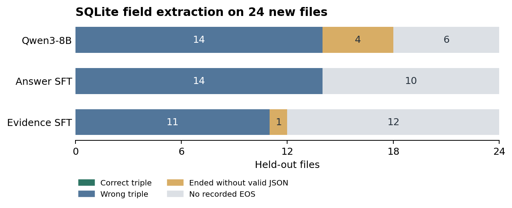

# 同工具、新文件上的防御性元数据分析

原始 Qwen3-8B 在合成 SQLite 文件头上完成了答案 SFT 和短证据推理 SFT 的同题配对比较。所有题都提供 od 只读转储，模型返回字段偏移、宽度和实际数值。每个文件的标注分别与 SQLite PRAGMA 和真实文件字节核对。四类主任务涉及 schema version、user version、application ID 和 freelist count。

| 模型 | 新文件主评测 | 回放字段的新文件 |
|---|---:|---:|
| base | 0/24 | 0/12 |
| answer | 0/24 | 0/12 |
| reason | 0/24 | 0/12 |

推理组相对答案组在主评测上新增 0 题正确，丢失 0 题。每个文件只作一次确定性评测。两组从相同初始化各经过 24 次真实参数更新，核对保存和重载后的 LoRA 张量。只有一个训练种子，外推范围限于同一文件生成器、工具及题型。

**筛选。** 在32个训练文件上，托管教师每题独立作答3次，有 12 题至少2次同时给出正确答案和原文件字节证据。Qwen3-8B 每题每种模式独立采样3次，有 0 题同时满足教师标准且学生在两种模式分别至少2次给出可判定的错误答案。截断或缺失答案单列为未判定。初筛 thinking 的 96 次作答均达到 1,024 token 上限。查看 TRAIN 基线后、训练前固定了补充口径：额外认可已正常结束且只包含一个完整有类型 JSON 的作答（允许一层代码围栏）。据此，有 6 题同时满足教师正确、学生非思考模式反复出错且教师解释可核验，全部纳入两组训练。这 6 题的 6,144 token 补充 thinking 复测已提交，尚无正式结果。训练前固定了24个主留出文件、8个回放文件、12个回放字段的新文件。回放保持范围为 page size 和 page count。

**损失。** 每个更新两组都处理相同的主答案和回放答案，两部分按各自有效目标 token 的平均交叉熵计算，系数固定为1和0.25。推理组增加系数0.5的独立证据任务，学习同一教师根据自己独立作答时的证据和数值写出的三步解释，依次说明字段含义和位置、宽度及原始字节、大端转换及十进制结果。逐项核验并保留教师原句。答案生成始终仅以原问题为条件。三种目标单独反传。相同的系数不能保证相同梯度或计算量。

**评测。** 两组参数冻结后，对基座和重载的两个适配器执行同一套无思考模式的贪心解码。严格判定要求三个整数全部正确。按文件配对的增减、各字段成绩、无有效输出数量、训练配置与文件哈希见 [聚合结果](summary.json)。本轮对原 KaliBench 面板与官方 TEST 的调用均为 0，本次覆盖属于新定义的防御性文件分析任务。该轮是固定训练设置的 SFT 对照，未运行 ABA 候选搜索。

**数值与格式。** 允许直接输出完整 JSON 后，主留出集的基座、答案组、推理组分别答对 0/24、0/24、0/24。完整三元组、字节级核验、单一工具和复用题型共同限定了解读范围。训练新增的证据解释是按要求重述并核验的三个步骤，不能据此推断自由形式长推理的收益。

**错误集中在哪里。** 主留出集按数值口径可读的回答分别为 14、14、11 个，它们全部给出了偏移 0。两种 SFT 的可读回答也全部给出宽度 16。题目实际要求四个不同位置的 4 字节字段。该模式与复述转储首行的位置和长度相符，无法据此断定模型内部原因。主留出中未记录结束标记的回答为 6、10、12 个。两项因素均有贡献，放宽格式仍然没有任一三元组完全正确。

**覆盖与复查。** 6 个训练文件来自 schema cookie 和 freelist count，各 3 个。主留出四类字段各 6 个，因此可分别观察训练中出现过的字段和另外两类字段。公开的 [核验训练样本](verified-training-examples.json) 包含合成题目、真实文件哈希、数值答案及可核对的三句解释。[逐文件配对判定](paired-file-verdicts.json) 用于重算结果，下载此目录后执行 `python3 recount.py` 即可复核。[冻结清单](frozen-file-manifest.json) 和 [训练前修订记录](training-protocol-amendment.json) 保留了两套口径。

**资料。** Hsieh 等将预测目标和教师解释作为独立监督任务，本轮据此拆分答案与证据损失。[ACL 论文](https://aclanthology.org/2023.findings-acl.507/) 字段偏移、端序及页大小特殊编码依据 [SQLite 文件格式规范](https://www.sqlite.org/fileformat2.html)。
