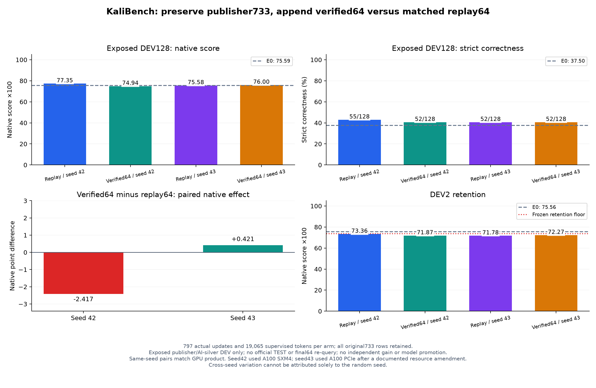

# 追加数据与重放对照：四组实际结果

四组训练和逐题复算完成。每组797次更新、19,065个监督token，原始733条均保留。A18在旧排队失败后，由用户明确要求重试，数值协议和硬件筛选保持不变。

| 组别 | 数据 / 种子 | strict/128 | native×100 | DEV2×100 | 通过全部保留门槛 |
| --- | --- | ---: | ---: | ---: | --- |
| A15 | 重放 / 42 | 55 | 77.354 | 73.356 | False |
| A16 | 新增 / 42 | 52 | 74.936 | 71.873 | False |
| A17 | 重放 / 43 | 52 | 75.583 | 71.777 | False |
| A18 | 新增 / 43 | 52 | 76.004 | 72.272 | False |

- A16-minus-A15：新增数据相对重放的均分变化 -2.417 分，严格正确变化 -3 题。
- A18-minus-A17：新增数据相对重放的均分变化 +0.421 分，严格正确变化 +0 题。

两个种子和已暴露DEV只能提供方向诊断；不据此选择种子、晋升模型或宣称独立泛化收益。种子42使用A100 SXM4，种子43使用A100 PCIe；同种子配对型号相同，跨种子变化不能全部归因于随机种子。

原生分为部分匹配评分，不是准确率。分项变化描述观察到的错误，不能单独证明训练机制或命令运行语义。新增数据为4种工具、32个相关任务族的AI银标，未经独立专家金标验证。

本轮没有官方TEST查询，也没有重新查询上一轮final64。旧结果继续保留；当前报告是新增对照的完整记录。

[完整汇总与诊断](summary.json) · [冻结设计](DESIGN_ZH.md)

两个种子的配对方向不一致：种子42为负，种子43小幅为正且严格正确数不变。四组均未通过DEV分组保留门槛，继续保留原模型E0。不能把本轮结果表述为稳定增益，也不能认定新增数据在所有种子上都造成退化。

四组对新增数据覆盖的四道DEV工具题均为0/4严格正确；两个配对在这四题上的输出都没有变化。观察到的改善/退化来自其余题目；训练题是否学会、具体迁移机制仍未验证。

[完成核验与清理记录](completion-audit.json)
