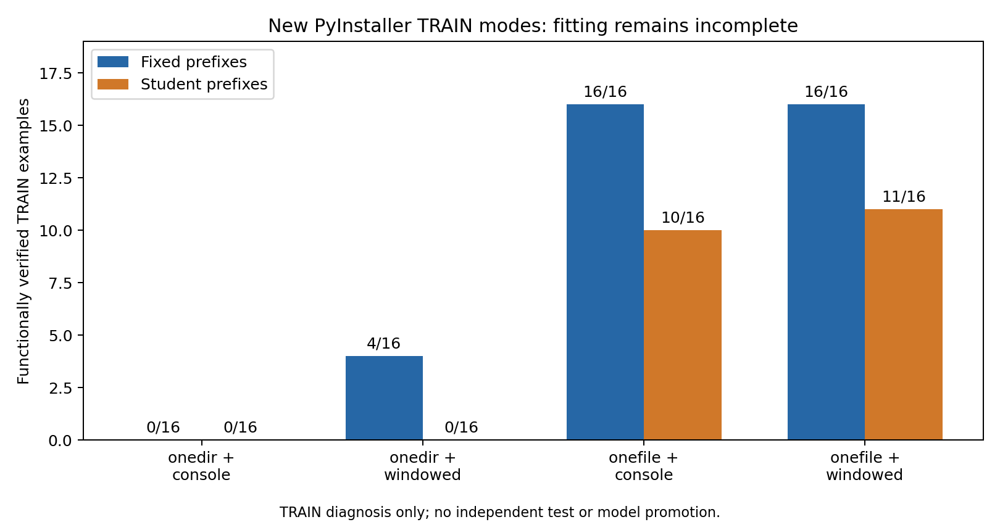
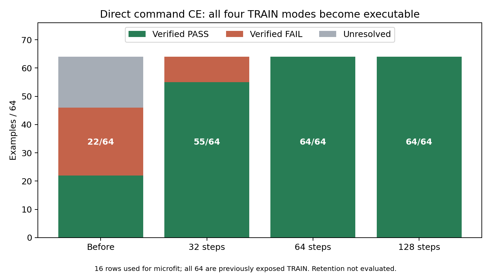
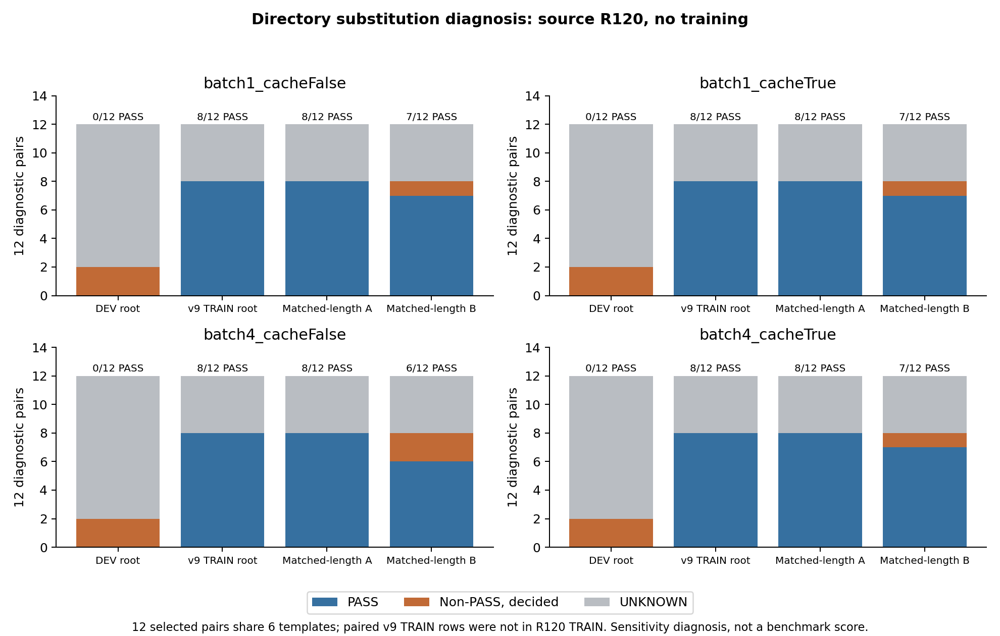
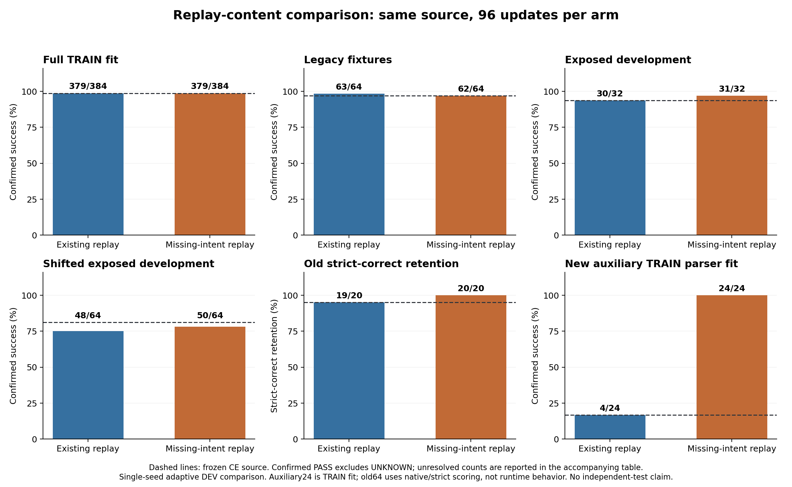

# 模式拟合与保持诊断

本轮剩余的 **v11目标对照、v12目录/推理设置诊断、v13回放内容对照均已完成**，不再有排队或运行中的本轮任务。最新结果是：补充缺失意图恢复了原模型正确旧题的20/20保持，旧64题strict为25/64、已曝光DEV32为31/32，但组合DEV64为50/64，低于起点52/64，仍未通过全部冻结门槛。**局部退化已修复，整体问题未解决，不推广模型。**

本轮是RedSage 8B系列适配器的固定SFT诊断，不是新一轮原始Qwen或ABA搜索；Han要求的可靠自动后训练收益尚不能据此宣告实现。以下v9/v10为历史背景，v11/v12/v13为此次完成的实验。

v9 两组192步训练及完整TRAIN384核验已完成，均未通过综合准入。固定前缀R通过352/384，学生采样前缀RK通过338/384；原正确旧题均保持19/20，旧夹具61/64。已曝光组合开发44→56/64是适应性开发收益，不能称独立泛化。

新增PyInstaller64的四模式结果见图。hardlink TRAIN128/128但组合开发8/16，提示参数/上下文敏感，尚未排除batch与数值影响。旧回放缺少端口、表格输出等关键意图。三类问题需要分别检验。



R/RK均无标准greedy提前EOS或截断。RK增加采样后训练加采样成本约1.74倍，本配置未显示主指标优势。冻结教师、q/v LoRA和混合损失不同于SDFT论文的EMA全参数配置，不称论文复现。

v10使用单卡完成TRAIN-only直接命令CE诊断：教师全部64题、四模式平衡16题微拟合、32/64/128步保存。它不含旧能力回放，也不作为可推广模型；功能核验结果见下表。后续依次为等预算CE/KL对照、hardlink参数不变性、旧意图覆盖和稳定基线后的ABA。

本目录的完整TRAIN与模式统计来自保存结果重新核算。UNKNOWN保持未决。未发布私有权重或确认题；本次新确认64和官方TEST未查询，另一Qwen研究已查询过其内部384题，不能合并声称全项目保留集未曝光。

## v10 TRAIN-only 直接 CE 微拟合结果

| 状态 | 全64功能PASS | 微拟合16功能PASS |
|---|---:|---:|
| teacher | 64/64 | 16/16 |
| source | 22/64 | 5/16 |
| micro32 | 55/64 | 14/16 |
| micro64 | 64/64 | 16/16 |
| micro128 | 64/64 | 16/16 |

实际完成128步；教师权重保持不变。仅16条参与本次微拟合，其他48条仍属于此前已曝光TRAIN，不是独立测试。没有检查旧能力，不推广该适配器。
微拟合门槛：通过。



第一项微拟合已经通过，但不证明旧能力保持或混合目标的唯一因果。v11已完成并核验：同R120起点、同384条新TRAIN和旧回放、每组192步、LR5e-6，仅替换新命令主目标；完整结果见下文。

## v13 回放内容对照：冻结设计（现已完成，结果见后文）

v13从v11直接CE端点固定起步，不根据其开发评分选择起点；两组各96步、各增加24条辅助回放，每条曝光16次。控制组重复已有可信用法，实验组加入经上游参数解析器和编码检查的缺失意图；两组公共训练数据、损失权重、优化器和顺序相同。原R120仍作为旧命令KL锚点。该对照检验回放内容的作用，不把训练题拟合或开发集适应称为独立泛化。协议与本机预检在结果产生前保存；本轮已完成两组训练、全部评分、导出与资源清理。原始预注册记录中的PREPARED状态是历史设计状态，不代表当前运行状态。

## hardlink 未决项的独立参数诊断

在相同运行镜像中确认 `hardlink` 为 util-linux 2.37.2；无目录操作的 `hardlink --name --help` 返回退出码1，明确报告 `--name` 为未知选项。v9两组各5条 hardlink UNKNOWN都包含该选项，因此能补充确认这些案例具有无效参数。冻结的主评分和UNKNOWN上下界不回写；补充证据单独保存，不增加任何PASS。文档参照：[util-linux v2.37.2](https://github.com/util-linux/util-linux/blob/v2.37.2/misc-utils/hardlink.1)。

## v11 同数据、同顺序、同更新预算的目标对照：已完成

同一张 A10、相同 R120 初始适配器、每组192个实际非零梯度更新。R为条件教师反向KL加0.1倍完整输出CE；RK在此版本仅是历史存储名称，实际为直接命令CE加0.1倍完整输出CE，**没有学生采样前缀**。两组可信旧例CE和通用旧例KL完全相同，教师未改变，两个端点权重均导出并核验SHA。

| 功能检查 / 保持项 | 起点R120 | 条件KL | 直接CE |
|---|---:|---:|---:|
| 完整TRAIN384 PASS | 本轮未测完整384 | 353/384（1 UNKNOWN） | 379/384（2 UNKNOWN） |
| 新增平衡PyInstaller64 PASS | 本轮未测该子集 | 36/64 | 63/64 |
| 旧功能夹具64 PASS | 64/64 | 61/64（1 UNKNOWN） | 62/64 |
| 已曝光DEV32 PASS | 30/32 | 30/32 | 30/32 |
| 已曝光组合DEV64 PASS | 44/64（10 UNKNOWN） | 56/64（5 UNKNOWN） | 52/64（6 UNKNOWN） |
| 原模型正确旧题保持 | 20/20 | 19/20 | 19/20 |
| 起点正确旧题保持 | 24/24 | 23/24 | 23/24 |

两组在主面板、完整TRAIN和组合DEV均无截断。TRAIN384实际包含368条自建夹具和16条历史TRAIN例；PyInstaller总计152条，新增平衡64条只是其中一部分。以完整384个训练ID与对应参考逐题关联，避免漏掉16条历史例。


**结论是混合的，不能只报TRAIN提升。** 直接CE相对KL多得到27个TRAIN PASS、少1个，净增26。新增PyInstaller四模式分别从16/16、16/16、0/16、4/16变为16/16、16/16、16/16、15/16。这支持在当前预算下采用直接监督解决模式拟合不足。两组训练部分分别约1887秒和1885秒；这些不是包括加载、推理、评分的端到端成本。源码成本复查还发现：v11的CE分支保留了768次未用于其损失的无梯度新任务教师前向，因此不能用这组相近耗时认定两种优化实现的成本相同。已冻结的v13实现移除了这项冗余，仍保留旧能力KL所需的教师前向；已完成v11的训练和评分不改写。

但直接CE在组合DEV上净少4个PASS：hardlink从8/16到10/16，PyInstaller从16/16到10/16。6个PyInstaller退化输出都遗漏了所需`--noupx`，并加入`--windowed`；其中4个还缺少`--console`。这反映当前组合/上下文适应仍不可靠，不能因为TRAIN接近满分就推广模型。两组均把一条旧端口用法的有效`--neo4j-port`写成无效`--bolt-port`；旧题总strict仍为24，是因为另有1题新变正确，不能掩盖配对丢失。

证据边界：本轮是单种子、同GPU的目标干预，不是原始Qwen训练，也不是ABA搜索。目标替换同时改变梯度尺度：KL有146/192步触发范数1裁剪，CE为62/192步；尚未单独控制裁剪强度或蒸馏软分布，不能认定某一种数学机制为唯一原因。所有结果都是TRAIN或已曝光开发诊断，官方TEST与新确认64未查询，两个端点均未获推广资格。

中间语法统计曾将解释段的选项当作实际命令参数；现已改为只解析唯一`<output>`片段。原始生成与冻结功能评分均未改变。修正记录见`v11-mode-syntax-audit.json`，正式结论始终使用Linux功能判定。

### 核验与复现范围

公开的`v11-functional-details.json`、`v11-native-details.json`、`v11-panels.json`和`v11-training-audit.json`支持逐题重算。运行：

```bash
python3 scripts/verify-kali-mode-repair-public.py
python3 scripts/verify-kali-remaining-public.py
python3 scripts/plot-kali-remaining-results.py
```

绘图需要matplotlib。上述验证是公开证据重算，不是重新训练；完整GPU重跑仍需要私有训练/评测材料、授权集群、模型缓存和项目内部调度依赖。公开的研究脚本用于记录方法及审计，不能误称无外部依赖的一键复现。

## v12 目录替换 × batch/cache：已完成

固定同一个R120适配器，仅更换任务中的根目录字符串，并同步更换夹具根目录；共12对选择性诊断样例，每对4种目录变体，在batch1/4与cache关/开四种设置下共生成192条输出，**0个优化更新**。根目录归一化后文件内容、大小、模式和时间戳均一致；两个随机目录控制与对应DEV提示的token长度相同。A10实际worker记录962秒，GPU和独立CPU评分任务均已清理。

| 推理设置 | 原DEV目录 PASS/12 | v9 TRAIN配对目录 PASS/12 | 等token长度随机A PASS/12 | 等token长度随机B PASS/12 |
|---|---:|---:|---:|---:|
| batch1，cache关 | 0 | 8 | 8 | 7 |
| batch1，cache开 | 0 | 8 | 8 | 7 |
| batch4，cache关 | 0 | 8 | 8 | 6 |
| batch4，cache开 | 0 | 8 | 8 | 7 |

原DEV目录每组是**2 FAIL、10 UNKNOWN**，不是已证明12个语义错误。UNKNOWN不算PASS，也不擅自当成已知FAIL。192条均无截断。



**支持的原因：** 无语义变化的目录替换能稳定改变确认通过数，且等token长度控制也出现该差异，所以不能仅用提示长度或某一个batch/cache设置解释。缓存/批量变化仍会影响少数结果：相对batch1+cache开，三组的完整响应相同数分别42/48、44/48、45/48，功能判定相同数46/48、47/48、48/48。因此不宣称完全消除了数值敏感性，也不宣称已证明某个特定单词的唯一因果。

**重要限制：** 12对只共享6种归一化模板；对应的6个v9 TRAIN题在R120的240条训练例中出现数为0。这里“TRAIN目录”是后来v9训练数据中的目录，不是R120训练过的目录。这个实验确认的是继续训练前已经存在的上下文敏感性，不能直接证明v9/v11训练导致目录记忆，也不是随机抽样的benchmark准确率。后续数据修复应在TRAIN内部加入语义保持的目录和参数值多样性，而不是把这些DEV答案复制进训练。

## v13 回放内容对照：完成结果

固定从v11直接CE端点继续，旧KL教师仍是原R120。每组96个实际非零梯度更新、每组24条辅助数据各曝光16次。公共TRAIN384、可信回放64、通用旧KL数据160和更新顺序相同；新辅助24条仅做上游源码参数解析与编码验证，没有执行联网业务、没有真人独立审核，不夸大为运行时验证数据。

| 检查项 | CE起点 W0 | 已有意图回放 R | 缺失意图回放 RK |
|---|---:|---:|---:|
| 完整TRAIN384功能PASS | 379（来自v11） | 379（1 FAIL，4 UNKNOWN） | 379（1 FAIL，4 UNKNOWN） |
| 可信TRAIN64 strict | 本轮未重测 | 64/64 | 64/64 |
| 缺失意图辅助TRAIN24解析匹配 | 4/24 | 4/24 | 24/24 |
| 旧64题strict正确 | 24/64 | 23/64 | 25/64 |
| 原模型正确旧题保持 | 19/20 | 19/20 | 20/20 |
| 起点正确旧题保持 | 24/24 | 23/24 | 24/24 |
| 旧64题native部分得分 | 76.6406 | 76.0069 | 76.8750 |
| 旧功能夹具64 PASS | 62/64 | 63/64 | 62/64 |
| 已曝光DEV32 PASS | 30/32 | 30/32 | 31/32 |
| 已曝光组合DEV64 PASS | 52/64（6 UNKNOWN） | 48/64（6 UNKNOWN） | 50/64（6 UNKNOWN） |

“旧64题”是原生/strict评分的旧能力面板；“旧功能夹具64”是另一套执行行为检查，不能互换。旧保持20/20也不意味着所有64题都正确。两组主192题、完整TRAIN384及组合DEV64均无截断；可信TRAIN64也无截断。



### 逐题原因核验

1. **缺失用法确实可通过定向监督恢复。** 起点和已有意图回放都在`sample_4867`生成不存在的`--bolt-port`；缺失意图组恢复为上游支持的`--neo4j-port`，参数解析及取值与参考一致。`sample_2933`在控制组新增无效`--details --layout`，实验组保留有效`--tabular`。实验组对起点旧题没有新损失，新增正确1题；这比只报告总分更能说明恢复位置。
2. **重复已有正确用法没有覆盖缺口。** 两组可信TRAIN64均64/64，但新的缺失意图TRAIN24在起点和控制组仅4/24匹配（smb2-quota 4/12、sprayhound 0/12），实验组为24/24。它支持在该配方下增加缺失用法覆盖，比重复既有用法更适合修复这两个已观察问题；24题是训练拟合，不是独立测试收益。
3. **组合任务仍退化，且两组共同发生。** 相对起点，R没有新增PASS、丢4题；RK没有新增PASS、丢2题。共同丢失的2题均为PyInstaller组合需求，输出都遗漏`--noupx`。R另外在hardlink中新增无效`--name`，或把实际合并任务改成`--dry-run`。组合面板分工具结果如下。观察到的输出差异不等于证明唯一的梯度机制；两组都丢同2题，也不能把该退化单独归罪于新增的缺失意图数据。

| 组合DEV功能PASS | W0 | R | RK |
|---|---:|---:|---:|
| hardlink | 10/16 | 8/16 | 10/16 |
| PyInstaller | 10/16 | 8/16 | 8/16 |
| virtualenv | 16/16 | 16/16 | 16/16 |
| dnstwist | 16/16 | 16/16 | 16/16 |

两组完整TRAIN的hardlink128/128、PyInstaller151/152，而对应组合DEV仍显著不足。这是训练拟合与组合/上下文迁移的落差；结合v12可确认对上下文变化的敏感性，但尚未证明增加某种数据一定能解决。UNKNOWN继续保持未知，本轮没有为通过门槛而重写评分器。

### 实现、统计与资源核验

- 三套主面板基线各192条、起点组合面板64条，与v11对应保存结果逐字段一致，共640条；支持本次基线加载/生成的可重复性，不能推广为跨所有GPU完全确定。
- 真实更新各96步、非零有限梯度；冻结源和旧教师哈希不变，四个v11/v13端点的实际本地权重与导出记录重新计算SHA一致。
- v13公共行顺序一致、辅助曝光一致，但不是严格token/FLOP配平：两组辅助完整输出token曝光为9920/12544，命令为5408/8704。内容、工具分布和长度共同变化，不能单独识别某一个因素的因果效应。
- v13两组训练窗口约1080/1081秒；裁剪步数12/96与40/96。实验组辅助损失前16步均值0.5432降到后16步0.0007；旧KL均值从0.0033升至0.0073。这些训练迹象与真实行为评分分开报告，不能用低loss证明没有遗忘。
- 本轮14个命名Job都已结束且其Job/Pod/ConfigMap/NetworkPolicy清理完成；13成功，v11第一次预检失败、0更新，其记录保留。GPU容器顺序执行，总容器墙钟13314秒（3.70小时），包含加载、推理、等待和失败预检，非纯训练耗时或账单。v13在最后CPU评分前已释放GPU。持久缓存保留，未处理其他人的资源。

**决定：** 两组仍不满足旧功能夹具全部通过和组合DEV至少56/64、每工具至少14/16的冻结要求；`eligible=[]`，不推广、不查询新确认64或官方TEST。即使部分指标改善，本轮也不称新的ABA胜利或独立泛化提升。

### 下一研究阶段（尚未运行）

先在TRAIN内部增加语义保持的目录、参数值和组合约束变体，用现有Linux功能正反例检查标签，保留本次有效的缺失意图监督；不要把已曝光DEV的具体答案复制到训练集。随后冻结数据、评分器和每工具保持门槛，在相同起点、总更新/目标token预算与明确端到端成本下比较固定SFT和真正的原生ABA候选搜索。先通过开发门槛，再按单次预定协议使用保留的确认集。若继续失败，应报告阴性结果和适用范围，而不是反复增加训练步数或降低门槛。

本次请求对应的剩余诊断实验已全部完成；上面的新研究阶段不能误记为已经执行。
