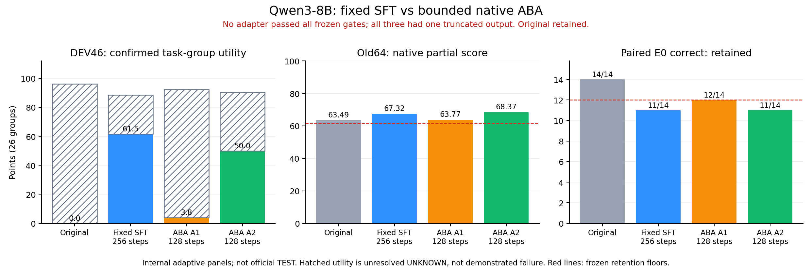
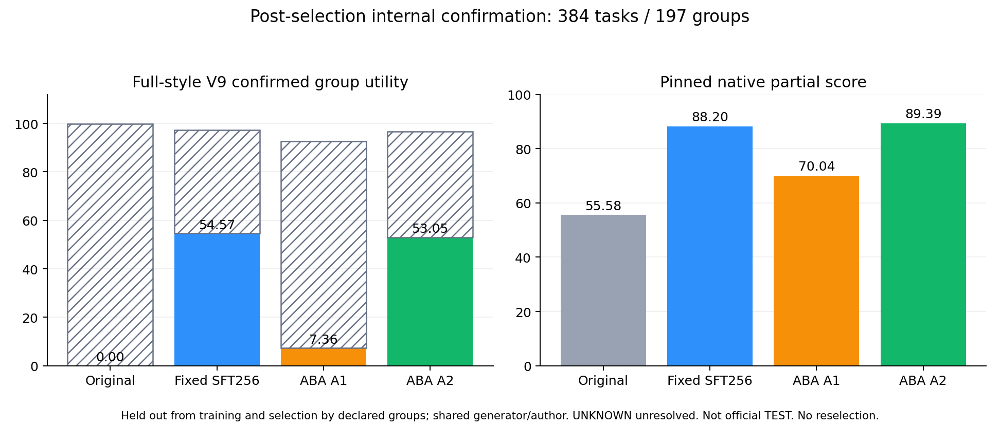

# 原始 Qwen3-8B：原生 ABA 与固定 SFT 对照

状态：**真实原生 ABA 的两候选搜索、训练、评分、Finalizer 与权重恢复均已核验**。原生 ABA 选中 **A1**；预先冻结的主机保留规则选择 **E0**。原生胜者相对固定 SFT 的选择分差为 **+1.000**；原生胜者未通过准入，选择分差不能解释为优于固定SFT。分数是本实验的效用与保持目标，不是官方榜单准确率。

|模型|新DEV46原生分|新DEV46严格匹配|行为PASS / FAIL / UNKNOWN / 无效|组宏平均确认效用|旧64原生分|旧64严格匹配|历史13题保留|本次E0答对题保留|准入|选择分|
|---|---:|---:|---|---:|---:|---:|---:|---:|---|---:|
|E0|32.88|0/46|0 / 1 / 45 / 0|0.00–96.15|63.49|14/64|13/13|14/14|通过|0.000|
|fixedSFT256|85.68|30/46|32 / 2 / 11 / 1|61.54–88.46|67.32|18/64|11/13|11/14|未通过|-103.000|
|A1|47.64|2/46|2 / 3 / 41 / 0|3.85–92.31|63.77|14/64|12/13|12/14|未通过|-102.000|
|A2|83.88|24/46|26 / 3 / 17 / 0|50.00–90.38|68.37|18/64|11/13|11/14|未通过|-103.000|

截断按110题统一检查：固定SFT的一条来自新DEV的`look`题；A1、A2的截断各来自旧64题。较低学习率的A1仍有旧题输出可靠性问题，并非三份适配器都在同一道`look`题上失败。

## 实际执行

固定 SFT 是上轮真实训练256步的已核验适配器，此次重新在相同输入与评分协议下评测，没有冒充新训练。ABA 的 A1、A2 都从原始 `Qwen/Qwen3-8B` 的不可变修订 `b968826d9c46dd6066d109eabc6255188de91218` 开始，使用相同256条TRAIN（新题128＋发布方重放128），每个候选128次真实非零梯度更新，合计256次新更新、31,100个监督目标token，与固定SFT的总目标token曝光量一致。基座BF16冻结；训练FP32的q/v LoRA（r16、alpha32、dropout0），AdamW、microbatch1/累积4、逐目标token归一化CE、梯度裁剪1。学习率由原生流程在预先允许集合中选择，实际配方与耗时见 summary.json。

真实框架固定到 `c8bd734cafd5a7cd609efb5f561594bde4107d5b`，原生运行ID `d3606cecd35a4bc69aac42bd321cbf85`，保留原生 Setup、Verifier/Reviewer、Designer、Worker、Score、Finalizer。主机在验证原生 Worker 正处于运行状态后才执行 GPU 请求；没有把手工循环或缓存权重算作新 ABA 训练。Finalizer 四个文件与原生所选输出字节一致。所有新评测和 ABA 候选训练使用相同 GPU 型号：`NVIDIA A10`；上轮固定 SFT 的训练 GPU 是 RTX3090。候选权重均恢复到本机并核验SHA256，重新加载后四条完整生成逐字相同。

## 验证与保持规则

新DEV46覆盖9工具、26个声明任务组，由已曝光的四工具DEV32加14条辅助CLI题组成；按组而非逐题宏平均，减少同组变体重复计权。46题的参考答案、等价写法及该版本所提供的错误反例均通过Linux实测；模型命令仅在有限白名单和实际外联阻断后执行。无法审查的替代写法仍记UNKNOWN，没有强行改成错误。

旧能力以旧64题原生部分分、严格匹配总数、历史13道答对题逐题保留，以及本次E0答对题保留率共同衡量。候选必须保持旧分不低于E0−2分，历史至少11/13，且本次E0答对题至少保留80%，110题无截断或过早EOS。选择分为 `新确认效用−E0效用 + 0.25×旧分变化 −10×历史丢失/13`；不达准入门则使用冻结惩罚分。原生候选另与E0、固定SFT竞争，持平保留原模型。

## 解释范围

这是单种子、两个128步候选的有限学习率搜索。其**总更新数**与固定256步SFT相同，但所选候选只有128步；两次新初始化、不同历史训练GPU和实际墙钟开销意味着不能宣称端到端算力严格相等，更不能据此评价ABA普遍优劣。没有在本轮生成新的训练数据。虽然新题与旧重放各128条，但按目标token计每轮是5192与2583，约2:1；不能把等行数误称为等梯度权重。固定SFT与ABA均使用同一配比。

E0在46道新题上的45个UNKNOWN不能算作语义错误；其确认效用0是有限验收器的已确认下界。原生ABA选出候选时使用同一冻结规则，不能把其相对0的确认效用增量直接宣传成真实准确率提升。

14条辅助DEV覆盖5个TRAIN中未见的工具。四种模型在这14题上均没有有限验收器确认的PASS；多数仍是UNKNOWN，不能等同于语义正确率0。现有确认通过都集中于四个已训练工具，尚未建立跨工具改善。

本次旧64输入与上轮逐字相同，但当前旧题从整体110题的第46个位置开始，和历史旧题独立起始的batch组成/左padding不同，GPU也发生变化；历史13道与本次E0的14道答对题分别报告，不能把数值变化单独归因于GPU。当前所有模型共享完全相同的110题输入与batch组成。

这46题属于自适应开发集，旧64题属于便利保持面板；AI银标与正反例检查均不能替代独立专家金标。辅助工具部分只有单题；UNKNOWN只说明未确认，原始模型的UNKNOWN不能解释为零语义能力。这里的严格匹配、原生部分分与行为通过数是不同指标。本阶段已完成选型后内部384题确认；它共享生成器与作者，并不构成外部独立专家测试。官方TEST查询为0，历史final64未重查。本报告不作全KaliBench、榜单提升或模型推广结论。

所有实际失败与零输出排队尝试保留在私有运行记录中；缺失CPU工具和提交池构造错误在第一条模型输出前修复并加入检查。未绕过配额、优先级、taint或保留节点，也未改动他人的任务。GPU任务、CPU评测与导出器及原生CPU VM都已清理；持久缓存和私有权重保留供复查。

## 选型后的完整配置复核

V8仅核对clang-format请求的覆盖属性，不能证明基础LLVM/Google配置和未请求属性都正确。搜索开始后发现这一源码盲点，因此保持原始选择分与候选不变，新增V9作为补充复核：比较完整有效配置（忽略YAML注释），增加“错误基础风格”和“多改一个属性”两类反例。所有现有DEV输出都做同样复核，没有额外生成或挑选赢家。其他工具状态必须保持一致。

|模型|V8确认组效用|V9完整配置复核后的组效用|状态改变题数|
|---|---:|---:|---:|
|E0|0.00|0.00|0|
|fixedSFT256|61.54|61.54|0|
|A1|3.85|3.85|0|
|A2|50.00|50.00|0|

## 选型后保留集确认

先冻结原生选型，再读取旧release中此前未查询的384题。分配元数据和实际ID/题目检查确认当前TRAIN、选择DEV与它无声明任务组/原题交集；它有197组、8工具，仍共享作者、生成器和基本技能。384题参考/等价命令、所有提供的反例，以及154个clang-format任务的基础配置/额外设置反例均先通过目标Linux检查，之后才调用模型。在任何保留题被读取前，将原来的三模型确认计划扩为完整四模型队列：原模型、固定SFT、A1、A2各查询384题一次，共1536条。此项范围修订及理由另行封存；原生winner和主机保留决策不变，没有根据确认结果重新训练或更换候选。

|模型|保留集原生部分分|严格匹配|V9行为PASS / FAIL / UNKNOWN / 无效|组宏平均确认效用–未决上界|截断|
|---|---:|---:|---|---:|---:|
|Original|55.58|0/384|0 / 0 / 383 / 1|0.00–99.75|1|
|Fixed SFT256|88.20|209/384|214 / 8 / 161 / 1|54.57–97.21|1|
|ABA A1|70.04|20/384|29 / 26 / 327 / 2|7.36–92.64|2|
|ABA A2|89.39|207/384|209 / 11 / 163 / 1|53.05–96.70|1|

独立的格式统计显示：原始模型和固定SFT各有383/384条包含且仅包含一个闭合输出块，A1为382/384、A2为383/384。因此原始模型严格匹配为0不能仅归因于未使用输出标签，具体命令与有限验收范围仍需分别判断。格式统计见confirmation-format-audit.json。

原模型在确认集中也有一条截断；保留E0是冻结开发准入规则下的选择，不表示原模型已经通过所有输出可靠性检查。

该集合PyInstaller154题、clang-format154题，合计约80.2%，分工具结果同时公开。这是内部组合保留集，不是官方KaliBench TEST或全榜单成绩。行为上界只是UNKNOWN可能性的界限，不是置信区间。原生部分分与严格匹配各有局限；不把有限白名单下的0个确认通过解释成模型0%语义能力。

## 输出可靠性与具体旧题错误

固定SFT的三条本次E0已严格答对而失去的题，分别涉及metacam增加未支持的`--no-xml`、d2j把`--arg-types`改成`--type`、expect把`-c`脚本改成`--inline --log_user`等命令行参数。当前[Kali metacam帮助](https://www.kali.org/tools/metacam/)、[dex2jar参数源码](https://github.com/pxb1988/dex2jar/blob/2.x/dex-tools/src/main/java/com/googlecode/dex2jar/tools/DecryptStringCmd.java)和[Expect主手册](https://www.tcl-lang.org/man/expect5.31/expect.1.html)支持这些具体命名/绑定错误的判断；没有执行这些旧模型命令。它们不是仅靠参数顺序即可消除的严格分差。

新的look题在SFT训练中没有样本。原始模型生成的是grep管道，因有限安全验收范围保持UNKNOWN；问题没有明确限定工具和词序，因此不能凭UNKNOWN判其语义错误。固定SFT出现长串grep参数变体、未闭合输出、1024token截断，这是可直接观察的可靠性问题。

选型后另用相同四题batch、相同GPU/预算，对四种模型做guard开启/关闭诊断，共32条已曝光DEV输出，独立于384题确认。它只检验重复屏蔽是否是截断的唯一原因；原始选择分保持不变，raw输出的语义正确性不由是否截断决定。

|模型|guard开启时截断|guard关闭时截断|guard四题复现一致|
|---|---|---|---|
|qwen_base|False|False|True|
|fixedSFT256|True|True|True|
|A1|False|False|True|
|A2|False|False|True|

A1在旧64的`lsirq`题、A2在旧64的`naabu`题也达到1024token且未闭合输出。上表的guard/raw诊断只覆盖`look`所在的四题batch，不能据此解释这两个旧题截断；它们的机制仍需单独检验。聚合输出可靠性证据另见output-reliability-audit.json，没有执行这些旧题命令。

同一当前协议下更换适配器会改变输出，但本轮没有独立干预数据比例、学习率、步数各因素，因此不把某个超参数或某条训练数据说成已完全证明的根因。

## 执行勘误与复核范围

冻结任务README残留“一张RTX3090”的文字；真实资源修订、每个Job配置和CUDA回执均为A10，并以它们为准。未静默修改已验收的任务文件。原生Worker还自行恢复了wait客户端临近截止时的RPC超时，并在自动记忆写入被沙箱拒绝后改用允许的scratch路径；没有重复提交GPU或绕过保护。原生最终完成与未恢复的执行失败另由真实journal核验。

当前报告记录完整工程通路和有限预算实验，不等于已经建立可靠的广泛网络安全能力提升。所有正负结果保留，未用确认集重选模型。
