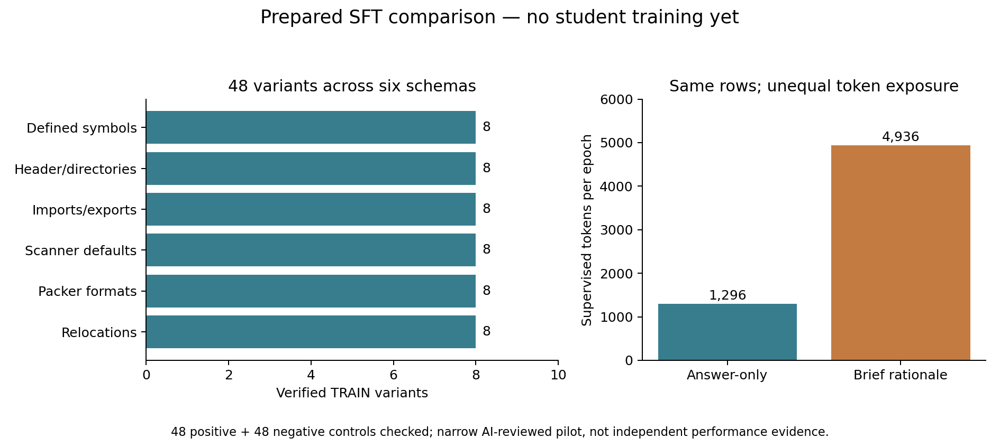

# 简短教师解释数据与 SFT 对照准备

**状态：准备完成，未启动学生训练。** 已修正此前两条有问题的解释，构建并验证48条TRAIN变体，取得48条依据资料与正确命令生成的教师解释，完成两个SFT数据版本、训练/评测脚本及预检。不能把这些准备工作报告成模型提升。

## 已做好的数据

| 检查项 | 结果 |
|---|---:|
| 自编TRAIN变体 | 48条，6个结构家族、5种工具 |
| 正确命令功能检查 | 48/48通过 |
| 错误对照 | 48/48被验收器拒绝 |
| 教师解释返回／截断 | 48／0 |
| 保留原文的教师解释 | 36 |
| 经AI编辑修订的解释 | 12 |
| 原有问题解释修复记录 | 2 |
| 两组编码、提示屏蔽与EOS检查 | 96/96通过 |

六类任务为：去修饰符号与重定位、packer报告格式、默认扫描报告、仅导入导出表、可选头部与数据目录、已定义符号及大小排序；每类8条。变体包含问法、文件名、含空格路径和部分格式值变化。**48条不是48个独立任务家族**，覆盖范围仍窄，不能据此预计整个KaliBench都会提升。

所有变体继承已隔离TRAIN父结构，和冻结的DEV24、confirmation24及旧能力面板没有相同粗粒度结构组；没有把保留集题目发给教师。readpe的原始“完整报告”疑点没有偷偷改分，而是在新自编TRAIN题中明确改成“只输出导入导出表”。pehash的XML缺陷家族没有纳入。

## 如何验证

在短时CPU容器里安装固定提交的readpe 0.85.1，配合LLVM14，对自行组装的无害ELF/PE文件进行静态分析。测试使用参数数组调用固定工具，不执行目标二进制，也不接触外部目标。

每条数据都有一个正确命令和一个负对照。检查包括输出格式与字段、符号去修饰、导入/导出范围、头部/目录范围、默认文本输出；符号表另核对大小为1和6的两个定义符号及顺序。负对照包括格式不符、遗漏所需内容或不满足任务约束的有效命令，验收不只是检查退出码。

这些是局部样例上的程序验证，不能等同于任意文件上的正确性。CPU任务已清理，本阶段未申请GPU、未执行8B训练。

## 教师解释来源及修正

教师实际响应模型为 **Qwen/Qwen3.8-27B-FP8**（NRP `qwen3-small`）。输入包含新TRAIN题、已验证的正确命令和工具事实，要求输出简短解释及原样命令。因此这是**正确答案与资料条件下生成的解释**，不是48次独立解题成功，也不是未经修改的原生长推理轨迹。

训练目标只使用可见的简短解释，不使用接口返回的原生reasoning字段。AI逐条检查后：

- 原有packer解释不再把默认数据库描述成内置、必然存在或保证检测结果；保留默认文件查找的准确含义。
- 原有默认报告解释去掉无依据的verbose/details开关举例。
- 新解释中修订了12条：避免对选项不存在作过度断言，修正“没有运行时依赖”等说法，并将SysV大小列描述为包含而非追加。

原始响应、修订文本、理由和哈希均留在本机。36条解释未编辑，12条明确标记AI编辑；没有冒充独立真人签核或声称语义审核绝对无误。工具依据包括[readpe固定版本源码](https://github.com/mentebinaria/readpe/tree/0.85.1/src)和实际安装版本的帮助及运行输出。

## 冻结的两组对照

| 项目 | Answer-only | 简短解释SFT |
|---|---|---|
| 底座 | 原始Qwen3-8B，同一固定revision | 相同 |
| 训练题与最终命令 | 48条 | 完全相同48条 |
| 官方Qwen模板 | 同一个thinking-enabled提示，空think内容 | 同一个提示，think内放审核后的简短解释 |
| 提示词标签 | 全部屏蔽 | 全部屏蔽 |
| 最终命令token | 与另一组逐条一致 | 与另一组逐条一致 |
| 训练轮数／更新次数 | 4轮／48次 | 4轮／48次 |
| 每轮监督token | 1,296 | 4,936 |
| 最长训练序列 | 107 token | 192 token |

固定配置：BF16、LoRA r16/alpha32、q_proj与v_proj、dropout0、学习率2e-5、AdamW、weight_decay0、microbatch1、有效batch4、seed3407、最大长度1024、梯度裁剪1。每组从原始底座和新LoRA开始，顺序训练，不继承上一组adapter；启动器会核对两组初始adapter哈希一致。

损失为标准因果assistant-token交叉熵，prompt不参与损失，按有效batch的目标token数归一化。另记录命令部分loss，便于区分总loss下降和命令学习改善。采用官方完整聊天模板编码，验证开闭think标签、EOS、token边界及解码回环，未手工替换特殊token。

**公平性边界：题目、答案、初始化、顺序、轮数、更新次数和超参数相同；监督token数、序列长度、算时及标准token均值损失下的命令相对权重不同。** 解释组每轮监督token约3.81倍。这是实用SFT配方对比，不是等算力或完全分离推理机制的因果实验。两组固定采用最后第48步，不看DEV挑最佳checkpoint。

## 已准备的评测

对原始底座、answer-only最终adapter、解释最终adapter，分别运行相同的DEV24和已暴露旧能力64题，共计划264次回答。推理固定为官方thinking-enabled提示、贪心解码、最多1024新token、batch4。评测请求只有问题，不含参考答案。

报告原生部分分数、严格匹配、逐题变化、无效/截断、生成成本，并单独计算新配对底座原本答对的旧题保留率。保留能力的预设检查为至少95%的底座正确旧题仍正确，且无效/截断不增加；分母为0时不宣称通过。旧能力面板不是独立测试集。

confirmation24和官方TEST继续不调用。此单种子窄范围pilot不直接晋升模型；若出现值得继续的方向，再另行冻结更大数据或多种子实验。

## 脚本与当前验证程度

已准备四个通用脚本：训练单臂、评测单个模型状态、配对评分、顺序启动整组实验。启动器默认只检查计划，只有传入 `--execute` 才运行；总时长限制3小时，顺序调用，不并行占用多张卡。GPU环境仍需满足固定依赖及原始模型文件SHA。

已通过5项CPU测试，覆盖因果标签移位、prompt梯度屏蔽、变长有效batch归一化、标签泄漏拒绝和评测输入无答案；两个训练臂预检与88题评测预检通过，完整启动计划校验通过。**这些不等于完整8B CUDA训练或adapter重载已经跑过**。实际启动后还必须检查梯度、权重变化、两组初始化一致性、保存与重载，并按冻结协议评分。

公开汇总可运行：`python3 scripts/verify-kali-rationale-prep-20261117.py`。原始训练数据、教师回答、逐题审核和私有执行清单没有上传公开仓库，因此公开仓库不是完整的一键复现包。本机已生成两份训练JSONL、编码后的共同payload和执行清单。

下一步是用一张兼容GPU执行这组固定对照，再依据结果判断简短解释是否改善新题表现及旧能力保持。本轮只完成用户要求的准备和核验，没有新增训练效果结论。
