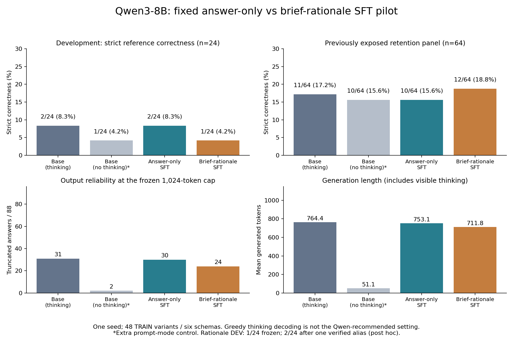
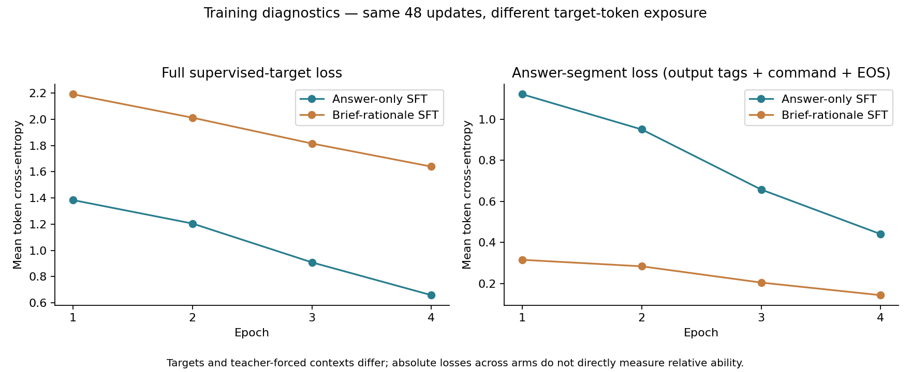

# Answer-only 与简短解释 SFT：完整运行、核验与原因分析

**两组训练、264条主评测和88条额外提示模式对照均已完成，GPU资源已清理。当前没有证据支持替换原始底座。** 冻结评分下开发集为2/24、2/24、1/24；最后一个差异来自一个经官方源码确认的合法选项别名，单独作事后敏感性检查后为2/24、2/24、2/24。不能将这个评分差异称为已证实的功能退化，也不能将修正后的持平称为提升。

本实验比较的是**训练目标**：仅答案与简短解释加答案。两组主评测均使用thinking-enabled提示；它们不等于“推理时不开思考”与“推理时开思考”两种部署方式。

## 完整结果

以下为预先冻结的原始参考评分，未因后续分析而修改。

| 模型状态 | DEV24严格参考匹配 | 旧能力64题严格参考匹配 | DEV／旧题截断 | 旧题原本答对的保留率 |
|---|---:|---:|---:|---:|
| 原始Qwen3-8B，开启思考 | 2/24（8.33%） | 11/64（17.19%） | 14／17 | 基准 |
| Answer-only目标SFT，开启思考 | 2/24（8.33%） | 10/64（15.63%） | 9／21 | 9/11（81.82%） |
| 简短解释目标SFT，开启思考 | 1/24（4.17%） | 12/64（18.75%） | 9／15 | 10/11（90.91%） |
| 原始底座，关闭思考：额外对照 | 1/24（4.17%） | 10/64（15.63%） | 2／0 | 不属于主比较 |

两组SFT均未满足预设的“保留至少95%的底座正确旧题，且无效／截断不增加”要求。解释组旧题总正确数增加1题，仍丢失了1道原本答对的旧题，不能用总分抵消这个保留问题。旧题面板已在历史研究中暴露，不是独立测试集。

原生部分分数（0–100）：DEV依次为29.40、38.66、32.14，旧题依次为51.04、43.48、48.03。部分字段得分上涨不能代替完整命令正确；解释组的旧题严格正确数增加，但原生部分分数反而下降。

主比较中，解释组相对answer-only在DEV是0题新增正确、1题减少；旧题是3题新增、1题减少。对应双侧精确配对检验p值分别为1.0和0.625。这是小样本、单种子、窄覆盖pilot，不构成可靠优势证据；p值也不证明两者等效。

## 查明的评分别名问题

逐题复核发现，DEV唯一减少的正确题使用了一个合法的LLVM长选项拼写，冻结标签的别名列表没有包含它。LLVM 14.0.6的官方选项定义将相应单横线和双横线拼写映射至同一选项，并定义了短选项别名。[固定版本官方源码](https://github.com/llvm/llvm-project/blob/llvmorg-14.0.6/llvm/tools/dsymutil/Options.td)

我们保留了主评分、原始标签和全部输出，只对**这一条已确认的别名规则**作事后规范化，规则对四种模型状态及两个面板一视同仁，没有新增模型调用。结果：

- DEV：原始底座2/24、answer-only 2/24、解释组2/24；关闭思考对照仍为1/24。
- 旧题分数和保留率均不变。

这只是单一别名的敏感性检查，不是完整的功能执行评测，也没有系统排除其他等价命令被参考评分器拒绝的可能。没有为了让结果好看而覆盖冻结主分数。

## 哪些原因有证据，哪些尚未证明

**1. 训练确实执行了，尚未发现原先那类模板／标签错误。** 两组均从同一原始Qwen3-8B和相同初始LoRA开始，各执行48次更新；训练顺序、标签屏蔽、EOS及模型／输入哈希均经过检查。梯度有限且非零，保存后重新加载完成评测。本机备份与训练收据哈希一致；每组144个FP32 LoRA张量均为有限值，72个原本为零的B矩阵都已更新。以上排除了空跑、未更新adapter、拿错保存文件等具体故障，并不证明超参数最优或代码绝不可能存在其他问题。

**2. 对训练目标的拟合没有转化为可确认的新题收益。** Answer-only训练损失的逐轮均值从1.384降至0.659，解释组从2.191降至1.639，但严格开发成绩没有改善。解释组的命令段loss更低时，输入上下文包含标准教师解释；不能把这种teacher-forced条件下的低loss直接当成自由生成能力更强。我们没有做训练题的自由生成测验，因此不能仅凭这些曲线判定是充分记忆后过拟合，还是自由生成仍未充分学会。

**3. 输出预算／模式是重要瓶颈，但不是唯一问题。** 主比较的截断总数为31/88、30/88、24/88。仅关闭原始模型的思考、完全不训练，就使截断降到2/88，但严格正确数没有改善到更高水平。可见让输出更短、更容易结束并不自动解决命令和参数错误。该对照另外有3条旧题格式错误，所以“2条截断”不等于“只有2条无效回答”。

Answer-only组在这88题上没有生成任何完整的空think块；它仍保留了思考行为。准确结论是“训练用了空思考目标，但这个行为没有在这些评测提示上实现”，而不是已经成功把模型变成直接回答模型。

本轮冻结方案是贪心解码、最多1024个新token。Qwen官方对thinking模式建议采样，并提醒贪心解码可能降低表现或反复生成；因此这些结果不是推荐解码设置下的模型能力上限。目前尚未用对照分离贪心策略和长度上限各自的影响。[Qwen3-8B官方使用说明](https://huggingface.co/Qwen/Qwen3-8B#best-practices)

**4. 数据覆盖很窄，近邻任务也没有得到可确认改善。** 48条训练变体只覆盖6个结构家族、5个工具；DEV24中仅4题涉及训练见过的工具，另外20题涉及未训练工具。三组在这4题上都严格匹配0/4：两题持续截断，另外两题的输出没有使用任务所需的文档化选项组合。不能把失败全部归因于“工具没见过”，也不能认为复制更多同类模板就会解决问题。

训练题48/48显式包含工具名，开发题只有14/24包含参考工具名原文。这是输入分布差异的一个描述性证据；字面统计不包含别名或语义提示，本身不构成因果证明。

**5. 这批解释并非Han建议的完整独立解题推理轨迹。** 教师已得到经过验证的TRAIN答案和工具事实，再生成短解释；其中12条经过AI编辑。这不等于48个独立的“教师会、学生不会”案例，也不是未经修改的长推理轨迹。因此本实验没有否定“高质量教师推理轨迹可以改善SFT”的方向。

旧题变化的具体分解也已核验：answer-only相对底座新增1题、丢失2题，其中一次丢失来自截断，另一次来自参考所需参数的变化。解释组新增2题、丢失1题；一次新增来自原先截断的回答现在完成，另一次来自所需命令结构的修正，而丢失来自新发生的截断。这些是参考评分下的观察，没有对外部系统执行预测命令。

## 配置、成本与核验范围

原始模型为Qwen/Qwen3-8B，revision `b968826d9c46dd6066d109eabc6255188de91218`。同48题、4轮、seed3407、有效batch4、microbatch1；BF16底座，FP32 LoRA，r16/alpha32，q_proj/v_proj，学习率2e-5，固定最终第48步，未根据DEV挑选checkpoint。每组实际训练参数7,667,712。

两组监督token总量分别为5,184与19,744，约3.81倍差异。题目、答案、更新次数相同，但目标长度、命令token相对损失权重和条件上下文不同；不能把它解释成等token或纯推理机制的因果实验。

成功任务使用一张A100 80GB。训练循环与adapter保存各约23秒，不含模型加载和前置文件校验；三次主评测约9.2、10.1、10.1分钟，关闭思考对照约72秒。成功任务总墙钟约33.9分钟，另有此前排队时间和已丢弃的3090尝试。首次3090尝试发生软件热降频，未完成底座评测、未开始训练，其输出没有混入最终结果。所有本轮GPU任务均已清理。

完成的核验包括：冻结文件未变、两组初始化相同、逐步训练顺序／目标token数量、梯度与权重更新、adapter备份与重载、352条回答齐全、本机重新评分与集群完全一致，以及逐题得失复核。官方TEST和24题confirmation均未调用。

公开仓库只提供汇总、图表及通用核验代码；原始题目、教师回答、逐题记录和adapter留在本机／研究存储中。公开核验脚本检验汇总数学和文件哈希，不应被理解为读者在没有原始数据时独立复现了模型运行。

## 后续决策

**暂不采用任何一个新adapter，保留原始底座。** 下一轮先冻结更完整的别名／语义验收规则，并建立符合Qwen使用建议且能容纳完整回答的配对基线；将输出模式、解码和训练效果分开比较。然后收集更多独立TRAIN任务上的真实教师解题轨迹，验证教师确实会做而学生不会，再做训练规模／数据表达的消融。不能继续仅靠增加这六类模板的变体数来宣称推理数据已充分扩充。

这轮完成了两个SFT目标的受控pilot和原因排查，没有完成新的ABA搜索，也没有达成最终研究所需的稳定性能提升。
