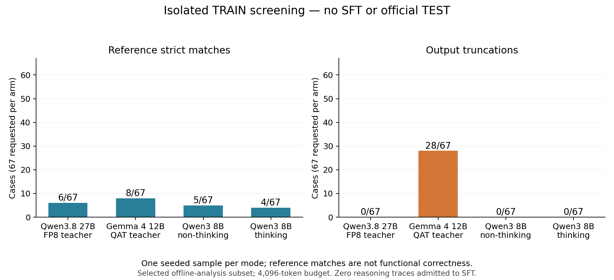

# 教师筛选、学生基线与差异案例核验

**本阶段已完成：两组学生基线均收齐，6个评分差距均已核验，GPU/CPU任务已清理。** 这是无训练的教师筛选与诊断实验，不是新的 SFT/ABA 效果报告，也不是官方 KaliBench 测试成绩。

## 1. 完整结果

| 模型/模式 | 返回 | Native partial（×100） | Native exact | 补充严格匹配 | 截断 |
|---|---:|---:|---:|---:|---:|
| Qwen3.8-27B-FP8 教师 | 67/67 | 60.86 | 6/67 | 6/67 | 0 |
| Gemma 4 12B QAT 教师 | 67/67 | 43.74 | 9/67 | 8/67 | 28 |
| 原始 Qwen3-8B non-thinking | 67/67 | 57.61 | 5/67 | 5/67 | 0 |
| 原始 Qwen3-8B thinking | 67/67 | 59.63 | 5/67 | 4/67 | 0 |

共268条纳入评分的回答：134条教师回答与134条学生回答。接口失败重试和中性连通性检查不算额外评测样本。评分器、问题和既定生成上限均未因结果而更改；功能核验另行报告，不回写原评分。

学生 thinking 模式挽回3题，同时丢失4题，两个模式共同严格通过1题。它的部分分数更高，但严格匹配没有提高。单卡 inference loop 用时约209秒与2,089秒，thinking约为9.98倍，生成token约为7.85倍。**这不是“思考越长效果越好”的证据，也不能据一次采样判定学生永远不会。** 两模式使用各自推荐采样参数，故不是仅改变思考开关的纯因果消融。

## 2. 教师会、学生不会：从评分差距到实际核验

筛选条件是同一 TRAIN 题上“教师严格匹配通过，学生两个模式均未通过”。两位教师各贡献3题，合计6个不同案例。对6题均运行参考、教师、两个学生的命令，共24次；另加9次针对性对照。相同核验在两个工具版本中重复，未重新调用模型或挑选最佳回答。

所有执行都限制在短时 CPU 容器中，用自行组装的无害 ELF/PE 文件作输入。文件只供静态分析，**从未执行生成的二进制文件**。没有真实恶意样本、外部目标或多步攻击环境。

| 最终处置 | 数量 | 实测依据 |
|---|---:|---|
| 确认本地样例上的任务差距 | **4** | 教师输出满足对应任务检查；两种学生命令都被工具以错误参数或格式选项拒绝 |
| 参考答案/任务范围疑点 | **1** | 教师和参考都只输出导入导出内容，未满足“完整报告”所包含的头部与节信息 |
| 工具输出缺陷，保留待定 | **1** | 正确的头部哈希选项仍生成无效XML；旧版及固定新版工具均复现 |

这里的4个确认案例覆盖重定位/符号解析、默认文本输出与两种格式输出。检查不止看退出码：核对实际重定位及去修饰符号、XML/HTML输出、内容字段，以及与参考和负对照的关系。它们只证明这些无害输入上的差异，不证明完整恶意软件识别能力或任意文件上的正确性。

“完整报告”疑点在 readpe 的源码和实测中一致：选择 imports/exports 会关闭默认全量输出；完整输出对照包含额外头部和节内容。因此该参考匹配不能作为完整任务成功。另一项 pehash 的XML问题在 `pev 0.81-7` 与官方 `readpe 0.85.1` 都出现，文件内容哈希的XML对照则可正常解析。该问题属于本地样例上的工具/环境输出缺陷证据，不归咎于教师选错参数，也不计入已确认任务成功。

依据：[readpe 官方源码](https://github.com/mentebinaria/readpe/blob/0.85.1/src/readpe.c)、[pehash 官方源码](https://github.com/mentebinaria/readpe/blob/0.85.1/src/pehash.c)、[LLVM readelf 文档](https://llvm.org/docs/CommandGuide/llvm-readelf.html)。

## 3. 原因与训练数据处置

六个学生失败案例都没有截断，CLI实测能确认错误选项，而不只是评分器不接受另一种正确写法。学生经常把任务词直接猜成通用选项，或把其他工具的习惯套过来；thinking输出中仍可观察到这种猜测。**这支持优先补足工具知识、默认行为与约束到参数的映射，但尚未证明增加教师推理SFT一定能修复。**

命令正确不等于整段推理可靠。4个任务差距中：

- **2条简短可见解释可作为后续训练数据构造的种子**；它们不是全部原生推理链的认证，也尚未用于SFT。
- **2条解释需要修正**：数据库默认行为表述不精确，或提到了无文档支持的附加选项。原始教师长推理中也有不可靠的猜测。
- 另2个任务/工具疑点继续隔离。

因此完整教师推理轨迹准入仍为0，本次不启动SFT、不导出训练适配器。不能因为Gemma在参考评分上9比6高就自动选为唯一教师：它有28次截断，且两教师的可用优势样本很少。当前选择是保留逐题证据，不宣布某位教师整体可靠领先。

早先定向审查还发现，shell引号差异可能被参考匹配忽略，一些工具解释包含未证实的别名。这些发现保留为评分与数据质量风险，不用于事后改写本轮分数。

## 4. 数据隔离及来源限制

源为 publisher verified TRAIN。历史文件清点排除了已提及ID及同工具/选项结构，再限定为离线二进制、文件、取证分析。剩余115题按完整结构组划分为 **TRAIN67 / DEV24 / confirmation24**，对应57/23/22组；ID、完整问题哈希和粗粒度结构组无交集。67题涉及24个工具。

**DEV24、confirmation24与官方TEST的模型调用始终为0。** 不公开保留题目和答案。哈希、逐题记录与冻结协议留在私有工作区。这不是完整语义去重，也无法排除未记录的历史暴露或模型预训练污染。

67个源参考记录全部是 `PASS_RUNTIME_ERROR`，含义是运行报错但未识别为工具/参数幻觉，不能当成成功执行认证。本轮增加了6个候选的定向功能核验，未把其余61题升级为已验证。过度要求历史上从未使用的TRAIN，会使候选池偏向稀有工具和缺失环境；下一轮可重新使用已验证历史TRAIN，仍严格隔离DEV/确认内容，无需为了TRAIN新颖性牺牲质量。

## 5. 冻结的模型与生成配置

- 学生：原始 `Qwen/Qwen3-8B@b968826d9c46dd6066d109eabc6255188de91218`，BF16，无adapter，无训练。逐文件SHA与提交的worker/input SHA一致；两模式的67题ID顺序、每批seed、token计数及正常结束状态另行核对。
- 教师：NRP响应模型分别为 `Qwen/Qwen3.8-27B-FP8`、`google/gemma-4-12B-it-qat-w4a16-ct`。服务别名不等于不可变权重revision。
- 统一可见指令：简洁解释加唯一output块；只有原始题目，不提供参考答案。该指令不是官方command-only协议，non-thinking也可产生可见解释。
- 教师 temperature=0.6、top_p=0.95、max_tokens=4096、seed=3407；Qwen设medium reasoning effort。无法仅凭请求证明服务端完全实现所有参数。
- 学生non-thinking：temperature=0.7、top_p=0.8；thinking：0.6/0.95。均top_k=20、min_p=0、max_new_tokens=4096、batch4，每批seed=3407+offset；每题每模式一次采样。
- 评分只读取唯一闭合output块；不把解释中的选项混入命令。截断计未完成，同时单独列出。

## 6. 运行与核验记录

学生在一张 **NVIDIA A10** 上完成，worker总时长约 **39.8分钟**，包含模型准备及推理，非8张卡训练。GPU任务已成功退出并清理。CPU核验使用2 CPU / 3 GiB RAM / 4 GiB临时盘，无GPU。

CPU初次尝试在无害PE样例的导入链接阶段失败，尚未运行候选命令；修正为通过导入表链接后成功。随后为排除工具版本问题，在官方 `readpe 0.85.1` 固定提交 `d1e885a271de3477bea212508be88aecff171a26` 上重跑全部6例。LLVM使用14.0.0。两次成功核验共36次模型命令执行、12次参考执行、18次对照；所有工具调用均为本地静态分析。三个CPU任务，包括失败记录，均已收集并清理。

Qwen教师早先出现31个HTTP500题目，服务恢复后仅补失败请求，原设置不变；原失败记录保留。旧串行进程最多2个未收集在途请求不算完成样本。无提权优先级、taint绕过、配额修改或闲置GPU进程。

隔离/解析的5项测试通过。私有核验脚本检查全部134条学生回答和两版本24×2条案例结果，公开核验脚本检查脱敏汇总与图表哈希、配对计数及处置总数。命令：`python3 scripts/verify-kali-teacher-screen-20261116.py`。

公开内容仅含脱敏汇总、报告、图表及通用校验/绘图代码，无法独立从逐题输出重算全部结果；逐题问题、回答、推理、ID和溯源工件保留本机。这是AI辅助文档与程序核验，不冒充独立真人签核。

## 7. 接下来的实验

本次要求的数据隔离、教师筛选、两组学生基线及差异核验均已完成。下一阶段应围绕已确认的工具知识/约束映射缺口扩充**可执行验证的TRAIN数据**，修正解释并单独验证，不直接使用全部原始教师长推理。数据规模与质量足够后，冻结同题answer-only与简短解释+answer的匹配SFT对照，再考虑更长教师推理和ABA搜索。2条干净简短解释只是种子，不能支持有效训练或泛化结论。
