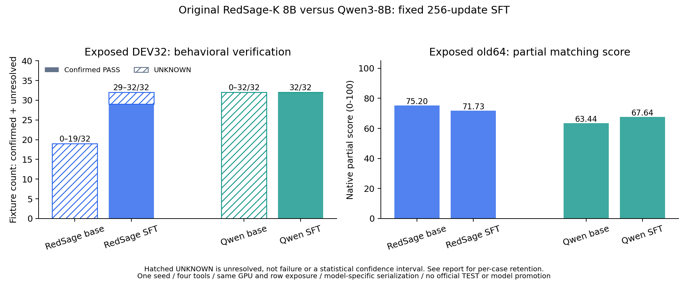

# 原始 RedSage 与 Qwen3-8B：小规模SFT对照

两组从固定发布权重与全新FP32零B LoRA开始；未加载F22或历史适配器。同一张GPU上顺序运行，同样256条TRAIN、同样四轮样本顺序，每组256次实际更新。公开所有固定128/256步checkpoint结果，不事后挑最优。

| 模型 | 新DEV32行为确认范围 | TRAINprobe32行为范围 | 旧64原生分 | 旧64严格正确 | 保留基线原正确题 |
|---|---:|---:|---:|---:|---:|
| redsage_base | 0–19/32 | 0–13/32 | 75.196 | 20/64 | 20/20 |
| redsage_step128 | 17–30/32 | 23–32/32 | 73.892 | 20/64 | 16/20 |
| redsage_step256 | 29–32/32 | 32–32/32 | 71.734 | 21/64 | 16/20 |
| qwen_base | 0–32/32 | 0–32/32 | 63.435 | 13/64 | 13/13 |
| qwen_step128 | 20–32/32 | 24–32/32 | 66.058 | 15/64 | 11/13 |
| qwen_step256 | 32–32/32 | 32–32/32 | 67.640 | 18/64 | 11/13 |

行为范围下界为确认PASS，上界为PASS+UNKNOWN，不是统计置信区间。TRAINprobe来自训练集，不能当泛化成绩。原生分是部分匹配分，不是命令执行成功率；旧64未执行认证。严格匹配使用项目strict_option_values参数值检查，不宣称与官方排行榜Exact Correct完全相同。



## 原始解码与统一guard对照：新DEV32

| 模型/协议 | 行为范围 | 严格匹配 | 单个完整output块 | 截断 |
|---|---:|---:|---:|---:|
| redsage_base | 0–19/32 | 1/32 | 19/32 | 0 |
| redsage_base_raw | 0–19/32 | 1/32 | 19/32 | 0 |
| redsage_step256 | 29–32/32 | 29/32 | 32/32 | 0 |
| redsage_final_raw | 29–32/32 | 29/32 | 32/32 | 0 |
| qwen_base | 0–32/32 | 0/32 | 32/32 | 0 |
| qwen_base_raw | 0–32/32 | 0/32 | 32/32 | 0 |
| qwen_step256 | 32–32/32 | 30/32 | 32/32 | 0 |
| qwen_final_raw | 32–32/32 | 30/32 | 32/32 | 0 |

带raw后缀的行不加ngram guard；其余行使用统一guard。这里是固定诊断，不据此重新挑选checkpoint或改写训练方案。

## 方法与边界

RedSage使用原始RISys-Lab/RedSage-K-SFT-GRPO，保留其推理prefill，并明确沿用BPE空think目标格式；Qwen使用原始Qwen/Qwen3-8B官方非思考模板与直接output目标。两者都是新LoRA，r16/alpha32、q/v、LR2e-5、AdamW、microbatch1/accum4、四轮，未用KL。

主要推理对所有基线和候选统一应用命令块ngram8规则；另完整报告新DEV32不加guard的基线/最终诊断。训练格式不同且监督token数不同，因此这是实际训练配方的对照，不是纯架构或等FLOPs实验。应比较各自相对同机基线的变化，不能将不同任务/协议下的历史分数拼接比较。

执行评分在联网隔离后使用固定v6验收器，正例、替代解与错误反例全部通过预检。hardlink dry-run必须有预期链接计数且文件未改变；另以独立临时目录的shadow执行检验提出的分组，仅移除dry-run标志，不修正工具、选项、路径或值。shadow是验收证据，不能写成模型实际完成了真实链接任务。UNKNOWN未计为错误。

已核验512步完整顺序/监督token/有限非零梯度、固定源模型文件哈希、144个适配器张量变化、四个导出checkpoint哈希与重载后的四题完整回答一致。作业和CPU评分/导出资源已清理，只检查本轮名称，未干预其他会话任务。

这是四工具、一个种子的开发实验。旧DEV64和新DEV32均已用于开发；未查询官方TEST、之前使用过的final64或新的确认面板。没有据此晋升模型，也没有将人工设定SFT称为新的ABA搜索。后续选择须同时看新增任务、旧能力逐题损失和计算开销，再做独立验证与ABA对照。

[完整聚合](summary.json) · [预先冻结协议](protocol.json) · [数据预检](data-preflight.json)

## 结果解释与下一轮起点

**下一轮小预算ABA可优先测试原始Qwen3-8B，同时保留原始RedSage作为强基线。** 这是开发阶段的研究建议，没有将本轮checkpoint晋升为正式模型。

- 固定256步时，Qwen新DEV32全部确认执行PASS，项目严格匹配为30/32；两条严格检查不通过的回答仍通过行为验收，说明不能把严格匹配当成执行准确率。
- Qwen旧64原生分63.435→67.640，严格总数13→18；但原正确题仅保留11/13，仍损失2题，不能称为零遗忘。
- RedSage新DEV32确认PASS29、UNKNOWN3，项目严格匹配1→29；旧64原生分75.196→71.734，严格总数20→21，但只保留16/20原正确题。
- RedSage训练后的旧题绝对分和严格总数仍高于Qwen，所以不能宣称Qwen全面胜出。它在本次配方下的新任务验收和相对自身基线的旧题变化更有利，适合作为下一轮候选起点。

**Qwen的基线行为不能写成0%成功率。** 它的32条输出全部未被当前四工具有限执行器接纳，保持UNKNOWN；常见选择包括PyInstaller主构建命令、Python venv、其他域名工具与find组合命令。没有执行未经接纳的替代命令，也没有把它们直接改判失败。Qwen的保守行为增益范围因此是0至32题，不能严格证明其行为成功率增加了32题；目标CLI严格匹配与最终32/32验收则是已观察到的事实。RedSage的相应保守增益下界为10题。

这项UNKNOWN处理也限制了模型比较：若要进一步证明相对基线的语义增益，需要预先扩展、统一验证替代命令的安全接纳与验收规则，而非只复核胜出候选。当前不改变固定评分器或旧结果。

两个最终SFT模型在新DEV32上的raw/guard输出分别32/32完全一致，最终通过数未依赖guard改变答案。Qwen原始基线raw/guard只有24/32逐题完全一致，但行为判定仍全部UNKNOWN；不能说所有基线输出都没有guard影响。[逐项核验](raw-guard-audit.json)。

成功GPU容器耗时约43.6分钟，包含下载、加载、训练及生成；两组各256步，合计512步、912条生成记录（原始模型的部分回答缺少所需格式）。启动前的Multi-Attach和新卷目录创建失败均零训练且另有保留记录；其排队与GPU预留时间不计作零成本。本轮Job/Pod、CPU导出/评分作业及NetworkPolicy已清理，保留8Gi专用缓存和私有实验权重；原共享40Gi卷未修改。详细资源证据哈希见summary。

## 可复算范围

本次公开聚合结果、协议、图和审查代码。完整GPU复现还需要授权的Kubernetes环境、固定依赖包及本地输入清单；未公开私有评测答案或模型预测，仓库不是无需配置的一键GPU复现包。`prepare_...`等脚本展示实际数据和执行接口，不能直接在缺少私有清单的克隆上启动实验。

以下单元检查可独立运行；目标函数测试需要PyTorch：

```bash
python3 -m unittest discover -s tests -p test_kali_hardlink_oracle_v6_20261115.py
python3 -m unittest discover -s tests -p test_kali_two_model_startup_20261115.py
python3 -m unittest discover -s tests -p test_kali_stable_objective_20261114.py
```
