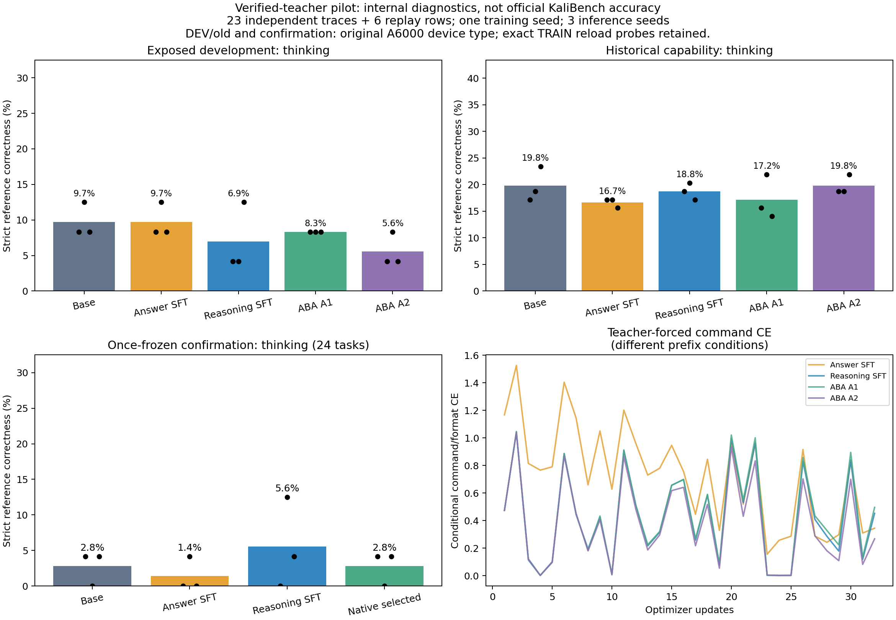

# 独立教师推理 SFT 与原生 ABA：完整内部试验

本轮已完成：可执行训练数据核验、独立教师筛选、原始 Qwen3-8B 的 answer-only/推理 SFT 对照、原生 ABA 派发的两候选训练及修复后的原生验收、选模冻结后的确认评测，以及四个适配器的本机哈希核验备份。**不等于完成官方 KaliBench / CyberGym 研究目标，也不保证训练有收益。**

## 数据与方法

主训练集为 **23 条独立 U 教师公开推理**（8 工具），加 6 条经过执行核验的 publisher TRAIN 回放；没有把提供正确答案或指定工具文档后的教师表现当成独立能力。有 **3 个候选**达到教师至少 2/3 次通过、学生两种模式各至多 1/3 次通过的原始低成功率规则；逐次区分 PASS/FAIL/UNKNOWN 后，只有 **1 个**有学生双模式各至少 2 次已证实失败的充分证据，另 **2 个**受 UNKNOWN 限制，不能称为确认能力差距。达到的是小规模通路准入门，未达到原计划 64 条/12 教师工具/32 强差距案例的规模。

该确认差距的执行记录显示，学生会混淆“工具自身版本”和“文件中的版本元数据”，另有一次使用不支持的选项；前一种错误虽然返回码为 0，仍未完成任务。两种模式各 3 次采样均仅 1 次通过。这是对已记录训练案例的事后机制描述，不能外推为所有退化的原因，也不能证明必须依靠复杂推理才能解决。后面的已见 TRAIN 拟合检查与独立确认评测分开报告。

独立推理教师 API 实际返回的模型标识为 **Qwen/Qwen3.8-27B-FP8**；底座是固定 revision 的原始 Qwen3-8B；ABA 调度控制模型为 deepseek-v4-flash，三者角色分开。每个训练候选重新初始化。固定对照每组 32 更新，LoRA r16/alpha32/q_proj+v_proj、BF16 底座与 FP32 适配器、学习率 1e-5、8 epochs、有效 batch8、prompt masking。推理组和答案组的监督 token 数分别为每 epoch 6377/569，未匹配计算量或答案权重，因此不能把差异全归因于推理内容。

**样本回放比例与目标权重不同。** 每轮回放均为 6/29 个样本、123 个监督 token，采用每个有效 batch 的 token 平均损失。解释更长使相同短回放在推理组目标中的系数变小：

| 组别 | 回放样本曝光 | 回放占监督 token | 每更新平均回放 token 系数 |
|---|---:|---:|---:|
| 答案组 | 20.69% | 21.62% | 21.36% |
| 推理组 | 20.69% | 1.93% | 2.09% |

这些是封存数据、顺序和损失分母推导出的目标组成，并非测得的梯度份额；尚未通过因果对照证明它们导致成绩变化。本轮没有据此调整 loss 或回放配方。

**命令 loss 的条件不同。** 23/23 条教师公开解释中已出现最终命令的完整文本，推理组命令 CE 是在这个正确前缀条件下计算。教师的独立解题请求仍只有题目。这个监控不能与空 think 答案组直接比较为独立解题能力，也不能替代自由生成或执行核验。

本项实验包含真实原生 Setup/Designer/Worker/Score/Finalizer 和原生派发的真实梯度更新。A1/A2 两个不同学习率在本研究中各累计 32 新更新、共 64 更新；相较单个固定 SFT 的 32 更新，端到端训练预算不同。仅调整允许的学习率，不是开放式数据/算法搜索；中断/完成轮与实际新增步数按下文分别说明。

第二次原生尝试暴露了交付协议问题：真实 A1 后端仍在评测时，Agent 手工提交了 E0 基线指针，原任务适配层允许它在搜索阶段评分，框架因而接受了该交付。这不是 A1 的有效交付，也不是已记录的终态超时。此时原生 A2 也已经实际派发并训练；两者分别真实更新 32 步。我们停止有问题的控制流程，保留原始作业记录与训练权重，继续按相同 624 条封存评测完成核验，没有重训或因为分数更换候选。修复后，E0 只允许在候选开始前的 Setup 验证阶段评分；两个已完成的真实适配器在新一轮原生 Setup/Designer/Worker/Score/Finalizer 中重新验收、选择和交付。完成轮新增参数更新为 **A1=0、A2=0**，本研究的 **64 步**均来自原始原生派发，不能把复用说成新训练。原生双分支终态、实际评分模型 ID、未修改客户端和真实收据逐一验证后才允许确认评测。修复后未额外重跑从零开始的长时训练，本轮采用已完成检查点续跑；这一边界保留在结论中。本次修复针对状态/模型标识与交付协议，不把它当作模型性能改善的证据。

运行干预也单独保留：为保护未完成 GPU 作业，本地桥接曾暂停 75.4 秒，并于 2026-11-18T02:13:01.904957+00:00 恢复，晚于原角色预算截止 2026-11-18T02:12:52.433173+00:00。这可能影响状态请求时序，不能把 Agent 回退完全归因于外部服务。原生时钟和 GPU 作业没有被暂停；实际 A1 GPU 容器于 2026-11-18T02:19:11Z 完成。此轮按交付协议无效处理，原始记录保留。

此前一次原生尝试在第一个 GPU Job 创建时遇到 Gatekeeper webhook 传输故障，尚未进行参数更新；失败日志和遗留资源核验保留后，按相同冻结数据、训练和评分规则重启。上述原生日志统计属于完成的尝试，不能理解为整个执行过程从未遇到基础设施故障。没有因看到训练分数而丢弃该尝试。

更早的 E0 基线作业曾因进程上限结束，尚未开始 SFT。保留其 224 条已完成输出，在相同模型 revision、输入、解码和随机种子下重放首批 16 条，逐字段一致后接续至 624 条。原始与续跑的实际提交 bundle、前缀哈希及全部前缀输出均已复核；224 条没有重复计数，也没有把旧 SFT 权重当成新训练。两次 GPU 分配均计入资源账本。

A1 运行中曾观测到评测进程 D/xfs_buf_lock、GPU利用率0%，且16Gi内存限额主要被干净文件缓存占用，没有OOM。对本作业五个已校验、只读下载的检查点做非特权 POSIX_FADV_DONTNEED 后，内存降至约3.6GB、进程恢复、GPU重新计算且输出推进。未重启GPU作业、修改模型或清理全节点缓存；后续仅对本轮自有作业进行有界同类监控。该干预后的恢复有记录，但底层内核/XFS机制未独立证实，更不能据此解释模型质量变化。等待时间也计入分配账本。

A2 原作业所在节点出现 NodeNotReady，随后 TaintManager 驱逐 Pod。原作业永久保留 FAILED 状态。CPU 只读取回的 32 步训练记录、原权重与收据哈希一致，但恢复后预测文件为 0 字节；此前遥测只能证明至少生成过 312 条，不能恢复其内容。没有把丢失样本算作成绩，也没有重训 A2。以相同原适配器、原模型 revision、原数值推理代码、相同 624 输入/随机种子/解码参数启动完整重评，原逐位重载 probe 通过；该重评之后仍遇到下述运行时限，最终输出由其全部已提交前缀与单次缺失后缀续算合并，不按成绩择优。故障前推理成本仍全计入资源账本。操作恢复在 A2 成绩及确认集首次查询前封存：ABA 分配上限因额外推理从 8 调到 9 GPU 小时，训练仍是原有两候选共 64 更新，总预算仍为 24 GPU 小时；确认 Pod 上限在首次调用前收敛为 4.5 小时，所有评测样本和 token 上限不变。恢复数据归档通过远端完整长度、SHA 与逐文件哈希核验；转存命令曾返回非零，未把它称为正常退出。 第一次重做只按 Ready 状态筛选节点，被重新调回原故障节点，在首批生成时出现 CUDA unspecified launch failure，未产生完整预测输出。该失败收据和分配成本保留；第二次明确排除该节点，后续确认和控制 VM 也排除它。仅凭异步 CUDA 报错不能定位具体 kernel 或证明硬件根因；排除节点是隔离措施。 排队接近一小时后，在同一 Pod 尚未分配节点时，只将同一 Job 的含排队总窗口从 3.5 延为 6 小时，Job/Pod UID 和排队位置不变，GPU Pod 上限仍 3 小时。仅此作业的 GPU 分配账本依据逐次 API 快照：以最后一次未分配节点请求的开始时间减去 60 秒安全裕量，作为同一 Pod 节点分配的保守下界；可证实未分配节点的等待不记为 GPU 分配。所有更早失败成本仍计入，9/24 GPU 小时上限不变。这是 API 分配时长核算，不是精确物理 GPU 功耗计量；没有重置原生角色时钟或重复提交作业。 待排 A6000 和较大 A100 申请分别以最终 DELETED 事件证明从未获配，均计0GPU分配。随后实际获配的 A100 加载了 SHA 相同的权重，但未通过原A6000训练收据的逐位logit probe，在正式预测前失败；这次失败和成本保留，不放宽检查，也不称为权重损坏的已证实根因。最终恢复使用原A6000类型、20GiB内存和24GiB暂存；原权重、输入、代码、种子、评分和逐位probe不变。独立确认的全部端点也使用同一原类型A6000，先验证所有适配器原TRAIN收据probe，再查询确认题。跨硬件不保证逐位相等见PyTorch官方[数值精度说明](https://github.com/pytorch/pytorch/blob/main/docs/source/notes/numerical_accuracy.md)，但此处未把该一般说明当作本次差异的完整因果证明。 原类型A6000申请继续被CPU不足阻挡；最终DELETED事件再次确认旧Pod从未获配，计0GPU分配。为纯推理改用0.5CPU核（request=limit），GPU/内存/暂存/模型/推理/逐位probe不变，事先服务端预检通过；这只提高资源匹配机会，并未声称事先测得可用CPU碎片或保证调度。实际GPU利用率另行监控，没有新增优先级或预约容忍项。 原类型 A6000 的 R6 进程按未修改的原时限结束，保留 FAILED 状态。保留其全部 496 条有序完整批次，新增一次有界纯推理作业，仅生成余下 128 条；先重放首16条并逐字段一致后才接受续算。最终624条不重复计数，全部原失败成本保留，没有重训。操作预案在A2成绩读取及确认首次查询前，将先前512条/1500秒的备用限制明确修订为至少416条完整前缀、单个尾段Pod6600秒/Job8400秒；研究分配上限24→26GPU小时、ABA基础设施分配9→11GPU小时，仅增加最多一次尾段推理，原两个训练候选仍共64步。停止预算修订和各失败尝试均保留在记录中，最终上限按26/11GPU小时核验，实际消耗见账本。原运行时钟没有暂停、延长或重置，数据、数值生成块、随机种子、评分、选择和确认协议未变。 另有一次本机网络隔离在首次提交前阻止API读取，未创建GPU作业；恢复正常连接后核对了完全相同的已准备GPU负载，未新增训练或候选。

A1 的未启动排队 Job 曾两次按正常 API 权限替换：CPU 请求和上限从 2 核改为均 1 核，再将已过时的普通兼容节点范围从 4 台刷新至 5 台；随后在 hcc 节点启动。旧对象、UID 和未分配节点/未启动容器的证据已保留，没有增加 GPU、训练候选数或参数更新。GPU 型号、最低驱动要求、优先级、数据、模型、解码与评分不变；不声称不同阶段 CPU 资源和端到端时间匹配。

## 已暴露的内部诊断

以下是 **3 个推理随机种子的平均正确题数**，仅有一个训练种子。严格参考等价可能把某些未解决的合法替代命令留为 UNKNOWN，不能替代完整语义或官方评分。旧能力要求每个种子、两种模式保留至少 95% 的底座答对案例，且总正确数与输出可靠性不下降。

这个小面板上的保持门很保守：单个种子/模式原来答对不足20题时，95%的整数阈值等价于一题也不能丢失。因此，不通过保持门不等于平均成绩必然下降或已证明统计显著退化；它只表示没有达到本轮预设的部署保护条件。这个事实不会用于事后放宽选模。

| 状态 | thinking DEV | thinking old | nonthinking DEV | nonthinking old | 全部保持门 |
|---|---:|---:|---:|---:|---|
| Base | 2.33/24 | 12.67/64 | 1.67/24 | 9.33/64 | 通过 |
| Answer SFT | 2.33/24 | 10.67/64 | 1.33/24 | 12.00/64 | 未通过 |
| Reasoning SFT | 1.67/24 | 12.00/64 | 1.00/24 | 10.00/64 | 未通过 |
| ABA A1 | 2.00/24 | 11.00/64 | 1.67/24 | 11.00/64 | 未通过 |
| ABA A2 | 1.33/24 | 12.67/64 | 2.00/24 | 11.00/64 | 未通过 |

以下是保持门实际使用的 DEV+old（每模式 88 题 ×3 种子 =264 条）输出诊断，不包含额外 TRAIN-fit。无效数量含截断，两者并非互斥；UNKNOWN 是参考等价未解决，不能当作功能已证实失败。

| 状态 | thinking 无效/截断 | nonthinking 无效/截断 | thinking UNKNOWN | nonthinking UNKNOWN |
|---|---:|---:|---:|---:|
| Base | 6/6 | 3/2 | 183 | 204 |
| Answer SFT | 4/4 | 6/6 | 189 | 198 |
| Reasoning SFT | 10/10 | 4/3 | 180 | 200 |
| ABA A1 | 4/4 | 4/3 | 186 | 185 |
| ABA A2 | 2/2 | 5/5 | 181 | 195 |

另对每状态全部 624 条采样（包含单列 TRAIN-fit）检查输出完成方式，未加载参考答案、未新增模型调用：

| 状态 | 平均生成 token | 截断 | thinking 截断且未闭合 think | 截断但已有完整非空 output 段 |
|---|---:|---:|---:|---:|
| Base | 668.6 | 8 | 6 | 0 |
| Answer SFT | 587.1 | 10 | 4 | 0 |
| Reasoning SFT | 646.8 | 13 | 10 | 0 |
| ABA A1 | 649.4 | 7 | 4 | 0 |
| ABA A2 | 601.0 | 7 | 2 | 0 |

最后一列只统计标签完整性，不证明命令语法或任务正确。不能预设截断只是“答完后继续说话”，也不能仅凭平均长度判断长尾截断；逐模式/面板分层见汇总。本诊断不修改冻结的截断拒绝、评分或选模规则，也不构成对训练退化机制的因果证明。

原生搜索交付候选是 **A1**；按预设保持门和 DEV 指标实际保留 **E0**。不使用确认集重新选模。

确认阶段含四个去重前端点及单列 TRAIN 诊断。原先根据固定组耗时将进程上限从 4 小时调为 6 小时，后因 A2 节点故障的额外评测，在确认题首次调用前收敛为 4.5 小时；完成后立即退出。题目、随机种子、每条 4096 token 上限、选择和评分均未改变，最终自有研究作业分配预算为 26 GPU 小时（修订历史见上文）。运行上限不是实际耗时，实测值见收据。

原独立确认作业按未修改的原进程时限结束，保持FAILED。操作备用方案在任何确认评分前已封存；新增加的一次有限纯推理尾段保留全部已完成输出，完整文件逐字节复制，部分文件先重放原首批并逐字段一致，再仅补齐缺失输出。确认输出保留576条、新补0条，额外校验重放0条不重复计分；已见TRAIN-gap另保留57条、新补15条。最终仍是同24题、四个固定端点、三种子、两模式的576条确认输出，加单列72条已见TRAIN诊断。原失败收据、新尾段成功收据与明确标记的组合收据分开保存；两次都验证原训练probe，没有改变模型、问题、参数、评分、选模或训练。额外Pod/Job上限分别6600/8400秒，仍在26GPU小时总停止预算内。

本轮主要成本是生成评测输出。下表分别计优化循环和生成循环，**不含模型下载/加载等开销**；完整分配时间另由保守 GPU 账本统计，不将短训练时间冒称为总实验成本。每状态计分的是 624 个不同的 seed/mode/task 输出，含三种子、双模式和单列 TRAIN 题；校验重放不重复计分，故障中丢失的输出也不充当成绩。下表 token 数对应这 624 条计分输出，不是包括失败与重放的全部计算量；相应消耗仍保留在完整 GPU 分配账本。

GPU 账本覆盖本阶段自有 Kubernetes GPU 作业，包括失败尝试；NRP 托管教师与控制模型服务端 GPU 消耗未单独计量，因此不能当作整个研究的端到端总算力或 FLOP 公平性证明。

| 状态 | 优化循环秒数 | 生成循环分钟 | 生成 token |
|---|---:|---:|---:|
| Base | 0.0 | 131.7 | 417,201 |
| Answer SFT | 64.2 | 146.6 | 366,340 |
| Reasoning SFT | 66.1 | 153.3 | 403,624 |
| ABA A1 | 66.1 | 163.9 | 405,251 |
| ABA A2 | 79.1 | 202.8 | 375,013 |

另按原方案报告工具/结构宏平均，避免同一工具多题占比掩盖分布差异。下表是已暴露 DEV 的 thinking 结果：宏平均基于严格参考等价，最后一列为上游原生评分函数的部分分，二者不是同一指标，也不是官方排名。

| 状态 | 严格工具宏平均 | 严格结构宏平均 | 原生部分分 ×100 |
|---|---:|---:|---:|
| Base | 6.86% | 10.14% | 50.69 |
| Answer SFT | 7.84% | 10.14% | 54.73 |
| Reasoning SFT | 4.90% | 7.25% | 54.47 |
| ABA A1 | 7.84% | 8.70% | 53.86 |
| ABA A2 | 2.94% | 5.80% | 49.75 |

按原方案另报告“三个推理种子中至少两次参考匹配”的稳定旧题子集，避免把某题偶然的一次匹配当成已经证实的能力。它只作诊断，**不替代冻结的逐种子保持门**。同样，因 UNKNOWN 丢失参考匹配不等于已证实任务执行失败；各类型数量见汇总。

| 状态 | thinking 稳定底座旧题保留 | nonthinking 稳定底座旧题保留 |
|---|---:|---:|
| Base | 12/12 | 8/8 |
| Answer SFT | 8/12 | 7/8 |
| Reasoning SFT | 11/12 | 7/8 |
| ABA A1 | 11/12 | 7/8 |
| ABA A2 | 8/12 | 7/8 |

## 冻结后确认

| 端点 | thinking 严格匹配 | nonthinking 严格匹配 | 截断 thinking/nonthinking |
|---|---:|---:|---:|
| Base | 2/72 | 0/72 | 0/3 |
| Answer SFT | 1/72 | 6/72 | 0/2 |
| Reasoning SFT | 4/72 | 2/72 | 2/4 |
| Native A1 | 2/72 | 3/72 | 1/2 |

每列 /72 是同24题的3个推理种子，不是72道独立题；严格匹配也不是完整功能执行正确率。下列比较和区间使用这些相同的固定输出，不据此重新选模。

独立留出的 24 个内部任务在选模后调用，E0/固定答案/固定推理/原生交付候选以相同三种子、两模式评测，权重完全相同者去重。thinking 模式推理减答案的均值差为 **+1.00/24（+4.17 个百分点）**，按任务组做的描述性 bootstrap 区间为 [0.00, 11.11] 个百分点。该区间不反映独立训练复现或真实世界泛化保证。确认结果没有改变保留决定，官方 TEST 未调用。

固定 SFT/E0 赢家在确认前已经选定为 **E0**。以下补充比较用于区分“原生搜索交付的候选”与“保持门后实际保留的模型”；它不改变主要比较或选模。逐工具分层、各比较的描述性区间见机器可读汇总。

| 对比 | thinking 平均正确数差 | nonthinking 平均正确数差 |
|---|---:|---:|
| native_selected_minus_fixed_winner | +0.00/24 | +1.00/24 |
| retained_minus_fixed_winner | +0.00/24 | +0.00/24 |
| retained_minus_E0 | +0.00/24 | +0.00/24 |

每端点144条确认输出对应同24题、3种子和2种模式。下表单列确认文件的生成计时、token和截断，不合并额外已见TRAIN诊断；当前资源为单张A6000、0.5CPU、每条最多4096token。计时不含下载/加载与原训练probe；若文件因运行时限续算，其计时包含校验重放，不能直接当作纯吞吐对照。完整准备、失败和分配成本由GPU账本另行报告。

| 端点 | 确认输出条数 | 生成分钟 | 生成token | 截断 |
|---|---:|---:|---:|---:|
| Base | 144 | 48.5 | 99,689 | 3 |
| Answer SFT | 144 | 51.5 | 88,891 | 2 |
| Reasoning SFT | 144 | 79.7 | 111,688 | 6 |
| Native A1 | 144 | 55.2 | 99,069 | 3 |

## 已见 TRAIN 小面板的拟合

原先16题 TRAIN-fit 中，主夹具覆盖10题，另外6条回放改用先前已存在的独立夹具补充验证，单列下一节；它们不改变本表分母。每题三种子，所以主夹具每模式30次响应。下表是已见任务拟合，**不用于选模、不代表泛化**。本次 CPU 批次也核验后文单列的3条 TRAIN-gap，其中有 1 题与主10题重叠，合计 12 个独立夹具任务。整个批次正对照 24 次、负对照 50 次，负对照没有误通过。

| 状态 | thinking 功能通过 | thinking UNKNOWN | nonthinking 功能通过 | nonthinking UNKNOWN |
|---|---:|---:|---:|---:|
| Base | 22/30 | 0 | 16/30 | 10 |
| Answer SFT | 22/30 | 0 | 21/30 | 0 |
| Reasoning SFT | 20/30 | 1 | 20/30 | 6 |
| ABA A1 | 22/30 | 2 | 18/30 | 9 |
| ABA A2 | 16/30 | 0 | 22/30 | 2 |

## 六条 publisher TRAIN 回放的辅助拟合

这6题的参考目标此前已通过两套良性夹具。现在复用当时实际执行的 oracle（包括原 LLVM-dev 依赖修复），直接检验本轮模型已经生成的命令，补齐主夹具未覆盖的部分。每模式为6题×3推理种子，共18次响应；它们仍是**已见训练题，不是保持集或泛化评测**，没有新增模型调用或改变选择。

| 状态 | thinking 功能通过 | thinking UNKNOWN | nonthinking 功能通过 | nonthinking UNKNOWN | 引号不闭合 thinking/nonthinking |
|---|---:|---:|---:|---:|---:|
| Base | 4/18 | 0 | 2/18 | 4 | 0/0 |
| Answer SFT | 3/18 | 2 | 2/18 | 1 | 0/0 |
| Reasoning SFT | 5/18 | 3 | 4/18 | 0 | 1/0 |
| ABA A1 | 2/18 | 3 | 1/18 | 3 | 0/0 |
| ABA A2 | 3/18 | 4 | 2/18 | 1 | 0/0 |

最初的 CPU 辅助任务因已完成四组中的 1 条模型命令引号不闭合，触发旧 oracle 的未捕获解析异常；失败作业与源码保留。修复仅将该解析异常返回为 UNKNOWN，并调整输出传输，实际命令和任务通过条件均未改写；完全相同的命令文件通过 SHA 核对后重做。两次成功执行批次合计 24 次正对照、32 次负对照，负对照无误通过；这些是同6题在两批中的重复对照，不是新增独立任务。源码、实际 CPU 作业输出、每条命令与原模型预测之间的对应均重新核验。

## 三个已训练候选差距的拟合检查（仅1个充分确认）

由于冻结评测没有覆盖这 3 个候选（1个充分确认、2个不确定），额外在选模后以独立文件对原始底座、固定两组与原生交付候选做了已知 TRAIN-gap 自由生成诊断。每状态三种子、两模式、3 题，共18响应；每个生成命令再过两套良性夹具。它不参与选择、不改变确认集，也不是新题泛化结果。表中 /9 为3题×3种子的推理响应，/3 为至少2种子都通过的任务数；未知语法单独记录在汇总。

| 状态 | thinking 功能通过 | nonthinking 功能通过 | thinking 稳定通过 | nonthinking 稳定通过 |
|---|---:|---:|---:|---:|
| Base | 2/9 | 4/9 | 0/3 | 1/3 |
| Answer SFT | 2/9 | 6/9 | 1/3 | 2/3 |
| Reasoning SFT | 3/9 | 4/9 | 1/3 | 2/3 |
| Native selected | 4/9 | 6/9 | 2/3 | 2/3 |

另将先前具有双模式重复明确失败证据的 **1题** 单独列出，避免与2个不确定候选混合。每列 /3 是同一训练题的3次推理采样，不是3道独立题；不确定/无有效输出单列。基座在本次协议下的通过率也重新测量，不将先前少量失败固定为永久“不会”。

| 状态 | thinking 功能通过 | thinking 不确定/无输出 | nonthinking 功能通过 | nonthinking 不确定/无输出 |
|---|---:|---:|---:|---:|
| Base | 1/3 | 0 | 0/3 | 0 |
| Answer SFT | 0/3 | 0 | 3/3 | 0 |
| Reasoning SFT | 0/3 | 0 | 0/3 | 0 |
| Native selected | 2/3 | 0 | 0/3 | 0 |

## 审计与局限

从原始预测重新评分并匹配保存结果；逐步核验样本顺序、监督 token 分母、非零梯度、各候选相同初始 LoRA 哈希、保存后 FP32 张量与一个 logit probe 的重载一致性。重载核验不是完整生成轨迹的逐字复现。图中的 command-loss 监控覆盖命令与输出格式 token（包含相应标签/EOS），并使用教师强制前缀；它不证明自由生成或执行正确。TRAIN-fit 命令由 CPU 上固定白名单工具、两套良性夹具及正负对照核验，主10题与辅助6条回放分别报告；它只说明已见训练任务的拟合，不用于选模。四份真实适配器已私下备份，未公开权重。

**评测覆盖限制（在新 SFT 结果前已记录）：** 主训练工具只覆盖 DEV 的 4/24 题、确认集的 1/24 题；历史 old64 没有主训练工具，3 个低成功率候选所在的工具在这三块面板中均未覆盖。因此独立评测部分主要检验跨工具迁移与旧能力保持，其成绩不能直接证明那 3 个差距是否被学会，也不能将平坦结果解释为推理 SFT 普遍无效。额外 TRAIN-gap 与 TRAIN-fit 只补充已见任务拟合证据。后续域内迁移需要另行预先冻结、工具覆盖更匹配的独立面板，不能用事后换题改变此轮选模。

这是有限范围的 AI 事实复核和程序夹具，未宣称专家金标准或完美审核。DEV/old 面板曾暴露，数据量小且工具相关，不能宣称官方排行榜提升；23 条推理只有1条满足充分确认的差距标准，可能限制训练收益。无论结果正负，本次结论只适用于该内部试验。

机器可读汇总：[final-results.json](final-results.json)。 图中的各步条件命令 CE 和各推理种子得分均以无题目内容的聚合数值公开；可用 `python scripts/plot-kali-curriculum-final-20261118.py --output /tmp/kali-final-recreated.png` 在仓库根目录重绘，不需私有输入、权重或 GPU（需 NumPy 和 Matplotlib）。[实际执行代码快照与复现边界](source/README_ZH.md)逐文件匹配提交 bundle / 原生封存 SHA；它需要合法私有输入，不是开箱即用的公开数据复现包。历史的短解释 SFT 与旧实验保留原报告，不能和本轮混合统计。原始问题、ID、参考答案、教师推理、预测、凭证和适配器均未公开。
