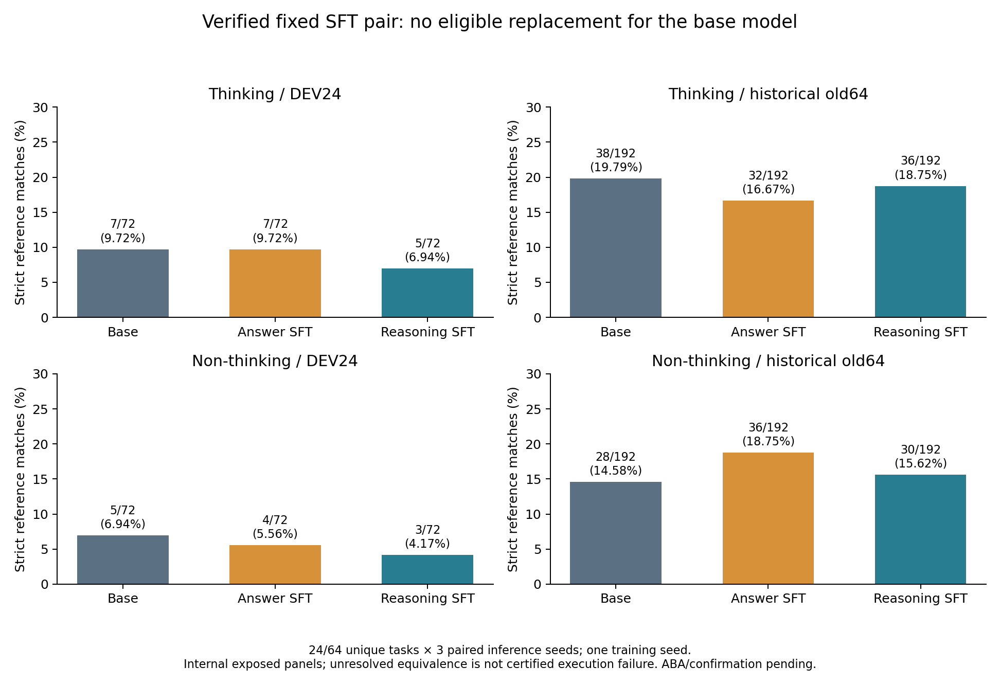

# 配对 SFT 阶段结果（2026-11-17，历史快照）

**本页只报告已经完成并独立重评分核验的固定 SFT 对照。发布时原生 ABA 与选模后的独立确认尚未完成，不是最终研究结论。**

原始 Qwen3-8B，23 条独立教师推理示范加 6 条 publisher TRAIN 回放。两组使用相同提示、最终命令、样本顺序、初始 LoRA 和 32 次真实更新；已逐步检查梯度、标签遮罩和重载一致性。3 个低成功率候选中仅 1 个具备学生双模式重复明确失败的证据，另外 2 个受 UNKNOWN 限制。

以下为合并 3 个配对推理种子的严格参考匹配数，**不是独立训练重复，也不是官方 KaliBench 分数**：

| 状态 | thinking DEV24×3 | thinking old64×3 | nonthinking DEV24×3 | nonthinking old64×3 |
|---|---:|---:|---:|---:|
| 原始基座 | 7/72 | 38/192 | 5/72 | 28/192 |
| 答案 SFT | 7/72 | 32/192 | 4/72 | 36/192 |
| 推理 SFT | 5/72 | 36/192 | 3/72 | 30/192 |

两组都未通过预设的每种子、双模式旧能力保持和输出可靠性门槛，**保留原始基座**。答案组的非思考旧题匹配数上升，但没有保持全部要求；不能只挑这一项宣布成功。未解决的等价命令仍归 UNKNOWN，参考匹配丢失不自动证明功能性遗忘。

训练损失下降没有转化成当前开发集的稳定提升。主要限制是样本少、只有 1 个充分确认差距，以及主训练工具仅覆盖开发集 4/24 题、确认集 1/24 题。两组每轮监督 token 为 569 / 6377，命令与格式 token 都是 453，权重与计算量未匹配，不能当作纯推理内容的因果比较。尚不能判定这些因素中哪一个导致本轮结果。

按原计划继续真实 ABA 两候选搜索，再使用冻结的独立确认集；不更改当前评分和选择规则来追求正结果。已见训练题的 CPU 功能拟合核验与泛化评测分开。发布本快照时本轮官方 TEST 查询为 0。

机器可读结果：[paired-sft-interim.json](paired-sft-interim.json)。仅发布汇总、方法与校验信息；原始问题、答案、轨迹、凭据与权重不公开。
