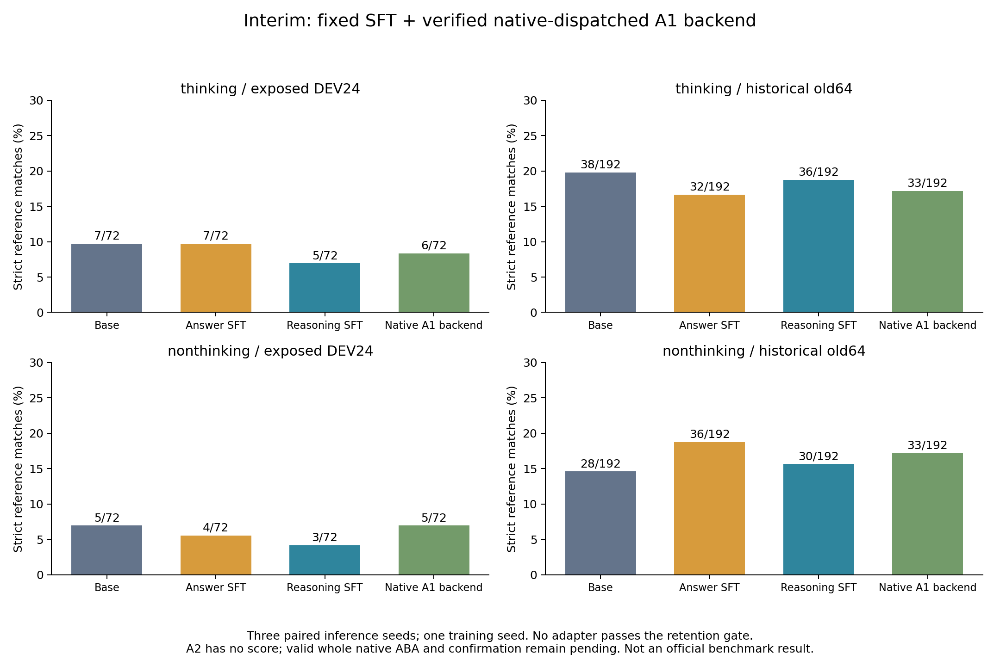

# 已核验结果与故障恢复（历史中期快照）

**本轮尚未完成。** 固定 SFT 对照与原生派发的 A1 后端训练/评测已核验；A2 原权重和训练记录已恢复，完整评测正在重新排队。有效的整轮原生 ABA 验收、选模后独立确认均未完成。本页不是官方 KaliBench/CyberGym 成绩。

## 可报告的结果

下表合并 3 个配对推理种子。只有 1 个训练种子；每状态另有单列 TRAIN-fit，完整已见面板共 624 次生成。A1 是学习率 5e-6、32 次真实更新的原生派发后端，不能把后端完成当作整轮原生流程验收通过。

| 状态 | thinking DEV /72 | thinking old /192 | nonthinking DEV /72 | nonthinking old /192 |
|---|---:|---:|---:|---:|
| Base | 7/72 | 38/192 | 5/72 | 28/192 |
| Answer SFT | 7/72 | 32/192 | 4/72 | 36/192 |
| Reasoning SFT | 5/72 | 36/192 | 3/72 | 30/192 |
| Native A1 backend | 6/72 | 33/192 | 5/72 | 33/192 |

三个已评分适配器均未通过封存的逐种子、双模式保持/可靠性门，保留原始 Qwen3-8B。A1 的非思考旧题匹配数上升，仍不能抵消其他保持条件失败。UNKNOWN 不等于功能已证实失败。A2 没有可用分数，不能填写为 0 或宣称没有改善。

## 做了什么恢复与核验

1. 原生第一次候选分支在 A1 后端尚未完成时交付了 E0 指针。该分支按交付协议无效保留，不能称为有效 A1 或终态超时失败。新增 E0 搜索阶段拒绝及真实候选/收据检查，仍待新的真实全流程验证。为保护未完成作业，本地桥接曾暂停约 75.4 秒并在原角色预算之后恢复；原生时钟和 GPU 作业未暂停，干预可能影响请求时序，未将责任完全归给外部服务。
2. 原 A2 节点 NotReady 后被驱逐，作业保持 FAILED。CPU 只读转存核验了完整归档长度、SHA 和逐文件哈希；原 32 步训练记录与约 767 万参数的适配器完好，全部参数有限。原预测文件在故障恢复后为 0 字节；此前至少 312 条的遥测只有计数，没有可复用内容。转存命令曾非零退出，但完整数据独立校验通过；未声称命令正常退出。
3. 第一次零更新重做只筛选节点 Ready 状态，被调回同一节点，在首批生成出现 CUDA unspecified launch failure，零完整预测。该异步错误不能定位具体 kernel 或证明硬件根因。当前再次使用同一权重、相同数值推理代码和封存的 624 输入/种子/解码，明确排除该节点；不增加训练步数，不从不同输出中择优。原始失败均保留。
4. 确认脚本输出目录与只读卷的冲突已在首次调用前修正；确认任务与控制 VM 也排除故障节点。私有预测备份监控已启用，90 项相关 CPU 测试通过。代码检查通过不等于实际全链路已成功。

资源按原始失败与恢复尝试一并计数。基础设施额外推理使 ABA 分配上限从 8 调为 9 GPU 小时，总预算仍为 24 GPU 小时，训练候选与更新不增加。后续确认进程上限在首次调用前由 6 收敛至 4.5 小时；样本、随机种子、4096 token 上限、评分和选模规则不变。

## 解释边界与剩余步骤

23 条独立教师示范中，仅 1 条差距具备双模式重复明确失败证据，另 2 条不确定；主训练工具仅覆盖 DEV 4/24 与确认集 1/24。答案与推理组监督 token/回放权重不同。当前负结果不能证明推理 SFT 普遍无效，也没有确认哪一种数据因素导致变化。

还需：A2 完整评测 → 两已有检查点的真实原生验收与冻结选择 → 一次独立确认 → 全量审计、CPU 已见任务拟合检查和私有权重备份 → 最终报告。确认与官方 TEST 查询目前均为 0。本页是发布时间的历史快照，后续完成状态见项目首页。

[机器可读中期结果](recovery-interim.json)。只公开汇总、图和方法；原始问题、教师轨迹、预测、凭据与权重保持私有。
