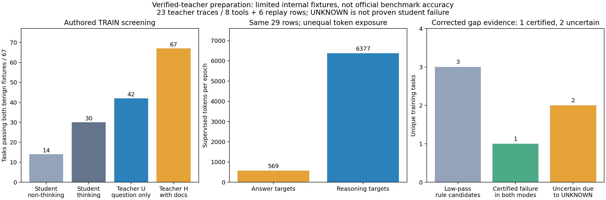

# 独立教师推理数据：已核验的准备结果

> **差距证据等级已更正：原3个低通过率候选中，1个充分确认，2个受UNKNOWN限制。不是3个已证实失败差距。训练数据和配置未改。详见[更正记录](CORRECTION_ZH.md)。**

**当前状态：数据阶段完成；全流程已提交：固定对照作业运行中；真实 ABA 与确认评测等待前置核验。本页不包含它们尚未得到的新成绩。**

本轮按 Han 的建议，先检查教师能独立解决、学生低通过率的案例，再对比相同问题和答案的答案监督与完整教师推理监督。此前48条答案条件短解释实验仍单独保留，不能与本轮混同。

## 已完成且可核验的结果

68个作者构建的离线工具候选中，一条要求不成立的任务被隔离；其余67题覆盖14种工具。固定版本 LLVM14/readpe0.85.1/Galleta 在自造无害文件上运行，目标文件从未执行。对参考答案进行了134次正例检查，另有286次错误对照检查，最终全部符合预设结果。它们是局部行为验收，不能证明所有输入上的完整语义正确，也不是官方 KaliBench TEST。

| 同一67题的闭卷条件 | 两套样例均通过 |
|---|---:|
| 原始 Qwen3-8B，non-thinking | 14/67 |
| 原始 Qwen3-8B，thinking | 30/67 |
| Qwen3.8-27B-FP8 教师，首次独立解题 | 42/67 |
| 同教师独立重试 | 45/67 |

文档辅助教师的最终命令可达到67/67，但该条件给了工具文档与版本事实；不能冒充独立教师能力，也不代表每条原始解释都正确。这些H轨迹没有进入本轮主对照。托管教师别名及实际返回身份逐次记录，服务端权重版本不能由这些记录完全复现。

经过正反例、事实和重复采样检查，主数据准入23条未经事实改写的独立U教师推理，覆盖8种工具；加入6条合法、经过局部执行核验的官方TRAIN回放，两组相同比例20.69%。23条中只有3题达到教师至少2/3成功、学生两模式各至多1/3成功的局部差距标准。没有达到原先64个主任务、12工具、尽量32差距的目标；这是达到16题/4工具最低条件的小规模可行性研究。回放不能用于凑独立教师任务数。AI审查不是专家金标或完美复核。

## 已封存的实验

底座为原始Qwen3-8B，revision b968826d9c46dd6066d109eabc6255188de91218。两组均为29题、8轮、有效batch8、32次更新、lr1e-5、LoRA r16/alpha32、q_proj/v_proj、dropout0，BF16底座/FP32 LoRA，每组重置。答案组使用原生空think；推理组在23条主任务上使用完整公开返回的reasoning字段，回放保持空think。模板回环、提示遮罩和EOS检查58行均通过，无训练截断，实际最长641 token。

每轮答案组569个监督token，推理组6377个；曝光、最终命令与更新数匹配，计算量及答案token相对权重未匹配。因此不能把未来差异称为纯推理因果效应。

评测使用已经暴露的DEV24和历史old64，另有16条TRAIN拟合诊断；两种模式、4096生成上限、batch16、三个配对推理种子3407/4407/5407。训练种子仅一个。按每个种子、每种模式检查旧正确题至少95%保持、旧总正确数不下降、无额外无效或截断。未知等价写法单列，原生部分分和严格参考等价分开报告。

真实ABA将在固定对照完成并核验后，运行原生Setup/Designer/Worker/Score/Finalizer与两个真正新训练的候选。它是有界配方搜索，搜索总更新数64，单个固定R组32；不声称等总计算量或24小时广泛搜索。可以保留E0。确认24题只在模型选择冻结后，对预定端点比较一次，不用于继续调参或重新选择；官方TEST保持0调用。

## 执行修复与资料边界

普通A100/L40没有空位后，通过官方公开资源信息找到一张普通RTX A6000 48GB，未使用预约节点容忍或特殊优先级。初始整个配对作业3.5小时上限不足，已在零训练更新时主动中断，保存224条完整基线输出并以8小时有限时Job续跑。旧失败日志保留。恢复时先重放16条逐项核对，一致才复用；不一致则丢弃前缀重算。日志传输已改为带序号和SHA的分块格式，防止大结果与错误日志混杂。该修复不改变科学配置。

完整原始数据、逐题输出和证据保留在私有工作区。公开核心代码、聚合结果及哈希，不能凭这些聚合文件独立复现全部逐题成绩。图中的任务共享作者、工具事实和样例生成器，不能把67条当作独立外部基准样本。GPU作业、原生VM及临时资源在结束后清理；新训练收益目前尚未验证。

参考：[Qwen3推荐解码](https://huggingface.co/Qwen/Qwen3-8B#best-practices)、[KaliBench](https://github.com/RISys-Lab/KaliBench)、[STaR](https://arxiv.org/abs/2203.14465)、[s1](https://arxiv.org/abs/2501.19393)、[NRP批处理与资源规范](https://nrp.ai/documentation/userdocs/start/policies/)。
