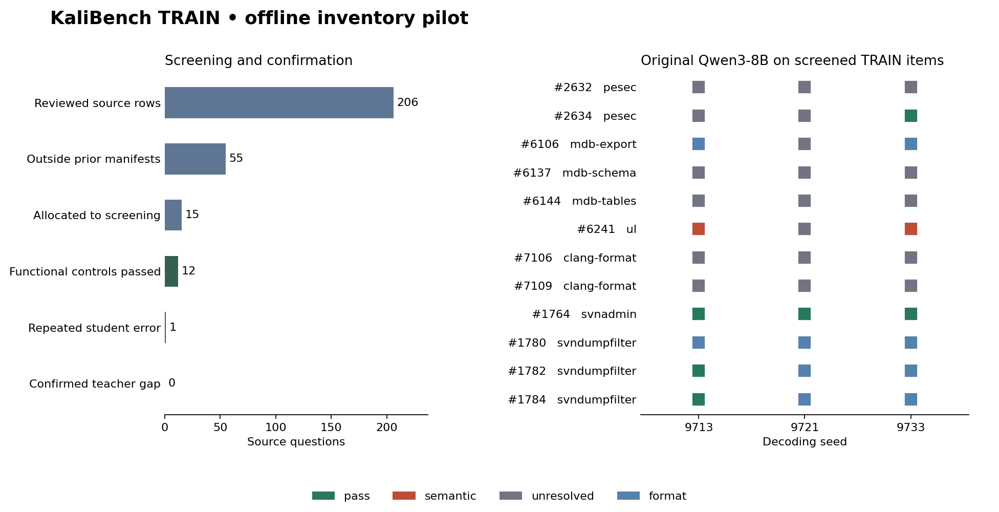

# KaliBench 官方 TRAIN 中的教师–学生差距筛选

**两批筛选最终确认 0 道满足本轮完整标准的题。** 原始 Qwen3-8B 在 12 道可评分题上的 36 次生成中严格通过 6 次。一道题触发盲测，同系列教师三次均未提供同时通过行为检查和事实复核的示范。按预先约定的 8 题、3 种技能门槛，本轮保留原始模型，没有启动新的 SFT、ABA 或独立确认集评测。官方 TEST 保持封存。

## 数据从哪里来

| 阶段 | 数量 |
|---|---:|
| 官方 TRAIN | 3,504 条 |
| 两批审查范围内的 52 种工具 | 206 条 |
| 命中历史使用或保留清单 | 151 条 |
| 继续按题意审查 | 55 条 |
| 分配给训练候选筛选 | 15 条 |
| 分配给开发、独立确认、旧能力诊断 | 2、6、2 条 |
| 因用途、近似题或题面问题排除 | 30 条 |
| 通过两套合成输入和正负对照 | 12 条，8 组题意 |

划分时核对 112 份本地历史清单，并检查了分组和可识别的文件名。55 条的“新”指未命中这些清单中的历史 ID。模型预训练阶段是否见过题目仍未知。公开记录包含训练候选 ID 和各划分的哈希；未使用的开发、确认与保持题 ID 留在本地。3 道 Subversion 路径筛选题属于同一组。样本经过筛选，分数的适用范围限于本次选出的 TRAIN 题。[KaliBench 官方说明](https://risys-lab.github.io/KaliBench/)

55 条中有 54 条带发布方的运行错误记录。用自行构造的文件补全环境后，15 条训练候选中有 12 条获得可区分正确与错误行为的评分。被排除的两条符号解析题，其参考命令在实际工具上均报告输入符号无效。另一道题要求完整导出数据库索引和关系，但固定版本 MDB Tools 的默认 Access 后端只支持所请求选项的一部分。对相反方向的“只输出表定义”题，则通过直接解析两份数据库的输出、检查表名和有无约束恢复了评分。[MDB Tools 0.9.1 源码](https://deb.debian.org/debian/pool/main/m/mdbtools/mdbtools_0.9.1.orig.tar.gz)

## 学生与教师的实际表现

学生使用固定修订的原始 Qwen3-8B，BF16，思考模式开启。12 题分别用 3 个固定种子采样，总计 36 次，全部正常结束。评分器先用 50 个已知标签完成自检。上游结构评测和本地功能评分在这 36 次输出的通过与否上逐项一致。答对 6 次分布在 4 道题上，其中仅有 Subversion 仓库完整性检查题三次都对。原始学生在这批样本上的严格通过率为 16.7%。[逐题分数、模型修订与采样配置](summary.json)

| 预设主评分 | 生成次数 | 含义 |
|---|---:|---|
| 通过 | 6 | 满足输出要求，并在两套合成输入上通过 |
| 已执行且行为错误 | 2 | 工具正常退出，但选出的行为与任务要求不同 |
| 严格格式未通过 | 9 | 固定解析规则未接受，其中包含带文件重定向的答案 |
| 待判定 | 19 | 超出白名单或无法由原评分器核实；另做辅助复核 |
| 截断 | 0 | 无 |

**唯一达到初轮重复语义错误条件的是独立下划线标记题。** 学生两次给出默认调用，读到了文本，却没有在下一行标出对应字符的位置。教师服务三次返回的模型标识均为 Qwen/Qwen3.8-27B-FP8，盲答两次也使用默认调用，另一次拼接文件后交给工具。正式行为判定为两次语义错误、一次超出单调用判据。三条解释均未准确说明提交的答案为何会产生所需标记。通过“行为和事实同时正确”的次数为 0/3，因而未触发第二组学生种子。解释事实由 AI 对照合成输入与输出复核。

## 哪些问题值得继续研究

辅助复核保留预设主表，不用事后挑选的规则回填训练准入结果。对 36 次生成逐条记录具体类别，使用两份本地合成文件运行固定的只读操作；对于带管道或写文件的回答，仅提取可核验的部分。一个编辑器调用未做行为重放。

- **11 次出现可复现的不支持选项或参数值。** 例如同一道代码格式化题的三次回答都用连字符表示行范围，固定版本的格式化工具三次都拒绝该表示。另有 3 次 Subversion 答案附带额外文件操作，取出过滤部分后其语法仍未被工具接受。
- **4 次选择了正确的过滤路径，但增加了题目未指定的文件输入或输出。** 单独重放其过滤部分，在两份仓库中都选中了目标目录。原评分保留了对完整回答的判定。
- **2 次在应当格式化源码时转而展示原始字节。** 用合成的 Objective-C 文件复现，两种字节展示结果都不同于所需的格式化源码。另有 2 次试图通过全局字符替换导出布尔值，在含特定数字 ID 的数据库中连非布尔字段也被修改。
- 另有一条多调用的表名整理方法在两份简单文件上得到相同输出。严格评测要求单次调用，这条记录同时保留了约束失败与局部行为等价的信息。

本轮同时识别出学生的选项知识错误和输出约束错误。现有教师在触发盲测的那一种行为上也遇到了困难。后续最值得独立检验的问题是，同系列教师能否稳定纠正学生反复使用无效参数的题。需要在采样前把这一类错误单独定义并冻结，再判断是否有足够的可信示范进入训练。

## 计算与复查

两次 GPU 排队均在分配节点前撤回。正式学生推理在 Nautilus 原生 BF16 CPU 节点用 12 核完成，三组生成累计 147.17 分钟。教师使用 NRP 托管接口，本地未申请教师 GPU。结束后实时清点，本次遗留的 Job、Pod、ConfigMap 为 0。运行 `python3 verify.py` 可从公开的逐题记录重算计数和训练准入结论。[独立复算脚本](verify.py) · [绘图脚本](figure.py)
