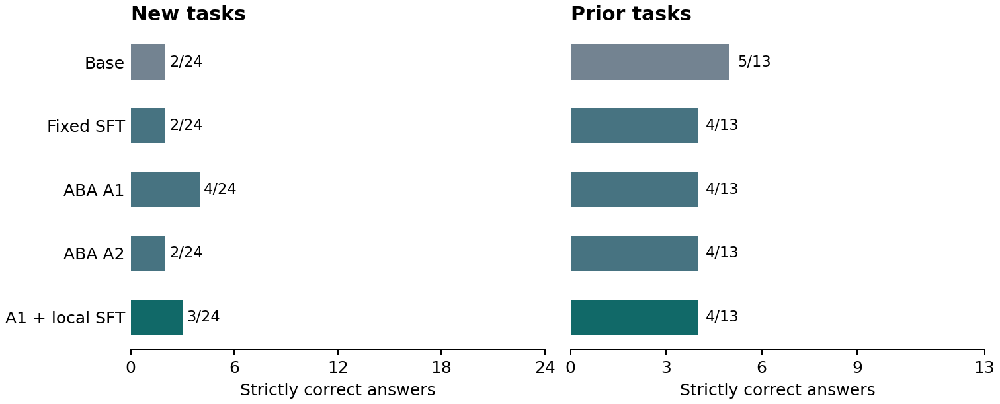

# ABA 后训练与教师盲测的独立复核

**保留原始 Qwen3-8B。** 在 24 道新离线工具题上，ABA 选中的 A1 答对 4 道，底座答对 2 道。A1 在 13 道旧题中丢失了底座原已答对的一道，另一道旧题出现截断。给 A1 续训 32 步后，新题降为 3/24，旧题仍为 4/13。

| 模型 | 新题严格 /24 | 按工具等权 | 旧题严格 /13 | 旧题改对 / 丢失 | 截断（新 / 旧） |
| --- | ---: | ---: | ---: | ---: | ---: |
| 原始 Qwen3-8B | 2 | 5.0% | 5 | 0 / 0 | 1 / 0 |
| 固定 SFT（256 步） | 2 | 5.0% | 4 | 0 / 1 | 2 / 0 |
| ABA 选中的 A1 | 4 | 10.8% | 4 | 0 / 1 | 0 / 1 |
| ABA 候选 A2 | 2 | 5.0% | 4 | 0 / 1 | 1 / 0 |
| A1 加 32 步本地工具 SFT | 3 | 7.5% | 4 | 0 / 1 | 0 / 1 |

24 道新题来自发布方 TRAIN，覆盖 10 种本地工具。13 道旧题取自历史面板。确认集与本次 25 道续训样本的题号、完整题面和完整参考命令无重合；8 道新题使用的工具也出现在本次续训中。官方 TEST 未查询。五组相同提示、相同非思考贪心解码，每组 37 份输出。主要指标额外核对完整格式和参考答案要求的参数值。37 道金标自测及六种负对照均通过。

原生 ABA 的 A1、A2 和固定 SFT 均为历史检查点。新增组从逐张量验证的 A1 出发，在 25 道本地文件或构建工具题上固定更新 32 步，答案损失外加冻结底座的 KL 项。续训组单独于原生 ABA 搜索报告。此次没有仅去除 KL 的配对对照，因此无法独立估计 KL 的作用。

## 教师会而学生反复答错的题

DeepSeek-V4.1-Flash 对 24 道题各做两次盲测，严格答对 18/48，有 8/24 道两次都正确。其中 7 道原始学生在首次非思考贪心解码时答错。对这 7 道题重新抽样，每种模式每题三次，使用 3,072 token 上限。关闭思考答对 1/21，开启思考答对 3/21。有 6/7 道在两种模式下均至少错两次。各次解码共享题源；这组已筛选题的错误率不能外推到整个基准。

在一道本地代码绑定题上，原始学生关闭思考时 0/3，开启思考时 3/3。这也是续训相对底座唯一新增的严格正确题，其收益可以用原始模型的另一种推理设置复现。三个 clangd 例子展示了可观察的差距。原始学生使用的选项名看似符合请求，但本机 Apple clangd 21 将它们标为未知；教师的对应选项通过了解析检查。这支持工具选项知识或参数绑定是部分案例的问题。隐藏推理机制仍未确定。[clangd 官方文档](https://clangd.llvm.org/troubleshooting.html)

在此前针对已知弱点的受控 SFT 中，学生能记住示范。在另一个合成计数实验中，两个训练种子下，双向仅答案和双向解释监督都完整通过 3/6 个新题组。本次新教师盲测只用于定位能力差距，没有用这批留出题再训练。

本次主要门槛在推理前固定。新候选须在新题严格正确数及工具等权分上超过底座、在新题上超过固定 SFT、保住全部原答对的旧题，且各面板截断数均不增加。后两项未达到。在六道预先指定的等价写法诊断中，续训组有一个回答把 500000.0 写成 500000。若将等值采样率计为正确，它的新题成绩可由 3/24 变为 4/24，旧题损失和截断仍然存在。一次续训、有限的题源及参考答案匹配限制了结论。该研究没有 CyberGym 分数。[聚合成绩](aggregates.json) · [KaliBench 论文](https://arxiv.org/abs/2610.02206) · [验证集选择偏差](https://jmlr.org/papers/v11/cawley10a.html) · [教师解释辅助监督](https://arxiv.org/abs/2305.02301)
