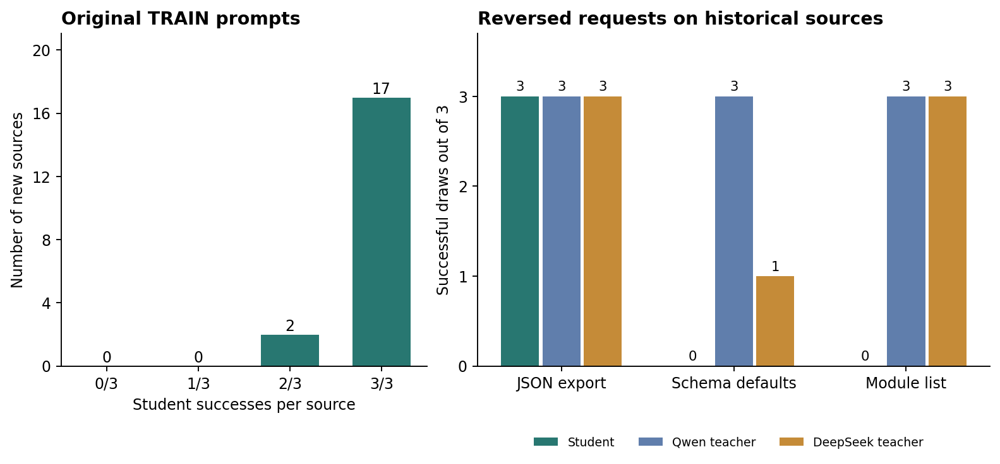

# KaliBench 只读工具题的学生与教师配对筛查

原始 Qwen3-8B 在 19 道经校准的新 TRAIN 题上通过 **55/57** 次。17 题三次全对，另外两题各通过 2/3。纠正有问题的帮助文本后，本轮新增合格训练来源 **0**。累计 51 个已做学生筛查的独立 TRAIN 来源，3 个满足原方向门槛，其中 2 个同时具备五组正反向标签。多来源 SFT 要求至少 8 个独立来源并覆盖 3 项技能，本轮止于数据筛查。

| 读数 | 原始 Qwen3-8B | Qwen 27B 教师 | DeepSeek 4.1 Flash 教师 |
| --- | ---: | ---: | ---: |
| 新题原方向，19 题各 3 次 | 55/57 | 按筛选协议跳过 | 按筛选协议跳过 |
| 历史 JSON 导出反向题 | 3/3 | 3/3 | 3/3 |
| 历史表结构反向题 | 0/3 | 3/3 | 1/3 |
| 历史模块列表反向题 | 0/3 | 3/3 | 3/3 |

分母是生成回答次数。同题的不同文件用于验证同一条回答，采样种子、文件和改写均不能当作独立题。学生本轮共生成 84 条回答，两位教师共生成 18 条历史反向回答。19 道新题覆盖 14 个意图组。另有 13 个候选因参考、运行环境或缺少独立文件对照暂未进入模型评分。

本轮只用官方 TRAIN。第一批冻结 24 个新来源，第二批在学生生成前冻结 8 个来源。每道原题采样三次，固定学生版本、思考模式和采样种子。对 19 道可评题，用两个不同的本地合成输入分别跑参考行为和刻意构造的错误行为。题目筛选有目的性，相近意图归组。重复采样和同一来源的改写均不增加来源数。

#### 三项会改变结论的复核

1. 两道 PE 静态报告题第一次给学生的帮助只有一行插件目录错误。把插件配置放进工具读取帮助的工作目录后，重新获取了二进制自带的完整说明。新旧帮助在同一个 GPU 作业中以相同位置和种子配对，另放一题输入完全相同的 Python 文档题作为对照。HTML 标题含生成报告时的命令，原文哈希会误罚等价的短选项，因此评分比较正文、格式和显式的详细输出要求。[工具作者的 HTML 示例](https://github.com/mentebinaria/readpe/wiki/Usage)
2. 归档题有一次使用单短横线的完整选项名。初始白名单把它标成待复核。在两份归档上实际运行后，输出目录树及内容都与参考一致，最终计为通过。
3. 两个链接器题的发布者参考在锁定版本上无法解析。把参数值改成等号连接后，两题都在两个独立目标文件上通过，负对照均可区分。修复用于诊断，保留原题原始参考的筛选记录。[LLD 参数文档](https://manpages.debian.org/trixie/lld-19/ld.lld-19.1.en.html)

#### 教师监督能用到什么程度

历史三题都准备了两种方向。A 组保留共同最终答复，B/C 组分别加入 Qwen 或 DeepSeek 的原始教师示范，D 组加入经核验的双向条件说明，E 组加入相同分词长度的中性说明。六个方向逐个核对了提示词、答案、可见解释、格式及结束符的分词。各组可见解释都写明具体的参数选择依据。两位教师只在均达到门槛的题目上进行五组配对。

DeepSeek 在保留字段默认值的反向题上，两次把一个约束选项中的下划线写成了短横线。对保存的两份回答分别只修一个字符，两份都通过原生工具验证。这个回放定位了这两次失败的直接原因。原始采样仍记为 1/3，以免修复后的示范夸大教师可靠性。

本轮没有用开发集挑选检查点，也没有打开官方测试集。本轮的学生结果描述原始 Qwen3-8B 对选定工具的表现。只有向未参与筛题的来源迁移，才能说明教师解释带来了泛化收益。

#### 能直接定位的错误

- 两道静态报告题在错误帮助下各 0/3，在真实帮助下各 3/3。同批输入完全相同的文档题两边均为 3/3。这个配对实验表明，工具说明的可用性足以改变这两题的结论。[逐种子重跑记录](help-replay.json)
- 新题仅错两次，一次漏写共享库的输出文件名，另一次漏写模块切分文件的前缀。对保存的回答仅补输出参数，两次都通过两个文件上的原生检查。两题分别只有一次失误，均未达到每个来源至少重复两次的筛选条件。
- 历史模块列表反向题中，学生三次都选对开关却省略了可执行程序名。补回程序名恢复 3/3。历史表结构反向题中，学生三次都将下划线写成短横线，仅纠正字符恢复 3/3。这些回放定位了原生命令失败的原因。原回答中关于错误拼写的文字解释仍需要另行修订。[学生单项修复](student-error-replays.json) · [教师原始分数与修复](reverse-directions.json)

#### 训练决策与复算

本轮准备了 29 个可用的“方向 × 监督方式”标签单元，来自 3 个历史来源、6 个方向。3 个历史合格来源中有一个属于输出格式问题。此次证据支持具体、可重复的参数表达与调用完整性问题；教师解释能否带来跨来源增益仍待检验。新一轮五组 SFT 和 ABA 均未启动。若按同协议继续收集，应优先筛查必须同时满足多个约束的只读任务，在采样前验证帮助和参考输出。若转用其他公开来源，应单列数据集和结果。

在本目录运行 `python3 recount.py` 可核对每个来源的三次结果，运行 `python3 figure.py` 可从公开记录重绘图。公开文件保留输入与输出摘要、原生检查结果和模型版本，原始教师轨迹保存在本地。[逐题记录](screening.json) · [工具校准与排除原因](calibration.json) · [模型与运行环境](environment.json) · [标签审计](paired-label-audit.json) · [之前 32 个来源的台账](../schema-factor-2026-11-23/source-accounting.json)
