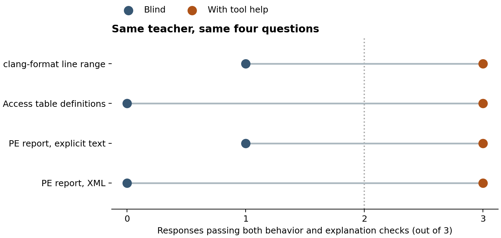

# 工具帮助对教师答题的影响

在上一轮原始 Qwen3-8B 至少两次用错参数的四道 KaliBench TRAIN 题上，同系列教师 Qwen3.8-27B-FP8 盲答时，12 次中有 2 次同时通过行为与解释检查。给它对应版本的完整工具帮助后，12 次全部通过。盲答时没有一道达到预设的稳定标准。这轮没有新增可用来检验“教师原本会、学生反复不会”的训练样本。

| TRAIN 题号 | 只读任务 | 学生此前可复现的参数错误 | 教师盲答通过 | 教师有文档通过 |
| --- | --- | ---: | ---: | ---: |
| 7106 | 按指定行范围格式化 C 代码并输出 | 3/3 | 1/3 | 3/3 |
| 6137 | 从 Access 文件导出最小表定义 | 3/3 | 0/3 | 3/3 |
| 2632 | 显式指定文本格式的 PE 元数据报告 | 2/3 | 1/3 | 3/3 |
| 2634 | XML 格式的 PE 元数据报告 | 2/3 | 0/3 | 3/3 |

## 如何判定

四道题和盲答规则在请求教师前冻结。每道题每组发送三次独立请求，使用相同的三个指定种子、模型、系统提示和解码参数。盲答只看原题，文档组另附固定版本工具的完整 `--help` 输出。两组均未向教师提供参考答案、学生回答或评分反馈。

一次通过要求同一回答同时满足两项。命令要在两套合成输入上得到要求的输出并遵守题目约束，公开简短解释也要正确描述参数选择的依据。执行器仅运行已经审核的只读参数组合。对明显选错工具或不符合直接调用约束的回答作单独记录。每道题都有一个阳性和一个阴性行为对照，两轮都得到了预期判定。解释由 AI 依据题意、工具说明和回放作事实复核，没有独立人工评分。判断的是可见解释及行为，实验没有观察教师的内部推理过程。

## 从结果能判断什么

- 按同题同种子配对，2 次在两组均通过，10 次只在文档条件下通过。12 次来自 4 道定向选题，两道 PE 题还共用一类格式选择规则。因此不能用这组数估计整个 KaliBench 的效果。
- 行范围题中教师盲答两次使用连字符，工具实际要求用冒号。PE 文本题中有回答选对文本格式却额外加入了无效的输入参数。对应版本的工具帮助可以直接解答这两类错误。
- Access 题三次盲答都选错了工具。附上 `mdb-schema` 帮助也提示了应选哪个工具，这题无法分离工具选择提示和具体参数说明各自的作用。
- 预设条件要求一题盲答三次至少两次通过，才对学生做新种子复测。符合条件的题为 0。因此本轮没有启动学生复测、SFT 或 ABA，也没有评测官方 TEST。若研究文档辅助蒸馏，下一项有信息量的对照是给原始学生同样的帮助，比较学生独立使用文档能解决哪些题。

运行 `python3 verify.py` 可从逐次记录复算两组通过数、稳定题数和配对结果。完整回放依赖原环境、固定工具版本及合成输入。此脚本只做离线复算。
