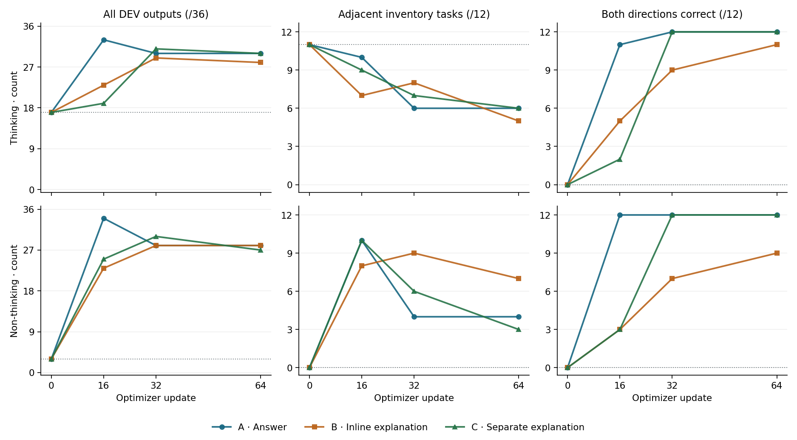

# Qwen3-8B 正反题训练与检查点退化诊断

三组从同一个原始模型与 LoRA 初始化开始，同顺序重复学习四道题。每个训练文件都有一对问题，分别查询本机工具的版本和文件内部的 ELF 符号版本记录。开发集使用四个新文件和新措辞，每组文件再加入一道清点相邻元数据的题，用来观察已有能力保持情况。开发集在取得模型输出前冻结，未访问官方测试集。

A 组只学答案及格式。B 组在答案前学习教师的公开解释。C 组使用与 A 逐 token 相同的答案输入和标签，在同一优化步中另用一个提示监督解释，再合并梯度。B、C 使用相同的解释正文 token；C 的辅助目标还包含结束符。三组答案损失权重为 1、格式损失权重为 0.1，B、C 的解释损失权重为 0.5。优化步数与答题次数相同，额外解释导致监督 token 数和计算量不同。

教师服务返回 Qwen3.8-27B-FP8。第一道工具版本题的三次盲答均未通过。为统一示范来源，四道训练题都采用提供两种工具用法参考后的教师回答。四个答案都通过两个合成文件变体的执行核验。AI 复核时从一条解释删去了声称输出不列出内部分区名称的从句，其他解释保留原文。

## 开发集结果

三类题各有四道，每题在同一模式下用三个固定种子各生成一次。表中的分母 36 对应 12 题 × 3 次。正反同时通过的分母 12 对应四个文件 × 三次抽样。相邻题的失去、得到均逐文件逐种子相对第 0 步计算。

### 思考模式（主要指标）

| 模型/步 | 工具版本 /12 | 文件版本 /12 | 相邻 /12 | 总通过 /36 | 正反均对 /12 | 相邻原对→未通过 | 相邻原未通过→对 |
|---|---:|---:|---:|---:|---:|---:|---:|
| base | 1 | 5 | 11 | 17 | 0 | 0 | 0 |
| A-16 | 12 | 11 | 10 | 33 | 11 | 2 | 1 |
| A-32 | 12 | 12 | 6 | 30 | 12 | 5 | 0 |
| A-64 | 12 | 12 | 6 | 30 | 12 | 5 | 0 |
| B-16 | 6 | 10 | 7 | 23 | 5 | 4 | 0 |
| B-32 | 10 | 11 | 8 | 29 | 9 | 4 | 1 |
| B-64 | 11 | 12 | 5 | 28 | 11 | 6 | 0 |
| C-16 | 2 | 8 | 9 | 19 | 2 | 3 | 1 |
| C-32 | 12 | 12 | 7 | 31 | 12 | 4 | 0 |
| C-64 | 12 | 12 | 6 | 30 | 12 | 5 | 0 |

| 组 | 首次相邻净分低于底座 | 首次丢失底座答对的相邻输出 | 首次总分低于前一个测量点 |
|---|---|---|---|
| A | 第 0–16 步之间 | 第 0–16 步之间 | 第 16–32 步之间 |
| B | 第 0–16 步之间 | 第 0–16 步之间 | 第 32–64 步之间 |
| C | 第 0–16 步之间 | 第 0–16 步之间 | 第 32–64 步之间 |

### 非思考模式

| 模型/步 | 工具版本 /12 | 文件版本 /12 | 相邻 /12 | 总通过 /36 | 正反均对 /12 | 相邻原对→未通过 | 相邻原未通过→对 |
|---|---:|---:|---:|---:|---:|---:|---:|
| base | 0 | 3 | 0 | 3 | 0 | 0 | 0 |
| A-16 | 12 | 12 | 10 | 34 | 12 | 0 | 10 |
| A-32 | 12 | 12 | 4 | 28 | 12 | 0 | 4 |
| A-64 | 12 | 12 | 4 | 28 | 12 | 0 | 4 |
| B-16 | 9 | 6 | 8 | 23 | 3 | 0 | 8 |
| B-32 | 9 | 10 | 9 | 28 | 7 | 0 | 9 |
| B-64 | 9 | 12 | 7 | 28 | 9 | 0 | 7 |
| C-16 | 9 | 6 | 10 | 25 | 3 | 0 | 10 |
| C-32 | 12 | 12 | 6 | 30 | 12 | 0 | 6 |
| C-64 | 12 | 12 | 3 | 27 | 12 | 0 | 3 |

| 组 | 首次相邻净分低于底座 | 首次丢失底座答对的相邻输出 | 首次总分低于前一个测量点 |
|---|---|---|---|
| A | 截至第 64 步未观察到 | 截至第 64 步未观察到 | 第 16–32 步之间 |
| B | 截至第 64 步未观察到 | 截至第 64 步未观察到 | 截至第 64 步未观察到 |
| C | 截至第 64 步未观察到 | 截至第 64 步未观察到 | 第 32–64 步之间 |

## 核验与适用范围

第 0 步评测原始底座，第 16、32、64 步分别重新加载 A、B、C 的适配器并评测。九份适配器权重和配置都保存至项目持久卷并导出本机，每份经 SHA-256 和张量结构核验。A、C 首步更新前的答案损失相同（0.770612）。一个 A100 容器累计运行 39.85 分钟。文件和采样种子在各检查点间配对，三次采样不构成三道独立题。

“退化起点”指首次采样观测到的变化区间。只跑了一个训练种子、四组开发文件；未在 1–15、17–31 或 33–63 的每一步测量。相邻题净分可能保持或提高，同时丢失某些原来答对的输出。检查点支持加载到固定基座进行推理，不包含优化器状态。

[汇总数据与适配器哈希](summary.json) · [前一轮单题实验](../readelf-transfer-2026-11-19/RESULT_ZH.md)

## 对照解读

- 仅答案（A）的思考模式总通过数为 17 → 33 → 30 → 30。相邻题净分在第 16 步首次低于底座。到第 64 步，原先通过的相邻输出中有 5 次未再通过，同时新增 0 次通过。
- 解释在答案前（B）的思考模式总通过数为 17 → 23 → 29 → 28。相邻题净分在第 16 步首次低于底座。到第 64 步，原先通过的相邻输出中有 6 次未再通过，同时新增 0 次通过。
- 解释独立训练（C）的思考模式总通过数为 17 → 19 → 31 → 30。相邻题净分在第 16 步首次低于底座。到第 64 步，原先通过的相邻输出中有 5 次未再通过，同时新增 0 次通过。

第 64 步的思考模式中，相同题目和采样种子下，独立解释组 C 比仅答案组 A 多答对 0 次，也丢掉 A 已答对的 0 次。两组直接答案的前缀、标签、出现次数完全一致。

第 64 步的非思考模式中，相同题目和采样种子下，独立解释组 C 比仅答案组 A 多答对 0 次，也丢掉 A 已答对的 1 次。两组直接答案的前缀、标签、出现次数完全一致。

四组开发文件仅适合定位此次退化出现的时间和输出类别。比较 A 与 C 可以估计这组训练条件下增加辅助解释任务的效果；比较 B 与 C 时，解释位置、提示及条件上下文均有差异。当前实验不能单独归因于其中某一项。

本轮思考模式开发总分最高的是 A-16（33/36），非思考模式也以 A-16 最高（34/36）。第 32 步 A 和 C 在同一文件、同一采样下正反同时答对 12/12。第 64 步 A 和 C 的思考模式在全部 36 个配对通过判定上完全相同。若优先兼顾正反题和相邻能力，A-16 可作为后续未见数据上的候选；开发集用于比较过多个检查点，仍需独立确认。

在第 64 步，A 和 C 的思考模式各有 6 次相邻题未通过。逐条分析发现它们都带上了正确文件名，但用了当前 LLVM 14 不识别的两个选项，各出现 3 次。独立 CPU 作业在两个合成文件上直接验证了这些选项会报错；这六次可以具体定位到命令选项。开发集中第 0 和第 16 步的 288 个判定另行回放，与最终全量评分逐项一致。

[独立复评分与错误核验](cross-checks.json) · [三组梯度复算](gradient-audit.json)
