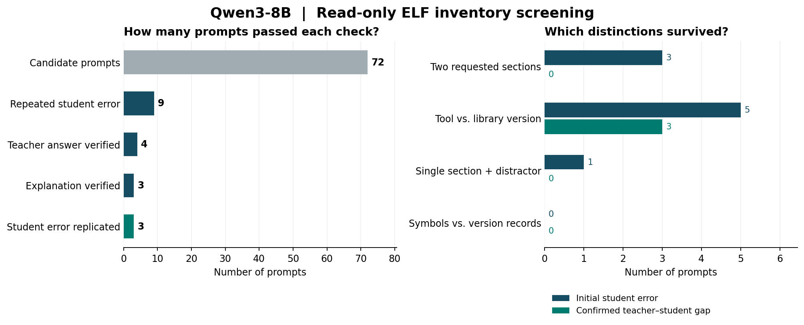

# Qwen3 教师与学生在只读 ELF 清点任务上的能力差异

在 72 道训练候选题中，确认了 3 道教师能稳定答对、学生反复答错的题。三道都要求查询 LLVM 工具自身的版本。预设训练门槛为至少 8 道、覆盖至少 3 个题型。本轮完成了协议中的筛选与诊断分支，保留原始学生模型。没有产生新的 SFT 或 ABA 性能分数。

## 实验设置

教师为 NRP 返回的 `Qwen/Qwen3.8-27B-FP8`，保留每次调用标识和时间。服务未提供不可变的教师权重修订号。学生为原始 `Qwen/Qwen3-8B`，修订号 `b968826d9c46dd6066d109eabc6255188de91218`，使用校验过的 BF16 权重。每个候选题有两个独立编译的合成库，评分器在固定 LLVM 14 环境下比较实际输出与参考输出。两份文件是同一道题的验证变体。

每道候选题进行三次思考模式和三次非思考模式采样。进入教师复核要求学生在三次思考模式生成中至少有两次可解释的语义错误。教师同题采样三次，要求至少两次既通过执行检查，又给出符合事实的简短公开解释。最后用三个新种子再次确认学生的错误。事实复核由 AI 助手完成，判定理由逐条留档。

| 筛选步骤 | 首批 | 补充批 | 合计 |
| --- | ---: | ---: | ---: |
| 候选题 | 48 | 24 | 72 |
| 学生至少两次语义错误 | 6 | 3 | 9 |
| 教师至少两次答案通过 | 3 | 1 | 4 |
| 对应解释也通过复核 | 2 | 1 | 3 |
| 新种子下学生错误重现 | 2 | 1 | 3 |

## 错在什么地方

| 入选题 | 教师执行通过 | 学生首次语义错误 | 学生复测语义错误 |
| --- | ---: | ---: | ---: |
| train-01 | 3/3 | 3/3 | 3/3 |
| train-09 | 2/3 | 2/3 | 2/3 |
| extra-09 | 2/3 | 3/3 | 3/3 |

在 train-01 上，题面给出一个库名供识别工单，要求查询工具本身的版本。学生首次的三条命令都读取了文件中的符号版本信息。教师三次返回了正确的工具版本查询。这个结果定位到了输出行为中的对象混淆。三个同类例子不足以确定内部推理机制或证明解释监督能够改善泛化。

另一个候选 train-06 的两条教师命令符合参考输出，但解释没有准确交代实际输出范围。两份文件的版本信息都包含版本符号索引和版本定义，都没有版本需求段。其中一条解释声称展示定义和需求而省略所有其他段，另一条对省略符号的描述不够准确。这道题的题面还限定了比参考命令更窄的范围，因此不适合作为严格训练示范。即使放宽这一条解释判定，在命令层面通过的也只有 4 道，仍低于 8 道。

## 学生基线

| 模式 | 总生成数 | 执行通过 | 语义错误 | 不支持或无法执行 | 格式错误 | 截断 |
| --- | ---: | ---: | ---: | ---: | ---: | ---: |
| 思考 | 216 | 124 | 39 | 52 | 1 | 0 |
| 非思考 | 216 | 69 | 31 | 103 | 9 | 4 |

这些分母包含同一题的三次生成。它们衡量内部候选池上的严格通过率。没有向模型查询本轮的 16 道开发题、32 道新留出题或 16 道能力保持题，也没有查询官方 KaliBench 测试集。

## 配置核验与计算成本

- 首轮 2048 token 校准中，思考模式截断 1/24 次，非思考模式截断 7/24 次。第一版脚本只看思考模式。核对书面协议后，撤回了尚未分配节点的首个训练池请求，保留旧记录，按全部 48 次生成计算并重新校准。随后冻结 4096 token，上述正式筛选均采用这一设置。
- 在查看训练池预测前，已用固定 LLVM 环境验证评分器能区分无效选项和选错元数据。教师单次校准通过 6/8。4096 token 学生校准的思考模式通过 17/24，非思考模式通过 6/24。
- 用原分词器核对提示、监督片段和 EOS，再以独立实现复算直接答案、联合平均、分段加权和辅助解释四种损失。在一次性校准例、合成 logits 上，四项最大梯度差均为 0。这项检查验证损失实现。
- 已完成 GPU 容器累计 110.22 分钟，包括容器内初始化时间。学生累计生成 302,786 个 token，教师返回 35 次响应。从首次集群提交到最后一个作业完成为 276.71 分钟。最终只读核对显示本实验遗留 Job、Pod、ConfigMap 各 0 个。

[公开汇总数据](summary.json)
