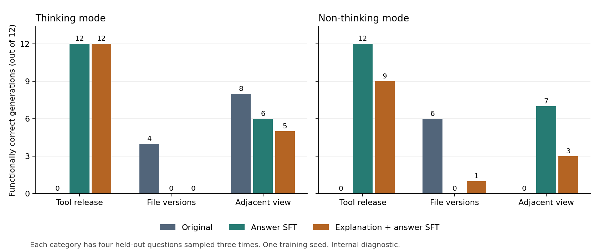

# Qwen3-8B 单样本 SFT 与正反问题对照

Qwen3-8B 在此前确认的一道工具版本查询错题上学会了教师的公开示范。训练后，两组模型都能回答同方向的新题。把查询目标改成文件内的符号版本记录后，两组在思考模式下的功能通过次数均为 0/12。

从同一原始模型和相同的 LoRA 初始化开始，A 组学习最终答案，B 组额外学习 Qwen3.8-27B-FP8 的简短公开解释。两组各训练 64 步，答案部分均为 12 个 token，损失权重相同。B 组另有 38 个解释 token。教师原文末尾的一句格式提示在训练前移除。第 16、32、64 步保存的适配器均在重新加载后答对了原题，B 组在第 32、64 步还能逐字复现教师解释。

## 留出题结果

每列包含 4 道新题，每题采样 3 次。每道题的输出都在两个合成文件变体上执行核验。正反问题共享文件，改变的是要查询的信息。合计仅含留出题。

| 解码模式 | 模型 | 工具版本 /12 | 文件版本记录 /12 | 相邻元数据 /12 | 合计 /36 |
|---|---|---:|---:|---:|---:|
| 思考 | 原始模型 | 0 | 4 | 8 | 12 |
| 思考 | 仅答案 SFT | 12 | 0 | 6 | 18 |
| 思考 | 解释＋答案 SFT | 12 | 0 | 5 | 17 |
| 非思考 | 原始模型 | 0 | 6 | 0 | 6 |
| 非思考 | 仅答案 SFT | 12 | 0 | 7 | 19 |
| 非思考 | 解释＋答案 SFT | 9 | 1 | 3 | 13 |

思考模式下，A 组在反向题上 12 次都重复了训练命令。B 组有 10 次写出了题目指定的文件名，却仍未完成所需查询。示范中先提到附件，再说明实际要查的是工具版本；本轮没有单独测量这句措辞的影响。只有一个训练种子和四组文件，本次对照不足以推断教师解释对整个 KaliBench 的效果。

## 新错例筛选与决定

从 KaliBench 官方训练集筛选的 48 道只读题中，25 道通过了评分环境的正负对照。教师对每题作答三次，11 道有至少两次同时通过执行验证和 AI 对公开解释的事实复核。原始学生在这 11 道题上通过了 30/33 次。其余三次中，两次把要求的一次调用写成两次，另一次返回了文字说明。没有题目满足首次采样中至少两次可确认语义错误的条件，因此没有触发新种子复测。

本轮新增符合条件的官方训练题为 0 道。此前的 3 道内部错例都属于同一技能。预设门槛为至少 8 道、覆盖至少 3 种技能，因此保留原始模型，本轮止于单题对照与筛选。官方测试集保持封存。两项 A100 作业累计占用约 45.7 个容器分钟；作业结束后已核查资源回收。

[汇总数据](summary.json) · [此前的教师与学生差异筛选](../readelf-screening-2026-11-19/RESULT_ZH.md)
