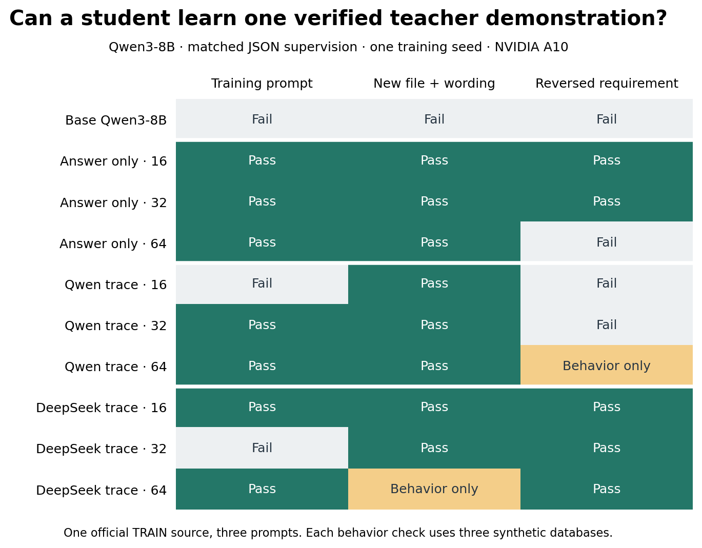

# 两位教师的原始轨迹能教会 Qwen3-8B 什么

在一个已确认的师生差距上，原始 Qwen3-8B 在三种提示下均未通过。训练到第 16 步，仅监督命令答案和加入 DeepSeek 原始轨迹都达到 3/3。三种提示合计的生成量分别为 283 和 1,459 个 token。加入同系列 Qwen 教师轨迹的学生在同一步达到 1/3。这三个提示共享一道官方 TRAIN 原题，其他两个提示用于检查同技能的新措辞、文件名和相反要求。

## 单题对照

| 训练配方 | 第 16 步严格通过 | 第 32 步严格通过 | 第 64 步严格通过 | 第 64 步实际行为通过 |
|---|---:|---:|---:|---:|
| 仅命令答案 | 3/3 | 3/3 | 2/3 | 2/3 |
| 答案＋Qwen 教师原始轨迹 | 1/3 | 2/3 | 2/3 | 3/3 |
| 答案＋DeepSeek 教师原始轨迹 | 3/3 | 2/3 | 2/3 | 3/3 |

每条命令均用固定版本的数据库工具在三套合成数据库上回放；同一提示须在三套上都符合参考输出，才计行为成功。严格评分另要求输出正常结束且完整遵守 JSON 协议。每个设置使用一个训练种子和一个自由生成种子。两个作业的基础模型在两张 A10 上复测，三条原始生成结果逐条一致。

- **第 32 步的截断可以定位。** Qwen 轨迹组在反向题、DeepSeek 轨迹组在原题都用尽 4,096 个生成 token。它们各自的另外两题取得严格通过。
- **第 64 步有两种不同的失败。** 两个轨迹组各将一条回答拆成两个 JSON 对象。每条只有一个命令，把该命令原样放入行为验收器，三套数据库均通过。仅答案组则给反向题额外启用了非空约束，程序成功退出，但两套数据库的 SQL 错了。单独反转这个开关后，命令与已验证通过的参考命令逐参数一致。
- **教师强制下的轨迹拟合确实发生。** Qwen 轨迹交叉熵从 2.059 降到 0.00209，DeepSeek 从 2.259 降到 0.000768。两条原始轨迹分别有 1,027 和 430 个受监督 token，而且各自包含完整参考命令 3 次和 1 次。这些数据支持单题学习；教师身份、轨迹长度及答案重复次数没有在此实验中独立控制，对跨任务泛化需另作评估。

## 训练设置和核验

学生使用固定版本的 Qwen3-8B，BF16 权重、LoRA rank 16、alpha 32、dropout 0，仅更新 q_proj/v_proj。AdamW 学习率为 0.0001，权重衰减为 0，梯度范数上限为 1。三组使用相同初始化，第 16、32、64 步的适配器均保存、重载并核对权重哈希。自由生成从只有系统消息和用户题面的提示开始，温度为 0.6，top-p 为 0.95，top-k 为 20。

教师示范和学生使用相同的双字段 JSON 输出协议。每组对完全相同的 32 个命令 token 赋平均损失权重 1，对 13 个结构 token 赋权重 0.1。303 个提示 token 和 43 个可见短解释 token 均屏蔽；短解释在命令之后。两组轨迹分段取平均，额外赋权重 0.5。首次运行的空思考块有一个额外换行，两种模板将它分成不同的格式 token。主表的仅答案组来自修正后的 A10 重跑，三个训练阶段全部重新执行；另外两组的标签逐 token 保持一致。各组在自由生成时都自行产生可见解释。

## 教师筛选

原始 Access 案例使用相同的工具帮助页。原始 JSON 协议下，Qwen 教师和 DeepSeek 教师分别为 3/3 和 2/3，原始学生为 0/3。本轮同日复测，两位教师的 JSON 命令行为成绩仍为 3/3 和 2/3。改为 XML 命令协议后成绩分别为 3/3 和 0/3，DeepSeek 的三条命令均把参数中的下划线写成了连字符。选入 SFT 的是经轨迹审查及执行验证的原始 JSON 示范。

新的双教师筛选覆盖 18 个同属官方 TRAIN 的题源。两位教师各抽样 54 次，Qwen 有 46 次通过，DeepSeek 有 52 次通过。两位教师共有 15 个题源各自至少两次通过行为评分。Qwen 有一次输出达到长度上限。其余计为运行报错或未核实的调用形式。原始 Access 案例另外计入训练资格审查。一个补充目录检查来源使用经过正反实验校准的简短参数说明，和主批次提供的通用帮助文本有所区别。

同一类 LLVM 检查的两个题源尤其值得区分。DeepSeek 在两题合计 6/6 通过，Qwen 的 6 个答案均用了程序拒绝的选项。双方收到的 5,000 字符帮助节选均未列出所需的两个参数。单独用两个合成输入验证，指定一次或两次打乱得到相应的轮数，默认没有临时文件残留；显式要求保留临时文件时，每次留下 8 个。这项证据适用于该文档条件下的两道同类题。

划分在新候选抽样前按来源和相近意图冻结。48 个官方 TRAIN 源 ID 中，21 个分到新训练候选，10 个只作历史训练候选，3 个开发、4 个确认、2 个保持，另排除 8 个。只有能通过本地正反验证且满足只读范围的来源进入模型筛选。一个权限查询参考答案在固定工具版本上返回错误码 2；在相同的合成权限配置上，使用该版本规定的参数能分别得到只读和读写结果。此题未作为学生错误。官方测试集全程封存。

资料与方法见 [Qwen3-8B 模型卡](https://huggingface.co/Qwen/Qwen3-8B)、[TRL SFT 文档](https://huggingface.co/docs/trl/en/sft_trainer)、[DeepSeek 推理接口说明](https://api-docs.deepseek.com/guides/thinking_mode)和[对照集评测方法](https://aclanthology.org/2020.findings-emnlp.117/)。

## 教师能做、学生反复出错的题目

18 个题源各抽样三次，原始学生累计 45/54 次通过。将已单独验证的 Access 训练题纳入后，19 个题源中有两个符合双教师共同入选条件。学生和教师三次抽样都拿到相同题面的帮助信息。表中数字是固定环境中通过行为校验的次数。

| 官方 TRAIN 来源 | Qwen3-8B 学生 | Qwen 27B 教师 | DeepSeek 教师 | 执行核验 |
|---|---:|---:|---:|---|
| 6137，数据库结构 | 0/3 | 3/3 | 2/3 | 学生把参数里的下划线写成连字符。修复一个字符后，三个数据库都产生参考输出。|
| 7293，列出编译产物中的函数 | 0/3 | 3/3 | 3/3 | 学生三次都只给出选项，漏写可执行程序。补上程序名后，两个合成文件均返回正确的符号列表。|
| 7543，编译器测试轮数 | 0/3 | 0/3 | 3/3 | 学生与 Qwen 教师重复使用工具拒绝的参数。此题仅有 DeepSeek 达到教师正确率要求。|
| 7546，编译器默认行为 | 3/3 | 0/3 | 3/3 | 学生使用默认设置，通过了对轮数和临时文件的核验。按参考命令字面匹配会把它误判成错误。|

单题训练验证了这套 SFT 实现可以拟合教师文本，也能改变学生生成的答案。现有取证将具体失败定位到参数拼写、遗漏程序名和输出格式。它们不足以证明学生获得了教师在陌生任务上的推理能力，也不足以把结果归因于教师模型大小。

## 扩大训练的判定

方案预设三个训练配方，各跑三个训练种子。开跑条件为至少 8 个独立训练来源、覆盖 3 项技能，每题都有两位教师通过的可用示范，并能重复验证学生的同一错误。本次为 **2 个来源、2 项技能**。因此九次多题源训练未启动，独立确认集、保持集和官方 TEST 均未调用。本次报告不提供这三项的成绩。下一批最有信息量的工作是从独立的只读训练题源中补充至少 6 个合格来源，并覆盖目前两种工具以外的技能。原题改写和新增文件均沿用同一来源计数。

从仓库根目录运行 `python3 results/readonly-teacher-match-2026-11-22/recount.py` 可离线重算各检查点和训练资格。公开脚本使用已保存的逐项评分。重新运行模型需要原始训练输入、权重和固定工具环境。两个 A10 作业已结束并释放，计算记录包含排队调度、模型加载和评测耗时。[逐题评分](screen-summary.json) · [SFT 标签核对](labels.json) · [第 64 步参数修复](aligned-a64-diagnosis.json) · [计算记录](compute.json) · [预设扩展条件](decision-protocol.json)
