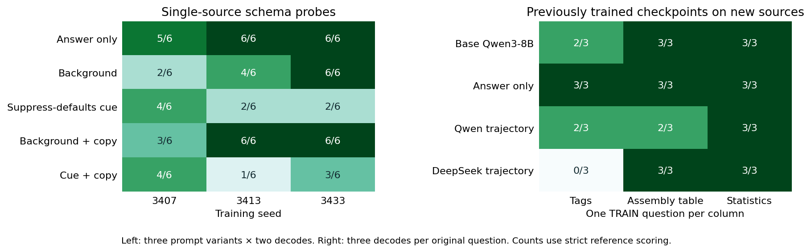

# 同题记忆、条件变化与跨题迁移

**同一题的学习和换条件后的表现出现分离。** 五组在原题上均为 6/6，四个辅助组每次都能复现自己的训练文本。三个变体上，仅答案为 17/18，加入原题的一句关键解释为 8/18。该句指出最简导出要求排除默认值。训练文本只示范了一个方向。题面明确改为保留默认值时，关键解释组为 0/6，原种子相同的仅答案组为 6/6。

在关键解释组的六条反向题失败中，四条来自后两个训练种子，仅替换默认值选项就在三个数据库上全部恢复。另两条来自第一个种子，一条被截断，一条无法可靠提取命令。其他错误还包括选项拼写与结构化输出问题。这个结果具体定位到交付的选项和输出格式；模型内部为何作出这一选择仍是推断。

学生为 Qwen3-8B。一次回答只有在按要求正常结束、给出有效的结构化答案，并在所有预设的合成文件上得到正确结果时才记严格通过。每次生成只记一票。

## 在同一道数据库结构题上改变监督内容

五组都学习同一个最终答案。四个辅助组的监督文本各为 59 个学生 token；在同一次初始化中，仅替换关键条件句、背景句或一份完整答案。比较其余组与仅答案组时，另有辅助文本的有无及长度差异。每个训练种子分别训练五个适配器至第 64 步。表中前三列各为三个同源变体、两个解码种子，共六次生成。

| 监督 | 3407 | 3413 | 3433 | 变体合计 | 原题通过 | 变体截断 |
|---|---:|---:|---:|---:|---:|---:|---:|
| 仅答案 | 5/6 | 6/6 | 6/6 | 17/18 | 6/6 | 0/18 |
| 等长背景 | 2/6 | 4/6 | 6/6 | 12/18 | 6/6 | 5/18 |
| 关键条件 | 4/6 | 2/6 | 2/6 | 8/18 | 6/6 | 1/18 |
| 背景＋抄写答案 | 3/6 | 6/6 | 6/6 | 15/18 | 6/6 | 0/18 |
| 关键条件＋抄写答案 | 4/6 | 1/6 | 3/6 | 8/18 | 6/6 | 5/18 |

下表逐一配对相同初始化、题面和解码种子。胜表示仅左组通过，负表示仅右组通过。每一行都来自同一个训练来源，不能用 18 次采样代替 18 道独立试题。

| 左组相对右组 | 胜 | 负 | 都通过 | 都失败 |
|---|---:|---:|---:|---:|
| 关键条件 相对 等长背景 | 2 | 6 | 6 | 4 |
| 关键条件＋抄写答案 相对 背景＋抄写答案 | 2 | 9 | 6 | 1 |
| 背景＋抄写答案 相对 等长背景 | 3 | 0 | 12 | 3 |
| 关键条件＋抄写答案 相对 关键条件 | 2 | 2 | 6 | 8 |
| 关键条件 相对 仅答案 | 1 | 10 | 7 | 0 |

## 错误回放

在原始严格失败的回答上，分别回放两类指定改动：按本机工具帮助修正已识别选项的拼写（保留正确选项 `--no-not_empty` 中的下划线），或将“保留/忽略默认值”选项改为题面要求。每次改动均在相同三个数据库上重新执行。“两项都改”与两列单独修复可能重叠。截断及无法提取可审核命令的回答仅计入原始失败。回放分单独记录，原始得分保持有效。

| 监督 | 原始失分 | 仅改拼写后恢复 | 仅改条件后恢复 | 两项都改后恢复 |
|---|---:|---:|---:|---:|
| 仅答案 | 1 | 0 | 1 | 1 |
| 等长背景 | 6 | 0 | 1 | 1 |
| 关键条件 | 10 | 0 | 6 | 6 |
| 背景＋抄写答案 | 3 | 3 | 0 | 3 |
| 关键条件＋抄写答案 | 10 | 0 | 2 | 2 |

## 在三个新增原始 TRAIN 来源上测试原有检查点

这里固定使用前一日的原始学生、仅答案、Qwen 完整教师轨迹和 DeepSeek 完整教师轨迹四个检查点。两位教师另外做相同试题。每格三次生成；每次都用两个合成文件环境评分。所有模型得到相同题面和对应工具帮助。

| TRAIN 来源 | 原始学生 | 仅答案 | Qwen 轨迹 | DeepSeek 轨迹 | Qwen 教师 | DeepSeek 教师 |
|---|---:|---:|---:|---:|---:|---:|
| 6402 磁盘标签 | 2/3 | 3/3 | 2/3 | 0/3 | 3/3 | 2/3 |
| 7538 编译器统计 | 3/3 | 3/3 | 3/3 | 3/3 | 3/3 | 3/3 |
| 7395 汇编指令表 | 3/3 | 3/3 | 2/3 | 3/3 | 3/3 | 3/3 |

磁盘标签题另外记录“只输出指定字段”的字面语义，因为发布方命令在导出格式下也会加入设备名。统计文件样例 7539 与 7538 的意图重复。地址解析样例 7259 的发布方命令在修正的调试文件上能解析三个地址，但题面缺少所用文件名。这两题都没有计入上表。

在这三道新题上，按发布方输出计算，原始学生为 8/9，仅答案 9/9，Qwen 轨迹 7/9，DeepSeek 轨迹 6/9。DeepSeek 组的三个失分全部来自磁盘标签题：它把两个标签合并为一个逗号分隔的参数。原生回放中，五条使用该形式的回答全部产生了不同输出；改成给每个大写标签各传一次参数后，五条都通过两个文件环境。Qwen 轨迹组还有一次把汇编输入文件放在输出选项后，去掉该选项后得到正确结果。DeepSeek 教师自己的一次回答只输出了题目要求的字段，按字面要求通过，按发布方包含设备名的参考输出失分。这些区别均可从逐题回执核实。[跨题错误回放](transfer-replays.json)

此前 DeepSeek 轨迹在两道用于定位错误的题上为 5/6，其中的提升来自一题。这次在三个额外来源上没有复现整体领先。原学生在三个新来源分别为 2/3、3/3、3/3；没有任何一个达到“同一错误重复至少两次”的准入条件。主筛查累计 32 个来源，3 个符合预先发布的条件，其中 1 个是答案格式错误。多题训练预定至少 8 个来源，尚缺 5 个。规则扫描补充诊断、采样次数和变体均未计入这一独立来源数。[来源台账](source-accounting.json) · [先前两题结果](../teacher-recall-2026-11-22/RESULT_ZH.md)

## 独立核查参考答案与题面

以下为补充诊断。两道本地规则扫描题的上游长选项在 Debian 13 的固定工具版本下按原写法执行失败，使用带等号的选项可在两个合成文件环境上得到期望输出。两道题的题面均缺少规则文件名。另一道 LDIF 转换题指定了 padding，但改变该选项并不改变所要求格式的输出。原生行为和显式选项遵循情况均已记录。

| 来源 | 原始学生 | Qwen 教师 | DeepSeek 教师 |
|---|---:|---:|---:|
| 2280 | 0/3 | 0/3 | 0/3 |
| 2281 | 0/3 | 1/3 | 0/3 |
| 4556 | 3/3 | 3/3 | 3/3 |

对 2280 另外只增加一句“The rule file is rules.yar.”。学生在原题与改题上重新按 batch=1 配对采样。教师原题复用原回执。三次生成均用相同的三个解码种子和上限。下表的“占位符绑定后另通过”只统计将明确的未知文件名绑定至合成文件后，两套环境都通过的回答。

| 模型 | 原题通过 | 明确文件名后通过 | 原题占位符绑定后另通过 | 改题占位符绑定后另通过 |
|---|---:|---:|---:|---:|
| student | 0/3 | 3/3 | 0 | 0 |
| qwen | 0/3 | 3/3 | 1 | 0 |
| deepseek | 0/3 | 3/3 | 3 | 0 |

给题目补全文件名后，原始学生由 0/3 升至 3/3，Qwen 和 DeepSeek 教师也都由 0/3 升至 3/3。三者收到相同澄清。这道题的困难可以通过补充缺失输入解决，故不作为教师独有能力的训练样本。

## 复算与范围

训练使用 BF16、LoRA rank 16 / alpha 32、q_proj 和 v_proj、学习率 0.0001。第 16、32、64 步均保存权重，本轮主要评测固定在第 64 步。三种初始化独立，每种初始化内五组配对。使用三种合成数据库检查同源条件；16 个正、反与格式评分器控制已通过。旧单种子答案组与本轮的首个种子初始状态和第一步损失相同，但适配器文件哈希不同；激活检查点与推理批次的设置有差异，新结果按本轮冻结的内部对照解释。

运行 `python3 recount.py` 可复算两个主表，`python3 audit.py` 可核验配对比较、错误回放与补充核查。官方 TEST 未参与本轮训练、选择或评分。

[冻结方案](PROTOCOL.md) · [120 条单题对照评分](factor-results.json) · [跨来源逐次评分](prospective-results.json) · [改动回放](option-replay.json) · [版本核查](reference-supplement.json) · [题面澄清](clarification.json)

两道规则扫描题的六条原始学生回答均省略了规则文件参数。给命令插入唯一一个文件名并保留每个原始选项后，6/6 在两个合成目录中都通过。这说明学生生成的其他选项足以完成这两个例子。给已生成答案补文件名与给学生澄清题面属于不同干预，上表报告了后者的独立结果。[逐次文件名修复回放](filename-replays.json)
