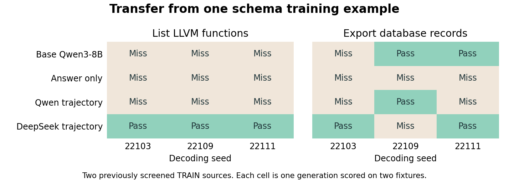

# 学生能在原题上独立复现教师轨迹吗？

学生为 Qwen3-8B。在此前完成的一道只读数据库结构题上，我将保存的自由生成结果与教师 API 响应、实际训练目标和执行评分逐一核对。学生推理时只看到题面、系统说明和相同的工具帮助。两位教师的训练示范都来自通过审核的同一采样种子 22103。

| 学生在原题上的自由生成 | 第 16 步 | 第 32 步 | 第 64 步 |
|---|---:|---:|---:|
| Qwen 教师组，与教师相同的开头 token 数 / 教师全文 | 0/1,027 | 2/1,027 | **1,027/1,027** |
| DeepSeek 教师组，与教师相同的开头 token 数 / 教师全文 | 0/430 | 未闭合，达到长度上限 | **430/430** |
| Qwen 教师组，最终答案严格通过 | 否 | 是 | 是 |
| DeepSeek 教师组，最终答案严格通过 | 是 | 否 | 是 |

第 64 步，两组均在正常结束的回答中复现了各自教师的完整轨迹正文，并给出了执行正确且符合 JSON 协议的最终答案。比较去除了输出的思考标签及两端空白，同时核对分词 ID 和 UTF-8 字节哈希。Qwen 教师原文有一个末尾空白。原始学生、仅答案组以及同源的换文件与反向题均未逐字复现任一完整示范。原题和同源变体的这项诊断各用一个训练种子和一个解码种子。[逐次哈希和分词比较](recall.json) · [比对代码](audit.py) · [原有执行评分](../readonly-teacher-match-2026-11-22/single-aligned-results.json)

原学生的错误可以从生成文本追踪到实际运行。它在原题、换文件题和反向题的自由解释中分别 **4、5、3 次**使用同一个错误拼写，三段解释均未写出正确拼写。此前在另一组同文件诊断中，给六条原始命令各修正一个字符，六条命令都恢复正确行为。两位教师的训练文本分别包含 **3 次和 1 次**完整参考命令，因此轨迹监督同时提供了额外的答案暴露。完全复现原文证实了学生可以拟合该目标。单凭这个对照无法把得分变化归因于学会了教师的通用解题策略。[参数修复实验](../condition-explanations-2026-11-22/one-edit-grades.json) · [训练文本中的答案计数](../readonly-teacher-match-2026-11-22/trace-exposures.json)

## SFT 配置

此前训练使用 BF16、LoRA、学习率 0.0001、alpha 32，仅更新 q_proj 和 v_proj 的适配器，rank 为 16。Qwen 官方的 Qwen3-8B 示例同样使用前三项设置和 alpha 32，示例的 rank 为 8，覆盖所有线性层，并采用 5% 预热。本实验固定学习率，在单样本上做 64 次更新，以检验能否过拟合。适配器初始状态在组间相同，逐段损失、因果位移和检查点均已核验。当前配置足以实现单题拟合，最适合多题训练的超参数仍需开发集验证。[Qwen 官方 Qwen3-8B SFT 示例](https://qwen.readthedocs.io/en/latest/training/ms_swift.html) · [损失权重核验](../condition-explanations-2026-11-22/loss-check.json)

## 两道没有用于拟合适配器的题

将已有第 64 步适配器装回相同版本的 Qwen3-8B，在一张 A10 上重新生成 24 条回答。评测取此前入选的另两个 TRAIN 来源，沿用原始题面和工具帮助。四组均使用种子 22103、22109、22111，温度 0.6，top-p 0.95，生成上限 4,096 token。每个通过的回答都正常结束、给出合规的 JSON，并在两套不同的本地文件上得到正确结果。所有 24 条都正常结束。该组题曾用于发现原学生错误，选择方式会影响得分的代表性。

| Qwen3-8B 检查点 | LLVM 函数列表 | 数据库 JSON 导出 | 严格通过合计 | 生成 token 合计 |
|---|---:|---:|---:|---:|
| 原始学生 | 0/3 | 2/3 | 2/6 | 1,454 |
| 仅答案 SFT | 0/3 | 0/3 | 0/6 | 322 |
| Qwen 教师轨迹 SFT | 0/3 | 1/3 | 1/6 | 2,631 |
| DeepSeek 教师轨迹 SFT | **3/3** | **2/3** | **5/6** | 2,578 |

**LLVM 函数列表。** 原学生、仅答案组和 Qwen 教师组三次都只输出了参数，漏掉可执行程序名。给这九条回答各补上程序名后，两套文件都返回了预期函数。DeepSeek 教师组三次自行生成了完整调用。该适配器只在数据库结构题上训练过。这里观察到的迁移可以具体描述为在另一种工具上补全了调用。

**数据库 JSON 导出。** 仅答案组三次都添加了一个会改变不可打印字符处理方式的选项，生成的记录在两个文件上都与要求不符。其余三组共有四次在解释字段写入非法的 JSON 转义。每次仅在解释字段增加一个转义符、保留原命令后，原学生的一条和 Qwen 教师组的两条均在两个文件上得到正确结果。DeepSeek 教师组的那条还在命令末尾多加了一个参数，两个文件上仍都报错。原始严格分保留全部四次失败。[原始评分、逐题命令和修复回放](transfer.json)

**结论的适用范围。** Han 提出的两种教师、一条训练样本的过拟合检查、学生重复错误定位和 SFT 配置检查均已有实测记录。同源的无关措辞诊断上，Qwen 教师组为 6/6，DeepSeek 教师组为 4/6。本次换到另外两题，DeepSeek 教师组在函数列表题上领先，在 JSON 导出题上与原学生持平。现有证据支持一个具体的跨工具改善，也显示出评测题型会改变教师组之间的排序。29 个已筛查来源中有 3 个符合当前多题训练准入条件。更多独立来源、多个训练种子和未参与筛选的数据是检验总体迁移效果的后续工作。[同源实验](../condition-explanations-2026-11-22/RESULT_ZH.md) · [冻结的多题协议](../condition-explanations-2026-11-22/multisource-protocol.json)

本次新增工作使用现有适配器推理和 CPU 文件回放。一个 GPU 作业、三个 CPU 作业均已完成并回收。开发流程中保留的确认集、旧能力保持集和官方 TEST 本次均未调用。从仓库根目录运行 `python3 results/teacher-recall-2026-11-22/recount.py` 可复算公开结果。拥有原始运行回执时可用 `audit.py` 重新核验教师轨迹和学生自由生成的文本。[复算代码](recount.py) · [推理程序](../condition-explanations-2026-11-22/paired_inference_worker.py)
