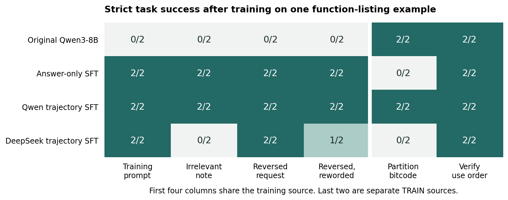
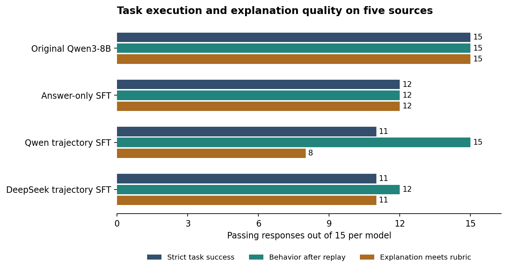

# 教师轨迹给 Qwen3-8B 带来了什么？

在两个分别只训练一道题的实验中，Qwen3-8B 都能在第 64 步逐字复现各自教师的示范。跨题表现随训练题和评测题变化。目前保留原始 Qwen3-8B。以下结果来自 KaliBench TRAIN 内部实验，官方 TEST 保持封存。[研究首页](../../README.md) · [完整实验日志](../../EXPERIMENT_LOG.md)

## 第二个训练来源：能否根据要求选择操作

给定一个本地编译文件，训练题要求列出函数。评测包括原题、加入无关信息、改为列出全局变量，以及反向要求的另一种表述。原始模型在这八次回答中都选对了参数，却每次都漏掉程序名。仅训练正确答案已足以让这八次操作全部成功。

| 第 64 步的模型 | 原题 | 加无关信息 | 相反要求及其改写 | 另外两个编译工具来源 |
| --- | ---: | ---: | ---: | ---: |
| 原始 Qwen3-8B | 0/2 | 0/2 | 0/4 | 4/4 |
| 仅答案 SFT | 2/2 | 2/2 | 4/4 | 2/4 |
| Qwen 教师轨迹 SFT | 2/2 | 2/2 | 4/4 | 4/4 |
| DeepSeek 教师轨迹 SFT | 2/2 | 0/2 | 3/4 | 2/4 |



两种轨迹组都在原题的两次解码中逐字复现了各自的教师示范。Qwen 教师组额外保住了一道原本会做的分割题。DeepSeek 教师组的十二份输出有四份耗尽 4,096 token 预算，未交付完整答案。差异集中在少数题源，教师、轨迹内容和长度也同时变化，本轮不足以据此给教师模型排名。

三组从同一 Qwen3-8B 初始化出发，每组 64 次更新，在 16、32、64 步保存检查点。预先固定第 64 步比较，每个条件使用同样的两个解码种子。前两个检查点各在训练原题上采样一次。全程只有一个训练种子。另两道编译工具题曾用于来源筛查，适合诊断训练后的旧能力保持。评分按输出格式与两份合成文件的原生执行结果判定。[训练协议、九个检查点哈希与 54 次逐次评分](second-source-sft.json)

## 第一轮对照：挑选弱点与预先选题的结果不同

以一道只读数据库题做单题训练后，DeepSeek 轨迹组在一个先前确认过的模块列表弱点上取得 3/3，其余三组均为 0/3。在预先选择的另外八个来源上，每题三次解码，原始、仅答案、Qwen 轨迹、DeepSeek 轨迹分别取得 **23/24、21/24、18/24、17/24**。原模型距满分只差一次。不能把这个分母与第二次训练或后续筛查合并。[单题复现与已知弱点](../teacher-recall-2026-11-22/RESULT_ZH.md) · [八个来源的严格评分和操作回放](../constraint-audit-2026-11-23/RESULT_ZH.md)

## 答案能执行，和解释说得对，是两个问题

在上述八个来源中的五个来源，回看了四个模型的 60 份已交付回答。严格指标要求按约定格式交付并执行成功。行为回放允许检查可无歧义恢复的输出或等价步骤。解释复核检查最终可见文字是否说明必要操作且有事实依据。每组有 15 份回答。



仅答案组有三份回答能正确说明文件的作用，但实际操作失败，所以严格通过 12/15、解释达标 12/15，两者同时通过只有 **9/15**。Qwen 轨迹组严格通过 11/15，回放后行为通过 15/15。解释复核由单一 AI 事后完成，评分对象是最终可见解释。原始严格指标仍是主要结果。[复核规则、逐次记录与评分宽严对照](evidence.json)

## 来源筛查与复算

新增八个通过参考答案校准的 TRAIN 来源，原始学生通过 23/24 次，唯一错误没有重复。另两道题的发布者参考答案与固定工具版本不匹配，修正后单独记录，未进入模型评分分母。累计筛过 64 个来源，只有三个满足教师反复成功、学生反复失败的准入要求。正式多来源方案要求至少八个合格来源、覆盖三类技能。当前缺口为五个独立来源。[筛查记录与参考答案校准](evidence.json)

在仓库根目录运行以下命令可从公开的逐次判定复算统计。绘图需要 Matplotlib，复算只需 Python 标准库。公开记录保留结果与哈希，训练权重和教师原始轨迹保存在私有实验环境。

```sh
python3 results/teacher-transfer-2026-11-23/verify.py
python3 results/teacher-transfer-2026-11-23/figures.py
```
